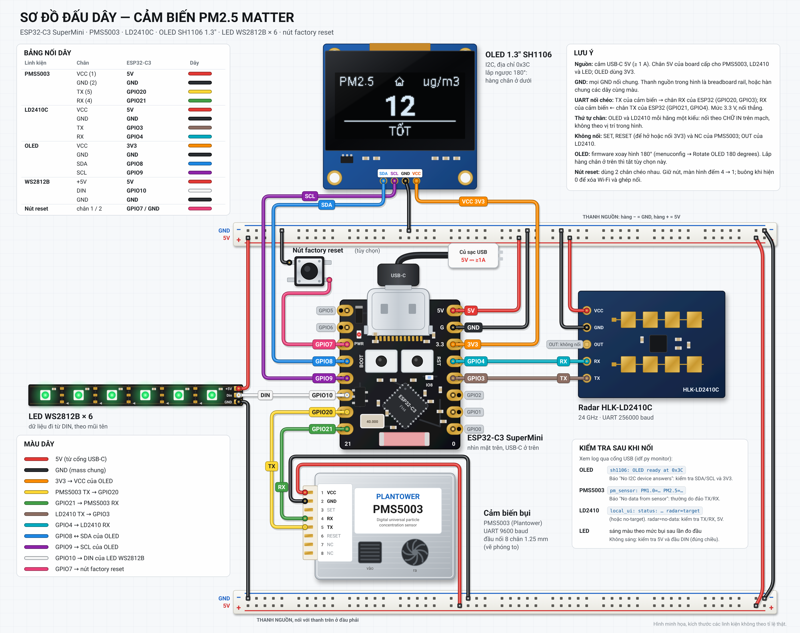

# Matter PM2.5 Air Quality Sensor (ESP32-C3, Wi-Fi)

Cảm biến bụi mịn PM2.5 chuẩn **Matter over Wi-Fi** chạy trên ESP32-C3, thêm trực tiếp vào **Apple Home (HomeKit)**, Google Home, Home Assistant, SmartThings...

Không dùng radar LD2410? Xem [bản PCB không radar](../../matter-pm25-sensor/): PMS5003 ở GPIO6/7, OLED ở GPIO4/5, LED ở GPIO3, màn hình luôn sáng (có thể thêm nút bật/tắt).

Thiết bị dùng device type **Air Quality Sensor (0x002C)** và chỉ gửi qua Matter hai giá trị:

| Cluster | Nội dung |
|---|---|
| Air Quality (0x005B) | Mức chất lượng không khí, tính từ PM2.5 (trạng thái chính của cảm biến) |
| PM2.5 Concentration Measurement (0x042A) | PM2.5, µg/m³ |

Màn hình OLED, đèn LED WS2812 và radar LD2410 chạy **tại chỗ trên thiết bị**, không gửi qua Matter (giống bản ESPHome trước đó):

- **LED WS2812** đổi màu theo mức chất lượng không khí, theo bảng màu của Apple Home: xanh lá, xanh vàng, vàng, đỏ, tím. Khi ứng dụng gửi lệnh **Identify** (ví dụ nút *Identify* của thiết bị trong Home Assistant), LED nháy trắng để chỉ ra thiết bị, xong thì trở lại màu chất lượng không khí.
- **Màn hình OLED** hiện PM2.5 và mức chất lượng không khí. Giữa dòng tiêu đề có biểu tượng ngôi nhà khi thiết bị có Wi-Fi **và** có ít nhất một ứng dụng (Apple Home, Home Assistant...) đang kết nối. Khi không còn ứng dụng nào kết nối, biểu tượng tự mất, chậm nhất sau khoảng thời gian báo cáo tối đa mà ứng dụng chọn (thường tới 10 phút).
  Màn hình sáng/tắt như sau:
  - Luôn sáng khi khởi động cho tới khi có kết quả đo đầu tiên, sau đó sáng thêm 5 giây. Nếu cảm biến PM lỗi thì tối đa 120 giây.
  - Sau đó chỉ sáng khi **radar LD2410 thấy người trong khoảng 120 cm**, và tắt sau 60 giây khi không còn ai.

## Phần cứng

- ESP32-C3 (ESP32-C3 SuperMini, ESP32-C3-DevKitM-1, ...), flash 4 MB
- Một cảm biến bụi UART:
  - **Plantower PMS5003 / PMS7003 / PMSA003** (mặc định)
  - **Nova Fitness SDS011 / SDS021**
- Màn hình OLED **SH1106 128x64** (I2C, địa chỉ 0x3C)
- Dải LED **WS2812**, 6 bóng
- Radar hiện diện **HLK-LD2410**
- Một nút nhấn bất kỳ để factory reset (không bắt buộc)

Các phần OLED, LED và LD2410 đều không bắt buộc. Thiếu phần nào thì firmware ghi lỗi vào log rồi chạy tiếp, cảm biến PM2.5 và Matter vẫn hoạt động. Màn hình không trả lời (chưa cắm, lỏng dây, mất nguồn giữa chừng) thì firmware thử khởi tạo lại mỗi 5 giây và tự sáng lại khi màn hình trả lời.

Thiết bị **chạy độc lập với Matter**: cảm biến, màn hình, LED và radar khởi động trước Matter. Chúng vẫn hoạt động khi thiết bị chưa được ghép nối, khi mất Wi-Fi, hoặc khi Matter không khởi động được. Mỗi 30 giây, log in một dòng `local_ui: status: ...` cho biết trạng thái của màn hình, radar và LED, và một dòng `local_ui: heap: free=... min=... largest=...` cho biết RAM trống hiện tại, mức thấp nhất từ khi khởi động và khối liền lớn nhất.

Nếu luồng Matter hoặc một task của thiết bị (cảm biến PM, radar, màn hình) bị treo quá 30 giây, watchdog khởi động lại thiết bị thay vì để nó đứng im.

### Sơ đồ nối dây



Hình minh họa, không theo tỉ lệ. Thứ tự chân của OLED và LD2410 khác nhau giữa các hãng và phiên bản: nối theo chữ in trên mạch, không theo vị trí chân trong hình.

| Thiết bị | Chân | ESP32-C3 |
|---|---|---|
| PMS5003 | TX | **GPIO20** |
| PMS5003 | RX | **GPIO21** |
| PMS5003 | VCC / GND | 5V / GND |
| LD2410 | TX | **GPIO3** |
| LD2410 | RX | **GPIO4** |
| LD2410 | VCC / GND | 5V / GND |
| OLED SH1106 | SDA | **GPIO8** |
| OLED SH1106 | SCL | **GPIO9** |
| OLED SH1106 | VCC / GND | 3.3V / GND |
| WS2812 | DIN | **GPIO10** |
| WS2812 | VCC / GND | 5V / GND |
| Nút factory reset | Chân 1 / chân 2 | **GPIO7** / GND |

Quạt PMS5003 và radar LD2410 cần nguồn **5V**, nhưng mức logic UART là 3.3V nên nối thẳng vào ESP32-C3 được. Chân SET/RESET của PMS (nếu có) để hở hoặc nối 3.3V.

Việc phân chia UART giống bản ESPHome: PMS5003 dùng UART1, LD2410 dùng UART0 (256000 baud), còn log chạy qua USB.

### Factory reset

Factory reset xóa Wi-Fi và thông tin ghép nối Matter, rồi thiết bị khởi động lại và chờ ghép nối lại. GPIO9 (nút BOOT) đang làm chân SCL của màn hình nên không dùng được nút BOOT. Có hai cách:

- **Nút factory reset trên GPIO7** (nối giữa GPIO7 và GND, firmware tự bật điện trở kéo lên):
  1. Giữ nút. Sau 1 giây màn hình sáng, hiện **ĐẶT LẠI THIẾT BỊ** và đếm ngược 4, 3, 2, 1.
  2. Khi màn hình hiện số **0**, buông nút. Màn hình hiện *Đang đặt lại...* rồi thiết bị khởi động lại.
  3. Buông nút trước khi về 0 là hủy. Nút bị kẹt (giữ mãi không buông) cũng không reset.

  Đổi chân trong `menuconfig` → *Factory Reset Button*, đặt `-1` nếu không lắp nút. Firmware báo lỗi khi build nếu chọn trùng chân đang dùng, chân strapping (GPIO2/8/9), chân flash (GPIO11–17) hay chân USB (GPIO18/19). Chân còn trống: GPIO0, 1, 5, 6, 7.
- **Cắm rồi rút nguồn 5 lần liên tiếp**, mỗi lần giữ điện dưới 10 giây. Ở lần cắm thứ 5, thiết bị factory reset. Cách này dùng được cả khi không lắp nút.
- Nếu bạn xóa thiết bị khỏi tất cả ứng dụng (Apple Home, Home Assistant...), thiết bị tự mở lại chế độ ghép nối, không cần reset.
- Cả hai cách vẫn chạy khi Matter không khởi động được: khi đó firmware xóa thẳng phân vùng NVS rồi khởi động lại.
- Nếu phân vùng NVS không dùng được (hết trang trống, hoặc do bản ESP-IDF mới hơn ghi), firmware tự xóa nó khi khởi động. Kết quả giống factory reset: phải ghép nối lại.

> **Lưu ý về GPIO20/GPIO21:** đây là chân UART0 (console) mặc định của ESP32-C3. Firmware này chuyển log sang **USB-Serial-JTAG** có sẵn trên chip (`CONFIG_ESP_CONSOLE_USB_SERIAL_JTAG=y`). Vì vậy:
> - Nạp firmware và xem log qua **cổng USB native** của ESP32-C3 (SuperMini chỉ có cổng này).
> - Với board có chip USB-UART (CP2102/CH340) nối vào GPIO20/21 như ESP32-C3-DevKitM-1, hãy cắm board qua cổng USB native, và tháo dây cảm biến nếu cần nạp qua cổng USB-UART.
> - Khi khởi động, ROM bootloader in vài dòng log ra GPIO21. Cảm biến bỏ qua dữ liệu này, không ảnh hưởng.

## Phần mềm

Yêu cầu: **ESP-IDF v5.4.1** và **esp-matter `release/v1.4`**.

```bash
# ESP-IDF
git clone -b v5.4.1 --recursive https://github.com/espressif/esp-idf.git
cd esp-idf && ./install.sh esp32c3 && cd ..

# esp-matter
git clone -b release/v1.4 --depth 1 https://github.com/espressif/esp-matter.git
cd esp-matter
git submodule update --init --depth 1
./connectedhomeip/connectedhomeip/scripts/checkout_submodules.py --platform esp32 linux --shallow
./install.sh
cd ..
```

Build và nạp:

```bash
. ./esp-idf/export.sh
. ./esp-matter/export.sh

cd ESP32-C3/matter-wifi/matter-pm25-sensor
idf.py set-target esp32c3
idf.py menuconfig          # (tùy chọn) PM2.5 Sensor Configuration
idf.py -p /dev/ttyACM0 flash monitor
```

`sdkconfig.defaults` chỉ áp dụng khi tạo file `sdkconfig` mới. Sau khi kéo code mới về, nếu thư mục đã có `sdkconfig` từ lần build trước thì xóa nó đi để các thay đổi trong `sdkconfig.defaults` có hiệu lực.

Mỗi lần build xong, thư mục `build/firmware/` chỉ chứa file của đúng phiên bản vừa build (xem [Phiên bản firmware](#phiên-bản-firmware)):

| File | Dùng khi | Nạp ở địa chỉ | Wi-Fi và ghép nối Matter |
|---|---|---|---|
| `haxeko_pm5003_v1.0.49_esp32c3_merged.bin` | Mạch mới, hoặc muốn xóa sạch | `0x0` | **Bị xóa**: file phủ cả vùng NVS |
| `haxeko_pm5003_v1.0.49_esp32c3_update.bin` | Cập nhật thiết bị đang dùng | `0x1D000` | Giữ nguyên |

```bash
# Mạch mới (xóa ghép nối)
esptool.py --chip esp32c3 -p /dev/ttyACM0 write_flash 0x0 build/firmware/haxeko_pm5003_v1.0.49_esp32c3_merged.bin
# Cập nhật, giữ ghép nối
esptool.py --chip esp32c3 -p /dev/ttyACM0 write_flash 0x1d000 build/firmware/haxeko_pm5003_v1.0.49_esp32c3_update.bin
```

File update chỉ ghi vùng chọn phân vùng OTA và firmware, nên vẫn chạy đúng kể cả sau một lần cập nhật OTA. Khi bootloader hoặc bảng phân vùng thay đổi (sửa `partitions.csv` hay cấu hình bootloader), phải nạp file merged. `idf.py flash` cũng giữ nguyên ghép nối.

### Cấu hình (`idf.py menuconfig`)

*PM2.5 Sensor Configuration*:

| Tùy chọn | Mặc định | Ý nghĩa |
|---|---|---|
| PM sensor model | PMS5003/7003/A003 | Chọn loại cảm biến |
| UART RX / TX pin | 20 / 21 | Chân nối với TX / RX của cảm biến |
| PMS measurement period | 300 s | PMS ngủ giữa các lần đo (tắt quạt và laser). Mỗi chu kỳ: đánh thức, chờ 30 giây, đo 5 giây rồi ngủ lại. Giá trị đầu tiên có sau khoảng 35 giây. Đặt `0` để đo liên tục |
| Report interval | 10 s | Chỉ dùng khi đo liên tục: lấy trung bình các mẫu trong khoảng này |
| SDS011 working period | 0 (liên tục) | Chế độ đo chu kỳ của SDS011 (1–30 phút) |

*Local Display and Indicators*:

| Tùy chọn | Mặc định |
|---|---|
| OLED SDA / SCL pin | 8 / 9 |
| OLED I2C address | 0x3C |
| Rotate OLED 180 degrees | bật |
| WS2812 data pin / số LED / độ sáng | 10 / 6 / 50% |
| LD2410 RX / TX pin | 3 / 4 |
| Khoảng cách bật màn hình | 120 cm |
| Giữ màn hình sáng sau khi người rời đi | 60 s |
| Bỏ qua dữ liệu radar cũ hơn | 30 s |

*Factory Reset Button*:

| Tùy chọn | Mặc định | Ý nghĩa |
|---|---|---|
| Button GPIO | 7 | Chân nối nút factory reset (nút nối xuống GND). `-1` = không có nút |

### Thông tin thiết bị và phiên bản firmware

Ứng dụng nhà thông minh hiển thị các thông tin sau:

| Mục | Giá trị | Sửa ở đâu |
|---|---|---|
| Nhà sản xuất (Manufacturer) | `Haxeko` | `menuconfig` → *Device Information* |
| Kiểu máy (Model) | `PM5003` | `menuconfig` → *Device Information* |
| Phần cứng (Hardware) | `ESP32C3-PMS5003` (`ESP32C3-SDS011` khi chọn SDS011) | `menuconfig` → *Device Information* |
| Tên thiết bị khi ghép nối | `Air Quality Sensor` | `menuconfig` → *Device Information* |
| Số serial | `<MAC Wi-Fi>`, ví dụ `8ED0B2A8594B` | Tự động, riêng cho từng chip |
| Tên Bluetooth khi chờ ghép nối | `AirQuality-3840` | `CONFIG_BLE_DEVICE_NAME_PREFIX` trong `sdkconfig.defaults` |
| Tên và loại thiết bị khi dò tìm trong mạng (DNS-SD `DN`, `DT`) | `Air Quality Sensor`, loại 0x002C | `main/chip_project_config.h`, `CONFIG_DEVICE_TYPE` |
| Firmware | `1.0.<số commit>`, ví dụ `1.0.49` | Tự động, xem bên dưới |

### Phiên bản firmware

Phiên bản có dạng **`<major>.<minor>.<build>`**, ví dụ `1.0.49`, và chỉ được tính ở **một chỗ** (`tools/firmware_version.cmake`). Cùng một số đó xuất hiện ở:

| Nơi | Ví dụ |
|---|---|
| Apple Home / Home Assistant, mục Firmware (`SoftwareVersionString`) | `1.0.49` |
| Tên file nạp trong `build/firmware/` | `haxeko_pm5003_v1.0.49_esp32c3_merged.bin` |
| Log khi khởi động | `Haxeko PM5003, firmware 1.0.49` |
| Số phiên bản Matter dùng cho OTA (`SoftwareVersion`) | `49` |

- `<build>` là số commit của repo (`git rev-list --count HEAD`): cùng một commit luôn ra cùng phiên bản, commit mới hơn luôn ra số lớn hơn, nên OTA không bao giờ coi bản mới là bản cũ. Số này đếm commit của cả repo, nên commit ở dự án khác trong repo cũng làm nó tăng.
- `<major>.<minor>`: sửa `FIRMWARE_VERSION_BASE` trong `CMakeLists.txt` khi ra bản lớn, ví dụ `1.0` thành `1.1`.
- Build khi còn sửa đổi chưa commit trong `main/`, `CMakeLists.txt`, `sdkconfig.defaults` hay `partitions.csv` thì phiên bản có đuôi **`-dev`**, ví dụ `1.0.49-dev`, ở cả ứng dụng lẫn tên file. Bản phát hành là bản build từ commit đã đẩy lên git, không có `-dev`.
- Phiên bản được tính khi CMake cấu hình dự án (sau mỗi commit hoặc checkout). Nếu sửa code sau đó mà chưa commit, bước build in cảnh báo; chạy `idf.py reconfigure` để bản build mang đuôi `-dev`.
- Clone repo đầy đủ, **không dùng `--depth`**. Với clone nông, số commit sẽ sai (bước build cũng cảnh báo).
- Nếu build từ thư mục không có git (ví dụ tải file zip), phiên bản sẽ là `1.0.0`.

Sau khi nạp bản mới qua USB, ứng dụng có thể vẫn hiện số phiên bản đã đọc trước đó một thời gian. Log khởi động luôn in số của bản đang chạy.

## Thêm vào Apple Home

1. Mở log (`idf.py monitor`); khi thiết bị chạy lần đầu sẽ in ra link QR code, ví dụ:
   `https://project-chip.github.io/connectedhomeip/qrcode.html?data=MT:Y.K9042C00KA0648G00`
2. Mở link đó để hiện QR code, hoặc dùng mã ghép nối thủ công **`3497-011-2332`** (passcode mặc định `20202021`, discriminator `3840`).
3. iPhone: **Nhà → + → Thêm phụ kiện → quét QR**. Khi gặp cảnh báo phụ kiện chưa được chứng nhận (*Uncertified Accessory*), chọn tiếp tục thêm (*Add Anyway*).
4. iPhone gửi thông tin Wi-Fi cho ESP32-C3 qua BLE. Sau khi thêm xong, phụ kiện hiện là **Cảm biến chất lượng không khí**, gồm mức chất lượng không khí và mật độ PM2.5.

Nên dùng iOS bản mới và có Home hub (HomePod mini/HomePod/Apple TV 4K) để xem từ xa và chạy tự động hóa. Phiên bản iOS cũ có thể không hiển thị đầy đủ cảm biến chất lượng không khí Matter.

> Firmware dùng chứng chỉ test (VID `0xFFF1`, PID `0x8000`) nên chỉ hợp với mục đích DIY. Để làm sản phẩm thật, hãy tạo DAC/passcode riêng bằng `esp-matter-mfg-tool`.

## Cách tính mức chất lượng không khí

Thiết bị chia chất lượng không khí thành 5 bậc theo PM2.5. Mỗi bậc gửi một mức Matter tương ứng, để Apple Home hiển thị cùng đánh giá với màn hình:

| PM2.5 (µg/m³) | Màn hình | LED | Matter gửi đi | HomeKit |
|---|---|---|---|---|
| ≤ 12 | TỐT | Xanh lá | 1 Good | Good |
| 12 – 35,4 | KHÁ | Xanh vàng | 2 Fair | Fair |
| 35,4 – 55,4 | KHÔNG TỐT | Vàng | 3 Moderate | Inferior |
| 55,4 – 125,4 | KÉM | Đỏ | 4 Poor | Poor |
| > 125,4 | CỰC KỲ KÉM | Tím | 6 ExtremelyPoor | Poor |

HomeKit có 5 mức (Excellent, Good, Fair, Inferior, Poor). Hai bậc cuối cùng hiện "Poor" trên Apple Home, còn Home Assistant vẫn phân biệt được Poor và Extremely poor.

Muốn đổi ngưỡng thì sửa `local_ui_pm25_level()` trong `main/local_ui.cpp`. Muốn đổi mức gửi qua Matter thì sửa bảng `k_level_to_matter` trong `main/app_main.cpp`.

Nếu cảm biến không gửi dữ liệu (lỏng dây, mất nguồn), Matter báo PM2.5 là `null` và Air Quality là `Unknown`. Màn hình và LED giữ giá trị cuối cùng, giống bản ESPHome. Khi có lại dữ liệu, thiết bị tự cập nhật bình thường.

## Kiểm thử trên máy tính

`test/host/` chạy code của driver và màn hình trên máy tính (Linux/macOS, chỉ cần `gcc`/`g++`), với UART, I2C, GPIO và đồng hồ giả lập. Không cần ESP32 hay ESP-IDF:

```bash
test/host/run.sh
```

| Test | Kiểm tra |
|---|---|
| `test_pm_sensor.cpp` (đo theo chu kỳ và đo liên tục) | Ghép khung PMS5003 bị chia nhỏ, nhiễu, khung trả lời lệnh; bỏ 30 giây khởi động; báo mất dữ liệu; gửi lại lệnh cấu hình khi cảm biến im lặng |
| `test_ld2410.cpp` | Khung radar bị chia nhỏ, header lặp, độ dài sai, footer hỏng, chế độ engineering, khung ACK |
| `test_button.cpp` | Chống dội nút, thời gian giữ, nút bị kẹt |
| `test_local_ui.cpp` | OLED bật/tắt theo khởi động và radar, rút/cắm OLED, OLED mất nguồn âm thầm, màn reset, LED theo mức không khí, Identify |

Phần Matter, Wi-Fi và BLE vẫn phải thử trên thiết bị thật.

## Đổi font màn hình

Font chữ trên OLED là bitmap sinh sẵn từ Roboto (Regular 12 px, Bold 16 px, Bold 28 px), nằm trong `main/ui/fonts.c`. Muốn đổi cỡ chữ hoặc thêm ký tự, sửa `tools/gen_fonts.py` rồi chạy:

```bash
pip install pillow
python3 tools/gen_fonts.py Roboto-Regular.ttf Roboto-Bold.ttf > main/ui/fonts.c
```

## Cấu trúc thư mục

```
matter-pm25-sensor/
├── CMakeLists.txt
├── docs/wiring.png            # Sơ đồ đấu dây
├── partitions.csv
├── sdkconfig.defaults
├── main/
│   ├── chip_project_config.h # Tên/loại thiết bị khi dò tìm ghép nối
│   ├── app_main.cpp          # Matter node, endpoint Air Quality Sensor, factory reset
│   ├── device_info.cpp       # Manufacturer / Model / Hardware (Basic Information)
│   ├── local_ui.cpp          # Logic màn hình / LED / radar chạy tại chỗ
│   ├── Kconfig.projbuild     # Cấu hình chân và tham số
│   ├── idf_component.yml
│   ├── drivers/
│   │   ├── pm_sensor.cpp     # PMS5003/7003/A003 và SDS011 (UART1)
│   │   ├── ld2410.cpp        # Radar LD2410 (UART0)
│   │   ├── sh1106.cpp        # OLED SH1106 I2C + vẽ chữ
│   │   ├── status_led.cpp    # WS2812
│   │   └── button.cpp        # Nút factory reset
│   └── ui/
│       └── fonts.c           # Font bitmap Roboto (sinh bởi tools/gen_fonts.py)
├── test/host/                 # Kiểm thử trên máy tính (run.sh)
└── tools/
    ├── firmware_version.cmake # Tính phiên bản firmware
    ├── firmware_files.cmake   # Tạo file nạp mang số phiên bản sau mỗi lần build
    └── gen_fonts.py
```
