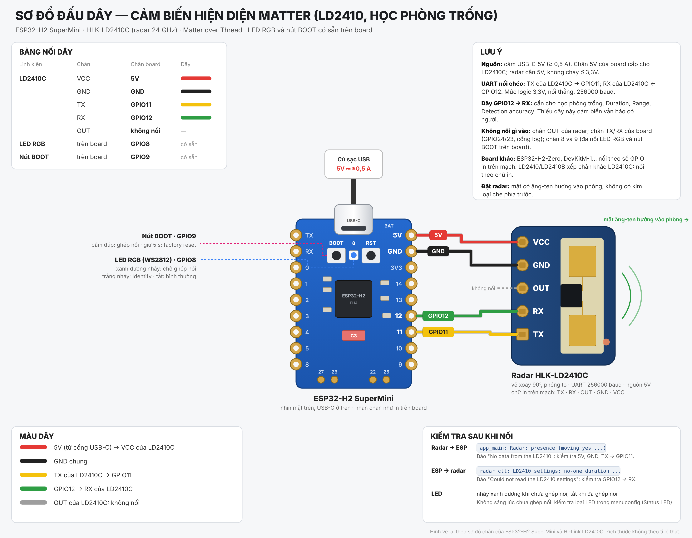

# Matter Presence Sensor + học phòng trống (ESP32-H2 + HLK-LD2410, Thread)

> Bản fork của [`matter-presence-occupancy`](../matter-thread/matter-presence-occupancy) (bản đang chạy ổn định, giữ nguyên). Khác biệt: thêm 4 điều khiển LD2410 trong **Home Assistant** (không hiện trong Apple Home): **học phòng trống** giúp radar bớt báo nhầm có người, **Range** và **Radar resolution** chỉnh khoảng cách phát hiện và độ phân giải của radar, **Radar Bluetooth** bật/tắt Bluetooth của radar (mặc định tắt); thời gian chờ chỉnh bằng **Hold time**. Học phòng trống cũng bắt đầu được bằng cách **bấm nút BOOT 3 lần**, LED báo từng bước; **bấm 4 lần** ghi lại ngưỡng mặc định của radar (LED nháy tím). Tên thiết bị: **Presence-** + 4 ký tự cuối của số serial, ví dụ **Presence-B2C3** (mỗi mạch một tên). Phần cứng, chân nối, ghép nối giống hệt bản gốc; LED và nút bấm thêm phần học phòng trống. Biến thể thử nghiệm **`espfilter`**: ESP tự xác nhận các phát hiện yếu của radar trước khi báo có người (mục **Bộ lọc năng lượng trên ESP32**). Biến thể thử nghiệm **`esppresence`**: ESP tự quyết định có người từ năng lượng từng vùng của radar, cùng bộ xử lý với bản ESP32-C3-WROOM 1.0.166, cho ESP32-H2 SuperMini và ESP32-C3 SuperMini (mục **Bộ xử lý hiện diện trên ESP32**).

Cảm biến hiện diện chuẩn **Matter over Thread** chạy trên **ESP32-H2** với radar 24 GHz **HLK-LD2410**. Đây là bản chuyển từ Zigbee (`ESP32-H2/zigbee-presence-occupancy`) sang Matter: cùng chip ESP32-H2, cùng radio 802.15.4, nhưng thay Zigbee bằng Thread + Matter. Thêm trực tiếp vào **Apple Home**, Google Home, Home Assistant, SmartThings, Alexa... mà không cần Zigbee coordinator / Zigbee2MQTT.

Radar LD2410 phát hiện được cả người đang ngồi yên (thở, cử động nhẹ), khác với cảm biến PIR chỉ thấy chuyển động.

**Bản ESP32-C3 (Matter over Wi-Fi):** cùng mã nguồn này build được cho **ESP32-C3 SuperMini** + LD2410C (radar TX → GPIO3, RX ← GPIO4, LED xanh GPIO8), chạy Matter qua Wi-Fi vì ESP32-C3 không có radio Thread. Project riêng ở [`ESP32-C3/matter-wifi-presence`](../../ESP32-C3/matter-wifi-presence) (chỉ gồm `CMakeLists.txt` và `sdkconfig.defaults`, dùng thư mục `main` ở đây), hoặc `idf.py set-target esp32c3` ngay trong thư mục này. Bản ESP32-H2 không đổi: cùng cấu hình, chân, endpoint, VID/PID. Chi tiết, chân và khác biệt: README của bản C3.

## Từ Zigbee sang Matter

| Zigbee (Occupancy Sensing 0x0406) | Matter (bản này) |
|---|---|
| Thiết bị Occupancy Sensor | Device type **Occupancy Sensor (0x0107)** |
| `Occupancy` (bit 0: có người) | `Occupancy` của cluster **Occupancy Sensing (0x0406)** |
| `OccupancySensorType` | `FeatureMap` = **Radar**, `OccupancySensorType` / `OccupancySensorTypeBitmap` do cluster tự tính |
| `PIROccupiedToUnoccupiedDelay` (thời gian giữ) | **`HoldTime`** (1–300 s, mặc định 30 s), có `HoldTimeLimits`, lưu lại sau khi mất điện |
| Ghép nối qua Zigbee coordinator | Ghép nối bằng **BLE** (quét QR), dữ liệu đi qua **Thread Border Router** |
| Router Zigbee (cấp nguồn lưới) | **Thread FTD**: có thể làm Thread Router, mở rộng mạng mesh |

Logic phát hiện giữ nguyên như các bản LD2410 khác trong repo:

- **Có người** ngay khi radar thấy mục tiêu đang di chuyển hoặc đứng yên.
- **Không có người** sau khi radar không thấy ai trong khoảng **HoldTime**. Bộ đếm do cluster Matter xử lý, nên chỉnh HoldTime trong app có tác dụng ngay. Bản thân LD2410 cũng giữ trạng thái có người thêm một khoảng (*unmanned duration*, mặc định 5 s) trước khi báo mất mục tiêu, nên tổng thời gian = khoảng đó + HoldTime.
- Nếu radar không gửi dữ liệu quá **10 giây** (lỏng dây, mất nguồn), thiết bị báo **không có người** và ghi lỗi vào log. Có dữ liệu lại thì tự hoạt động bình thường.
- Tuỳ chọn chỉ tính người ở gần hơn một khoảng cách (*Only count targets closer than*). Độ nhạy từng vùng (gate) được chỉnh tự động bằng chức năng **học phòng trống** bên dưới, khoảng cách phát hiện bằng entity **Range** (hoặc bằng app **HLKRadarTool** qua Bluetooth của LD2410B/C).
- Biến thể `espfilter` (thử nghiệm) thêm một bước trên ESP khi phòng đang trống: năng lượng vượt ngưỡng nhiều thì báo có người ngay, vượt ít thì phải vài báo cáo liên tiếp. Xem mục **Bộ lọc năng lượng trên ESP32**.
- Biến thể `esppresence` (thử nghiệm) thay logic trên bằng bộ xử lý trên ESP: hai ngưỡng cho từng vùng (kích hoạt, duy trì), tắt sau Hold time không còn tín hiệu duy trì, radar mất dữ liệu là lỗi cảm biến chứ không phải phòng trống. Xem mục **Bộ xử lý hiện diện trên ESP32**.

## Học phòng trống (giảm báo nhầm)

Trong phòng không có ai, radar vẫn nhận được "năng lượng" từ quạt, rèm bay, cây cảnh, phản xạ của đồ vật... Ở vùng nào năng lượng nền này vượt ngưỡng của LD2410, radar báo nhầm là có người. Chức năng học đo năng lượng nền của phòng trống rồi nâng ngưỡng từng vùng lên trên mức đó.

**Trong Home Assistant:** trang thiết bị → mục *Cấu hình* (Configuration) có entity **Learn empty room** với ba lựa chọn `Off` / `Learning` / `Factory thresholds`. Đây là cluster Matter *Mode Select*; Apple Home không hỗ trợ cluster này nên không hiện gì.

**Bằng nút BOOT:** bấm nhanh **3 lần** (mỗi lần cách nhau dưới 0,4 s). Kết quả giống hệt chọn **Learning**, entity trong Home Assistant cũng chuyển sang `Learning`. Không cần ghép nối hay mạng, chỉ cần radar đã nối dây đủ.

1. Chọn **Learning** (hoặc bấm nút BOOT 3 lần).
2. **Rời khỏi phòng** trong 20 giây đầu (**LED cyan sáng liên tục**), đóng cửa, tắt những thứ chuyển động bất thường (không cần tắt quạt nếu quạt vẫn thường chạy, vì đó chính là nhiễu cần học). Radar nhìn xa khoảng 6 m và xuyên được cửa gỗ, vách mỏng, nên phải ra hẳn khỏi tầm đó.
3. Thiết bị bật *engineering mode* của LD2410 và ghi năng lượng chuyển động / đứng yên của từng vùng (gate, mỗi gate 0,75 m) trong **60 giây** (**LED cyan nháy chậm**: 1 s tắt, 1 s sáng), khoảng 600 báo cáo.
4. Thiết bị tính ngưỡng mới, ghi vào LD2410, đọc lại để kiểm tra. **LD2410 tự lưu ngưỡng vào bộ nhớ của nó**, giữ nguyên khi mất điện hay khi nạp lại firmware ESP32-H2. Ghi xong: **LED xanh lá trong 10 giây**. Học thất bại (xem bên dưới): **LED đỏ trong 10 giây**.
5. Entity tự trở về **Off** (khoảng 80 giây sau khi chọn). Kết quả xem trong log `quiet_learn`.

**Radar tự đo nhiễu nền (lệnh 0x000B):** một số LD2410B/C có firmware mới tự đo nhiễu nền và tự đặt độ nhạy, như nút *Auto* trong app HLKRadarTool. Lệnh này có trong tài liệu giao thức LD2410C V1.09 (mục 2.2.20–2.2.21); Hi-Link không ghi từ firmware radar nào thì có, cũng không ghi radar tính ngưỡng thế nào.
- Mỗi lần học, sau 10 s đầu, thiết bị đọc phiên bản firmware và ngưỡng hiện tại của radar (log `LD2410 firmware V...`), rồi gửi lệnh 0x000B với thời gian đo bằng **thời gian ghi (60 s)**.
- **Radar nhận lệnh:** radar tự chờ 10 s (vẫn trong 20 s để rời phòng), đo 60 s rồi tự lưu ngưỡng chuyển động và đứng yên của mọi gate. Thiết bị chỉ chờ kết quả, không dùng engineering mode và không ghi ngưỡng nào. Tổng cộng vẫn khoảng **80 s**, LED giống hệt: cyan 20 s, cyan nháy 60 s, rồi xanh lá hoặc đỏ.
  ```
  I quiet_learn: The LD2410 measures the empty room itself: 10 s more to leave, then 60 s
  I quiet_learn: Thresholds before: moving 50,50,40,30,20,15,15,15,15 | still -,-,40,40,30,30,20,20,20
  I quiet_learn: Thresholds set by the radar: moving 45,40,30,25,18,12,10,10,10 | still -,-,35,30,25,22,15,15,15
  I quiet_learn: Learning done: thresholds set by the LD2410 background noise detection
  ```
  (số minh hoạ từ test trên máy tính, không phải từ radar thật)
- Ngưỡng do radar đặt **không bị giới hạn** bởi mức 95 %, +10 hay +30: radar có thể đặt thấp hơn mặc định (nhạy hơn) hoặc cao hơn nhiều. Gate cao hơn mặc định + 30 có cảnh báo `W quiet_learn` trong log. Thấy radar báo nhầm có người nhiều hơn thì chọn **Factory thresholds**, hoặc tắt chức năng này để ESP32 tự học.
- **Radar từ chối hoặc không trả lời lệnh** (log `This LD2410 firmware has no background noise detection: learning on the ESP32`): thiết bị tự học như bên dưới, ghi bắt đầu đúng lúc hết 20 s.
- Radar nhận lệnh nhưng không chạy (không báo trạng thái "đang đo" trong 15 s), báo đo thất bại, hoặc chưa xong sau 10 + 60 + 30 s: học thất bại, **LED đỏ 10 s**. Trường hợp chưa xong thì thiết bị khởi động lại radar để dừng.
- Chọn **Off** hoặc *Factory thresholds* trong lúc radar đang đo: thiết bị khởi động lại radar để dừng. Hi-Link không ghi radar giữ ngưỡng cũ hay đã đổi một phần trong trường hợp này (chưa kiểm chứng trên radar thật): nếu nghi ngờ, chọn *Factory thresholds* hoặc học lại.
- Tắt trong `menuconfig` → *Empty Room Learning* → *Let the radar measure the room itself when it can*: luôn học trên ESP32.

**Mức nhiễu của mỗi gate là mức 95 %:** bỏ 5 % số báo cáo có năng lượng cao nhất của gate đó, rồi lấy giá trị cao nhất trong phần còn lại.
- 60 s là khoảng 600 báo cáo, nên các đợt nhiễu ngắn, tổng cộng dưới khoảng 3 s, bị bỏ qua và không làm radar kém nhạy. Ví dụ: người đi ngoài hành lang, cửa đóng mở.
- Nguồn nhiễu chuyển động hơn 5 % thời gian vẫn được học, ví dụ quạt, rèm bay, máy lạnh.
- Bản cũ lấy giá trị **cao nhất**, nên chỉ một lần nhiễu thoáng qua cũng đủ nâng ngưỡng vĩnh viễn.

**Ngưỡng mới = mức nhiễu + 10**, nhưng:
- không bao giờ thấp hơn **mặc định của nhà sản xuất** (chuyển động `50,50,40,30,20,15,15,15,15`, đứng yên `–,–,40,40,30,30,20,20,20`): việc học chỉ làm radar **bớt nhạy** ở vùng có nhiễu, không làm nhạy hơn. Học lại trong phòng yên tĩnh sẽ đưa ngưỡng về gần mặc định;
- không cao hơn **mặc định + 30**, để một gate không bị "mù" chỉ vì có người hay vật chuyển động trong lúc ghi.
  - Gate bị giới hạn như vậy có cảnh báo `W quiet_learn` trong log, kèm khoảng cách của gate.
  - Thứ chuyển động ở đó vẫn có thể bị báo là có người: học lại khi nó không còn, hoặc tăng giới hạn trong `menuconfig`;
- ngưỡng **đứng yên của gate 0 và 1** không chỉnh được trên LD2410, giữ nguyên.

Ví dụ log (minh hoạ). Mỗi nửa dòng ghi: mức nhiễu 95 %, giá trị cao nhất đã ghi (trong ngoặc), ngưỡng mới, ngưỡng cũ (trong ngoặc):

```
I quiet_learn: 600 reports. Noise = energy of 95 % of them, threshold = noise + 10, from the factory default to factory + 30
I quiet_learn: Gate (0.75 m each): moving noise (highest) -> threshold (was) | still noise (highest) -> threshold (was)
I quiet_learn: Gate 0:  41 ( 52) ->  51 ( 50) | not settable
I quiet_learn: Gate 3:  11 ( 14) ->  30 ( 30) |  75 ( 78) ->  70 ( 40)
I quiet_learn: Gate 5:  15 ( 40) ->  25 ( 15) |  12 ( 14) ->  30 ( 30)
I quiet_learn: Gate 6:   8 (  9) ->  18 ( 15) |  36 ( 38) ->  46 ( 20)
W quiet_learn: Gate 3 (2.25 m to 3 m): still noise 75, threshold limited to 70 (factory 40 + 30). Something kept moving there while recording (person, fan, curtain) and may be reported as presence: learn again without it, or raise "Highest raise above the factory threshold" in menuconfig
I quiet_learn: Learning done: new thresholds saved in the LD2410 (600 reports)
```

Ở gate 5 (3,75–4,5 m) trong ví dụ, một người đi ngang lúc ghi đẩy năng lượng cao nhất lên 40. Cách cũ sẽ đặt ngưỡng chuyển động 50 cho gate này, nên người ở khoảng 4 m dễ bị bỏ sót. Mức 95 % bỏ đợt đó nên ngưỡng chỉ là 25.

**Factory thresholds:** ghi lại ngưỡng mặc định của nhà sản xuất vào LD2410, ví dụ sau một lần học hỏng. Chọn trong Home Assistant, hoặc **bấm nhanh nút BOOT 4 lần** (không cần ghép nối hay mạng; entity trong Home Assistant cũng chuyển sang `Factory thresholds` trong lúc ghi).
- Chỉ ngưỡng từng gate được ghi lại. Range, Radar resolution, Radar Bluetooth và *no-one duration* giữ nguyên, radar không khởi động lại.
- Ghi xong: **LED nháy tím 10 s** (0,2 s sáng, 0,2 s tắt), entity trở về **Off**. Radar không trả lời hoặc đọc lại không khớp: **LED đỏ 10 s**. Bản 1.0.131 trở về trước báo xanh lá 10 s như khi học xong.
- Log ghi cả ngưỡng cũ (`Thresholds until now: ...`), để chép lại nếu cần. Radar đã giữ ngưỡng mặc định thì không ghi gì (LED vẫn nháy tím).
- Chọn *Factory thresholds* (hoặc bấm 4 lần) trong lúc đang học: huỷ việc học (không ghi ngưỡng học được), rồi ghi ngưỡng mặc định. Nếu radar đang tự đo (lệnh 0x000B), thiết bị khởi động lại radar, chờ 1 s cho radar sẵn sàng rồi mới ghi.
- Lựa chọn cuối cùng luôn thắng: chọn **Learning** hoặc bấm nút 3 lần sau *Factory thresholds* (hoặc sau 4 lần bấm) thì thiết bị học; chọn **Off** trước khi kịp ghi thì không làm gì.

Các trường hợp khác:
- Chọn **Off** trong lúc đang học: huỷ, không ghi gì vào radar. LED trở lại bình thường ngay (không xanh, không đỏ).
- Bấm 3 lần khi đang học: không có tác dụng (log `Empty room learning already requested or running`).
- Radar không trả lời lệnh: học thất bại, không ghi gì; LED có thể chậm vài giây mới chuyển cyan, cyan khoảng 13 s rồi **đỏ 10 s**, log báo kiểm tra dây **GPIO12 → chân RX của LD2410** (bản gốc chỉ đọc radar nên có thể chưa nối dây này).
- Cũng là học thất bại (LED đỏ 10 s): radar không gửi báo cáo engineering trong lúc ghi, không nhận ngưỡng mới hoặc đọc lại không khớp (khi đó radar có thể giữ lẫn ngưỡng cũ và mới: học lại; log `quiet_learn` ghi rõ lý do), không đủ bộ nhớ cho bản ghi (khoảng 3,6 KB, chỉ cấp trong lúc học), hoặc bấm nút 3 lần khi task radar không chạy được.
- Thời gian chờ, thời gian ghi, mức 95 %, mức +10 và giới hạn +30 chỉnh được trong `menuconfig` → *Empty Room Learning*; LED cyan và cyan nháy theo đúng hai thời gian, màu xanh lá hoặc đỏ luôn 10 s.
- Build tại máy với file `sdkconfig` có sẵn từ bản trước: thời gian chờ và thời gian ghi vẫn là 10 s và 30 s. Chạy `idf.py set-target esp32h2` (tạo lại `sdkconfig` từ mặc định) hoặc đổi trong `menuconfig`. Firmware do GitHub Actions build luôn dùng mặc định mới.

## Hold time, Radar Bluetooth, Radar resolution và Range

Trong mục *Cấu hình* của thiết bị trên Home Assistant, các entity xếp theo tên: **Hold time**, **Learn empty room**, **Radar Bluetooth**, **Radar resolution**, **Range** (Home Assistant luôn xếp theo thứ tự chữ cái, nên tên được chọn để ra đúng thứ tự này; **Radar resolution** trước đây tên là *Radar accuracy*).

| Entity | Ý nghĩa | Lựa chọn |
|---|---|---|
| **Hold time** | Thời gian giữ "có người" sau khi radar hết thấy người (Matter HoldTime, lưu trong ESP32) | 1–300 s, mặc định 30 s |
| **Radar Bluetooth** | Bluetooth của LD2410B/C, dùng cho app HLKRadarTool | `Off` (**mặc định**: firmware tắt Bluetooth của radar cho tới khi chọn On), `On`. Radar không có Bluetooth (LD2410 đời đầu) thì chỉ có `Not available` |
| **Radar resolution** | *Distance resolution* của LD2410: độ dài mỗi gate | `0.75 m` (mặc định nhà sản xuất, xa tới 6 m), `0.2 m` (chỉ LD2410B/C: đo khoảng cách mịn hơn nhưng chỉ xa tới 1,6 m) |
| **Range** | *Detection range* của LD2410: gate xa nhất radar còn xét, đặt cùng lúc cho mục tiêu chuyển động và đứng yên | `1.5 m`, `2.25 m`, `3 m`, `3.75 m`, `4.5 m`, `5.25 m`, `6 m` (gate 2–8, mỗi gate 0,75 m; mặc định 6 m). Ở độ phân giải 0,2 m là `0.4 m` … `1.6 m` |

- **Thời gian chờ chỉnh bằng Hold time.** Từ lúc người rời đi tới khi báo "không có người" ≈ *unmanned duration* của radar + Hold time. Firmware không đổi *unmanned duration*: radar giữ giá trị đang lưu (mặc định nhà sản xuất 5 s, xem trong log `radar_ctl: LD2410 settings: no-one duration ...`; đổi bằng app HLKRadarTool nếu cần, sau khi bật **Radar Bluetooth**). Muốn đèn tắt nhanh thì giảm Hold time; hay bị báo "không có người" khi ngồi yên thì tăng Hold time.
- Radar resolution và Range được ghi vào **bộ nhớ của LD2410** (giữ khi mất điện, khi nạp lại firmware ESP32-H2) rồi đọc lại để kiểm tra; Home Assistant hiển thị giá trị radar thực sự đang giữ. Radar mới xuất xưởng là `0.75 m` và `6 m`; firmware không ghi đè giá trị radar đang giữ (kể cả giá trị chỉnh bằng app HLKRadarTool). Lúc khởi động firmware đọc thông số của radar (log `radar_ctl: LD2410 settings: ...`).
- Radar đang giữ gate xa nhất khác nhau cho chuyển động và đứng yên (đặt bằng HLKRadarTool) thì Range có thêm đúng giá trị đó, ví dụ `Moving 4.5 m, still 3 m`.
- **Range** do radar xử lý: mục tiêu xa hơn bị bỏ qua hoàn toàn (ví dụ không bắt người ở phòng bên qua vách mỏng). Tuỳ chọn *Only count targets closer than* trong menuconfig thì lọc trong firmware, sau khi radar đã báo.
- Radar chưa trả lời lệnh (chưa nối dây **GPIO12 → chân RX của LD2410**): thay đổi trong Home Assistant bị bỏ qua, entity giữ giá trị cũ; firmware thử đọc lại radar sau 15 s, 30 s, 1 min... (tối đa 5 min một lần).
- **Radar resolution**: radar có 9 gate (0–8) nên gate 0,2 m chỉ phủ tới khoảng 1,6 m, hợp với chỗ ngồi gần như bàn làm việc, đầu giường. Đổi độ phân giải thì firmware ghi vào LD2410 rồi **khởi động lại radar** (mất tín hiệu khoảng 1–3 s) và đọc lại; các lựa chọn của Range tự đổi theo (ví dụ `6 m` thành `1.6 m`). Ngưỡng từng gate đã học là cho độ dài gate cũ, nên **học lại phòng trống** sau khi đổi. Radar không trả lời lệnh độ phân giải (LD2410 đời đầu, firmware cũ) thì entity chỉ có `0.75 m`.
- Đang học phòng trống thì thay đổi Range/Radar resolution/Radar Bluetooth được áp dụng ngay sau khi học xong.
- Mỗi endpoint Matter chỉ có một cluster *Mode Select*, nên Range, Radar resolution và Radar Bluetooth nằm trên 3 endpoint riêng (2, 3 và 4) kiểu thiết bị *Mode Select* (0x0027). Apple Home không hỗ trợ kiểu thiết bị này nên vẫn chỉ hiện cảm biến chiếm chỗ (dự kiến theo tài liệu, chưa thử trên thiết bị Apple thật).
- Nâng cấp từ bản có entity Duration mà giữ ghép nối: các endpoint đổi số, nên trong Home Assistant xoá thiết bị rồi thêm lại (hoặc nạp file merged và ghép nối lại) để entity cũ không còn sót.
- Đổi tên *Radar accuracy* → *Radar resolution* không đổi endpoint (vẫn là 3) và giữ ghép nối. Home Assistant lấy tên từ thiết bị; nếu tên cũ vẫn hiện sau khi cập nhật, dùng **Re-interview** trên trang thiết bị (chưa thử). Tên đã tự đặt trong Home Assistant thì được giữ.

### Radar Bluetooth

LD2410B/C có Bluetooth để app **HLKRadarTool** đọc và chỉnh radar. Radar xuất xưởng bật sẵn Bluetooth, mật khẩu `HiLink` ai cũng biết. Bản này:

- **Mặc định tắt**: khi chưa chọn gì trong Home Assistant, lúc khởi động firmware tắt Bluetooth của radar (radar khởi động lại một lần). Chọn **On** để bật, **Off** để tắt lại. Lựa chọn được lưu trong NVS của ESP32-H2 (namespace `ld2410`): giữ qua khởi động lại, cập nhật OTA và reset bằng nút BOOT; mất khi `erase-flash` hoặc nạp file merged (về lại Off). Mỗi lần khởi động, nếu Bluetooth của radar khác lựa chọn đã lưu (ví dụ thay radar mới), firmware đặt lại theo lựa chọn đó.
- Mỗi lần đổi, firmware ghi vào bộ nhớ của LD2410 rồi **khởi động lại radar** (mất tín hiệu khoảng 1–3 s) và đọc lại trạng thái thật để hiển thị. Lệnh bật/tắt (0x00A4) theo tài liệu giao thức LD2410B V1.07, chỉ có hiệu lực sau khi khởi động lại radar.
- **Không đổi mật khẩu của radar.** App HLKRadarTool hỏi mật khẩu đang lưu trong radar: `HiLink` nếu chưa ai đổi. Radar từng được bản 1.0.111–1.0.115 ghi mật khẩu (khi Bluetooth của radar đang bật, log `radar_ctl: LD2410 Bluetooth password set`) thì vẫn giữ `solana` trong bộ nhớ của radar, cho tới khi đổi bằng app HLKRadarTool hoặc reset radar về mặc định nhà sản xuất. Bản ghi `bt_password` mà các bản đó lưu trong NVS (namespace `ld2410`) không còn được dùng và được để nguyên.
- Bật/tắt không thành công (radar từ chối, không làm theo, hoặc không trả lời sau khi khởi động lại) thì firmware không thử lại cho tới lần khởi động sau hoặc lần chọn tiếp theo trong Home Assistant, để radar không bị khởi động lại liên tục; Home Assistant hiện lại trạng thái thật của radar.
- **Tên Bluetooth của radar** (dạng `HLK-LD2410_xxxx` trong app) do firmware radar đặt, giao thức UART không có lệnh đổi tên. Để biết radar nào gắn với bo nào, bật Bluetooth rồi xem MAC trong log: `radar_ctl: New LD2410 settings: ... Bluetooth on, MAC 8F:27:2E:B8:0F:65`.
- Trạng thái Bluetooth được đọc qua lệnh hỏi địa chỉ MAC (0x00A5): khi Bluetooth tắt, radar trả về địa chỉ giả `08:05:04:03:02:01` (cách ESPHome xử lý). Cách đọc này chưa được thử trên radar thật trong repo này.
- Cập nhật OTA từ bản cũ vẫn **giữ ghép nối**: endpoint 1–3 giữ nguyên số, Radar Bluetooth là endpoint số 4. Nếu entity chưa hiện trong Home Assistant sau khi thiết bị khởi động lại, vào trang thiết bị → menu ⋮ → **Re-interview**. Từ bản 1.0.111/1.0.112 lên bản này: chưa có lựa chọn nào được lưu nên lần khởi động đầu tiên firmware tắt Bluetooth của radar; chọn On nếu cần.

Với chip-tool (endpoint 2 = Range, mode = số gate; endpoint 3 = Radar resolution, mode 0 = 0,75 m, 1 = 0,2 m; endpoint 4 = Radar Bluetooth, mode 0 = Off, 1 = On):

```bash
chip-tool occupancysensing write hold-time 60 0x7283 1
chip-tool modeselect read supported-modes 0x7283 2
chip-tool modeselect change-to-mode 6 0x7283 2    # Range gate 6 = 4.5 m
chip-tool modeselect change-to-mode 1 0x7283 3    # Radar resolution 0.2 m
chip-tool modeselect change-to-mode 0 0x7283 4    # Radar Bluetooth Off
```

## Bộ lọc năng lượng trên ESP32 (biến thể `espfilter`, thử nghiệm)

Cùng thuật toán với bộ lọc của bản ESP32-C3-WROOM (nhánh `claude/c3-wroom-esp-filter`), chạy trên ESP32-H2. Bản build mặc định **không** có bộ lọc; bộ lọc chỉ bật trong biến thể `espfilter`.

**Vấn đề:** LD2410 báo có người ngay khi **một** báo cáo (khoảng 100 ms) có năng lượng vượt ngưỡng ở một gate, rồi tự giữ trạng thái đó thêm *no-one duration*. Cộng thêm Hold time, một xung nhiễu nhỏ làm phòng trống thành "có người" khoảng 35 s (với no-one duration 5 s và Hold time 30 s).

**Cách ESP quyết định:**
- ESP giữ radar ở **engineering mode**: mỗi báo cáo có năng lượng chuyển động và đứng yên của 9 gate.
- ESP so năng lượng với **ngưỡng đang lưu trong radar** và với **Range**:
  - ngưỡng đọc bằng lệnh 0x0061, đọc lại sau mỗi lần học phòng trống hoặc ghi ngưỡng mặc định;
  - gate đứng yên chỉ tính từ gate 2, như radar (ngưỡng đứng yên của gate 0 và 1 không đặt được);
  - tuỳ chọn *Only count targets closer than* cũng bỏ các gate xa hơn.
- **Khi phòng đang trống**, một báo cáo được tính là "vượt" khi radar báo có người **và** có gate vượt ngưỡng:
  - **mức kích hoạt cao**, vượt ngưỡng **từ 15 trở lên**: báo có người **ngay**, nhanh như bản không có bộ lọc;
  - **mức thấp**, vượt ít hơn: phải có **3 báo cáo vượt liên tiếp** (khoảng 0,3 s). Một báo cáo không vượt thì đếm lại từ đầu.
- Bộ lọc đếm theo **năng lượng của từng báo cáo**, không theo cờ "có người" của radar, vì radar còn giữ cờ đó thêm no-one duration sau một xung nhiễu.
- **Khi đã có người:** radar tự quyết định như bản mặc định (giữ có người khi radar còn thấy, cộng no-one duration và Hold time). Người ngồi im vẫn được giữ như trước.
- **Bộ lọc chỉ bỏ bớt, không bao giờ báo có người khi radar không báo.** Không ghi gì vào radar.
- **Chưa có dữ liệu năng lượng**: radar tự quyết định. Trường hợp này xảy ra:
  - ngay sau khi khởi động;
  - khi radar khởi động lại (đổi Radar resolution, Radar Bluetooth, mất điện);
  - ngay sau khi học phòng trống.

  Task `radar_cfg` kiểm tra mỗi 2 s và bật lại engineering mode, tối đa 10 s một lần.
- **Khác bản C3-WROOM:** trước khi radar tự đo nhiễu nền (lệnh 0x000B), firmware tắt engineering mode, để radar đo đúng trong điều kiện đã chạy được trên radar thật (như bản mặc định). Engineering mode được bật lại sau khi học xong.

**Log** (cần cắm USB; số minh hoạ từ test trên máy tính):

```
I app_main: ESP32 energy filter on: an energy 15 above a threshold occupies the empty room at once, weaker ones after 3 reports in a row
I radar_ctl: Engineering mode on: the energy of every gate for the energy filter
I app_main: Energy filter: ignored 1 report above a threshold (highest moving gate 3 energy 35, threshold 30, +5)
I app_main: Energy filter: moving gate 3 energy 70, threshold 30 (+40): occupied at once
I app_main: Energy filter: 3 reports in a row above a threshold (highest still gate 4 energy 36, threshold 30, +6): occupied
```

**Tuỳ chọn** (`menuconfig` → *ESP32 Energy Filter (experimental)*; không thêm entity nào):

| Tuỳ chọn | Mặc định | Ý nghĩa |
|---|---|---|
| `PRESENCE_ENERGY_FILTER` | tắt (bật trong biến thể `espfilter`) | Bật bộ lọc |
| `PRESENCE_ENERGY_FILTER_STRONG` | 15 (1–100) | Vượt ngưỡng từng này trở lên thì báo có người ngay |
| `PRESENCE_ENERGY_FILTER_FRAMES` | 3 (2–20) | Số báo cáo vượt liên tiếp cần cho mức thấp |

**Build biến thể `espfilter`:**

```bash
cd ESP32-H2/matter-presence-ld2410-learning
idf.py -B build-espfilter -D IDF_TARGET=esp32h2 -D SDKCONFIG=sdkconfig.espfilter \
  -D SDKCONFIG_DEFAULTS="sdkconfig.defaults;sdkconfig.defaults.espfilter" build
```

Kết quả ở `build-espfilter/`: `matter_presence_h2_learn.bin`, file OTA `matter_presence_h2_learn-ota.bin` (đổi đuôi thành `.ota`). GitHub Actions chỉ build bản mặc định.

**Phiên bản, OTA và quay về bản mặc định:**
- Home Assistant hiện firmware `1.0.<số commit>-espfilter` và Model `Presence LD2410 ESP filter`. Số dùng cho OTA vẫn là số commit.
- VID/PID giữ `0xFFF1`/`0x8000`, endpoint giữ nguyên, nên OTA được từ bản mặc định có số commit nhỏ hơn và vẫn giữ ghép nối.
- Hai dòng firmware cùng VID/PID nên Matter Server không phân biệt được: chỉ cập nhật bo nào muốn chạy bộ lọc bằng file `-espfilter`.
- **Quay về bản mặc định:** radar không bị ghi gì (engineering mode mất khi radar khởi động lại hoặc mất điện), chỉ cần nạp lại firmware mặc định:
  - OTA bản mặc định có số commit lớn hơn bản `-espfilter` đang chạy: giữ ghép nối;
  - hoặc nạp USB bằng `idf.py flash` từ bản build mặc định (ghi cả `otadata`): giữ ghép nối;
  - file merged ghi đè vùng NVS: phải ghép nối lại.

**Mức độ kiểm chứng:**
- **Build biến thể `espfilter` 1.0.134** (Docker `release-v1.6.1_idf_v6.0.2`): **0 lỗi, 0 cảnh báo**.
  - `sdkconfig` chỉ khác bản mặc định ở Model và 3 tuỳ chọn của bộ lọc: cùng VID/PID, cluster, endpoint, Thread.
  - Header file OTA: VID `0xFFF1`, PID `0x8000`, phiên bản 134 / `1.0.134-espfilter`.
  - Firmware 1 810 624 B (phân vùng app còn trống 8 %), RAM tĩnh 175 282 B: hơn bản mặc định 2 336 B flash và 72 B RAM tĩnh.
  - Bản mặc định H2 và bản C3 vẫn build 0 lỗi, 0 cảnh báo; `sdkconfig` của hai bản này chỉ thêm dòng tuỳ chọn bộ lọc (tắt).
- **Host test:**
  - thuật toán (các trường hợp lấy từ bản C3-WROOM);
  - hook của driver với khung báo cáo dạng radar thật;
  - phần chạy của bộ lọc;
  - task `radar_cfg`: bật lại engineering mode, đọc lại ngưỡng sau khi học và sau khi ghi ngưỡng mặc định, tắt engineering mode trước 0x000B.
- **Thử làm hỏng 28 chỗ** trong bộ lọc, driver, task `radar_cfg` và phần học: test bắt được cả 28.
- **Chưa thử trên bo thật:**
  - đọc năng lượng từ radar thật, các log;
  - việc bộ lọc có thật sự chặn được xung nhiễu;
  - radar tự đo (0x000B) khi chạy cùng bộ lọc.
- Mức 15 và 3 báo cáo là giá trị ban đầu, **cần chỉnh theo log trên bo thật**.

## Bộ xử lý hiện diện trên ESP32 (biến thể `esppresence`, thử nghiệm)

Cùng bộ xử lý với bản ESP32-C3-WROOM **1.0.166** (nhánh `claude/c3-wroom-esp-presence`), chạy trên **ESP32-H2 SuperMini** (Thread) và **ESP32-C3 SuperMini** (Wi-Fi, [`ESP32-C3/matter-wifi-presence`](../../ESP32-C3/matter-wifi-presence)) từ cùng mã nguồn. Bản build mặc định và biến thể `espfilter` **không** có bộ xử lý này; nó chỉ bật trong biến thể `esppresence` (`sdkconfig.defaults.esppresence`).

**Khác với bản ổn định và bộ lọc năng lượng:**
- ESP32 tự quyết định có người hay không, từ năng lượng radar gửi lên ở engineering mode: năng lượng chuyển động và năng lượng tĩnh của 9 vùng khoảng cách (gate), mỗi báo cáo khoảng 100 ms. Đây là số radar đã tự xử lý (0–100 mỗi vùng) gửi qua UART, không phải tín hiệu radar thô.
- Cờ "có người" của radar không được dùng.
- **Ngưỡng là ngưỡng lưu trong radar.** Radar tự đo khi học phòng trống, như bản ổn định; cũng chỉnh được bằng app HLKRadarTool. ESP32 không lưu ngưỡng riêng.
- ESP32 đọc lại ngưỡng sau mỗi lần học hay ghi ngưỡng mặc định, rồi dùng cho cơ chế hai ngưỡng.
- **Tín hiệu mạnh phải vượt cả nhiễu phòng trống của chính vùng đó** (từ thuật toán 1.0.162). Vùng có nhiễu chạm ngưỡng radar (ngưỡng xuất xưởng, hay ngưỡng hạ bằng app) không tự kích hoạt được nữa. Học xong, ngưỡng radar ở các vùng đó được nâng lên trên nhiễu và ghi vào radar một lần.

### Thuật toán

1. **Lọc xung (trung vị 3 báo cáo).**
   - Mỗi kênh lấy trung vị của 3 báo cáo gần nhất trước khi so ngưỡng.
   - Một báo cáo đứng riêng, dù mạnh đến đâu, bị loại; phải có 2 trong 3 báo cáo liên tiếp cùng cao.
   - Đổi lại chậm thêm một báo cáo (0,1 s).
2. **Hai ngưỡng cho từng kênh** (18 kênh: 9 vùng × chuyển động/tĩnh), tính từ ngưỡng radar T và nhiễu phòng trống N của kênh đó:
   - **kích hoạt (mạnh):** năng lượng đã lọc **vượt T** (lớn hơn T), đúng như radar tự tính có người, **và đạt N + 5**. Vùng có nhiễu chạm ngưỡng radar thì ngưỡng kích hoạt nâng lên N + 5. T = 100: radar bỏ vùng đó, ESP32 cũng bỏ;
   - **duy trì:** năng lượng đã lọc **đạt T − 40 % của T, bớt tối đa 10**. Ví dụ T = 20 → 12, T = 15 → 9, T = 50 → 40;
   - ngưỡng duy trì **không thấp hơn N + 2**, và luôn thấp hơn ngưỡng kích hoạt;
   - **nhiễu phòng trống N** của một kênh là số lớn hơn trong hai số: phân vị 99, và trung vị + 3 × độ dao động (1,4826 × MAD). ESP32 đo nó lúc học (mục dưới);
   - N từ 96 trở lên: kênh đó không kích hoạt được; từ 99: cũng không duy trì được (không phân biệt được với người);
   - chưa có số đo nhiễu (chưa học bằng biến thể này, hoặc học với độ phân giải khác): kích hoạt khi vượt T, ngưỡng duy trì = T, không kiểm nhiễu;
   - năng lượng tĩnh của vùng 0 và 1 không được tính: radar không có ngưỡng tĩnh ở đó.
3. **Phòng trống → có người:**
   - một vùng "mạnh" khi năng lượng đã lọc đạt ngưỡng kích hoạt;
   - **đường chậm:** cần **6 trong 8 báo cáo gần nhất** mạnh ở cùng chỗ (một vùng hoặc vùng kề: người đi qua ranh giới vùng, còn nhiễu thì nhảy lung tung). Nhiễu dài đến khoảng 0,5 s bị bỏ; tín hiệu mạnh vừa phải được nhận sau khoảng **0,7 s**;
   - **đường nhanh (chỉ năng lượng chuyển động):** năng lượng đã lọc đạt **ngưỡng kích hoạt + 20** trong **3 báo cáo liền nhau** (cùng vùng hoặc vùng kề) thì kích hoạt ngay, khoảng **0,4 s** sau khi người bước vào. Ví dụ vùng 3 ngưỡng radar 30: mạnh từ 31, nhanh từ 51;
   - xung lẻ hoặc 2 báo cáo liền nhau không bao giờ kích hoạt, dù mạnh đến đâu. Một báo cáo hụt xen giữa được lọc trung vị lấp lại (vẫn tính là liền nhau); hụt 2 báo cáo thì đứt;
   - năng lượng tĩnh (vi chuyển động) chỉ đi đường chậm.
4. **Duy trì:**
   - khi đã có người, một vùng có **tín hiệu duy trì** khi năng lượng đã lọc đạt ngưỡng duy trì trong **3 trong 10 báo cáo** gần nhất (nhịp thở, cử động nhẹ);
   - mỗi báo cáo có tín hiệu duy trì đặt lại bộ đếm.
5. **Tắt hiện diện:**
   - hết tín hiệu duy trì liên tục **Hold time** (60 s trong biến thể này) thì phòng trống, quay về chờ tín hiệu mạnh;
   - tín hiệu duy trì quay lại trong lúc đếm thì bộ đếm bắt đầu lại;
   - Hold time là entity *Hold time* trên Home Assistant (1–300 s): đổi ở đó là đổi bộ đếm (task `presence` đọc lại mỗi giây).
   - Cluster Occupancy Sensing nhận "có người" khi có tín hiệu duy trì, và nhận "không" ngay lúc tín hiệu duy trì hết: cluster tự đếm Hold time như bộ xử lý, nên Home Assistant báo trống cùng lúc với bộ xử lý.
6. **Mất dữ liệu không phải phòng trống:**
   - không có báo cáo hợp lệ, hoặc báo cáo không có năng lượng, quá 2 s là **lỗi cảm biến**;
   - trạng thái giữ nguyên (đang có người thì vẫn báo có người), bộ đếm tạm dừng; khi dữ liệu trở lại, bộ đếm chạy lại từ đầu;
   - khác bản ổn định: bản ổn định coi radar im lặng quá `RADAR_TIMEOUT_SEC` (10 s) là không có người;
   - **lưu ý:** radar hỏng hoặc tuột dây lúc đang có người thì Home Assistant giữ *có người* cho tới khi radar báo lại, không có giới hạn thời gian (giống bản C3-WROOM 1.0.159–1.0.166). ESP32 vẫn tìm cách khôi phục radar (mục **Phạm vi, chân và khôi phục radar**) và ghi log `Sensor fault: ...`;
   - báo cáo hỏng (sai đuôi, năng lượng trên 100) bị bỏ và được đếm.

**Vì sao ngưỡng duy trì phải ở trên nhiễu:** radar tự đo thường đặt ngưỡng sát nhiễu. Hạ ngưỡng duy trì một khoảng cố định dưới ngưỡng đó thì nhiễu có thể chạm ngưỡng duy trì liên tục, và phòng không bao giờ trống. Vì vậy firmware không hạ khi chưa đo nhiễu.

**Vì sao ngưỡng kích hoạt cũng phải ở trên nhiễu:** ví dụ giả định trong test của bản WROOM (chưa đo trong phòng thật nào): radar còn ngưỡng xuất xưởng, năng lượng tĩnh vùng 2 (1,5–2,25 m) của phòng trống trung bình 56, cao nhất 63, ngưỡng radar 40. Nhiễu như vậy nằm trên ngưỡng radar gần như liên tục:
- tăng số báo cáo (3 trong 4 → 6 trong 8) chỉ chặn được xung ngắn, không chặn được nhiễu nằm trên ngưỡng liên tục;
- cộng một khoảng cho mọi vùng phải cộng ít nhất 23 mới qua 63, làm các vùng khác kém nhạy hẳn;
- vì vậy ngưỡng kích hoạt của **từng kênh** phải ở trên nhiễu đo được của chính kênh đó (N + 5). Kênh có nhiễu thấp hơn ngưỡng radar không đổi gì.

Test có phòng giả lập theo mô hình nhiễu tự đặt (không phải dữ liệu radar thật). Chưa có dữ liệu trên radar thật nên chưa nói được bộ xử lý tốt hơn bao nhiêu.

**Thời gian và tài nguyên:**
- Đồng hồ là mili-giây 32 bit, quay vòng sau 49,7 ngày; firmware chỉ dùng hiệu thời gian nên không bị ảnh hưởng (có test).
- Mỗi báo cáo chỉ vài trăm phép tính, không chờ ai. Task đọc UART (`ld2410`) đưa báo cáo vào hàng đợi 20 báo cáo (đầy thì bỏ và đếm); task `presence_eng` (priority 3, stack 4096) xử lý.
- Flash của ESP32 chỉ được ghi khi học thành công (nhiễu, 40 byte, NVS namespace `esp_presence`, key `noise`, có CRC). Flash của radar chỉ được ghi khi học (thêm **một** lần ghi nếu có ngưỡng được nâng lên trên nhiễu) hay ghi ngưỡng mặc định; không bao giờ tự ghi lúc đang chạy hay định kỳ.

### Học phòng trống

**Cách bắt đầu:** chọn **Learning** trên Home Assistant, bấm BOOT 3 lần, hoặc lệnh `LEARN_EMPTY` trên console. Việc học như bản ổn định (mục **Học phòng trống**):
- radar firmware có lệnh tự đo nhiễu nền (0x000B) thì radar tự đo và lưu ngưỡng;
- radar firmware cũ không có lệnh đó thì ESP32 đo và ghi ngưỡng vào radar;
- chưa rõ radar có thật sự đổi ngưỡng sau lệnh tự đo 0x000B không: log `Thresholds set by the radar` sau mỗi lần học cho biết; bước nâng ngưỡng bên dưới không phụ thuộc vào việc đó.

Biến thể này thêm hai bước: **ESP32 ghi nhiễu phòng trống 30 s trước khi radar đo**, và sau khi radar đo, **nâng ngưỡng radar ở các vùng mà nhiễu chạm tới**.

| Thời điểm | Việc | LED (ESP32-H2: WS2812) | LED (ESP32-C3 SuperMini: một màu) |
|---|---|---|---|
| 0–20 s | rời khỏi phòng | cyan sáng | sáng |
| 20–50 s | ESP32 ghi nhiễu (engineering mode) | cyan nháy | nháy chậm |
| 50–60 s | ESP32 tắt engineering mode, gửi lệnh tự đo 0x000B; radar tự chờ 10 s | cyan nháy | nháy chậm |
| 60–120 s | radar đo và lưu ngưỡng | cyan nháy | nháy chậm |
| khoảng 120 s | ESP32 lưu nhiễu vào NVS, nâng ngưỡng radar mà nhiễu chạm tới và ghi vào radar (nếu có), đọc lại ngưỡng, bật lại engineering mode | xanh lá 10 s (đỏ: thất bại) | sáng 10 s (cả khi thất bại: xem log) |

- **Ở ngoài phòng đến khi LED thôi nháy** (khoảng 2 phút, lâu hơn bản ổn định khoảng 40 s). Select *Learn empty room* hiện *Learning* trong lúc đó rồi về *Off*.
- **Nâng ngưỡng radar trên nhiễu:** ngưỡng một kênh nhỏ hơn N + 4 thì được nâng lên N + 4 (ESP32 kích hoạt từ N + 5), tối đa ngưỡng xuất xưởng + 30 (*Highest raise above the factory threshold*, `LD2410_LEARN_MAX_RAISE`) và 99. Ngưỡng cao hơn không bao giờ bị hạ; năng lượng tĩnh vùng 0–1 không chỉnh được nên không đụng tới.
  - log: `Gate 2 still: empty room noise 65, radar threshold 40 -> 69`, rồi `Thresholds raised above the noise recorded by the ESP32: moving ... | still ...` và `Raised thresholds saved in the LD2410`; HLKRadarTool thấy ngưỡng mới;
  - không vùng nào cần nâng thì không ghi gì thêm vào radar;
  - nhiễu cao hơn ngưỡng xuất xưởng + 30 (thường do có người hay vật chuyển động lúc học): ngưỡng radar chỉ nâng tới đó, ESP32 vẫn chỉ kích hoạt từ N + 5 ở vùng đó, log cảnh báo `raised at most to factory ...`.
- **Thất bại** (LED đỏ trên ESP32-H2):
  - ít hơn 5 báo cáo có năng lượng mỗi giây lúc ESP32 ghi nhiễu (radar không được yêu cầu đo; ngưỡng radar và nhiễu đã đo giữ nguyên);
  - hoặc radar đo thất bại (các trường hợp ở mục **Học phòng trống**; ngưỡng radar và nhiễu giữ nguyên);
  - hoặc radar không giữ ngưỡng được nâng (`Gate N reads back ...`): nhiễu mới đã lưu và được dùng; radar có thể giữ lẫn ngưỡng cũ và mới, ESP32 đọc lại và dùng đúng ngưỡng radar đang giữ.
- **Radar firmware cũ** (không có lệnh 0x000B): sau 30 s ghi nhiễu, ESP32 ghi tiếp 60 s, tự tính và ghi ngưỡng vào radar như bản ổn định; nhiễu lấy từ lần ghi 60 s đó.
- **Huỷ** (*Off* trên Home Assistant hoặc `LEARN_CANCEL`): không ghi gì; đang đo thì radar được khởi động lại để dừng, như bản ổn định.
- **Factory thresholds** (Home Assistant, bấm 4 lần, hoặc `FACTORY_THRESHOLDS YES`): ghi ngưỡng mặc định vào radar; nhiễu đã đo giữ nguyên.
- **Trong lúc học:** lúc radar tự đo thì không có năng lượng (lỗi cảm biến, không phải phòng trống), nên Home Assistant giữ trạng thái trước khi học; học xong mà không có ai thì hết người sau Hold time.
- **Chỉnh ngưỡng từng vùng bằng app HLKRadarTool** (bật *Radar Bluetooth* trên Home Assistant trước). ESP32 đọc lại ngưỡng khi bật hoặc tắt *Radar Bluetooth*, đổi Range hoặc độ phân giải, học xong, ghi ngưỡng mặc định xong, và khi khởi động.
- **Chưa học bằng biến thể này:** log nhắc học phòng trống; kích hoạt khi vượt ngưỡng radar và ngưỡng duy trì = ngưỡng radar, không kiểm nhiễu. Radar còn giữ ngưỡng xuất xưởng thì log cũng nhắc.

Thời gian chờ và thời gian đo là các tuỳ chọn *Empty Room Learning* như bản ổn định (20 s, 60 s); số ở bảng là với giá trị mặc định.

### Console

Lệnh chỉ xếp hàng yêu cầu, câu trả lời in ra log; gõ `help` để xem danh sách. Chữ thường cũng được (`diag_stream on`).

| Lệnh | Việc làm |
|---|---|
| `LEARN_EMPTY` | Học phòng trống, như *Learning* trên Home Assistant |
| `LEARN_CANCEL` | Huỷ việc học, giữ ngưỡng cũ |
| `STATUS` | Trạng thái hiện diện, thời gian còn lại trước khi tắt, cảm biến, nguồn ngưỡng (radar, xuất xưởng), nhiễu đã đo, Range |
| `DIAG` | Bảng 9 vùng: năng lượng hiện tại, đã lọc, cao nhất trong 1 s, ngưỡng duy trì, ngưỡng kích hoạt và ngưỡng radar, của chuyển động và tĩnh |
| `DIAG_STREAM on` / `off` | In `DIAG` mỗi giây (để hiệu chỉnh) |
| `THRESHOLDS` | Ngưỡng radar, ngưỡng kích hoạt, ngưỡng duy trì và nhiễu đo được của từng vùng |
| `FACTORY_THRESHOLDS YES` | Ghi ngưỡng mặc định vào radar, như *Factory thresholds* trên Home Assistant |

**Cổng:** biến thể này đặt console (log và lệnh) lên **cổng USB gốc của chip** (USB-Serial-JTAG: GPIO26/27 trên ESP32-H2, GPIO18/19 trên ESP32-C3). ESP-IDF 6.0.2 chỉ nhận lệnh gõ vào USB-Serial-JTAG khi đó là console chính, nên:
- **ESP32-C3:** như bản ổn định (log vốn ở USB-Serial-JTAG). Lệnh chạy trên REPL riêng của ESP-IDF, dấu nhắc `presence>` (task `console_repl`, khoảng 5 KB RAM).
- **ESP32-H2:** bản ổn định để console ở UART0 (GPIO23/24) và chỉ *xuất* log ra USB-Serial-JTAG. Biến thể này chuyển console chính sang USB-Serial-JTAG: **log và lệnh đều ở cổng USB gốc**, UART0 không còn log của firmware. Console Matter (`matter ...`, `matter esp ot_cli ...`) vẫn bật như bản ổn định và cũng chuyển sang cổng này; các lệnh của bộ xử lý được thêm vào cùng console đó (dấu nhắc `>`, sau mỗi lệnh console Matter in `Done` hoặc `Error: 1`).
- Bo cắm USB qua chip USB-UART (CH340, CP2102...) vào UART0, như cổng UART của ESP32-H2-DevKitM-1: đặt `ESP_CONSOLE_UART_DEFAULT` trong menuconfig rồi build lại; log và lệnh chuyển về UART0.

**Mở console:**
1. Cắm cổng USB của bo (cổng dùng để nạp) vào máy tính.
2. `idf.py -p /dev/ttyACM0 monitor` (macOS `/dev/cu.usbmodem*`, Windows `COMx`); thoát bằng `Ctrl+]`. Không có ESP-IDF: phần mềm terminal nối tiếp bất kỳ (PuTTY, *Serial Monitor* của Arduino IDE), tốc độ baud không quan trọng với USB-Serial-JTAG (chọn 115200).
3. Bấm Enter để thấy dấu nhắc, gõ lệnh (ví dụ `DIAG_STREAM on`) rồi Enter. Log khác vẫn in xen giữa, lệnh vẫn được nhận.

Không cắm máy tính (ví dụ cấp nguồn bằng sạc USB): log bị bỏ; theo mã ESP-IDF 6.0.2, lần đầu bộ đệm đầy thì task đang in log chờ tối đa 50 ms, sau đó bỏ ngay, không chờ nữa. Không cần console thì tắt `PRESENCE_ENGINE_CONSOLE`; học phòng trống vẫn chạy được từ Home Assistant hoặc nút BOOT.

**Bảng `DIAG`**, mỗi vùng một dòng, cho năng lượng chuyển động (*moving*) và tĩnh (*still*):

| Cột | Nghĩa |
|---|---|
| `now` | năng lượng trong báo cáo mới nhất |
| `filt` | sau lọc trung vị 3 báo cáo: số này được so với ngưỡng |
| `peak` | cao nhất trong khoảng 1 s gần nhất |
| `hold` | ngưỡng duy trì: `filt` đạt nó thì giữ người (`never`: kênh không giữ được) |
| `strong` | ngưỡng kích hoạt: `filt` đạt nó (6 trong 8 báo cáo; năng lượng chuyển động đạt nó + 20 trong 3 báo cáo liền nhau) thì phòng trống thành có người. Bằng `radar` + 1, hoặc nhiễu + 5 nếu cao hơn (`never`: kênh không kích hoạt được) |
| `radar` | ngưỡng lưu trong radar |
| `(not counted)` | vùng ngoài Range, vùng 0–1 của năng lượng tĩnh, hoặc vùng radar bỏ (ngưỡng 100) |

**Bảng ngưỡng** (khi khởi động, khi ngưỡng đổi, lệnh `THRESHOLDS`):

```
I esp_presence: Thresholds from the radar (75 cm gates): strong from radar + 1 and at least the empty room noise + 5; hold at radar - 40 % (at most 10), at least the noise + 2
I esp_presence:   gate 0 0-0.75 m    moving: radar 50 strong 51 hold 44 (noise 42, hold raised) | still: no radar threshold
I esp_presence:   gate 2 1.5-2.25 m  moving: radar 40 strong 41 hold 30 (noise 21) | still: radar 69 strong 70 hold 67 (noise 65, hold raised)
I esp_presence:   gate 7 5.25-6 m    moving: radar 15 strong 16 hold 10 (noise 8, hold raised) | still: radar 20 strong 21 hold 12 (noise 7)
```
Cùng phòng đó trước khi học lại (vùng 2 còn ngưỡng radar 40): `still: radar 40 strong 70 hold 67 (noise 65, strong and hold raised)`, kèm cảnh báo `Gate 2 still: the empty room noise 65 reaches the radar threshold 40, strong there only from 70. Learn the empty room again ...`.
(số minh hoạ từ test của bản WROOM trên máy tính, không phải từ radar thật)

**Log tự động** (tag `esp_presence`): khi có người, `Present (fast): moving gate 3 energy 70, fast from 51 (radar threshold 30), 3 reports in a row` (đường nhanh) hoặc `Present: still gate 5 energy 34, strong from 31 (radar threshold 30), 6 of the last 8 reports strong` (đường chậm); khi phòng trống (`Empty: no hold signal for 60 s ...`), khi lỗi cảm biến, và `STATUS` mỗi 5 phút (`PRESENCE_ENGINE_STATUS_LOG_SEC`). Log của việc học có tag `quiet_learn`, của task cấu hình radar tag `radar_ctl`, như bản ổn định.

### Phạm vi, chân và khôi phục radar

- **Chân UART của radar:** như bản ổn định (ESP32-H2: radar TX → GPIO11, RX ← GPIO12; ESP32-C3: TX → GPIO3, RX ← GPIO4), không đổi trong biến thể này.
- **Phạm vi:** select **Range** trên Home Assistant (vùng xa nhất, ghi vào radar khi chọn) và `PRESENCE_MAX_DISTANCE_CM` (bỏ các vùng bắt đầu xa hơn khoảng cách đó, tính ở ESP32). Vùng ngoài phạm vi không được tính. Nhiễu được đo ở mọi vùng, nên mở rộng Range sau đó không cần học lại.
- **Báo cáo không có năng lượng:** task `radar_cfg` bật lại engineering mode, kiểm tra mỗi 2 s, gửi lệnh tối đa 10 s một lần.
- **Radar im lặng 5 s**, và đã 5 s sau phiên cấu hình gần nhất (trong phiên, radar không gửi báo cáo):
  - ESP32 bỏ dữ liệu đang chờ trong UART;
  - gửi lệnh thoát chế độ cấu hình (radar bị bỏ lại trong chế độ đó thì không gửi báo cáo);
  - im lặng tiếp thì khởi động lại radar sau 15 s, 30 s, 1 phút... tối đa 5 phút một lần (không ghi gì vào flash của radar). Log `radar_ctl`: `No valid report from the LD2410 for N s: ...`, rồi `The LD2410 reports again`.

### Hiệu chỉnh thực tế

1. Lắp radar cố định ở chỗ dùng thật, chọn **Range** vừa đủ phòng (bớt vùng sau tường), rồi **học phòng trống** (ở ngoài đến khi LED thôi nháy).
2. Mở console, gõ `THRESHOLDS`: xem ngưỡng radar, ngưỡng kích hoạt, ngưỡng duy trì và nhiễu từng vùng.
   - Cảnh báo `the empty room noise N reaches the radar threshold T, strong there only from S`: vùng đó nhiễu chạm ngưỡng radar; ESP32 đã chỉ kích hoạt từ S. Học lại để ngưỡng radar cũng được nâng.
   - `strong and hold raised`: như trên. `hold raised`: vùng đó nhiễu nên ngưỡng duy trì không hạ được nhiều.
3. `DIAG_STREAM on`, rồi lần lượt:
   - **đi vào:** cột `filt` của vùng có người phải đạt `strong` trong vài báo cáo (log `Present (fast): ...` sau khoảng 0,4 s, hoặc `Present: ...` sau khoảng 0,7 s);
   - **ngồi yên ở chỗ xa nhất cần nhận:** cột `filt` của năng lượng tĩnh ở vùng đó phải thường xuyên đạt `hold`. `STATUS` phải báo `present, hold signal at gate ...`;
   - **ra khỏi phòng:** khoảng Hold time + 1 s sau, log `Empty: ...`.
4. **Ngồi yên mà bị báo trống** (`filt` thấp hơn `hold`):
   - hạ ngưỡng vùng đó trong HLKRadarTool (ngưỡng duy trì hạ theo), rồi tắt *Radar Bluetooth* để ESP32 đọc lại;
   - hoặc tăng `PRESENCE_ENGINE_HOLD_DROP_PERCENT` (40 → 50) hay `PRESENCE_ENGINE_HOLD_DROP_MAX` (10 → 15);
   - hoặc tăng Hold time trên Home Assistant;
   - nếu cột `hold` bị nâng lên vì nhiễu: học lại khi phòng thật sự trống, hoặc dời radar.
5. **Phòng trống mà bị báo có người** (log `Present: ...` không có ai): xem vùng, năng lượng và ngưỡng `strong from` trong log, rồi:
   - học lại khi nguồn nhiễu chạy như bình thường (quạt, máy lạnh bật như lúc dùng): nhiễu được đo lại, ngưỡng radar ở vùng nhiễu được nâng;
   - hoặc tăng ngưỡng vùng đó trong HLKRadarTool (rồi tắt *Radar Bluetooth* để ESP32 đọc lại);
   - hoặc tăng `PRESENCE_ENGINE_TRIGGER_NOISE_MARGIN` (5 → 8): vùng có nhiễu gần ngưỡng kích hoạt được cách nhiễu xa hơn;
   - hoặc `PRESENCE_ENGINE_TRIGGER_MARGIN` (0 → 3–5): mọi vùng kém nhạy đi chừng đó;
   - hoặc tăng `PRESENCE_ENGINE_TRIGGER_REPORTS` / `_TRIGGER_WINDOW` (6 / 8 → 8 / 10): chỉ chặn được xung ngắn, không chặn được nhiễu nằm trên ngưỡng liên tục;
   - log báo nhầm là `Present (fast)`: nhiễu chuyển động rất mạnh kéo dài 3 báo cáo; tăng `PRESENCE_ENGINE_FAST_MARGIN` (20 → 30) hoặc `PRESENCE_ENGINE_FAST_REPORTS` (3 → 4), hay đặt 0 để tắt đường nhanh;
   - hoặc giảm Range.
6. **Bị trễ tắt** (người đã ra mà vẫn có người lâu): `DIAG_STREAM` cho thấy vùng nào còn đạt `hold` khi trống. Học lại (đo lại nhiễu), giảm `PRESENCE_ENGINE_HOLD_DROP_PERCENT`, hoặc giảm Range.
7. Môi trường thay đổi (thêm quạt, đổi đồ đạc, đổi chỗ radar) thì học lại.

### Tuỳ chọn (`menuconfig` → *ESP32 Presence Engine (experimental)*)

| Tuỳ chọn | Mặc định | Ý nghĩa |
|---|---|---|
| `PRESENCE_ESP_ENGINE` | tắt (bật trong biến thể `esppresence`) | Bật bộ xử lý (không dùng cùng `PRESENCE_ENERGY_FILTER`) |
| `PRESENCE_ENGINE_TRIGGER_REPORTS` / `_TRIGGER_WINDOW` | 6 / 8 | Số báo cáo đạt ngưỡng kích hoạt / trong số báo cáo gần nhất để kích hoạt (đường chậm) |
| `PRESENCE_ENGINE_FAST_REPORTS` | 3 | Đường nhanh: số báo cáo liền nhau có năng lượng chuyển động đạt ngưỡng kích hoạt + biên dưới (0: tắt) |
| `PRESENCE_ENGINE_FAST_MARGIN` | 20 | Đường nhanh: biên trên ngưỡng kích hoạt |
| `PRESENCE_ENGINE_TRIGGER_NOISE_MARGIN` | 5 | Ngưỡng kích hoạt ít nhất nhiễu phòng trống + chừng này (3–30); ngưỡng radar được nâng lên nhiễu + chừng này − 1 sau khi học |
| `PRESENCE_ENGINE_TRIGGER_MARGIN` | 0 | Cộng thêm vào ngưỡng kích hoạt của mọi vùng (ngưỡng radar + 1 + chừng này); ngưỡng duy trì không đổi |
| `PRESENCE_ENGINE_HOLD_REPORTS` / `_HOLD_WINDOW` | 3 / 10 | Số báo cáo đạt ngưỡng duy trì / trong số báo cáo gần nhất để duy trì |
| `PRESENCE_ENGINE_HOLD_DROP_PERCENT` | 40 | Ngưỡng duy trì thấp hơn ngưỡng radar bao nhiêu % (0: bằng ngưỡng radar) |
| `PRESENCE_ENGINE_HOLD_DROP_MAX` | 10 | ...nhưng thấp hơn tối đa chừng này |
| `PRESENCE_ENGINE_NOISE_RECORD_SEC` | 30 | ESP32 ghi nhiễu bao lâu lúc học, trước khi radar đo |
| `PRESENCE_ENGINE_DATA_TIMEOUT_MS` | 2000 | Không có dữ liệu bao lâu thì là lỗi cảm biến |
| `PRESENCE_ENGINE_STATUS_LOG_SEC` | 300 | In `STATUS` mỗi (0: không) |
| `PRESENCE_ENGINE_CONSOLE` | bật | Lệnh console |
| `PRESENCE_HOLD_TIME_SEC` | 60 trong biến thể này | Hold time ban đầu (bộ đếm tắt hiện diện) |
| `LD2410_LEARN_*` (*Empty Room Learning*) | như bản ổn định | Thời gian chờ, thời gian radar đo, radar tự đo hay ESP32 đo; `LD2410_LEARN_MAX_RAISE` (30) cũng là mức nâng tối đa trên ngưỡng xuất xưởng khi nâng ngưỡng radar trên nhiễu |

Không thêm entity nào trên Home Assistant.

### Build biến thể `esppresence`

ESP32-H2 SuperMini (Thread):

```bash
cd ESP32-H2/matter-presence-ld2410-learning
idf.py -B build-esppresence -D IDF_TARGET=esp32h2 -D SDKCONFIG=sdkconfig.esppresence \
  -D SDKCONFIG_DEFAULTS="sdkconfig.defaults;sdkconfig.defaults.esppresence" build
```

ESP32-C3 SuperMini (Wi-Fi):

```bash
cd ESP32-C3/matter-wifi-presence
idf.py -B build-esppresence -D IDF_TARGET=esp32c3 -D SDKCONFIG=sdkconfig.esppresence \
  -D SDKCONFIG_DEFAULTS=../../ESP32-H2/matter-presence-ld2410-learning/sdkconfig.defaults.esppresence build
```

Kết quả ở `build-esppresence/`: `matter_presence_h2_learn.bin` / `matter_presence_c3_wifi.bin`, file OTA `...-ota.bin` (đổi đuôi thành `.ota`). GitHub Actions chỉ build bản mặc định.

**Phiên bản, OTA và quay về bản mặc định:**
- Home Assistant hiện firmware `1.0.<số commit>-esppresence` và Model `Presence LD2410 ESP engine`. Số dùng cho OTA vẫn là số commit, nên OTA được từ bản mặc định và từ `-espfilter` có số commit nhỏ hơn, và vẫn giữ ghép nối.
- VID/PID giữ nguyên (ESP32-H2 `0xFFF1`/`0x8000`, ESP32-C3 `0xFFF1`/`0x8001`), cùng endpoint, cluster và device type; định dạng dữ liệu đã lưu của bản ổn định không đổi.
- Hold time được đặt về 60 s **một lần** khi bo lần đầu chạy biến thể này (key `app/hold-init2` trong NVS của Matter); giá trị đặt sau đó trên Home Assistant được giữ.
- Các dòng firmware cùng VID/PID nên Matter Server không phân biệt được: chỉ cập nhật bo nào muốn chạy bộ xử lý bằng file `-esppresence`. Home Assistant có thể báo một "bản cao hơn" lạ (ví dụ `1.1.2610131557`) lấy từ test-net DCL cho cùng mã test: đó không phải firmware của repo, đừng cài (mục **Cập nhật qua mạng (OTA) từ Home Assistant**).
- **Từ bản `-esppresence` đầu tiên (1.0.136, bộ xử lý 1.0.159) lên bản này (bộ xử lý 1.0.166):**
  - nhiễu đã đo (NVS key `noise`, cùng định dạng) được dùng ngay cho ngưỡng kích hoạt, không cần học lại;
  - học lại một lần để ngưỡng radar ở vùng nhiễu cũng được nâng (thấy trong HLKRadarTool, và bản mặc định dùng được nếu quay lại);
  - tự build với file `sdkconfig.esppresence` cũ thì giá trị cũ (3 / 4 báo cáo, không có đường nhanh và biên nhiễu mới thì lấy mặc định) được giữ: xoá file đó trước khi build, hoặc chỉnh trong menuconfig.
- **Quay về bản mặc định:**
  - OTA bản mặc định có số commit lớn hơn bản `-esppresence` đang chạy, hoặc nạp USB bằng `idf.py flash` từ bản build mặc định (ghi cả `otadata`): giữ ghép nối; file merged ghi đè vùng NVS: phải ghép nối lại;
  - ngưỡng trong radar (kể cả ngưỡng đã được nâng trên nhiễu) giữ nguyên, bản mặc định dùng tiếp; engineering mode mất khi radar khởi động lại hoặc mất điện; nhiễu trong NVS (`esp_presence/noise`) không được dùng;
  - Hold time giữ giá trị 60 s, chỉnh lại trên Home Assistant nếu muốn;
  - ESP32-H2: console trở lại UART0.

**Mức độ kiểm chứng:**
- **Host test** (máy tính, radar và phòng giả lập; không phải dữ liệu radar thật):
  - các test của nhánh C3-WROOM 1.0.166 chạy trên mã của bản này:
    - bộ xử lý: 31 trường hợp, bản sao nguyên văn nên kết quả như bản WROOM (ngưỡng kích hoạt trên nhiễu, nâng ngưỡng radar sau khi học, đường nhanh và đường chậm, xung nhiễu, phòng giả lập theo ví dụ ở trên trong 30 phút, người ngồi yên ở xa, lỗi cảm biến, đồng hồ quay vòng...);
    - task `presence_eng` với driver radar và `radar_settings` của bản này: 14 trường hợp của bản WROOM, và 2 trường hợp thêm cho bản này (radar im lặng thì không đòi bật engineering mode; khung sai footer hay độ dài không thể có được đếm là khung hỏng);
    - học phòng trống của bản này (`quiet_learn.cpp`): 9 trường hợp của bộ xử lý (ghi nhiễu 30 s rồi tắt engineering mode trước 0x000B; ngưỡng được nâng ghi thêm một lần rồi đọc lại; không có gì để nâng thì không ghi thêm; radar không giữ ngưỡng được nâng; huỷ; thiếu báo cáo; radar đo thất bại; radar firmware cũ; học trên ESP32). Một kiểm tra của bản WROOM không qua vì câu log có sẵn của bản này ngắn hơn (`Gate 3 reads back 30/40 instead of 30/70`, bản WROOM thêm `, the radar may hold a mix of old and new thresholds`): câu log của bản ổn định được giữ nguyên;
  - task `radar_cfg` (`radar_control.cpp` của bản này) với bộ xử lý giả, 16 tình huống: cấu hình đưa ngưỡng và Range cho bộ xử lý, cờ bận quanh mỗi phiên; bật lại engineering mode tối đa 10 s một lần (cả khi radar không nhận lệnh); radar im lặng: xả UART và thoát chế độ cấu hình sau 5 s, khởi động lại sau 15 s rồi 30 s; radar từ chối khởi động lại; phiên cấu hình dài không bị coi là lỗi; radar kẹt ở chế độ cấu hình; học từ Home Assistant (ghi nhiễu, radar tự đo, đọc lại ngưỡng, bật lại engineering mode); bộ xử lý nâng một ngưỡng: ghi vào radar một lần sau khi radar đo, đọc lại và đưa cho bộ xử lý; radar không giữ ngưỡng được nâng: học thất bại (LED đỏ), ngưỡng được đọc lại; huỷ bằng Home Assistant, bằng `LEARN_CANCEL` lúc đang ghi nhiễu, lúc radar đang đo và trước khi bắt đầu; Factory thresholds từ Home Assistant và 4 lần bấm; radar firmware cũ; thiếu báo cáo lúc ghi nhiễu;
  - 12 bộ test cũ (bản mặc định, `espfilter`, driver, cấu hình radar, học phòng trống, LED, nút, tên thiết bị) vẫn qua.
- Chỉ kiểm tra bằng build và đọc mã, không có host test: task `presence` với bộ xử lý (đọc Hold time mỗi giây, báo cluster), console (REPL trên ESP32-C3, lệnh trong console Matter trên ESP32-H2), log `mem`, việc xả UART trong task đọc radar.
- **Chưa thử trên bo thật:**
  - năng lượng của radar thật qua bộ xử lý; ngưỡng radar tự đo trong phòng thật; radar tự đo ngay sau khi ESP32 tắt engineering mode; radar giữ ngưỡng ESP32 ghi ngay sau khi radar tự đo; đường nhanh với người đi vào thật;
  - console trên cổng USB gốc của ESP32-H2 SuperMini và ESP32-C3 SuperMini; Hold time từ Home Assistant; các bước khôi phục radar; RAM và stack lúc chạy (log `mem`); OTA lên biến thể này;
  - các tham số mặc định là giá trị ban đầu, **cần chỉnh theo log trên bo thật** (mục **Hiệu chỉnh thực tế**). Chưa có dữ liệu thử nghiệm nào cho biết bộ xử lý nhận diện tốt hơn hay kém hơn bản ổn định.

**Khác bản C3-WROOM 1.0.166** (thuật toán, ngưỡng, thời gian và trạng thái cảm biến giống hệt; `presence_engine.cpp` và `.h` là bản sao nguyên văn):
- task cấu hình radar là `radar_control.cpp` của bản này (select trên Home Assistant như bản ổn định), cùng các bước bận, engineering mode, khôi phục radar và ghi nhiễu như `radar_worker.cpp` của bản WROOM;
- driver radar của bản này: lệnh khởi động lại có thể không được trả lời vì radar khởi động lại trước; chỉ khi radar *từ chối* thì ESP32 mới gửi lệnh thoát chế độ cấu hình (như cách bản này dừng radar tự đo);
- ESP32-H2: lệnh của bộ xử lý nằm chung console Matter (bản WROOM không có console Matter); dấu nhắc `>` thay cho `presence>`;
- không có key `profile` cũ (bản 1.0.153–1.0.156 của nhánh WROOM).

## Phần cứng

- **ESP32-H2 SuperMini** (như trong sơ đồ), hoặc board ESP32-H2 khác có flash 4 MB: ESP32-H2-Zero, ESP32-H2-DevKitM-1...
- Radar hiện diện **HLK-LD2410** (LD2410, LD2410B, LD2410C)

### Sơ đồ nối dây



Hình vẽ lại theo sơ đồ chân của ESP32-H2 SuperMini và HLK-LD2410C, không theo tỉ lệ. Trên SuperMini, 5V, GND, GPIO12 và GPIO11 nằm cùng một hàng chân bên phải. Chân 8 và 9 đã nối sẵn LED RGB và nút BOOT trên board: không nối gì thêm vào. Board ESP32-H2 khác thì nối theo số GPIO in trên mạch; LD2410 và LD2410B xếp chân khác LD2410C: nối theo chữ in trên mạch radar.

| LD2410 | ESP32-H2 |
|---|---|
| TX | **GPIO11** |
| RX | **GPIO12** |
| VCC | **5V** |
| GND | GND |

LD2410 cần nguồn **5V**, nhưng mức logic UART là 3.3V nên nối thẳng vào ESP32-H2 được. Radar dùng **UART1** ở 256000 baud; UART0 (GPIO23/24) để dành cho log và console. Đổi chân trong `menuconfig` → *Presence Sensor Configuration* nếu cần, tránh các chân strapping (GPIO2, GPIO3, GPIO8, GPIO9, GPIO25) và chân flash (GPIO15–GPIO21).

| Chức năng | Chân |
|---|---|
| Radar LD2410 (UART1) | RX = GPIO11, TX = GPIO12 |
| LED RGB WS2812 trên board | GPIO8 |
| Nút BOOT: bấm đúp = chế độ ghép nối, bấm 3 lần = học phòng trống, bấm 4 lần = ngưỡng mặc định, giữ 5 s = factory reset | GPIO9 |

### Đèn LED

| LED | Trạng thái |
|---|---|
| Xanh dương nháy chậm (1 s sáng, 1 s tắt) | Chế độ ghép nối: đang chờ thêm vào ứng dụng Matter |
| Tắt | Hoạt động bình thường (đã ghép nối), hoặc chế độ ghép nối đã hết giờ |
| Trắng nháy nhanh | Ứng dụng yêu cầu *Identify* (xác định thiết bị) |
| Cyan sáng liên tục | Vừa bắt đầu học phòng trống: rời khỏi phòng (20 s) |
| Cyan nháy chậm (1 s tắt, 1 s sáng) | Đang ghi năng lượng nền của phòng trống (60 s) |
| Xanh lá trong 10 s | Học xong, ngưỡng mới đã lưu vào radar |
| Tím nháy nhanh (0,2 s sáng, 0,2 s tắt) trong 10 s | Đã ghi lại ngưỡng mặc định của radar (*Factory thresholds* hoặc bấm nút 4 lần) |
| Đỏ trong 10 s | Học hoặc ghi ngưỡng mặc định thất bại, xem lý do trong log `quiet_learn` |

Trong lúc học, LED báo việc học thay cho chế độ ghép nối (học xong thì nháy xanh dương lại nếu vẫn đang chờ ghép nối); *Identify* vẫn được ưu tiên. Huỷ học thì LED trở lại bình thường ngay. Học bắt đầu từ Home Assistant cũng báo LED như vậy. LED một màu (*Single-colour LED on a GPIO*) không đổi màu được: sáng 20 s, nháy chậm 60 s, rồi sáng 10 s cả khi xong lẫn khi thất bại; ghi ngưỡng mặc định xong thì nháy nhanh 10 s.

Trạng thái radar (có người / mất tín hiệu) chỉ xem được trong app và trong log, LED không báo.

Board không có LED WS2812: chọn *Single-colour LED on a GPIO* hoặc *None* trong `menuconfig` → *Status LED*.

### Nút BOOT (GPIO9)

| Thao tác | Kết quả |
|---|---|
| **Bấm đúp** (2 lần nhanh) | Vào **chế độ ghép nối** trong 15 phút, LED nháy xanh. Chưa ghép nối: thêm lại thiết bị khi chế độ ghép nối lúc khởi động đã hết giờ. Đã ghép nối: thêm thiết bị vào ứng dụng thứ hai (Multi-Admin) bằng chính mã ghép nối của thiết bị |
| **Bấm 3 lần** (nhanh) | Bắt đầu **học phòng trống**, như chọn *Learning* trong Home Assistant: LED cyan (rời phòng), cyan nháy chậm (đang ghi), xanh lá 10 s (xong) hoặc đỏ 10 s (thất bại). Xem mục **Học phòng trống** |
| **Bấm 4 lần** (nhanh) | Ghi lại **ngưỡng mặc định** của radar, như chọn *Factory thresholds* trong Home Assistant (huỷ việc học đang chạy nếu có): LED nháy tím 10 s (xong) hoặc đỏ 10 s (thất bại) |
| **Giữ 5 giây** | **Factory reset**: xoá mạng Thread và toàn bộ thông tin ghép nối Matter, khởi động lại. Sau đó LED nháy xanh chờ ghép nối |

Các lần bấm được đếm cho tới khi nhả nút quá 0,4 s, nên bấm đúp có tác dụng sau khi nhả nút khoảng 0,4 s (để phân biệt với bấm 3 lần); bấm 3 lần và 4 lần cũng vậy. Bấm 5 lần trở lên thì không làm gì. Một lần bấm giữ quá 0,5 s huỷ các lần bấm trước nó.

Sau khi đã ghép nối, BLE được tắt để tiết kiệm RAM. Khi đó chế độ ghép nối bằng nút bấm chỉ quảng bá qua mạng Thread (Border Router), nên ứng dụng thứ hai cần dùng cùng mạng Wi-Fi/LAN với Border Router.

## Yêu cầu mạng

Matter over Thread cần một **Thread Border Router** trong nhà, ví dụ:

- Apple: HomePod mini / HomePod 2 / Apple TV 4K (bản có Ethernet hoặc 2022)
- Google: Nest Hub (2nd gen) / Nest Hub Max / Nest Wifi Pro
- Amazon: Echo 4th gen
- Home Assistant: SkyConnect / ZBT-1 + OpenThread Border Router add-on
- Tự làm: ESP Thread Border Router (ESP32-S3 + ESP32-H2)

Điện thoại gửi thông tin mạng Thread cho thiết bị qua BLE trong lúc ghép nối, nên không cần nhập SSID/mật khẩu.

## Ghép nối (commissioning)

Firmware dùng chứng chỉ test của esp-matter (VID `0xFFF1`, PID `0x8000`), mã ghép nối mặc định:

- Mã nhập tay: **`3497-011-2332`**
- QR: `MT:Y.K9042C00KA0648G00` (mở [link này](https://project-chip.github.io/connectedhomeip/qrcode.html?data=MT:Y.K9042C00KA0648G00) để hiện QR)
- Discriminator 3840, passcode 20202021

**Apple Home:** app **Nhà → + → Thêm phụ kiện** → quét QR (hoặc *Thêm tùy chọn khác... → Nhập mã*). Khi gặp cảnh báo *Uncertified Accessory*, chọn **Vẫn thêm**. Phụ kiện hiện là **Cảm biến chiếm chỗ** (*Occupancy Sensor*), dùng được trong tự động hoá, ví dụ bật đèn khi có người, tắt đèn khi không còn ai.

Google Home, Home Assistant, SmartThings làm tương tự: chọn thêm thiết bị Matter rồi quét QR. Home Assistant hiện thêm mục **Hold time** để chỉnh thời gian giữ trạng thái.

Với chip-tool (lấy dataset từ Border Router, ví dụ `ot-ctl dataset active -x`):

```bash
chip-tool pairing ble-thread 0x7283 hex:<ACTIVE_DATASET> 20202021 3840   # mỗi bo một Node ID
chip-tool occupancysensing read occupancy 0x7283 1
chip-tool occupancysensing write hold-time 60 0x7283 1
```

- Sau khi bật nguồn, thiết bị quảng bá BLE nhanh trong 30 s rồi chuyển sang chậm (log `Start slow advertisement`). Đây là bình thường, thiết bị vẫn chờ ghép nối. Cửa sổ ghép nối mở 15 phút; hết thời gian thì **bấm đúp nút BOOT** để mở lại (hoặc rút điện cắm lại).
- Nếu xoá thiết bị khỏi tất cả ứng dụng, chế độ ghép nối tự mở lại trong 5 phút, giữ nguyên mạng Thread (ghép nối qua mạng, không cần BLE).
- Firmware dùng chứng chỉ test nên chỉ hợp với mục đích DIY. Để làm sản phẩm thật, hãy tạo DAC/passcode riêng bằng `esp-matter-mfg-tool`.

### Nhiều bo cùng firmware

Bản build mặc định cho mọi bo **chung một mã ghép nối** (mã test của SDK ở trên). Mã này chỉ dùng lúc ghép nối, không ảnh hưởng các bo đã ghép, nhưng:

- Ghép **từng bo một**: các bo chưa ghép khác để tắt nguồn, không bấm đúp hai bo cùng lúc. Nếu không, app có thể ghép nhầm bo (mọi bo quảng bá cùng tên BLE, cùng discriminator).
- Sau khi ghép, kiểm tra đúng bo bằng **Identify** hoặc so **Serial** trong app với dòng `id_diag: dev serial=` trong log.
- Thêm vào hệ thứ hai (Multi-Admin): ưu tiên chức năng chia sẻ của hệ đang quản lý (Apple Home: *Bật chế độ ghép nối*; HA: *Share device*), vì mã do app tạo ngẫu nhiên. Bấm đúp nút thì mở bằng mã chung.
- chip-tool: mỗi bo một Node ID (`0x7283`, `0x7284`, ...). Hai bo cùng Node ID trong cùng fabric sẽ trùng tên dịch vụ `_matter._tcp`.
- Muốn mỗi bo một mã riêng: xem mục **Mã ghép nối riêng cho từng bo**.
- Khi có người đi qua cảm biến mà Apple Home vẫn cập nhật nhưng lệnh từ Apple không tới bo, thì lỗi nằm ở đường controller → thiết bị (Border Router, SRP, định tuyến), không phải danh tính bo. Xem mục **Log chẩn đoán danh tính**.

## Mã ghép nối riêng cho từng bo

| Bản build | Mã ghép nối | DAC (chứng thực) |
|---|---|---|
| Mặc định | mã test chung `20202021` / `3840` | DAC test của SDK (chung mọi bo) |
| `sdkconfig.defaults.unique_setup` | mỗi bo tự sinh mã ngẫu nhiên lần đầu, lưu ở phân vùng `fctry` | DAC test của SDK (chung) |
| `sdkconfig.defaults.factory` | nạp từ file factory riêng từng bo (`ESP32-H2/tools/matter-mfg`) | DAC riêng từng bo |

```bash
idf.py -B build-unique -D IDF_TARGET=esp32h2 -D SDKCONFIG=sdkconfig.unique \
  -D SDKCONFIG_DEFAULTS="sdkconfig.defaults;sdkconfig.defaults.unique_setup" build
idf.py -B build-unique -p /dev/ttyUSB0 flash monitor
```

Khi bo có thể được ghép (lần đầu khởi động, hoặc sau khi bấm đúp), log in mã của chính bo đó:

```
W setup_code: New per-board setup code generated and stored in fctry/setup-code, discriminator 2294
I setup_code: Setup code of this board (BLE):
I setup_code:   QR code: MT:Y.K90...
I setup_code:   QR image: https://project-chip.github.io/connectedhomeip/qrcode.html?data=MT%3AY.K90...
I setup_code:   Manual pairing code: 21137749112
```

- Mã giữ nguyên qua khởi động lại, OTA, factory reset và nạp file merged. Chỉ `erase-flash` mới làm bo sinh mã mới (và in lại).
- Bo đã ghép vẫn giữ các hệ hiện có; mã mới chỉ dùng cho lần ghép sau.
- Bản mặc định cũng in mã (mã test chung). Làm sản phẩm thật thì tắt `CONFIG_PRINT_ONBOARDING_CODES`, vì QR chứa passcode.
- Factory data và chứng chỉ test: `ESP32-H2/tools/matter-mfg/README.md` và `ESP32-H2/docs/multi-device-audit.md` (mục G, H).

## Build

Yêu cầu: **ESP-IDF v6.0.2** + **esp-matter release/v1.6** (giống CI). Cách nhanh nhất là dùng Docker image của Espressif:

```bash
cd ESP32-H2/matter-presence-ld2410-learning
docker run --rm -it -v $PWD/../..:/project espressif/esp-matter:release-v1.6.1_idf_v6.0.2 \
    bash -c 'cd /project/ESP32-H2/matter-presence-ld2410-learning && git config --global --add safe.directory "*" && idf.py set-target esp32h2 && idf.py build'
```

Image tự `cd` vào thư mục esp-matter khi khởi động (bỏ qua `-w`), nên lệnh phải `cd` vào thư mục project.

Hoặc cài local:

```bash
. ~/esp/esp-idf/export.sh
. ~/esp/esp-matter/export.sh
idf.py set-target esp32h2
idf.py menuconfig          # (tuỳ chọn)
idf.py build
idf.py -p /dev/ttyUSB0 erase-flash flash monitor
```

Cùng thư mục build được bản ESP32-C3 (Wi-Fi). Đổi chip bằng `set-target`; lệnh này đã tự `fullclean` và chuyển `sdkconfig` cũ thành `sdkconfig.old` (`fullclean` riêng là không bắt buộc):

```bash
idf.py set-target esp32h2 && idf.py build     # build/matter_presence_h2_learn.bin (Thread)
idf.py fullclean
idf.py set-target esp32c3 && idf.py build     # build/matter_presence_c3_wifi.bin (Wi-Fi)
```

Mỗi lần push, GitHub Actions (`.github/workflows/matter-presence-h2-learn.yml`) build firmware và đính kèm file `matter_presence_h2_learn_merged.bin`, nạp một lần ở địa chỉ `0x0`:

```bash
esptool.py --chip esp32h2 -p /dev/ttyUSB0 write_flash 0x0 matter_presence_h2_learn_merged.bin
```

Vào tab **Actions** → lần chạy mới nhất → **Artifacts**.

Biến thể `espfilter` (bộ lọc năng lượng trên ESP32) và `esppresence` (bộ xử lý hiện diện trên ESP32) không có trong Actions: lệnh build ở mục **Bộ lọc năng lượng trên ESP32** và **Bộ xử lý hiện diện trên ESP32**.

> File merged ghi đè cả vùng NVS (`0x10000`), tức là **xoá thông tin ghép nối**: sau khi nạp phải thêm lại thiết bị. Nếu thiết bị đã từng được thêm vào Home với firmware khác, hãy xoá phụ kiện, `erase-flash`, nạp lại rồi thêm lại.
>
> Nâng cấp bản fork mà **giữ ghép nối** (thiết bị chưa từng cập nhật OTA): chỉ nạp phần ứng dụng `esptool.py --chip esp32h2 -p /dev/ttyUSB0 write_flash 0x20000 matter_presence_h2_learn.bin` (hoặc `idf.py flash`).

### Cập nhật qua mạng (OTA) từ Home Assistant

Mỗi bản build có thêm file `matter_presence_h2_learn.ota` (trong Artifacts; build tại máy là `build/matter_presence_h2_learn-ota.bin`, đổi đuôi thành `.ota`). Đây là file ứng dụng kèm header Matter OTA: mã hãng/sản phẩm `0xFFF1`/`0x8000` và phiên bản `1.0.<số commit>`. Không dùng được file `.bin` cho việc này.

1. Settings → Add-ons → **Matter Server** → **Open Web UI** (cần Matter Server bản matter.js 1.4.0 trở lên, có nút *Upload Firmware*).
2. Chọn thiết bị → **Upload Firmware** → chọn file `.ota` → **Start Update** (hoặc bấm Cài đặt ở entity *Firmware* của thiết bị trong Home Assistant).
3. Thiết bị tải qua Thread (khoảng 1,7 MB, có thể mất vài chục phút), tự khởi động lại vào bản mới và giữ ghép nối.

> - Phiên bản trong file phải **lớn hơn** bản đang chạy, nếu không sẽ báo "No update available".
> - Kiểm tra số phiên bản trước khi bấm cài: `0xFFF1`/`0x8000` là mã test dùng chung, test-net DCL có thể có firmware khác cùng mã.
> - Nếu sau khi upload vẫn báo không có cập nhật, bật tuỳ chọn test-net DCL trong cấu hình add-on.
> - Bản đổi số endpoint (như bản bỏ entity Duration) vẫn nên xoá thiết bị và ghép nối lại sau khi cập nhật. Bản chỉ thêm endpoint mới ở cuối (như Radar Bluetooth, endpoint 4) thì không cần: nếu entity mới chưa hiện, dùng **Re-interview** trên trang thiết bị.
> - Sau khi đã cập nhật OTA, thiết bị chạy từ phân vùng `ota_1`: nạp USB thì dùng file merged (hoặc `idf.py flash`, ghi cả `otadata`), không ghi riêng `0x20000`.

## Cấu hình (`idf.py menuconfig`)

*Presence Sensor Configuration*:

| Tuỳ chọn | Mặc định | Ý nghĩa |
|---|---|---|
| UART RX pin | 11 | Nối với TX của LD2410 |
| UART TX pin | 12 | Nối với RX của LD2410 |
| Only count targets closer than | 0 (tắt) | Bỏ qua mục tiêu xa hơn khoảng cách này (cm) |
| Default hold time | 30 s | HoldTime lúc mới nạp / sau factory reset. Đổi trong app thì giá trị mới được lưu lại |
| Report unoccupied when the radar sends nothing for | 10 s | Coi radar mất kết nối sau khoảng thời gian này |
| Status LED | WS2812 | WS2812 / LED một màu trên GPIO / không có |
| Status LED pin | 8 | Chân LED |
| WS2812 brightness | 20 | Độ sáng LED WS2812 (1–255) |
| Button pin | 9 | Nút BOOT: bấm đúp = chế độ ghép nối, bấm 3 lần = học phòng trống, bấm 4 lần = ngưỡng mặc định của radar, giữ 5 giây = reset. `-1` để tắt |

Build sẽ báo lỗi nếu hai chức năng dùng trùng một chân, hoặc nếu chọn chân flash (GPIO15–GPIO21). Mặc định của bản ESP32-C3 khác (GPIO3/4, LED một màu): xem README bản C3.

Lúc khởi động, log in chip, board và chân đang dùng:

```
I app_main: Target esp32h2, board ESP32-H2 SuperMini / DevKitM-1, Matter over Thread
I app_main: Pins: LD2410 RX GPIO11 (radar TX), TX GPIO12 (radar RX), button GPIO9, LED GPIO8 (WS2812)
```

*Device Information*:

| Mục | Giá trị mặc định |
|---|---|
| Nhà sản xuất (Manufacturer) | `Haxeko` |
| Kiểu máy (Model) | `Presence LD2410` (ProductName và ProductLabel; Home Assistant lấy ProductLabel làm Model) |
| Phần cứng (Hardware) | `ESP32H2-LD2410` |
| Tên thiết bị | `Presence-` + 4 ký tự cuối của số serial, ví dụ `Presence-B2C3` (*Device name prefix*), nên nạp cùng một firmware cho nhiều mạch thì mỗi mạch một tên. 4 ký tự hex có 65 536 tổ hợp, hiếm khi hai mạch trùng. Firmware ghi tên này vào **NodeLabel** lúc khởi động nếu chưa có nhãn nào được lưu (mạch mới, sau factory reset); nhãn đã đặt từ app thì giữ nguyên. Home Assistant đặt tên thiết bị theo NodeLabel; mạch đã thêm vào Home Assistant từ trước có thể giữ tên cũ (tên đã tự đổi trong Home Assistant luôn được giữ). Cũng là tên Bluetooth (GAP) khi chờ ghép nối, nhưng chỉ thấy sau khi kết nối BLE (ví dụ nRF Connect): gói quảng bá Matter không chứa tên, app Matter không hiển thị nó |
| Tên quảng bá trước khi ghép nối (DNS-SD) | `Presence Sensor`, giống nhau cho mọi mạch (*Name advertised before commissioning*) |
| Số serial | Địa chỉ MAC gốc trong eFuse, ví dụ `744DBDA1B2C3`. Tự động, riêng cho từng chip |
| Firmware | `1.0.<số commit>`, tự tăng sau mỗi commit; cũng là số phiên bản Matter dùng cho OTA |

*Empty Room Learning*:

| Tuỳ chọn | Mặc định | Ý nghĩa |
|---|---|---|
| Delay before recording | 20 s | Thời gian để rời phòng sau khi chọn Learning hoặc bấm nút 3 lần (LED cyan) |
| Recording time | 60 s | Thời gian ghi năng lượng nền của phòng trống (LED cyan nháy chậm) |
| Noise percentile | 95 % | Mức nhiễu = năng lượng mà 95 % số báo cáo của gate không vượt quá. `100` = giá trị cao nhất, như bản cũ |
| Margin above the recorded noise | 10 | Ngưỡng mới = mức nhiễu + giá trị này |
| Highest raise above the factory threshold | 30 | Ngưỡng học được tối đa = mặc định nhà sản xuất + giá trị này. `100` = không giới hạn |
| Let the radar measure the room itself when it can | bật | Radar có lệnh đo nhiễu nền (0x000B) thì để radar tự đo và tự đặt ngưỡng; tắt = luôn học trên ESP32 |

*ESP32 Energy Filter (experimental)*: `PRESENCE_ENERGY_FILTER` (tắt), `_STRONG` (15), `_FRAMES` (3), xem mục **Bộ lọc năng lượng trên ESP32**.

*ESP32 Presence Engine (experimental)*: `PRESENCE_ESP_ENGINE` (tắt) và các tuỳ chọn `PRESENCE_ENGINE_*`, xem mục **Bộ xử lý hiện diện trên ESP32**. Không dùng cùng bộ lọc năng lượng.

*Thread Diagnostics*: `THREAD_DIAG_LOG` (bật mặc định) in khối chẩn đoán Thread ra log mỗi 10 s cho tới khi ghép nối xong.

*Memory Monitor*: `MEM_MONITOR_PERIOD_SEC` (mặc định 600 s, `0` = chỉ khi khởi động) in heap và stack còn trống, xem mục **RAM và flash**.

## RAM và flash

Đo bằng `idf.py size` (ESP-IDF v6.0.2, esp-matter 1.6.1, cấu hình mặc định):

| | Bản ổn định | Fork, chỉ học phòng trống | Fork + Range, Radar resolution |
|---|---|---|---|
| Firmware (phân vùng app 1 920 KB) | 1 725 KB, trống 195 KB (10 %) | 1 741 KB, trống 179 KB (9 %) | 1 746 KB, trống 174 KB (9 %) |
| RAM tĩnh (DIRAM 252 KB) | 166,9 KB (66,2 %) | 168,1 KB (66,7 %) | 169,3 KB (67,2 %) |
| DIRAM còn trống (vùng dành cho heap) | 85,1 KB | 83,8 KB | 82,7 KB |

Phần thêm Range và Radar resolution tốn khoảng 5 KB flash và 1,2 KB RAM tĩnh. Khi chạy còn thêm task `radar_cfg` thường trực với stack 4 KB (bản trước chỉ tạo task 4 KB trong lúc học) và dữ liệu của 2 endpoint Matter mới. Bản hiện tại (thêm log chẩn đoán `id_diag`, Radar Bluetooth, học bằng nút bấm): firmware 1 760 KB, trống 160 KB (8 %); RAM tĩnh 171,0 KB (67,9 %). Riêng Radar Bluetooth (endpoint 4) tốn 2,5 KB flash và 0,5 KB RAM tĩnh so với bản 1.0.110. Flash và RAM tĩnh còn dư nhiều; heap thật khi chạy phụ thuộc Matter/Thread/BLE nên chỉ đo được trên thiết bị, bằng log `mem`:

```
I mem: Heap: <còn trống> bytes free, lowest <thấp nhất> since boot, largest block <khối lớn nhất>
I mem: Stack unused bytes: CHIP <n> ot_task <n> esp_timer <n> console <n> presence <n> ld2410 <n> radar_cfg <n>
```

Log in lúc khởi động rồi 10 phút một lần; con số quan trọng là `lowest ... since boot` (heap thấp nhất kể từ khi bật, thường rơi vào lúc ghép nối khi BLE còn chạy). Log chuyển sang cảnh báo `W mem` khi một stack còn dưới 512 byte, và khi heap thấp nhất xuống dưới 16 KB. Từ bản 1.0.130, cảnh báo heap chỉ in **một lần cho mỗi mức thấp mới**, kèm khoảng thời gian nó xảy ra (giữa hai lần log), rồi trở lại dòng `I mem: Heap` bình thường:

```
W mem: Heap low: lowest 16060 bytes free since boot, reached between 2 s and 602 s; now 96552 free, largest block 26624
```

Bản trước lặp lại cảnh báo mỗi 10 phút cho tới lần khởi động sau, dù heap đã hồi lại từ lâu. Trên console còn có lệnh `matter esp diagnostics mem-dump`.

## Xử lý sự cố: điện thoại không tìm thấy thiết bị

Ghép nối Matter over Thread có 2 giai đoạn:

1. **Qua BLE:** điện thoại tìm thấy thiết bị, kiểm tra chứng chỉ, gửi thông tin mạng Thread. Log: `Role detached -> child`, `advertising srp service: ...._matter._tcp`.
2. **Qua mạng IP:** điện thoại tìm dịch vụ `_matter._tcp` của thiết bị thông qua Border Router rồi mở phiên bảo mật. Log thành công: `Commissioning complete`.

Nếu giai đoạn 1 xong mà app báo không tìm thấy thiết bị, thường là do mạng nhà, không phải do firmware:

- Điện thoại và Border Router phải cùng một mạng Wi-Fi/LAN (không dùng mạng khách, tắt VPN trên điện thoại).
- Router Wi-Fi phải bật **IPv6** và không chặn **mDNS/multicast**; tắt "AP/client isolation".
- Border Router phải là của hệ đang dùng (Apple Home → HomePod/Apple TV; Google Home → Nest Hub/Nest Wifi; Home Assistant → OTBR add-on). Thử khởi động lại Border Router.
- Mỗi lần thử lại: factory reset (giữ nút BOOT 5 s) hoặc `erase-flash` để xoá thông tin mạng Thread cũ.

Khi chưa được ghép nối, cứ 10 s firmware in khối `thread_diag` ra log:

```
I thread_diag: Role: router, RLOC16: 0x7c00
I thread_diag: Address: fd12:3456:789a:1:abcd:...  [OMR (reachable from Wi-Fi/LAN)]
I thread_diag: Summary: OMR address YES, on-mesh prefixes 1, SRP host Registered, SRP service Registered
```

`OMR address NO` hoặc SRP không `Registered` nghĩa là lỗi phía Border Router / mạng LAN.

Có thể gõ lệnh OpenThread trên serial monitor (115200 baud, cổng USB **UART** của DevKit): `matter esp ot_cli state`, `matter esp ot_cli ipaddr`, `matter esp ot_cli srp client service`... Cổng USB gốc của ESP32-H2 chỉ xuất log, không nhận lệnh.

### Log chẩn đoán danh tính (`id_diag`)

Firmware in một khối log lúc khởi động, sau đó 5 phút một lần (`CONFIG_IDENTITY_DIAG_PERIOD_SEC`, 0 = tắt), và in thêm khi có sự kiện Thread, fabric hoặc phiên. Log không bao giờ chứa passcode, khóa riêng hay network key.

```
I id_diag: hw   efuse_mac=744DBDA1B2C3 eui64=744DBDFFFEA1B2C3 reset=power-on up=300s heap=... min_heap=...
I id_diag: dev  vid=0xFFF1 pid=0x8000 serial=... unique_id=... discriminator=3840 test_setup_code=yes
I id_diag: mtr  commissioned=yes fabrics=2 window_open=no failsafe=no sessions: case=2 pase=0, subscriptions=3 reads=0
I id_diag: fab  index=1 vendor=0x.... node_id=... fabric_id=... compressed_fabric_id=... case=1 subscriptions=2 label="..."
I id_diag: ot   role=router rloc16=0x5400 ext_addr=8E7D3F1A2B4C6D9E eui64=... ml_eid=fd...
I id_diag: ot   dataset=yes net="..." ext_panid=... panid=0x.... ch=15 partition=0x... leader_rid=...
I id_diag: mle  roles: ... attach_attempts=1 partition_changes=0 better_partition=0 parent_changes=0
I id_diag: br   on-mesh prefixes=1 (default route 1), OMR address=yes
I id_diag: srp  server=[fd...]:53 host=8E7D3F1A2B4C6D9E state=Registered services=2/2 registered
I id_diag: nvs  entries used=... free=... available=... total=... namespaces=...
```

Khi thêm bo thứ hai mà các bo chập chờn, so log giữa các bo:

- `efuse_mac`, `serial`, `unique_id`, `ext_addr`, `ml_eid`, `srp host` phải **khác nhau**. Trùng nghĩa là bo bị chép nguyên NVS từ bo khác: factory reset hoặc `erase-flash` bo đó rồi ghép lại.
- `ext_panid`, `partition` phải **giống nhau** giữa các bo và với Border Router. Khác nghĩa là các Border Router (Apple, HA, Aqara) không cùng một mạng Thread.
- `srp state` phải là `Registered`. `server=` cho biết Border Router nào đang giữ bản ghi của bo.
- `reset=` là `BROWNOUT`, `PANIC` hoặc `WATCHDOG` nghĩa là bo bị khởi động lại (nguồn yếu, lỗi firmware).
- Có dòng `SUB request` mà không có `SUB established`, hoặc `SUB terminated` lặp lại: controller mất subscription.

Phân tích đầy đủ, bảng định danh và bộ test nhiều thiết bị: `ESP32-H2/docs/multi-device-audit.md`.

## Cấu trúc thư mục

```
matter-presence-ld2410-learning/
├── CMakeLists.txt              # project esp-matter (tên theo chip)
├── presence.cmake              # dùng chung với ESP32-C3/matter-wifi-presence: phiên bản firmware theo số commit, component
├── partitions.csv              # 4 MB, 2 phân vùng OTA
├── docs/wiring.png             # Sơ đồ đấu dây
├── sdkconfig.defaults          # Matter/BLE, tắt các cluster không dùng (chung hai chip)
├── sdkconfig.defaults.esp32h2  # OpenThread (FTD, SRP client), chân radar, LED
├── sdkconfig.defaults.esp32c3  # Bản ESP32-C3: Wi-Fi, console USB, PID 0x8001, chân radar / LED
├── sdkconfig.defaults.unique_setup  # Mã ghép nối riêng từng bo (tùy chọn)
├── sdkconfig.defaults.factory       # Factory data riêng từng bo (tùy chọn)
├── sdkconfig.defaults.espfilter     # Bộ lọc năng lượng trên ESP32, Model riêng (thử nghiệm)
├── sdkconfig.defaults.esppresence   # Bộ xử lý hiện diện trên ESP32 (H2 và C3), Model riêng, Hold time 60 s, console USB (thử nghiệm)
└── main/
    ├── app_main.cpp            # Matter node, endpoint Occupancy Sensor, OpenThread (H2) / Wi-Fi (C3), task presence
    ├── presence.h              # Có người theo báo cáo của radar (và khoảng cách tối đa)
    ├── energy_filter.cpp/.h    # Bộ lọc năng lượng trên ESP32 (biến thể espfilter, mặc định tắt)
    ├── presence_engine.cpp/.h  # Bộ xử lý hiện diện (biến thể esppresence): ngưỡng, nhiễu, hai ngưỡng, lỗi cảm biến; bản sao của bản C3-WROOM 1.0.166
    ├── esp_presence.cpp/.h     # Task presence_eng: nhận báo cáo radar, nhiễu trong NVS, log, lệnh
    ├── esp_presence_console.cpp  # Lệnh console của bộ xử lý (LEARN_EMPTY, STATUS, DIAG...)
    ├── board.h                 # Chọn board_esp32h2.h / board_esp32c3.h theo chip: tên board, mạng, chân cấm
    ├── radar_control.cpp       # Mode Select "Learn empty room" / "Range" / "Radar resolution" / "Radar Bluetooth", task cấu hình radar, Bluetooth, học phòng trống (Home Assistant hoặc nút bấm)
    ├── radar_settings.cpp      # Danh sách lựa chọn, đọc/ghi thông số LD2410 (khởi động lại radar khi đổi độ phân giải, Bluetooth)
    ├── quiet_learn.cpp         # Học phòng trống: engineering mode, tính và ghi ngưỡng vào LD2410
    ├── mem_monitor.cpp         # Log heap / stack định kỳ
    ├── device_info.cpp         # Manufacturer / Model / Serial (Basic Information)
    ├── chip_project_config.h   # Tên thiết bị trong DNS-SD khi chưa ghép nối
    ├── thread_diag.cpp         # Log chẩn đoán Thread/SRP khi chưa ghép nối
    ├── identity_diag.cpp       # Log danh tính / Thread / SRP (H2) hoặc Wi-Fi (C3) / fabric / subscription (id_diag)
    ├── setup_code.cpp          # In mã QR; mã ghép nối riêng từng bo (unique_setup)
    ├── Kconfig.projbuild       # Cấu hình chân và tham số
    └── drivers/
        ├── ld2410.cpp          # Radar LD2410 (UART1, 256000 baud): đọc báo cáo, gửi lệnh cấu hình
        ├── status_led.cpp      # LED trạng thái (WS2812 hoặc LED thường): ghép nối, Identify, học phòng trống
        └── user_button.cpp     # Nút BOOT: bấm đúp, bấm 3 lần, bấm 4 lần, giữ lâu
```
