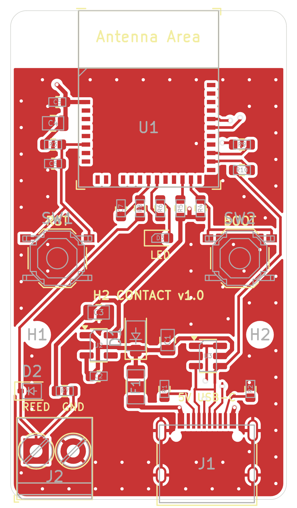

# h2-contact v1.0: PCB cảm biến cửa ESP32-H2 Matter over Thread

Bo mạch riêng cho firmware [`../`](../README.md): module **ESP32-H2-MINI-1-N4**, cấp nguồn và nạp qua **USB-C**, domino 2 chân cho **reed switch** (công tắc từ). Chân khớp với giá trị mặc định của firmware nên chỉ cần build và nạp, không phải đổi `menuconfig` (riêng LED phải bật, xem mục **Firmware**).



| | |
|---|---|
| Kích thước | 26 × 46 mm, bo góc R1,5; 2 lớp; FR-4 1,6 mm |
| Lắp ráp | toàn bộ SMD ở **mặt trên** (lắp 1 mặt); J2 (domino, xuyên lỗ) hàn tay |
| Luật thiết kế | dây ≥ 0,2 mm, khoảng cách ≥ 0,2 mm, via 0,6/0,3 mm, đồng cách mép bo ≥ 0,3 mm (trong khả năng tiêu chuẩn của JLCPCB) |
| Lỗ bắt vít | 2 × M2 (H1, H2) |
| Nguồn | USB-C 5 V → PTC 0,5 A → TVS SMF5.0A → AP2112K-3.3 (600 mA) |
| Nạp, log | USB-C (USB Serial/JTAG của ESP32-H2, GPIO26/27), USBLC6-2SC6 chống ESD; pad UART0 ở mặt dưới |

## Thư mục

| Đường dẫn | Nội dung |
|---|---|
| `kicad/` | Project KiCad 7 (`h2_contact.kicad_pro`): sơ đồ A3, PCB đã đi dây, symbol `ESP32-H2-MINI-1` và footprint module (thư viện Espressif) |
| `fab/h2_contact_gerbers.zip` | Gerber X2 + Excellon (lỗ oval của USB-C dạng G85) + drill map + job file: **file upload cho xưởng** |
| `fab/gerbers/` | các file trong zip, để xem từng lớp |
| `fab/h2_contact-BOM.csv` | BOM đầy đủ (có ghi chú linh kiện), kể cả J2 |
| `fab/h2_contact-BOM-JLCPCB.csv`, `fab/h2_contact-CPL-JLCPCB.csv` | BOM và file toạ độ (CPL) theo cột của JLCPCB, không có J2 (hàn tay) |
| `fab/h2_contact-pos.csv` | file toạ độ gốc của KiCad (mm, cả hai mặt) |
| `fab/h2_contact_schematic.pdf` | sơ đồ nguyên lý |
| `docs/images/` | ảnh mặt trên, lớp đồng trên, lớp đồng dưới (nhìn từ dưới) |
| `tools/gen/` | script dựng lại toàn bộ (mục **Dựng lại**) |

## Sơ đồ khối và gán chân

| Khối | Linh kiện | Chân ESP32-H2 (pad module) | Firmware (`menuconfig`) |
|---|---|---|---|
| Reed switch | J2 (REED, GND) → R7 10k kéo lên 3V3 ở phía domino → R8 1k → GPIO4; C7 100 nF xuống GND; D2 ESD 3,3 V | GPIO4 (18) | `CONTACT_SENSOR_GPIO=4`, `CONTACT_ACTIVE_LOW=y` (mặc định) |
| Nút BOOT / factory reset | SW2 xuống GND, R4 10k kéo lên | GPIO9 (23) | `FACTORY_RESET_GPIO=9`, giữ 6 s (mặc định) |
| Nút RESET | SW1 xuống GND; EN: R3 10k + C6 1 µF | EN (8) | — |
| Strapping | R5 10k kéo GPIO8 lên: cần cho chế độ nạp (GPIO8 = 1, GPIO9 = 0) | GPIO8 (22) | — |
| LED trạng thái | GPIO5 → R6 1k → LED xanh lá → GND (sáng mức cao) | GPIO5 (19) | `STATUS_LED_ENABLE=y`, `STATUS_LED_GPIO=5`, `STATUS_LED_ACTIVE_HIGH=y` |
| USB | J1 D−/D+ → U3 USBLC6-2SC6 → R10/R9 22 Ω → GPIO26/GPIO27 | 26, 27 | USB Serial/JTAG (nạp, log) |
| UART0 | pad TX0/RX0 (mặt dưới) | TXD0 (31), RXD0 (30) | log UART0 (mặc định của ESP-IDF) |
| Nguồn module | C4 10 µF + C5 100 nF sát chân 3V3 | 3V3 (3) | — |

- **VBAT (chân 15)** để trống: datasheet ESP32-H2-MINI-1 v1.6 (bảng 3, hình 7) ghi chân này nối sẵn với 3V3 bên trong module qua R2 0 Ω.
- Chân NC của module (4, 7, 17, 28, 29, 32–35) và GPIO không dùng (IO0–IO3, IO10–IO14, IO22, IO25) để trống. IO25 là chân strapping JTAG, để trống là mặc định.
- Mọi pad GND của module, kể cả EPAD, nối vào mặt GND phía trên; 2 mặt GND nối nhau bằng 70 via khâu và via của linh kiện.

## Nối reed switch

Domino J2, nhìn từ mép dưới của bo: trái **REED** (pad vuông), phải **GND**. Đưa 2 dây của reed switch vào hai chân, không phân cực.

- Dùng loại tiếp điểm **đóng khi nam châm ở gần** (cửa đóng → mạch kín). Đó là reed switch thường hở (NO) và cũng là kiểu cảm biến cửa có dây phổ biến (MC-38 và tương tự, thường được bán với tên "NC" theo cách gọi của ngành báo động: mạch kín khi cửa đóng). Firmware mặc định hiểu: **mạch kín = cửa đóng**. Loại ngược lại thì tắt `CONTACT_ACTIVE_LOW`.
- Dây dài được: R7 10k kéo lên ở phía domino cho dòng khoảng 0,3 mA qua tiếp điểm khi đóng; R8 1k + C7 100 nF lọc nhiễu; D2 chặn ESD. Firmware còn lọc dội 50 ms.
- Không nối nguồn ngoài vào J2.

## Firmware

Dùng nguyên firmware ở thư mục cha. Build như README firmware; muốn dùng LED trên bo thì bật một lựa chọn:

```bash
idf.py menuconfig   # Status LED → Status LED on a GPIO = y (GPIO5 và "LED lights when HIGH" đã đúng mặc định)
```

Nạp qua cổng USB-C của bo (Linux `/dev/ttyACM0`):

```bash
idf.py -p /dev/ttyACM0 flash monitor
```

Nếu USB không nhận (firmware lỗi): giữ **BOOT**, bấm **RESET**, nhả BOOT → chế độ nạp ROM. Sau khi firmware chạy, giữ **BOOT 6 giây** = factory reset Matter (cảnh báo: giữ BOOT **trong lúc cắm USB/reset** là vào chế độ nạp, không phải factory reset).

## Đặt làm ở JLCPCB (hoặc xưởng khác)

1. **PCB:** upload `fab/h2_contact_gerbers.zip`. 2 lớp, 1,6 mm, tuỳ chọn mặc định. Kích thước xưởng đọc được: 26 × 46 mm.
2. **Lắp ráp (PCBA):** chọn lắp **mặt trên** (Top). Upload `fab/h2_contact-BOM-JLCPCB.csv` và `fab/h2_contact-CPL-JLCPCB.csv`.
   - Cột **LCSC Part #** để trống: chọn mã trên trang JLC theo cột *Part / note* của `fab/h2_contact-BOM.csv` (giá trị, kích thước, điện áp). Chọn đúng **ESP32-H2-MINI-1-N4** (4 MB, anten PCB; không phải MINI-1U), **HRO TYPE-C-31-M-12** (USB-C 16 chân), **XKB TS-1187A** hoặc nút 5,1 × 5,1 mm cùng footprint.
   - Trong màn hình xem trước, **kiểm tra hướng xoay** từng linh kiện: quy ước góc của KiCad và JLC khác nhau ở một số footprint, hay gặp với U1, U2, U3 (SOT-23), J1 (USB-C), D1/D3 (cực tính). Chấm cực/chân 1: U1 chân 1 ở góc trên trái hàng pad (góc vát trên lớp Fab), U2/U3 dấu tam giác trên silkscreen cạnh chân 1, D1 vạch cathode ở phía +5V, D3 cathode nối GND.
3. **J2** (domino 3,5 mm 2 chân, ví dụ KF350-3.5-2P / Phoenix PT 1,5/2-3,5-H): hàn tay, hoặc thêm vào đơn lắp xuyên lỗ của JLC.
4. Mặt dưới chỉ có pad test (3V3, GND, TX0, RX0) và nhãn, không có linh kiện.

## Ghi chú thiết kế

- **Anten:** module đặt sát mép trên, đầu anten ra mép bo như Espressif khuyên. Vùng anten (5,4 mm trên cùng, cả bề ngang bo) không có đồng, dây hay via ở cả 2 lớp; dọc mép vùng này có một hàng via GND dày. Khi lắp vỏ: không để kim loại trong khoảng 15 mm quanh anten.
- **Dưới module:** lớp trên không có dây tín hiệu giữa các hàng pad (GND liền dưới module).
- **USB-C:** 16 chân có dữ liệu USB 2.0; CC1/CC2 mỗi chân 5,1k xuống GND (thiết bị nhận 5 V). D−/D+ xen kẽ trên đầu nối (B7 A6 A7 B6) nên phần thoát dây được đi tay và khoá: D− nối ở lớp trên, D+ đổi lớp qua 2 via; 2 chân VBUS nối nhau bằng cầu ở lớp dưới, dưới thân đầu nối.
- **Cặp D+/D−** không đi thành cặp vi sai 90 Ω (bo 2 lớp 1,6 mm, đường ngắn khoảng 25 mm, mỗi dây một phần ở lớp khác). Đủ cho USB Full-Speed 12 Mbit/s dùng để nạp và xem log; cảm biến chạy bình thường mà không cần USB dữ liệu.
- **Nguồn:** Espressif khuyên nguồn 3,3 V ≥ 350 mA; AP2112K-3.3 cho 600 mA. Tụ 10 µF ở đầu vào 5 V và ở chân 3V3 module như hướng dẫn thiết kế của Espressif.

## Trạng thái kiểm tra

Đã làm (KiCad 7.0.11, Freerouting 2.1.0):

- **DRC** (API pcbnew, sau khi đổ đồng): **0 vi phạm, 0 kết nối thiếu**, 0 lỗi footprint. Các mục tắt có chủ đích: silkscreen đè đồng/chồng nhau, silkscreen của module ("Antenna Area") sát mép bo, cảnh báo khác thư viện footprint.
- **Sơ đồ ↔ PCB:** netlist xuất từ sơ đồ (`kicad-cli`) so với net của từng pad trên PCB: **109/109 pad khớp** (`tools/gen/check_netlist.py`); H1/H2 chỉ có trên PCB.
- Footprint và bảng chân module lấy từ thư viện KiCad chính thức của Espressif (commit `dd76561`), đối chiếu datasheet ESP32-H2-MINI-1 v1.6.

**Chưa làm:**

- **ERC** chưa chạy: `kicad-cli` 7 không có ERC. Mở sơ đồ trong KiCad và chạy *Inspect → Electrical Rules Checker* trước khi đặt.
- Chưa sản xuất, chưa lắp, chưa đo trên bo thật; chưa có ảnh render 3D.
- Footprint USB-C, nút bấm, domino là footprint chuẩn của KiCad: so lại với datasheet của đúng mã linh kiện bạn chọn (nhất là khi đổi nhà sản xuất).

## Dựng lại

Toàn bộ project sinh ra từ `tools/gen/design.py` (linh kiện, vị trí, net). Cần KiCad 7.0.x (python `pcbnew`, `kicad-cli`), Java 21 và [Freerouting 2.1.0](https://github.com/freerouting/freerouting/releases/tag/v2.1.0); ảnh cần Node.js + Playwright Chromium.

```bash
cd tools/gen
FREEROUTING=/path/to/freerouting-2.1.0.jar ./route_all.sh   # symbol, PCB, thoát dây USB-C, Freerouting, via khâu, DRC
python3 build_sch.py         # sơ đồ (KiCad 7), UUID symbol = path footprint: "Update PCB from Schematic" khớp 1:1
python3 check_netlist.py     # sơ đồ ↔ PCB
python3 export_fab.py        # fab/ và docs/images/
```

Freerouting không cho kết quả giống hệt mỗi lần chạy: dây trong `kicad/` là bản đã kiểm tra ở trên.

## Giấy phép thư viện

Footprint `kicad/h2_contact.pretty/ESP32-H2-MINI-1.kicad_mod` lấy nguyên từ [espressif/kicad-libraries](https://github.com/espressif/kicad-libraries) (CC-BY-SA 4.0, kèm ngoại lệ giống thư viện KiCad: thiết kế dùng thư viện không bị ràng buộc bởi giấy phép này). Symbol `ESP32-H2-MINI-1` trong `kicad/h2_contact.kicad_sym` vẽ lại ở định dạng KiCad 7 theo số chân và tên chân của thư viện đó.
