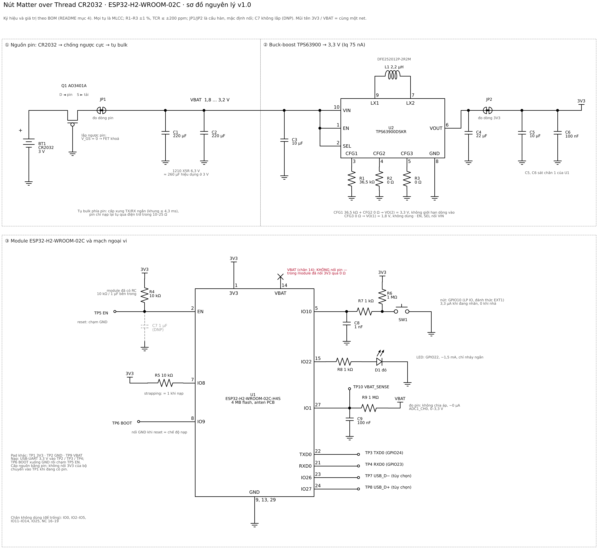

# ESP32-H2 Matter over Thread: nút nhấn pin CR2032

Thiết kế đầy đủ (phần cứng, firmware, tính pin, kiểm thử) cho một **nút nhấn Matter over Thread chạy pin CR2032**: module **ESP32-H2-WROOM-02C**, một nút nhấn vật lý, gửi **nhấn một lần / nhấn đúp / giữ lâu** dưới dạng sự kiện chuẩn của cluster **Switch** (device type Generic Switch 0x000F), dùng được trong Apple Home, Home Assistant và các controller Matter khác. Thiết bị là **Thread Sleepy End Device (SED)** kiêm **Matter Intermittently Connected Device (ICD)**: ngủ Light-sleep giữa các lần nhấn mà vẫn giữ kết nối Thread, thức dậy bằng ngắt của nút.

Firmware: ESP-IDF v6.0.2 + esp-matter release/v1.6.1 (cùng Docker image với các dự án khác trong repo). Cả 5 biến thể (mặc định SIT, LIT, `unique_setup`, `factory`, `debug`) đã build được; host test máy trạng thái nút qua 17 kịch bản. **Chưa đo trên bo thật**: mọi số đo đánh dấu [AS] phải được thay bằng số đo theo [checklist](docs/test-checklist.md).

> **Kết luận nhanh**
>
> - CR2032 **không cấp trực tiếp** được cho ESP32-H2 (VDD tối thiểu 3,0 V; pin chỉ ~2,9 V khi có tải và giảm dần về 2,0 V; xung TX/RX 32–68 mA qua điện trở trong 10–25 Ω). Bắt buộc có **buck-boost TPS63900** (Iq 75 nA) và **tụ bulk ≥ 220 µF hiệu dụng** trên đường pin.
> - Dòng ngủ: ESP32-H2 Light-sleep 25–27 µA ở 3,3 V → **~35 µA tại pin**: đạt mục tiêu < 50 µA, nhưng riêng mức sàn này đã giới hạn tuổi pin ở **tối đa ~6,8 tháng** dù không nhấn lần nào.
> - Tuổi pin dự tính (TX 0 dBm, 1 controller, 5–100 lần nhấn/ngày): **3,7–4,0 tháng** ở chế độ ICD **SIT** (mặc định, chạy với mọi controller kể cả Apple Home); **4,4–5,6 tháng** ở chế độ **LIT** (Home Assistant có Battery Saver; Apple Home hiện chưa hỗ trợ). **Mục tiêu 6–12 tháng không đạt được với CR2032 + ESP32-H2** khi phải giữ kết nối Thread (điều kiện để phản hồi < 300 ms).
> - Muốn ~1 năm trở lên: **CR2450** (cùng mạch: ~11 tháng SIT, ~15 tháng LIT), CR123A hoặc 2×AAA (> 1,5 năm), hoặc SoC Thread có dòng ngủ vài µA (mục [1.6](#16-kết-luận-và-phương-án)).
> - Phản hồi: sự kiện đầu tiên (`InitialPress`) rời anten **~25–40 ms** sau khi nhấn; sự kiện "nhấn một lần" mà Apple Home / Home Assistant dùng (`MultiPressComplete`) đi ra **350 ms sau khi nhả** (cửa sổ phân biệt nhấn đúp, chỉnh được; tắt nhấn đúp thì có ngay).

## Mục lục

1. [Đánh giá khả thi](#1-đánh-giá-khả-thi)
2. [Kiến trúc phần cứng](#2-kiến-trúc-phần-cứng)
3. [Sơ đồ nguyên lý và bảng kết nối](#3-sơ-đồ-nguyên-lý-và-bảng-kết-nối)
4. [BOM](#4-bom)
5. [Cấu hình Thread SED + Matter ICD](#5-cấu-hình-thread-sed--matter-icd)
6. [Thuật toán nút nhấn](#6-thuật-toán-nút-nhấn)
7. [Firmware](#7-firmware)
8. [Build, flash, commissioning (Windows PowerShell)](#8-build-flash-commissioning-windows-powershell)
9. [Bảng tính thời lượng pin](#9-bảng-tính-thời-lượng-pin)
10. [Rủi ro và cách khắc phục](#10-rủi-ro-và-cách-khắc-phục)

Kiểm thử: [`docs/test-checklist.md`](docs/test-checklist.md). PCB KiCad và file sản xuất: [`hardware/`](hardware/README.md).

Ký hiệu nguồn số liệu dùng trong toàn tài liệu: **[DS]** datasheet; **[ME]** số đo công bố của Espressif (esp-matter `examples/icd_app`, ESP32-H2 DevKitC); **[AS]** giả định / ước lượng, phải đo lại trên bo thật.

---

## 1. Đánh giá khả thi

### 1.1 Số liệu đầu vào

| Thông số | Giá trị | Nguồn |
|---|---|---|
| CR2032: điện áp danh định, dung lượng | 3,0 V; 235 mAh tới 2,0 V với tải 15 kΩ (≈ 0,19 mA); các hãng khác 220–225 mAh | [DS] Energizer CR2032 |
| CR2032: điện áp có tải | ~2,9 V phần lớn đời pin (tải nhẹ); ~2,8 V với xung 6,8 mA; tụt nhanh sau ~200 mAh | [DS] Energizer, đồ thị xung |
| CR2032: điện trở trong | ~10 Ω khi mới; ~15 Ω ở 150 mAh; ~20 Ω ở 175 mAh; ~25 Ω ở 200 mAh; > 100 Ω khi cạn | [DS] Energizer, đường IR |
| CR2032: tự xả, nhiệt độ | ~1 %/năm; −30…60 °C | [DS] |
| ESP32-H2: điện áp cấp (VDD3P3, VBAT, VDDPST) | **3,0–3,6 V** (typ 3,3 V) | [DS] ESP32-H2 v1.3, Bảng 5-2 |
| ESP32-H2: TX 802.15.4 | 36 mA @ 0 dBm; 60 mA @ 9 dBm; **140 mA @ 20 dBm** | [DS] Bảng 5-7 |
| ESP32-H2: RX 802.15.4 / BLE | 25 mA / 24 mA | [DS] Bảng 5-6, 5-7 |
| ESP32-H2: CPU 96 MHz, clock ngoại vi tắt | 10 mA chạy, 6 mA idle | [DS] Bảng 5-8 |
| ESP32-H2: Light-sleep (CPU, radio, ngoại vi số tắt nguồn) | **25 µA** typ (85 µA nếu giữ ngoại vi) | [DS] Bảng 5-9 |
| ESP32-H2: Light-sleep đo thực tế | 26,7–27,0 µA | [ME] |
| ESP32-H2: Deep-sleep | 7 µA (mất RAM, mất kết nối Thread) | [DS] |
| ESP32-H2: brownout | mức 7 ≈ 2,94 V (firmware chọn mức này) | ESP-IDF Kconfig |
| ESP32-H2: ADC, ATTEN 12 dB | 0–3300 mV, sai số ±23 mV sau hiệu chuẩn; dòng rò chân ≤ 50 nA | [DS] |
| TPS63900: dải vào, UVLO | 1,8–5,5 V; UVLO lên 1,75 V typ, trễ 0,1 V → tắt ở ~1,65 V | [DS] TI SLVSET3D |
| TPS63900: dòng tĩnh | 75 nA typ, 1 µA max | [DS] |
| TPS63900: hiệu suất, 3,3 V ra | ~89–91 % (VIN 2,5–3,3 V, tải 10 µA–10 mA); ~87 % ở VIN 1,8 V | [DS] Hình 8-7 |

### 1.2 CR2032 có cấp trực tiếp cho ESP32-H2 được không? Không

1. **Điện áp.** ESP32-H2 cần ≥ 3,0 V. CR2032 chỉ 3,0–3,2 V khi hở mạch lúc còn mới, ~2,9 V khi có tải và giảm dần về 2,0 V. Nối trực tiếp thì chip chạy **ngoài thông số ngay từ đầu**, và brownout (mức thấp nhất 2,57 V) cắt khi pin còn phần lớn dung lượng.
2. **Dòng.** Xung TX/RX 25–36 mA (0 dBm) qua điện trở trong 10–25 Ω gây sụt 0,25–0,9 V; ở +20 dBm (140 mA, mặc định của driver ESP-IDF) sụt 1,4–3,5 V → reset ở mỗi khung phát.
3. **Chân VBAT của module không phải đầu vào pin.** Trong WROOM-02C, chân 14 (VBAT) nối sẵn vào 3V3 qua điện trở 0 Ω (datasheet module, mục 8: *"When VBAT is powered by external battery, R2 can be NC"*). Đưa CR2032 vào chân này là chập pin với đường 3V3.

→ Cần bộ **buck-boost** giữ 3,3 V khi pin đi từ 3,2 V xuống ~1,8 V. LDO không dùng được (pin < 3,3 V). Boost thuần không hạ áp được khi pin mới (3,2 V gần bằng đầu ra). Chọn **TI TPS63900**: Iq 75 nA (≈ 0,2 % của mức sàn 35 µA), hiệu suất ~90 % ở dòng µA–mA, đầu vào tới 1,8 V.

### 1.3 Dòng rút từ pin khi phát/thu

Bộ buck-boost là **tải công suất không đổi**: I_pin = I_3V3 × 3,3 V / (η × V_pin). Pin càng yếu, dòng rút càng lớn.

| Trạng thái (dòng ở 3,3 V [DS]) | V_pin 2,9 V | V_pin 2,4 V | V_pin 2,0 V |
|---|---|---|---|
| TX 0 dBm (36 mA) | 46 mA | 55 mA | 68 mA |
| RX (25 mA) | 32 mA | 38 mA | 47 mA |
| CPU 96 MHz (10 mA) | 13 mA | 15 mA | 19 mA |
| TX +9 dBm (60 mA) | 76 mA | 92 mA | 114 mA |
| TX +20 dBm (140 mA) | 177 mA | 214 mA | 266 mA |

(η = 0,90 ở 2,9 V và 2,4 V; 0,87 ở 2,0 V.) **Firmware giữ TX ở 0 dBm** (`THREAD_TX_POWER_DBM`) và áp dụng ngay khi driver 802.15.4 khởi tạo, trước khung đầu tiên (mục [5.6](#56-công-suất-phát)). BLE (chỉ dùng lúc ghép nối) cũng đặt 0 dBm.

### 1.4 Sụt áp, tụ bulk và brownout khi phát

Mô hình: pin = nguồn V_oc nối tiếp R_trong. TPS63900 tắt khi V_pin < ~1,65 V (UVLO), lúc đó 3V3 sập và ESP32-H2 brownout.

- **Không có tụ bulk**, pin đã dùng ~200 mAh (V_oc ≈ 2,6 V, R ≈ 25 Ω): xung TX 0 dBm 55 mA → sụt 1,4 V → V_pin ≈ 1,2 V < UVLO → **reset ở mỗi lần phát**.
- **Có tụ bulk C trên đường pin** (trước buck-boost): tụ cấp phần lớn xung ngắn, pin nạp lại tụ qua R. Sụt áp sau thời gian t: ΔV = I·R·(1 − e^(−t/RC)). Khung 802.15.4 dài nhất 127 byte = **4,3 ms** ở 250 kbit/s. Với C = 220 µF hiệu dụng, R = 25 Ω (τ = 5,5 ms): ΔV = 1,38 V × (1 − e^(−0,78)) = **0,75 V** → V_pin ≈ 1,9 V > UVLO. Thiết kế dùng **2 × 220 µF 1210 X5R** (≈ 260 µF hiệu dụng ở 3 V sau DC-bias [AS], kiểm tra bằng Murata SimSurfing hoặc đo).
- Đặt tụ **phía pin** (được phép sụt từ 2,9 V xuống ~1,8 V) dùng năng lượng tụ hiệu quả hơn nhiều so với phía 3,3 V (chỉ được sụt 0,3 V trước brownout 2,94 V).
- **Thu liên tục** khi re-attach Thread (Parent Request tới router rồi tới REED: 0,75 s + 1,25 s ≈ 2 s RX) thì không tụ nào bù được: pin phải tự cấp ~95 mW (25 mA × 3,3 V / η). Giữ V_pin ≥ 1,75 V đòi hỏi R_trong ≤ ~20 Ω (V_oc 2,8 V), tức **~175 mAh** trên đường Energizer. Mô hình pin vì vậy chỉ tính **80 % dung lượng danh định** (176 mAh). Qua mức đó nút vẫn chạy (xung ngắn vẫn có tụ đỡ), nhưng một lần re-attach (mất Border Router, khởi động lại) có thể gây brownout.
- **Firmware bảo vệ thêm:** brownout 2,94 V trên đường 3,3 V; bộ đếm brownout và đo áp lúc khởi động → Deep-sleep 1 giờ khi pin quá yếu (không reset lặp vô hạn); từ chối tải OTA khi pin không ở mức OK; đo điện trở trong mỗi ngày để báo pin yếu **trước** khi sập (mục [2.5](#25-đo-pin-gần-như-không-tốn-dòng)).

### 1.5 Dòng ngủ là giới hạn chính

Dòng trung bình, SIT 15 s, 20 lần nhấn/ngày, 1 controller (`tools/battery_model.py --breakdown`):

| Thành phần | Tại 3,3 V | Tỷ lệ |
|---|---|---|
| Light-sleep ESP32-H2 | 27,0 µA | 58,6 % |
| Data poll mỗi 15 s (0,25 mC/lần) | 16,7 µA | 36,2 % |
| Report keep-alive mỗi giờ | 0,9 µA | 1,9 % |
| Bảo trì Thread/Matter (SRP, MLE, đo pin, hỏi OTA) | 0,7 µA | 1,5 % |
| 20 lần nhấn/ngày | 0,9 µA | 1,9 % |
| **Tổng tại 3,3 V** | **46,1 µA** | |
| **Tại pin** (× 3,3 / (0,89 × 2,85) + Iq + rò) | **60 µA** | → **4,0 tháng** |

Chỉ riêng Light-sleep (không poll, không nhấn) đã là 35,4 µA tại pin → **trần ~6,8 tháng**. Muốn 12 tháng với 176 mAh dùng được thì dòng trung bình tại pin phải ≤ ~20 µA, nghĩa là dòng ngủ của chip phải < ~12 µA: ESP32-H2 không có chế độ nào như vậy mà vẫn giữ kết nối Thread.

**Vì sao không dùng Deep-sleep (7 µA)?** Deep-sleep tắt RAM, mất trạng thái Thread và phiên Matter. Mỗi lần nhấn sẽ phải khởi động lại, attach Thread (≥ 2 s thu), mở lại phiên CASE và subscription (vài giây): **không đạt < 300 ms**, controller thấy thiết bị offline giữa các lần nhấn, và mỗi lần nhấn tốn 60–200 mC (bằng 2–8 giờ Light-sleep).

### 1.6 Kết luận và phương án

| Mục tiêu | Thiết kế này | Đạt? |
|---|---|---|
| Dòng ngủ < 50 µA | 27 µA tại 3,3 V; ~35 µA tại pin | ✅ |
| Phản hồi < 300 ms | `InitialPress` rời anten ~25–40 ms sau khi nhấn; "nhấn một lần" = lúc nhả + 350 ms (chỉnh được, mục [6.6](#66-độ-trễ)) | ✅ có điều kiện |
| Pin 6–12 tháng | SIT 3,7–4,0 tháng; LIT 4,4–5,6 tháng | ❌ |

Phương án khác (20 lần nhấn/ngày, 1 controller, cùng mạch và firmware, `tools/battery_model.py`):

| Nguồn | SIT 15 s (Apple + HA) | LIT 120 s (HA Battery Saver) | Ghi chú |
|---|---|---|---|
| CR2032 (thiết kế này) | 4,0 tháng | 5,4 tháng | |
| **CR2450** (620 mAh, Ø24,5 × 5,0 mm) | **11,2 tháng** | **15,0 tháng** | cùng mạch, chỉ đổi đế pin; khuyến nghị nếu cần ~1 năm |
| CR123A (1500 mAh) | ~30 tháng | ~41 tháng | Ø17 × 34,5 mm, chịu xung tốt |
| 2 × AAA alkaline (1150 mAh) | ~19 tháng | ~26 tháng | TPS63900 chạy tới 1,8 V (0,9 V/cell); pin alkaline có thể chảy |
| CR2032 + SoC dòng ngủ ~2 µA | 8,6 tháng | 19,7 tháng | chỉ đổi mức sàn, vẫn giữ chi phí poll của ESP32-H2 |

Nếu bắt buộc CR2032 và ≥ 6 tháng: dùng LIT (chỉ với Home Assistant), một controller, ít lần nhấn; hoặc chuyển sang SoC Thread chuyên dùng pin có dòng ngủ giữ RAM cỡ vài µA (phải thiết kế lại phần cứng và firmware).

---

## 2. Kiến trúc phần cứng

### 2.1 Sơ đồ khối

```
            Q1 P-FET                 VBAT (1,8 .. 3,2 V)                   3V3
 CR2032 ──► chống ngược ──JP1──┬────────────────┬──► TPS63900 ──JP2──┬──► ESP32-H2-WROOM-02C
 (BT1)      cực              C1+C2            R9 1 MΩ   buck-boost       │      GPIO10 ◄── SW1 (LP IO, EXT1 wake)
                             2 × 220 µF        │        3,3 V, Iq 75 nA  │      GPIO22 ──► LED D1
                             (tụ bulk)         └──────── VBAT_SENSE ─────┼────► GPIO1 (ADC1_CH0)
                                                                         │      UART0, EN, BOOT, USB ──► pad nạp/debug
                                                                       C4..C6
```

| Khối | Nhiệm vụ |
|---|---|
| Q1 (P-MOSFET) | chống lắp ngược pin, sụt ~5 mV (R_DS(on) ~0,1 Ω ở 50 mA) thay vì 0,3 V của diode Schottky |
| JP1, JP2 (cầu hàn) | điểm cắt để đo dòng pin (JP1) và dòng đường 3,3 V (JP2); mặc định nối |
| C1, C2 | tụ bulk, cấp xung TX/RX ngắn, giảm sụt áp trên điện trở trong của pin (mục 1.4) |
| TPS63900 | buck-boost 3,3 V, Iq 75 nA, chạy từ 1,8 V |
| R9 + C9 | đo áp pin không tốn dòng (mục 2.5) |
| SW1 + R6/R7/C8 | nút nhấn, lọc RC, kéo lên 1 MΩ (mục 2.4) |
| D1 + R8 | LED trạng thái (ghép nối, Identify, xác nhận reset, pin yếu); chỉ nháy ngắn |

### 2.2 Đường nguồn

- **Q1 AO3401A** nối kiểu "ideal diode": D về pin, S về VBAT, G xuống GND. Lắp đúng: diode thân dẫn trước, V_GS = −V_pin → FET mở. Lắp ngược: V_GS = 0, diode thân phân cực ngược → không có dòng. Cần thiết vì tay giữ (+) của đế Keystone 3034 chạm mặt trên của pin: lắp úp pin thì mặt (−) chạm tay giữ (+), mặt (+) chạm pad GND.
- **TPS63900** (theo mạch điển hình 3,3 V của datasheet, Hình 8-1 / Bảng 8-5):
  - CFG1 = **36,5 kΩ** và CFG2 = **0 Ω** → VO(2) = 3,3 V, giới hạn dòng vào **không giới hạn** (Bảng 7-2). Không dùng giới hạn dòng vào: tụ bulk đặt trước bộ chuyển đổi đã gánh xung; giới hạn thấp hơn dòng cần lúc pin yếu (68 mA ở 2,0 V) sẽ làm sụt 3,3 V. Muốn thử giới hạn 100 mA thì đổi R2 (CFG2) thành 511 Ω.
  - CFG3 = **0 Ω** → VO(1) = 1,8 V (Bảng 7-3), không dùng tới: SEL nối VIN nên luôn chọn VO(2). Chân không được để hở; 0 Ω cũng là giá trị của mạch tham chiếu 3,3 V trong datasheet (Bảng 8-5), và R2, R3 dùng chung một mã linh kiện.
  - EN và SEL nối VIN (luôn chạy, chọn VO(2)).
  - Điện trở CFG: ±1 %, TCR ≤ ±200 ppm, đặt sát chân (điện dung chân CFG ≤ 10 pF). R2D chỉ đọc lúc khởi động.
  - L1 2,2 µH DFE252012P-2R2M (Murata, I_sat 3 A, 70 mΩ; datasheet dùng DFE252012F-2R2M, cùng kích thước); C3 10 µF sát VIN; C4 22 µF sát VOUT.
- **Vì sao 3,3 V:** đủ biên trên brownout 2,94 V khi tải đột biến 36 mA (TPS63900 dao động ra tầm chục mV). Có thể thử 3,1 V (VO(2) với CFG1 = 24,9 kΩ) để giảm ~6 % năng lượng, chỉ sau khi đo gợn sóng và sụt áp lúc phát.
- **Không dùng tụ tantalum / siêu tụ** cho tụ bulk: dòng rò cỡ µA. MLCC X5R rò thấp nhất, nhưng tụ dung lượng lớn vẫn phải đo rò (mục 2.6).

### 2.3 Chọn GPIO

| Chức năng | GPIO (chân module) | Lý do |
|---|---|---|
| Nút nhấn | **GPIO10** (chân 5) | **LP IO** (GPIO7–14): là loại chân duy nhất đánh thức được chip bằng **EXT1** khi ngoại vi số tắt nguồn trong Light-sleep (cấu hình tiết kiệm nhất). Không phải chân strapping, không có điện trở kéo lúc reset. |
| LED | **GPIO22** (chân 15) | IO số thường, không strapping, không có kéo lúc reset. Không cần giữ mức khi ngủ: LED chỉ sáng lúc chip thức. |
| Đo pin | **GPIO1** (chân 27) | ADC1_CH0, không strapping. |
| UART0 TX / RX | GPIO24 (chân 22) / GPIO23 (chân 21) | console + nạp firmware. |
| BOOT | GPIO9 (chân 8) | strapping: 0 lúc reset = chế độ nạp (có kéo lên yếu bên trong). |
| GPIO8 | (chân 7) | strapping: phải = 1 khi vào chế độ nạp → kéo lên 10 kΩ (không tốn dòng, chân là input). |
| Không dùng | GPIO8/9/25 (strapping), GPIO13/14 (thạch anh 32 kHz), GPIO2–5 (JTAG), GPIO26/27 (USB D−/D+), GPIO23/24 (UART0) | |

GPIO8/GPIO9 cũng là LP IO nhưng là chân strapping: nút nối GND ở đó sẽ đưa chip vào chế độ nạp nếu bị nhấn lúc lắp pin. GPIO13/14 để dành cho thạch anh 32,768 kHz nếu sau này cần.

### 2.4 Nút nhấn

```
3V3 ──R6 1 MΩ────┬──R7 1 kΩ──┬── GPIO10 (LP IO)
                 │           C8 1 nF
               SW1           │
                 │          GND
                GND
```

- **Kéo lên ngoài 1 MΩ** thay vì kéo lên trong (~45 kΩ): khi nhấn chỉ tốn 3,3 µA (thay vì 73 µA), và mức logic không phụ thuộc cấu hình pad lúc ngủ. Lúc nhả không tốn dòng (chỉ dòng rò chân ≤ 50 nA).
- **R7 + C8**: lọc nhiễu/ESD, cạnh nhấn ~1 µs (1 kΩ × 1 nF), cạnh nhả ~1 ms (1 MΩ × 1 nF). Bật hysteresis đầu vào trong firmware vì cạnh nhả chậm.
- Chống dội hoàn toàn bằng phần mềm (mục 6), không cần mạch RC lớn.

### 2.5 Đo pin gần như không tốn dòng

```
VBAT ──R9 1 MΩ──┬── GPIO1 (ADC1_CH0, ATTEN 12 dB, 0..3,3 V)
               C9 100 nF
                │
               GND
```

- **Không có cầu chia áp**: V_pin ≤ 3,3 V nằm gọn trong dải ADC 0–3300 mV. Cầu chia 1 MΩ/1 MΩ sẽ tốn 1,5 µA liên tục (4 % mức sàn); mạch này không có đường DC nào xuống GND, chỉ có dòng rò chân (≤ 50 nA [DS], thường vài nA).
- **C9** giữ điện tích cho tụ lấy mẫu của ADC (16 mẫu ≈ vài nC → sai số µV). **R9 1 MΩ** cách ly và giới hạn dòng khi TPS63900 tắt (V_pin vẫn còn, 3V3 = 0 V: dòng qua diode bảo vệ chân ≤ ~1 µA).
- Sai số do dòng rò chân qua 1 MΩ: ≤ 50 mV trường hợp xấu nhất, thường < 5 mV; phép đo điện trở trong dùng hiệu hai lần đo nên sai số này triệt tiêu.
- **Firmware** (`main/battery.cpp`): đo **áp nghỉ** 12 giờ một lần (ADC chỉ bật vài ms, khoá Light-sleep trong lúc đo), và **mỗi ngày một lần đo có tải**: cho CPU chạy hết tốc độ 500 ms (~13 mA từ pin), đọc lại áp (RC 100 ms → đã ổn định sau 5τ), tính sụt áp, nhân 2,5 (tỷ lệ dòng thu radio / dòng CPU, `BATTERY_BURST_RATIO_X100`) để **dự đoán áp pin khi thu liên tục**. Mức pin:

| Mức | Điều kiện (mặc định Kconfig) | Báo cáo Matter (Power Source, endpoint 0) | Hành vi |
|---|---|---|---|
| OK | áp nghỉ ≥ 2750 mV và áp dự đoán ≥ 2200 mV | `BatChargeLevel = OK` | bình thường |
| Warning | áp nghỉ < 2750 mV hoặc dự đoán < 2200 mV | `BatChargeLevel = Warning` | LED nháy 2 lần sau mỗi cử chỉ; không tải OTA |
| Critical | áp nghỉ < 2600 mV hoặc dự đoán < 1950 mV | `BatChargeLevel = Critical`, `BatReplacementNeeded = true` | như trên |
| Lúc khởi động | áp có tải < 2200 mV hoặc ≥ 3 lần brownout liên tiếp | | Deep-sleep 1 giờ (7 µA); timer đánh thức để thử lại, hoặc nhấn nút (chỉ khi nút đang nhả lúc đi ngủ: nút bị đè sẽ không đánh thức liên tục) |

Ngoài ra `BatVoltage` (mV) và `BatPercentRemaining` (bảng áp nghỉ → %, ước lượng [AS], hiệu chỉnh bằng một lần xả pin thật). Ngưỡng là [AS], hiệu chỉnh theo phép đo ở checklist (mục I).

### 2.6 Ngân sách dòng rò (25 °C)

| Nguồn | Giá trị | Nguồn số liệu |
|---|---|---|
| ESP32-H2 Light-sleep (ở 3,3 V) | 25 µA typ / 27 µA đo | [DS] / [ME] |
| TPS63900 Iq (đầu vào) | 75 nA typ, 1 µA max | [DS] |
| Tụ bulk C1 + C2 (2 × 220 µF X5R) | **phải đo**; thường 0,05–0,5 µA sau vài phút có áp; spec chỉ cho điện trở cách điện tối thiểu (họ MLCC X5R dung lượng lớn thường ghi 50 Ω·F → tới ~13 µA/tụ ở 3 V trong trường hợp xấu nhất) | [DS] spec tối thiểu, [AS] điển hình |
| Q1 (dòng rò cổng) | ≤ 100 nA max, thường < 1 nA | [DS] |
| Chân ADC GPIO1 | ≤ 50 nA | [DS] |
| Nút nhả / nhấn | ≤ 50 nA / 3,3 µA (chỉ khi đang giữ) | tính |
| Kéo lên GPIO8, EN | 0 (chân input) | |
| LED tắt | 0 (GPIO22 cách ly khi ngủ) | |
| **Mô hình dùng** | **0,15 µA** ngoài chip và TPS63900 | [AS] |

Kiểm tra rò tụ bulk là bước đầu tiên của checklist: đo dòng toàn bo khi giữ EN ở mức thấp (chip tắt, ~1 µA [DS]).

### 2.7 Bố trí PCB và anten

PCB đã thiết kế bằng KiCad 9: **[`hardware/`](hardware/README.md)** (schematic, PCB đã đi dây, Gerber, BOM, file vị trí linh kiện; ERC và DRC sạch).

- PCB 2 lớp FR-4 1,6 mm, **29,8 × 23,9 mm**, không có lỗ bắt vít. Module ở mép trên, sát mép phải, **vùng anten (6 mm đầu module) chìa ra ngoài mép bo** → cả cụm **29,8 × 29,9 mm** (dưới 30 × 30 mm); không đồng, không đường mạch, không linh kiện dưới vùng anten (datasheet WROOM-02C, mục 11; ESP32-H2 Hardware Design Guidelines, *Positioning a Module on a Base Board*). Mặt phẳng GND hai lớp chạy tới sát mép bo ở chân anten.
- **Pin CR2032 (vỏ kim loại) và đế pin ở mặt dưới, nằm dưới module và mạch; mép pin cách chân anten 3,4 mm** (bố trí 25 × 27 mm: 6,5 mm; 30 × 38 mm: ~16 mm). Đây là đánh đổi để cả cụm dưới 30 × 30 mm: pin nằm sau mặt phẳng GND, không nằm dưới anten, nhưng có thể làm giảm tầm phủ. Đo RSSI/LQI của parent khi đã lắp vỏ (checklist mục C); nếu link yếu, dùng lại bố trí 25 × 27 mm (commit `af26218`) hoặc 30 × 38 mm (commit `6649456`).
- Mặt dưới, dưới pin chỉ có pad tiếp xúc âm Ø17,8 mm (GND); vành từ mép pad tới ngoài mép pin không có đồng (đường mạch, via, phủ đồng), vì mép vỏ pin là cực +.
- TPS63900: C3 (VIN) và C4 (VOUT) sát chân trên lớp trên, L1 ngay dưới LX1/LX2, điện trở CFG sát chân; pad tản nhiệt nối chân GND 8 và hai via (TI: via trong pad là tùy chọn).
- C1/C2 ngay sau Q1/JP1. Phủ đồng GND cả hai lớp, mỗi pad GND có via riêng.
- SW1 ở giữa bo, ngay dưới module; R7/C8 (lọc RC) và R6 bên trái module cạnh chân GPIO10, đường nút đi trong lề trái của module xuống SW1. D1 bên phải nút (ống dẫn sáng).
- 10 pad nạp/debug Ø1,5 mm ở mặt dưới: hai nhóm 2 × 2 ở hai góc trên (bước 2,54 × 2,7 mm), RX và VBAT bên phải đế pin (jig pogo-pin).
- Chữ in: "Thread Button" ở mặt trên, "Made by Haxeko" và số rev ở mặt dưới.

---

## 3. Sơ đồ nguyên lý và bảng kết nối

### 3.1 Sơ đồ nguyên lý



Schematic KiCad (dùng cho PCB): [`hardware/docs/schematic.pdf`](hardware/docs/schematic.pdf). Bản vector của ảnh trên: [`docs/schematic.svg`](docs/schematic.svg). Ảnh được vẽ bằng `tools/schematic.py` (`pip install schemdraw matplotlib`, rồi `python3 tools/schematic.py`); sửa mạch thì sửa script và chạy lại. Cùng sơ đồ ở dạng văn bản:

```
NGUỒN
                          Q1 AO3401A (P-MOSFET, SOT-23)
  BT1 CR2032 (+) ───────── D ┤├ S ──── JP1 ────┬──────────────┬──────────────┬─────────────── VBAT
  Keystone 3034             G                  │              │              │
  BT1 (−) ── GND            └── GND            C1 220µF       C2 220µF       C3 10µF (sát U2)
                                               │ 1210 X5R     │              │
                                              GND            GND            GND

                       U2 TPS63900DSKR (WSON-10)
  VBAT ──┬──────────── 10 VIN                  LX1 9 ───┐
         ├──────────── 1  EN                            L1 2,2 µH DFE252012P-2R2M
         └──────────── 2  SEL                  LX2 7 ───┘
  GND ── R1 36,5 kΩ ── 3  CFG1                 VOUT 6 ──┬──── JP2 ────┬──────────────── 3V3
  GND ── R2 0 Ω ────── 4  CFG2                          C4 22 µF      C5 10 µF   C6 100 nF  (sát chân 1 của U1)
  GND ── R3 0 Ω ────── 5  CFG3                          │             │          │
  GND ──────────────── 8  GND + pad nhiệt              GND           GND        GND

MODULE
                    U1 ESP32-H2-WROOM-02C-H4S
  3V3 ──────────────── 1  3V3                  IO0   28 ── NC
  3V3 ── R4 10 kΩ ──┬─ 2  EN                   IO1   27 ──┬── R9 1 MΩ ── VBAT
          C7 1 µF (DNP) ── GND                            C9 100 nF ── GND
              TP5 EN ─┘                        IO2   26 ── NC
  NC ───────────────── 3  IO4                  IO3   25 ── NC
  NC ───────────────── 4  IO5                  IO27  24 ── TP8 USB_D+ (tùy chọn)
  BTN ──────────────── 5  IO10                 IO26  23 ── TP7 USB_D− (tùy chọn)
  NC ───────────────── 6  IO11                 TXD0  22 ── TP3 TXD0 (GPIO24)
  3V3 ── R5 10 kΩ ──── 7  IO8                  RXD0  21 ── TP4 RXD0 (GPIO23)
  TP6 BOOT ─────────── 8  IO9                  IO25  20 ── NC
  GND ──────────────── 9  GND                  NC 16..19
  NC ───────────────── 10 IO12                 IO22  15 ── R8 1 kΩ ──►|── GND   (D1 KT-0603R)
  NC ───────────────── 11 IO13                 VBAT  14 ── NC (trong module đã nối 3V3; KHÔNG nối pin)
  NC ───────────────── 12 IO14                 GND   13, 29 (pad giữa) ── GND

NÚT NHẤN
  3V3 ── R6 1 MΩ ────┬── R7 1 kΩ ──┬── BTN (U1 chân 5, GPIO10)
                     SW1           C8 1 nF
                     │             │
                    GND           GND

PAD NẠP / ĐO
  TP1 3V3   TP2 GND   TP3 TXD0   TP4 RXD0   TP5 EN   TP6 BOOT (GPIO9)   TP7 USB_D−   TP8 USB_D+
  TP9 VBAT  TP10 VBAT_SENSE
  JP1: cắt để đo dòng pin (nối ampe kế qua 2 pad)   JP2: cắt để đo dòng đường 3,3 V
```

### 3.2 Bảng kết nối chân module

| Chân U1 | Tên | Nối tới | Ghi chú |
|---|---|---|---|
| 1 | 3V3 | net 3V3 (VOUT TPS63900 qua JP2), C5 10 µF + C6 100 nF sát chân | |
| 2 | EN | R4 10 kΩ lên 3V3, TP5; C7 1 µF để trống (module đã có RC 10 kΩ / 1 µF bên trong) | nối TP5 xuống GND để reset |
| 3, 4 | IO4, IO5 | không nối | JTAG MTCK/MTDI |
| 5 | IO10 | BTN: R7 1 kΩ → SW1/R6; C8 1 nF xuống GND | LP IO, EXT1 wake |
| 6 | IO11 | không nối | |
| 7 | IO8 | R5 10 kΩ lên 3V3 | strapping, cần = 1 khi nạp |
| 8 | IO9 | TP6 BOOT | nối GND lúc reset để vào chế độ nạp |
| 9, 13, 29 | GND | GND | 29 = pad giữa, nhiều via |
| 10 | IO12 | không nối | |
| 11, 12 | IO13, IO14 | không nối | dành cho thạch anh 32 kHz |
| 14 | VBAT | **không nối** | trong module đã nối 3V3 qua 0 Ω |
| 15 | IO22 | R8 1 kΩ → D1 → GND | LED, ~1,5 mA khi sáng |
| 16–19 | NC | | |
| 20 | IO25 | không nối | strapping JTAG, bị bỏ qua khi eFuse mặc định |
| 21 | RXD0 (GPIO23) | TP4 | |
| 22 | TXD0 (GPIO24) | TP3 | console 115200 baud |
| 23, 24 | IO26, IO27 | TP7, TP8 (USB D−/D+, tùy chọn) | nạp qua USB-Serial-JTAG |
| 25, 26 | IO3, IO2 | không nối | |
| 27 | IO1 | VBAT_SENSE: R9 1 MΩ từ VBAT, C9 100 nF xuống GND | ADC1_CH0 |
| 28 | IO0 | không nối | |

### 3.3 Danh sách net

| Net | Thành phần |
|---|---|
| BAT+ | BT1 (+), Q1 D |
| VBAT | Q1 S (qua JP1), C1, C2, C3, U2 VIN/EN/SEL, R9, TP9 |
| 3V3 | U2 VOUT (qua JP2), C4 (phía U2), C5, C6, U1.1, R4, R5, R6, TP1 |
| GND | BT1 (−), Q1 G, C1–C9, U2 GND/pad, R1, R2, R3, SW1, D1 cathode, U1.9/13/29, TP2 |
| EN | U1.2, R4, C7 (DNP), TP5 |
| BTN | U1.5, R7, C8 |
| BTN_SW | R6, R7, SW1 |
| LED | U1.15 → R8 → D1 anode |
| VBAT_SENSE | U1.27, R9, C9, TP10 |
| BOOT | U1.8, TP6 |
| STRAP8 | U1.7, R5 |
| TXD0 / RXD0 | U1.22 / U1.21, TP3 / TP4 |
| USB_D− / USB_D+ | U1.23 / U1.24, TP7 / TP8 |
| CFG1 / CFG2 / CFG3 | U2.3 – R1 / U2.4 – R2 / U2.5 – R3 |
| LX1 / LX2 | U2.9 – L1 / U2.7 – L1 |

---

## 4. BOM

| Ký hiệu | SL | Giá trị | Mã linh kiện (nhà sản xuất) | LCSC (JLCPCB) | Kiểu chân | Ghi chú |
|---|---|---|---|---|---|---|
| U1 | 1 | Module ESP32-H2, 4 MB flash, anten PCB | **ESP32-H2-WROOM-02C-H4S** (Espressif) | — (hàn tay) | SMD 18 × 20 mm | bản H2S có 2 MB: không đủ cho 2 phân vùng OTA 1,875 MB |
| U2 | 1 | Buck-boost 3,3 V, Iq 75 nA | **TPS63900DSKR** (TI) | C1518762 (Extended) | WSON-10 2,5 × 2,5 mm | |
| L1 | 1 | 2,2 µH, I_sat 3 A, 70 mΩ | **DFE252012P-2R2M=P2** (Murata) | C391305 (Extended) | 2520 (1008) | Bảng 8-5 datasheet TPS63900 dùng DFE252012F-2R2M (cùng kích thước) |
| Q1 | 1 | P-MOSFET −30 V, V_GS(th) ≤ 1,3 V, 85 mΩ ở −2,5 V | **AO3401A** (Alpha & Omega) | C15127 (Basic) | SOT-23 (1 G, 2 S, 3 D) | chống ngược cực |
| C1, C2 | 2 | 220 µF 6,3 V X5R | **GRM32ER60J227ME05L** (Murata) | C469553 (Extended) | 1210 | tụ bulk; thay được bằng Samsung CL32A227MQVNNNE (C400951) |
| C3, C5 | 2 | 10 µF 10 V X5R | **CL10A106KP8NNNC** (Samsung) | C19702 (Basic) | 0603 | vào TPS63900; 3V3 module |
| C4 | 1 | 22 µF 6,3 V X5R | **CL10A226MQ8NRNC** (Samsung) | C59461 (Basic) | 0603 | ra TPS63900 |
| C6, C9 | 2 | 100 nF 16 V X7R | CL05B104KO5NNNC (Samsung) | C1525 (Basic) | 0402 | |
| C7 | 1 | 1 µF 25 V X5R (để trống) | CL05A105KA5NQNC (Samsung) | C52923 | 0402 | chỉ lắp nếu EN cần trễ thêm |
| C8 | 1 | 1 nF 50 V X7R | CL05B102KB5NNNC (Samsung) | C1523 (Basic) | 0402 | lọc nút |
| R1 | 1 | 36,5 kΩ 1 % 100 ppm | FRC0402F3652TS (FOJAN) | C49010116 (Extended) | 0402 | CFG1; giá trị E96, không có trong thư viện Basic |
| R2, R3 | 2 | 0 Ω | 0402WGF0000TCE (UNI-ROYAL) | C17168 (Basic) | 0402 | CFG2, CFG3 (R2 = 511 Ω nếu muốn giới hạn dòng vào 100 mA) |
| R4, R5 | 2 | 10 kΩ 1 % | 0402WGF1002TCE (UNI-ROYAL) | C25744 (Basic) | 0402 | kéo lên EN, GPIO8 |
| R6, R9 | 2 | 1 MΩ 1 % | 0402WGF1004TCE (UNI-ROYAL) | C26083 (Basic) | 0402 | kéo lên nút; đo pin |
| R7, R8 | 2 | 1 kΩ 1 % | 0402WGF1001TCE (UNI-ROYAL) | C11702 (Basic) | 0402 | nút, LED |
| SW1 | 1 | Nút nhấn SMD, lực nhấn 160 gf, cao 2,5 mm | **PTS810 SJM 250 SMTR LFS** (C&K) | C116501 (Extended) | 4,2 × 3,2 mm | đổi theo cơ khí vỏ; bản SJG (400 gf) cứng hơn |
| D1 | 1 | LED đỏ | **KT-0603R** (Hubei KENTO) | C2286 (Basic) | 0603 | |
| BT1 | 1 | Đế pin CR2032 SMD | **3034** (Keystone) | — (hàn tay) | SMD, mặt dưới | đế khác (BU2032SM-HD-G…) cần đổi footprint |
| — | 1 | Pin CR2032 | Panasonic / Energizer / Murata CR2032 | | | dùng hãng có tên tuổi (SWRA349: pin không tên chỉ đạt ~50 % dung lượng khi tải xung) |
| JP1, JP2 | 2 | Cầu hàn 2 pad | — | | PCB | đo dòng |
| TP1–TP10 | 10 | Pad thử | — | | PCB | |

Mã linh kiện chọn theo thư viện lắp ráp của JLCPCB: dùng loại **Basic** (không tốn phí nạp linh kiện) khi có loại đạt thông số; còn **5 loại Extended** (U2, L1, C1/C2, R1, SW1), mỗi loại tốn phí nạp riêng. U1 và BT1 không có ở LCSC: không có trong `hardware/fab/bom-jlcpcb.csv` / `cpl-jlcpcb.csv`, hàn tay sau (mục lắp ráp trong [`hardware/README.md`](hardware/README.md)).

Điện trở CFG của TPS63900 phải là loại ±1 %, TCR ≤ ±200 ppm (R1 FOJAN FRC0402: ±1 %, ±100 ppm; R2, R3 là 0 Ω). Tất cả tụ đều là MLCC: không dùng tantalum/điện phân vì rò.

---

## 5. Cấu hình Thread SED + Matter ICD

### 5.1 SED và ICD là hai lớp khác nhau

| | Thread **SED** (Sleepy End Device) | Matter **ICD** (Intermittently Connected Device) |
|---|---|---|
| Lớp | mạng Thread (MAC/MLE, OpenThread) | ứng dụng Matter (ICD Management cluster, ICD manager) |
| Làm gì | tắt bộ thu khi rảnh (*rx-off-when-idle*), router cha giữ hộ gói tin, thiết bị **tự hỏi** (data poll) theo chu kỳ | quyết định **khi nào** thiết bị ở chế độ Active (poll nhanh) hay Idle (poll chậm), và **cam kết với controller** về độ trễ (SIT/LIT, Check-In) |
| Tham số | chu kỳ poll (`otLinkSetPollPeriod`), child timeout, child supervision | SlowPollingInterval, FastPollingInterval, IdleModeDuration, ActiveModeDuration, ActiveModeThreshold |
| Ai đặt | esp-matter đặt thiết bị thành SED khi bật ICD server; ICD manager gọi `SetPollingInterval()` theo chế độ | `sdkconfig.defaults` / `sdkconfig.defaults.lit` |

Nói gọn: **SED là cơ chế** (radio ngủ, cha giữ gói, con hỏi). **ICD là chính sách** (hỏi nhanh hay chậm, khi nào, và controller cần biết gì để không coi thiết bị là mất kết nối).

### 5.2 Thiết bị ngủ thế nào

```
dòng @3,3 V
  36 mA ┤   ▐                    ▐                         ▐▐▐▐▐▐▐▐  (report + poll nhanh 200 ms, 1,5 s)
  10 mA ┤   █                    █                         ████████
        │   █                    █                         ████████
  27 µA ┼───┘└───────────────────┘└────────────────────────┘      └─────────────
            poll                 poll (15 s sau)           nhấn nút → InitialPress, ShortRelease, MultiPressComplete
```

- **Radio:** tắt (*rx-off-when-idle*). Router cha đệm gói tin gửi tới thiết bị. Mỗi chu kỳ poll, thiết bị phát một khung Data Request (~1 ms), chờ ACK; nếu ACK báo còn gói (*frame pending*) thì thu tiếp vài ms.
- **CPU:** FreeRTOS tickless idle + `esp_pm` tự vào **Light-sleep** khi mọi task đều chờ và không có hẹn giờ trong vài ms tới. Trong Light-sleep, CPU, radio, ngoại vi số (`CONFIG_PM_POWER_DOWN_PERIPHERAL_IN_LIGHT_SLEEP`) và flash (`CONFIG_ESP_SLEEP_POWER_DOWN_FLASH`) đều tắt nguồn, trạng thái được lưu/khôi phục bằng DMA. MAC 802.15.4 và BLE có chế độ ngủ riêng (`CONFIG_IEEE802154_SLEEP_ENABLE`, `CONFIG_BT_LE_SLEEP_ENABLE`).
- **Đánh thức:** RTC timer (lần poll kế tiếp, hẹn giờ của các task) hoặc **EXT1** (mức của GPIO10 khi nhấn/nhả). Không có ngắt nào khác.
- **Ảnh hưởng của chu kỳ poll:** mỗi lần poll ≈ 0,25 mC ở 0 dBm (0,31–0,40 mC ở 20 dBm [ME]). Poll 15 s → 16,7 µA trung bình; poll 120 s → 2,1 µA. Chu kỳ poll cũng là **độ trễ tối đa của lệnh controller → thiết bị** (Identify, đọc thuộc tính, OTA). Hướng thiết bị → controller (sự kiện nút) **không phải chờ poll**: thiết bị tự phát ngay.
- Không có đồng hồ thạch anh 32 kHz: RTC chạy bằng RC 136 kHz trong chip. SED chỉ cần hẹn giờ poll, không cần định thời chính xác (không dùng CSL).

### 5.3 SIT và LIT

| | **SIT** (Short Idle Time) | **LIT** (Long Idle Time) |
|---|---|---|
| Slow poll tối đa | **15 s** (giới hạn của chuẩn) | không giới hạn (dự án: 120 s) |
| Controller cần làm gì | không gì đặc biệt: thiết bị như một node bình thường chỉ hơi chậm | đăng ký **Check-In client** (khóa đối xứng); khi subscription mất, thiết bị gửi **Check-In** để controller dựng lại |
| Bắt buộc kèm | | Check-In Protocol (CIP), User Active Mode Trigger (UAT), ActiveModeThreshold ≥ 5 s |
| Rủi ro | | controller không hiểu LIT sẽ thấy thiết bị "không phản hồi" lâu |

Hỗ trợ của controller (tới 10/2026):

| Controller | SIT | LIT / Check-In | Sự kiện Switch |
|---|---|---|---|
| Apple Home (iOS/tvOS 18–26) | ✅ | ❌ không đăng ký Check-In client → bản LIT tự giữ SIT (DSLS, bên dưới) | Single / Double / Long Press: `MultiPressComplete(1)`, `MultiPressComplete(2)`, `LongPress` |
| Home Assistant, Matter Server add-on (matter.js) | ✅ | ⚠️ thử nghiệm từ add-on **9.1.0** (*Battery Saving mode of ICD devices*) | event entity `multi_press_1`, `multi_press_2`, `long_press`, `long_release` (HA bỏ qua `InitialPress`/`ShortRelease` khi thiết bị có MSM) |
| Google Home, SmartThings, Alexa | SIT là hành vi Matter cơ bản | chưa kiểm chứng trong dự án | chưa kiểm chứng |

### 5.4 Cấu hình đã chọn

| Tham số | Bản mặc định: **SIT** | Bản `lit`: **LIT + DSLS** | Ghi chú |
|---|---|---|---|
| `CONFIG_ICD_SLOW_POLL_INTERVAL_MS` | 15000 | 120000 | chu kỳ poll khi Idle |
| `CONFIG_ICD_FAST_POLL_INTERVAL_MS` | 200 | 200 | khi Active (sau khi gửi/nhận) |
| `CONFIG_ICD_IDLE_MODE_INTERVAL_SEC` | 3600 | 3600 | = subscription max interval → 1 report keep-alive/giờ/controller |
| `CONFIG_ICD_SHORT_IDLE_MODE_DURATION_SEC` | — | 3600 | khi DSLS chuyển về SIT |
| `CONFIG_ICD_ACTIVE_MODE_INTERVAL_MS` | 1000 | 1000 | ActiveModeDuration |
| `CONFIG_ICD_ACTIVE_MODE_THRESHOLD_MS` | 1000 | 5000 | giữ Active sau mỗi trao đổi (LIT tối thiểu 5 s) |
| `CONFIG_ENABLE_ICD_LIT` / `CIP` / `USER_ACTIVE_MODE_TRIGGER` | n / n / n | y / y / y | UAT hint = *ActuateSensor* (nhấn nút) |
| `CONFIG_ENABLE_ICD_DSLS` | — | y | Dynamic SIT LIT Support |
| `CONFIG_ICD_CLIENTS_SUPPORTED_PER_FABRIC` | mặc định | 2 | |
| `CONFIG_OPENTHREAD_MTD` | y | y | Minimal Thread Device (không làm router) |
| Child timeout | 240 s (mặc định OpenThread) | max(240, 4 × poll) = 480 s | `main/power.cpp` đặt khi poll > 60 s |
| Child supervision interval / check timeout | 129 s / 190 s (mặc định) | 129 s / 279 s | check = interval + poll + 30 s |
| TX 802.15.4 | 0 dBm | 0 dBm | `THREAD_TX_POWER_DBM` |

**Chính sách LIT/SIT (bản `lit`, `main/power.cpp`):** thiết bị yêu cầu SIT (`NotifySITModeRequestNotification`) cho tới khi **mọi** fabric đều đã đăng ký Check-In client; khi đó mới rút yêu cầu và chạy LIT. Một fabric Apple Home (không đăng ký Check-In) trong Multi-Admin giữ thiết bị ở SIT, nên Apple vẫn thấy thiết bị bình thường. Chính sách được đánh giá lại khi thêm/xoá fabric, khi controller đăng ký/huỷ Check-In client (sự kiện `kTableUpdated` của ICD Management) và mỗi lần vào Active.

**Khuyến nghị:** dùng **SIT (mặc định)** khi có Apple Home hoặc nhiều hệ. Dùng **`lit`** khi chỉ dùng Home Assistant và đã bật Battery Saving trong Matter Server add-on: +35 % tuổi pin (4,0 → 5,4 tháng ở 20 lần nhấn/ngày), đổi lại mỗi lần nhấn tốn gấp đôi (Active tối thiểu 5 s) và lệnh từ HA tới nút chậm tới 2 phút.

### 5.5 Mất parent / mất Border Router

| Thời điểm | Sự kiện | Năng lượng (3,3 V) |
|---|---|---|
| t0 | parent (thường là Border Router hoặc router gần nhất) tắt | |
| ≤ 15 s (SIT) / ≤ 120 s (LIT) + ~4 s | data poll không được ACK, OpenThread thử lại 4 lần cách 1 s → **detach** | ~1 mC |
| ≤ 190 s (279 s ở LIT) | trường hợp parent khởi động lại (vẫn ACK nhưng quên child): **child supervision** hết hạn → Child Update → re-attach | |
| tiếp theo | OpenThread tự attach lại với backoff 0,25 s → 20 phút; mỗi lần thử ~2 s thu (Parent Request tới router rồi REED) ≈ 50–60 mC | ~13 lần trong 30 phút đầu ≈ 0,8 C |
| 30 phút (`THREAD_DETACHED_PAUSE_MIN`) | firmware **tạm dừng Thread** (không fabric nào bị xoá, dataset giữ nguyên) | |
| +30, +60, +120, +240, +240… phút (`THREAD_RETRY_MIN_MIN`…`MAX_MIN`) | bật lại Thread trong 20 s (`THREAD_RETRY_ATTACH_WINDOW_S`): khôi phục parent cũ hoặc attach mới | ~0,25 C/lần |
| bất kỳ lúc nào | **nhấn nút** → thử attach ngay (đang tạm dừng, hoặc đã detach > 60 s) | |
| mạng trở lại | lần thử kế tiếp thành công; controller dựng lại phiên CASE/subscription | |

Nếu để OpenThread tự xử lý (không tạm dừng), backoff tối đa 20 phút nghĩa là 3 lần thử/giờ ≈ 50 µA thêm ở 3,3 V: dòng tăng ~2 lần suốt thời gian mất mạng. Với chính sách tạm dừng, sau vài giờ đầu chỉ còn ~17 µA thêm (thử mỗi 4 giờ, ~0,25 C/lần), tức tổng dòng lúc mất mạng xấp xỉ lúc hoạt động bình thường. Không bao giờ tạm dừng khi đang ghép nối hoặc khi thiết bị chưa có fabric; nếu tới hạn mà cửa sổ ghép nối đang mở thì kiểm tra lại sau 5 phút. Khởi động lại giữa lúc mất mạng (thay pin, brownout, OTA) cũng áp dụng chính sách này, tính từ lúc khởi động.

Sự kiện nhấn trong lúc mất mạng: vẫn được ghi vào bộ đệm sự kiện Matter và gửi nếu subscription còn sống khi mạng trở lại; nếu controller đã huỷ subscription (offline > max interval), việc controller có lấy lại sự kiện cũ hay không tùy controller. Nút không phải là thiết bị lưu-và-chuyển.

### 5.6 Công suất phát

Driver 802.15.4 của ESP-IDF khởi tạo bảng công suất ở **mức tối đa (+20 dBm, 140 mA)** và OpenThread không bao giờ hạ xuống. Thiết bị đã ghép nối gửi Child Update Request tới parent cũ **0–25 ms** sau khi Thread khởi động (OpenThread `PrevRoleRestorer`), thường trước khi `app_main()` kịp lấy khoá OpenThread. Một khung +20 dBm rút ~180 mA từ pin: đủ làm brownout một CR2032 đã dùng một nửa, ở **mỗi lần khởi động**. Firmware vì vậy bọc `esp_ieee802154_enable()` bằng linker wrap (`main/CMakeLists.txt`: `-Wl,--wrap=esp_ieee802154_enable`) để đặt `THREAD_TX_POWER_DBM` ngay sau khi driver khởi tạo, rồi đặt lại sau mỗi lần attach.

0 dBm với anten PCB của WROOM-02C là đủ trong nhà khi có một router Thread (thiết bị cắm điện) trong ~10 m. Nếu link yếu (RSSI parent < −85 dBm, thấy trong log `id_diag`), tăng lên 3–6 dBm trước khi tăng tới 9 dBm (60 mA, chỉ chịu được khi pin còn mới).

---

## 6. Thuật toán nút nhấn

### 6.1 Đường đi của một lần nhấn

```
SW1 ─► RC ─► GPIO10 (LP IO)
             ├─ EXT1 (mức) ──► đánh thức chip khỏi Light-sleep (ngoại vi số đang tắt nguồn)
             └─ ngắt GPIO theo MỨC ──► ISR: tắt ngắt, ghi thời điểm, notify task
                                         │
button task (ưu tiên 4) ◄────────────────┘
  tắt EXT1 của chân trong cửa sổ debounce (chip vẫn ngủ được)
  ulTaskNotifyTake(timeout = hạn kế tiếp của FSM)       ← không có vòng polling
  ButtonFsm::Poll(now, mức đọc lại) ─► cử chỉ ─► callback (ngắn, không chặn)
  bật lại ngắt + EXT1 cho MỨC NGƯỢC với mức đã ổn định
                                         │ PlatformMgr().ScheduleWork()
CHIP task ◄──────────────────────────────┘
  SwitchCluster: OnInitialPress / OnShortRelease / OnMultiPressOngoing / OnMultiPressComplete / OnLongPress / OnLongRelease
  EventManagement::ScheduleUrgentEventDeliverySync()  → report gửi ngay tới mọi subscriber (sau min interval của subscription)
```

- **Ngắt theo mức, không theo cạnh:** ngắt và EXT1 luôn được đặt cho mức **ngược** với mức đã ổn định (đang nhả → chờ mức thấp; đang giữ → chờ mức cao). Nếu chân đã ở mức đó lúc đặt, ngắt xảy ra ngay, nên không mất chuyển trạng thái nào giữa lần lấy mẫu debounce và lúc đặt lại ngắt.
- **Light-sleep với ngoại vi số tắt nguồn:** ngắt GPIO thường không đánh thức được chip vì khối GPIO bị tắt; chỉ LP IO qua **EXT1** làm được. Sau khi thức, thanh ghi GPIO được khôi phục và ngắt mức xảy ra như thường. Chip ngủ cả khi đang giữ nút và trong cửa sổ chờ nhấn đúp.
- **Không chặn Matter/OpenThread:** ISR chỉ ghi thời gian và đánh thức task; task nút chỉ chạy máy trạng thái (vài µs) và đẩy việc Matter sang CHIP task bằng `ScheduleWork()`. Task nút ưu tiên 4: trên CHIP task (1) để thao tác Matter dài không làm sai thời gian cử chỉ, dưới task OpenThread để không ảnh hưởng định thời radio.
- **Không bỏ sót lần nhấn:** mỗi chuyển mức đều tạo ngắt (ngắt mức, đặt lại sau debounce); thời điểm lấy từ ISR nên trễ xử lý không làm sai đếm; FSM đếm cả những lần nhấn vượt `MultiPressMax`. Lần chạm ngắn hơn 20 ms (ngắn hơn thời gian debounce) bị coi là nhiễu: ngón tay thật nhấn ≥ 50 ms.

### 6.2 Máy trạng thái (`main/button_fsm.cpp`, thuần C++17)

Thông số (Kconfig, menu *Button*):

| Tham số | Mặc định | Ý nghĩa |
|---|---|---|
| `BUTTON_DEBOUNCE_MS` | 20 | lấy mẫu mức 20 ms sau cạnh đầu tiên; ngắt tắt trong lúc đó |
| `BUTTON_LONG_PRESS_MS` | 1000 | giữ lần nhấn **đầu tiên** của chuỗi lâu hơn → `LongPress` |
| `BUTTON_MULTI_PRESS_WINDOW_MS` | 350 | thời gian chờ lần nhấn kế tiếp sau khi nhả |
| `BUTTON_PAIRING_HOLD_MS` | 10000 | giữ rồi nhả → mở cửa sổ ghép nối |
| `BUTTON_RESET_HOLD_MS` | 20000 | giữ rồi nhả → factory reset |
| `BUTTON_STUCK_HOLD_MS` | 40000 | giữ lâu hơn → huỷ thao tác bảo trì (vật đè lên nút) |

```
          ┌────────────────────────── nhả (debounce) ───────────────────────────┐
          ▼                                                                      │
       [Idle] ── nhấn ──► [Pressed] ── nhả ──► [WaitNext] ── hết cửa sổ 350 ms ──┘ MultiDone(n)
                           │   ▲                  │
                           │   └──── nhấn (n+1) ──┘
                           │ giữ ≥ 1 s (chỉ khi n = 1)
                           ▼
                       [LongHeld] ── 10 s: HoldPairing ── 20 s: HoldReset ── 40 s: HoldCancel
                           │
                           └── nhả ──► LongRelease(action) ──► [Idle]
```

Hạn kế tiếp (`NextDeadline()`) là giá trị nhỏ nhất của: hết debounce, mốc giữ lâu, hết cửa sổ nhấn đúp, các mốc giữ bảo trì. Task chỉ thức đúng các hạn này hoặc khi có ngắt. Khi một cạnh mới còn đang debounce và xảy ra **trước** hạn cử chỉ, FSM xử lý cạnh đó trước (một lần nhả ngay trước mốc 1 s vẫn là nhấn ngắn).

### 6.3 Chuỗi sự kiện Matter

FeatureMap mặc định **MS | MSR | MSL | MSM** (0x1E), `MultiPressMax` = 2, `NumberOfPositions` = 2. Chuỗi khớp các bài thử chứng nhận TC-SWTCH-2.3 … 2.6:

| Cử chỉ | Sự kiện (endpoint 1, position 1) | Home Assistant `event_type` | Apple Home |
|---|---|---|---|
| Nhấn một lần (< 1 s) | `InitialPress` → `ShortRelease` → (350 ms sau khi nhả) `MultiPressComplete(1)` | `multi_press_1` | Single Press |
| Nhấn đúp | `InitialPress`, `ShortRelease`, `InitialPress`, `MultiPressOngoing(2)`, `ShortRelease`, `MultiPressComplete(2)` | `multi_press_2` | Double Press |
| Giữ ≥ 1 s | `InitialPress` → (1 s) `LongPress` → (khi nhả) `LongRelease` | `long_press`, `long_release` | Long Press |
| Nhấn 3 lần trở lên | … `MultiPressComplete(0)` (chuỗi bị huỷ, vượt `MultiPressMax`) | bị bỏ qua | bị bỏ qua |
| Nhấn ngắn rồi giữ | `InitialPress`, `ShortRelease`, `InitialPress`, `MultiPressOngoing(2)`, `ShortRelease`, `MultiPressComplete(2)` | `multi_press_2` | Double Press |
| Giữ 10 s rồi nhả | `InitialPress`, `LongPress`, `LongRelease` + mở cửa sổ ghép nối | `long_press`, `long_release` | Long Press |
| Giữ 20 s rồi nhả | `InitialPress`, `LongPress`, `LongRelease` + factory reset | | |

`CurrentPosition` = 1 khi đang nhấn, 0 khi nhả. Lưu ý: giữ 10 s / 20 s vẫn phát `LongPress`, nên automation "giữ" trong Apple/HA cũng chạy khi làm thao tác bảo trì.

Biến thể (menu *Matter Switch*):

| Tùy chọn | FeatureMap | Khác biệt |
|---|---|---|
| mặc định | MS \| MSR \| MSL \| MSM | như bảng trên |
| `SWITCH_MULTI_PRESS = n` | MS \| MSR \| MSL | không chờ cửa sổ: nhấn một lần = `InitialPress`/`ShortRelease` ngay; không có nhấn đúp. HA tạo `initial_press`/`short_release` |
| `SWITCH_ACTION = y` | MS \| AS \| MSL \| MSM | Matter 1.4: chỉ `InitialPress` đầu chuỗi + `MultiPressComplete`, ít report hơn; Apple Home chưa được xác nhận hỗ trợ → để tắt |

### 6.4 Khi chưa ghép nối

Nhấn ngắn mở lại cửa sổ ghép nối BLE (15 phút); giữ 10 s / 20 s như trên. Không có controller nên không gửi sự kiện Switch.

### 6.5 Năng lượng của nút

Đánh thức + debounce + FSM ≈ 0,1 mC/cử chỉ [AS] (chip ngủ cả trong 20 ms debounce và 350 ms cửa sổ). Dòng qua R6 khi đang giữ: 3,3 µA. Một lần nhấn đơn với 1 controller tốn ~3,8 mC ở SIT (3 report + 1,5 s poll nhanh), ~8,8 mC ở LIT (Active tối thiểu 5 s) — mục 9.2.

### 6.6 Độ trễ

| Đoạn | Thời gian | Nguồn |
|---|---|---|
| Thức khỏi Light-sleep (EXT1, khôi phục ngoại vi) | ~1–2 ms | [AS], đo ở checklist E |
| Debounce | 20 ms | cấu hình |
| `OnInitialPress` → report mã hoá → bắt đầu phát | ~5–10 ms | [AS] |
| Phát + ACK (CSMA, khung ≤ 4,3 ms) | 2–6 ms | |
| **Nhấn → `InitialPress` rời anten** | **~25–40 ms** | |
| Thread (1–2 hop) → Border Router → Wi-Fi → controller | ~10–50 ms | [AS] |
| `MultiPressComplete(1)` ("nhấn một lần") | lúc nhả + 350 ms (+ tới 200 ms nếu report trước chưa được xác nhận) | |

Mỗi subscription chỉ có một report đang chờ xác nhận; thiết bị nhận xác nhận ở lần poll nhanh kế tiếp (200 ms). Muốn "nhấn một lần" < 300 ms tính từ lúc nhấn: đặt `SWITCH_MULTI_PRESS = n` (mất nhấn đúp; Apple/HA dùng `InitialPress`/`ShortRelease`), hoặc giảm `BUTTON_MULTI_PRESS_WINDOW_MS` xuống 200–250 ms (nhấn đúp phải nhanh hơn).

---

## 7. Firmware

### 7.1 Cấu trúc thư mục

```
matter-button-cr2032/
├── CMakeLists.txt                  dự án esp-matter (esp32h2), phiên bản theo giờ build, file firmware đầy đủ mang tên phiên bản
├── partitions.csv                  4 MB: nvs 48 KB, 2 × OTA 1,875 MB, fctry 24 KB (0x3E0000)
├── sdkconfig.defaults              chung: Light-sleep/PM, ICD SIT, BLE tối giản, OTA + rollback, brownout, bỏ cluster thừa
├── sdkconfig.defaults.esp32h2      OpenThread MTD (SED), SRP client, chỉ IPv6
├── sdkconfig.defaults.lit          ICD LIT + Check-In + UAT + DSLS (Home Assistant)
├── sdkconfig.defaults.unique_setup mã ghép nối riêng từng bo
├── sdkconfig.defaults.factory      factory data (DAC riêng từng bo) từ esp-matter-mfg-tool
├── sdkconfig.defaults.debug        CHIP shell + OpenThread CLI, không Light-sleep
├── dependencies.lock               phiên bản cố định của managed components
├── main/
│   ├── CMakeLists.txt              + linker wrap esp_ieee802154_enable (công suất phát từ khung đầu tiên)
│   ├── Kconfig.projbuild           menu Button / Matter Switch / Power and Thread / Battery / Status LED / ...
│   ├── chip_project_config.h       kích thước pool observer của ICD manager
│   ├── app_main.cpp                khởi tạo, node Matter, sự kiện thiết bị, xác nhận OTA, Identify
│   ├── button_fsm.h/.cpp           máy trạng thái cử chỉ (thuần C++17, có host test)
│   ├── button.h/.cpp               driver nút: ngắt mức + EXT1, debounce theo hạn, task
│   ├── switch_events.h/.cpp        cử chỉ → sự kiện Matter Switch, ghép nối, factory reset
│   ├── power.h/.cpp                esp_pm, công suất phát, child timeout/supervision, chính sách mất mạng, LIT/SIT
│   ├── battery.h/.cpp              đo pin, đo điện trở trong, cluster Power Source, boot guard
│   ├── status_led.h/.cpp           LED nháy ngắn, khoá Light-sleep chỉ khi LED sáng
│   ├── device_info.h/.cpp          nhà sản xuất, model, phần cứng, serial = MAC eFuse
│   ├── setup_code.h/.cpp           in QR; mã ghép nối riêng từng bo (unique_setup)
│   ├── identity_diag.h/.cpp        log id_diag: danh tính, Thread, SRP, fabric, subscription
│   └── thread_diag.h/.cpp          log Thread/SRP khi chưa ghép nối
├── test/host/                      host test máy trạng thái nút (17 kịch bản, chỉ cần g++)
├── tools/battery_model.py          mô hình pin (bảng mục 9)
├── tools/schematic.py              vẽ sơ đồ nguyên lý (schemdraw) → docs/schematic.svg / .png
└── docs/                           schematic.svg / .png (sơ đồ nguyên lý), test-checklist.md
```

### 7.2 Mô hình dữ liệu Matter

| Endpoint | Device type | Cluster chính |
|---|---|---|
| 0 | Root Node | Basic Information (+ `SerialNumber`), General Commissioning, Network Commissioning (Thread), General Diagnostics, Operational Credentials, Access Control, Administrator Commissioning, OTA Software Update Requestor, **ICD Management**, **Power Source** (Battery + Replaceable, `EndpointList` = {0, 1}) |
| 1 | **Generic Switch (0x000F)** | Identify, **Switch** (FeatureMap 0x1E, `MultiPressMax` 2) |

### 7.3 Trình tự khởi động (`app_main.cpp`)

1. LED; **cấu hình chân nút trước tiên** (sau reset, GPIO10 tắt bộ đệm vào và `gpio_get_level()` đọc 0 = "đang nhấn"); đo pin lúc khởi động; **boot guard** (pin quá yếu hoặc brownout lặp → Deep-sleep 1 giờ).
2. Nút đang được giữ lúc lắp pin → chờ 5 s (LED nháy nhanh) → factory reset.
3. NVS; `esp_pm_configure()` (Light-sleep tự động); kiểm tra image OTA chờ xác nhận.
4. Tạo node (UAT hint ở bản LIT, thêm feature DSLS), endpoint Generic Switch, Power Source, `SerialNumber`.
5. `esp_matter::start()` (OpenThread khởi động; công suất phát đã được đặt nhờ linker wrap).
6. Công suất phát, child timeout/supervision, observer LIT/SIT; driver nút; task pin; log chẩn đoán.

### 7.4 Pin yếu

Mục [2.5](#25-đo-pin-gần-như-không-tốn-dòng). Tóm tắt: Power Source (`BatVoltage`, `BatPercentRemaining`, `BatChargeLevel`, `BatReplacementNeeded`, `BatIECDesignation` = "CR2032", `BatApprovedChemistry` = LiMnO2, `BatCapacity` = 220 mAh); LED nháy 2 lần sau mỗi cử chỉ khi pin không OK; huỷ tải OTA khi pin không OK (`CancelImageUpdate()`); Deep-sleep khi khởi động với pin quá yếu. Thuộc tính chỉ được cập nhật khi đổi ≥ 20 mV để không sinh report thừa.

### 7.5 Factory reset

| Cách | Thao tác | LED |
|---|---|---|
| Giữ nút | giữ **20 s** (LED nháy 50/100 ms) rồi nhả | 3 nháy 150 ms rồi khởi động lại |
| Lúc lắp pin | giữ nút trong khi lắp pin, tiếp tục giữ **5 s** | nháy nhanh trong lúc chờ |
| Từ controller | xoá thiết bị khỏi hệ cuối cùng (fabric cuối) → tự reset sau 1 s; nếu lúc đó cửa sổ ghép nối đang mở thì reset khi cửa sổ đóng mà vẫn chưa có hệ nào | |
| Lệnh (bản debug) | `matter device factoryreset` | |

Factory reset xoá fabric, thông tin mạng Thread, cấu hình (NVS) rồi mở lại cửa sổ ghép nối BLE 15 phút. Phân vùng `fctry` (mã ghép nối riêng, factory data) được giữ.

### 7.6 Commissioning

- **Chưa ghép nối:** sau khi lắp pin, cửa sổ ghép nối BLE + DNS-SD mở **15 phút**, LED nháy 40 ms mỗi 3 s. Hết giờ → nhấn ngắn để mở lại.
- **Đã ghép nối, thêm hệ thứ hai (Multi-Admin):** ưu tiên chức năng chia sẻ của hệ đang quản lý (Apple Home: *Bật chế độ ghép nối*; HA: *Share device*). Hoặc **giữ nút 10 s** rồi nhả → mở cửa sổ 15 phút với mã gốc, chỉ qua Thread/DNS-SD (BLE đã tắt sau lần ghép đầu, `CONFIG_USE_BLE_ONLY_FOR_COMMISSIONING`).
- Khi cửa sổ ghép nối mở, ICD giữ Active (poll 200 ms): mỗi cửa sổ 15 phút tốn ~1,1 C (~0,4 mAh từ pin). Đóng sớm bằng cách ghép xong.

### 7.7 OTA

Matter OTA Requestor, hỏi provider **1 lần/ngày** (`APP_OTA_QUERY_INTERVAL_H`). Bản tải về chỉ được nhận khi pin ở mức OK. Rollback: image mới chỉ được xác nhận sau **60 s** làm Thread child với fabric còn nguyên; reset trước đó thì bootloader quay về bản cũ, và nếu **60 phút** sau khi khởi động vẫn chưa xác nhận được (image chạy nhưng không vào mạng) thì firmware tự đánh dấu image hỏng và quay về bản cũ. Mỗi lần build tạo `build/matter_button_h2-ota.bin` để đưa vào OTA provider. Tải 1,4 MB qua Thread mất vài phút tới hơn chục phút ở chế độ Active, ước lượng 1–5 mAh từ pin [AS] (đo ở checklist M): chỉ cập nhật khi cần.

### 7.8 Tùy chọn Kconfig chính

| Menu / tùy chọn | Mặc định | Ý nghĩa |
|---|---|---|
| *Button* `BUTTON_GPIO` | 10 | LP IO (7–14) |
| `BUTTON_INTERNAL_PULLUP` | n | dùng kéo lên trong ~45 kΩ (khi không lắp R6) |
| *Matter Switch* `SWITCH_MULTI_PRESS` / `SWITCH_MULTI_PRESS_MAX` | y / 2 | nhấn đúp |
| `SWITCH_FORCE_EVENT_DELIVERY` | y | gửi sự kiện ngay cả tới subscriber không đặt cờ urgent |
| *Power and Thread* `APP_LIGHT_SLEEP` | y | tắt chỉ khi debug với console |
| `THREAD_TX_POWER_DBM` | 0 | công suất phát 802.15.4 |
| `THREAD_PAUSE_WHEN_DETACHED`, `THREAD_DETACHED_PAUSE_MIN`, `THREAD_RETRY_MIN_MIN`, `THREAD_RETRY_MAX_MIN`, `THREAD_RETRY_ATTACH_WINDOW_S`, `THREAD_KICK_AFTER_S` | y, 30, 30, 240, 20, 60 | chính sách mất mạng (mục 5.5) |
| `APP_OTA_QUERY_INTERVAL_H` | 24 | chu kỳ hỏi OTA |
| *Battery* `BATTERY_SENSE_GPIO`, `BATTERY_SENSE_RATIO_X1000` | 1, 1000 | chân đo, tỷ lệ chia (1000 = không chia) |
| `BATTERY_MEASURE_INTERVAL_H` / `BATTERY_TEST_INTERVAL_H` / `BATTERY_TEST_LOAD_MS` | 12 / 24 / 500 | đo nghỉ, đo có tải |
| `BATTERY_WARNING_REST_MV` / `CRITICAL_REST_MV` / `WARNING_BURST_MV` / `CRITICAL_BURST_MV` | 2750 / 2600 / 2200 / 1950 | ngưỡng mức pin |
| `BATTERY_BOOT_MIN_MV`, `BATTERY_BROWNOUT_LIMIT`, `BATTERY_RECOVERY_SLEEP_S` | 2200, 3, 3600 | boot guard |
| *Status LED* `STATUS_LED_GPIO` / `STATUS_LED_PRESS_FEEDBACK` | 22 / n | −1 = không có LED; nháy 20 ms mỗi lần nhấn |
| *Identity Diagnostics* `IDENTITY_DIAG_PERIOD_SEC` | 86400 | log id_diag 1 lần/ngày (debug: 300 s) |
| *Device Identity* | Haxeko / Matter Button / ESP32-H2-WROOM-02C CR2032 v1.0 | Basic Information |

### 7.9 Host test

```bash
test/host/run.sh      # g++ -std=gnu++17 -Wall -Wextra -Werror; 17 kịch bản: đơn, đúp, ba, giữ, 999 ms, giữ 12/25/45 s,
                      # nhiễu, nhả sát mốc 1 s, poll trễ, nút đang giữ lúc khởi động, tắt nhấn đúp, ...
```

---

## 8. Build, flash, commissioning (Windows PowerShell)

### 8.1 Cài đặt một lần

```powershell
winget install --id Docker.DockerDesktop     # bật backend WSL 2, khởi động Docker Desktop
winget install --id Git.Git
winget install --id Python.Python.3.12
py -m pip install --upgrade "esptool>=5" pyserial
```

### 8.2 Build

```powershell
git clone https://github.com/haxeko/esp32-iot-project.git
cd esp32-iot-project
$repo = git rev-parse --show-toplevel
$img  = "espressif/esp-matter:release-v1.6.1_idf_v6.0.2"
$proj = "/repo/ESP32-H2/matter-thread/matter-button-cr2032"
$pre  = "git config --global --add safe.directory /repo && cd $proj"

# Bản mặc định: ICD SIT (Apple Home + Home Assistant)
docker run --rm -v "${repo}:/repo" $img bash -c "$pre && { [ -f sdkconfig ] || idf.py set-target esp32h2; } && idf.py build"

# Bản LIT (chỉ Home Assistant có Battery Saving)
docker run --rm -v "${repo}:/repo" $img bash -c "$pre && idf.py -B build-lit -D IDF_TARGET=esp32h2 -D SDKCONFIG=sdkconfig.lit -D SDKCONFIG_DEFAULTS='sdkconfig.defaults;sdkconfig.defaults.lit' build"

# Mã ghép nối riêng từng bo (nên dùng khi có nhiều nút); ghép được với LIT:
#   SDKCONFIG_DEFAULTS='sdkconfig.defaults;sdkconfig.defaults.lit;sdkconfig.defaults.unique_setup'
docker run --rm -v "${repo}:/repo" $img bash -c "$pre && idf.py -B build-unique -D IDF_TARGET=esp32h2 -D SDKCONFIG=sdkconfig.unique -D SDKCONFIG_DEFAULTS='sdkconfig.defaults;sdkconfig.defaults.unique_setup' build"

# Bản debug: CHIP shell + OpenThread CLI trên UART0, KHÔNG Light-sleep (không dùng để đo dòng)
docker run --rm -v "${repo}:/repo" $img bash -c "$pre && idf.py -B build-debug -D IDF_TARGET=esp32h2 -D SDKCONFIG=sdkconfig.debug -D SDKCONFIG_DEFAULTS='sdkconfig.defaults;sdkconfig.defaults.debug' build"
```

Sau khi sửa `sdkconfig.defaults*`, xoá file `sdkconfig*` tương ứng (`sdkconfig`, `sdkconfig.lit`, …) để áp dụng lại. Kích thước đã build: mặc định 1,33 MB, LIT ~1,35 MB, debug 1,45 MB, unique_setup 1,34 MB, factory 1,33 MB; phân vùng OTA 1,875 MB (còn ≥ 23 %).

| File trong `build*/` | Dùng để |
|---|---|
| `matter_button_h2-<phiên bản>.bin` | nạp một lần ở `0x0` (bootloader + bảng phân vùng + app); xoá NVS → phải ghép nối lại; giữ `fctry` |
| `matter_button_h2.bin` + `flash_args` | nạp bằng `write-flash "@flash_args"`, giữ ghép nối |
| `matter_button_h2-ota.bin` | Matter OTA |

GitHub Actions (`.github/workflows/matter-button-h2-cr2032.yml`) chạy host test, mô hình pin và build hai bản mặc định + `lit`; artifact `matter_button_h2-<phiên bản>` và `matter_button_h2-<phiên bản>-lit`.

### 8.3 Nạp firmware

Bo không có cổng USB-UART: dùng bộ chuyển USB-UART **3,3 V** (CP2102N, CH340, FT232, hoặc ESP-Prog có sẵn mạch tự reset) nối vào pad:

| Bộ chuyển | Pad trên bo |
|---|---|
| GND | TP2 GND |
| TXD | TP4 RXD0 |
| RXD | TP3 TXD0 |
| (ESP-Prog) EN / IO0 | TP5 EN / TP6 BOOT |

Cấp nguồn bằng **pin đã lắp** (hoặc nguồn 3,0 V vào cọc pin). **Không** nối 3V3 của bộ chuyển vào TP1 khi đang có pin. Vào chế độ nạp bằng tay khi không có mạch tự reset: nối TP6 (BOOT) xuống GND, chạm TP5 (EN) xuống GND rồi thả, thả BOOT.

```powershell
cd ESP32-H2\matter-thread\matter-button-cr2032\build
# Giữ ghép nối (app + bootloader + bảng phân vùng):
py -m esptool --chip esp32h2 -p COM5 -b 460800 --before default-reset --after hard-reset write-flash "@flash_args"
# Hoặc file đầy đủ (xoá NVS):
py -m esptool --chip esp32h2 -p COM5 -b 460800 write-flash 0x0 matter_button_h2-1.0.2610171200.bin
# Nạp bằng tay (không có mạch tự reset): thêm --before no-reset --after no-reset, rồi chạm EN để chạy
```

Tùy chọn USB: nối D−/D+ của cáp USB vào TP7/TP8 và GND (KHÔNG nối VBUS 5 V), bo vẫn chạy bằng pin; cổng USB-Serial-JTAG (`COMx` mới xuất hiện) nạp được và tự reset, nhưng log vẫn ở UART0.

Xem log (115200 baud):

```powershell
py -m serial.tools.miniterm COM5 115200      # Ctrl+] để thoát
```

Bản phát hành không có shell (UART không đánh thức được chip trong Light-sleep). Lệnh OpenThread/Matter chỉ có ở bản debug: `matter esp ot_cli state`, `matter esp ot_cli child`, `matter device factoryreset`.

### 8.4 Ghép nối

Bản mặc định dùng chứng chỉ test và mã ghép nối test của SDK (giống các dự án ESP32-H2 khác trong repo):

- Manual code: **34970112332**
- QR: `MT:Y.K9042C00KA0648G00` (discriminator 3840, passcode 20202021)

Log khi khởi động ở trạng thái chưa ghép nối in lại mã QR. Bản `unique_setup` in mã riêng của bo; bản `factory` dùng nhãn QR in ra lúc tạo factory data.

**Apple Home:** cần Home hub có Thread (HomePod mini / HomePod 2 / Apple TV 4K có Thread). Home → *+* → *Add Accessory* → quét QR → *Add Anyway* (phụ kiện chưa chứng nhận) → chọn phòng. Trong cài đặt phụ kiện có 3 mục **Single Press / Double Press / Long Press** (tên tiếng Anh; giao diện tiếng Việt dịch tương ứng) để gán cảnh hoặc phụ kiện.

**Home Assistant:** cần Matter Server add-on và Thread Border Router (OpenThread Border Router add-on + ZBT-1/SkyConnect, hoặc BR của Apple/Google đã chia sẻ thông tin mạng). Ứng dụng HA trên điện thoại → *Settings → Devices & services → Add device → Add Matter device* → quét QR. Thiết bị có thực thể **Event** (loại `multi_press_1`, `multi_press_2`, `long_press`, `long_release`), cảm biến **Battery** (%) và **Battery voltage**, nút **Identify**. Automation: *Trigger → Entity → Event → chọn thực thể → Event type*. Bản LIT cần Matter Server add-on ≥ 9.1.0 (matter.js, hỗ trợ thử nghiệm *Battery Saving* cho thiết bị ICD). Log của nút cho biết chế độ thực tế: `power: Every fabric has a Check-In client: LIT allowed` hoặc `power: A fabric has no Check-In client: staying in SIT mode`.

**Multi-Admin (Apple + HA):** ghép vào hệ thứ nhất, rồi dùng chức năng chia sẻ của hệ đó để lấy mã cho hệ thứ hai, hoặc giữ nút 10 s (mục 7.6). Mỗi controller thêm ~1 report keep-alive/giờ và 3 report/lần nhấn (bảng 9.1).

Nếu app ghép xong bước BLE nhưng báo không tìm thấy thiết bị: điện thoại và Border Router phải cùng mạng LAN, router Wi-Fi bật IPv6 và mDNS; mỗi lần thử lại thì factory reset. Chẩn đoán qua log `thread_diag` (10 s/lần, chỉ khi chưa ghép và cửa sổ ghép nối đang mở) và `id_diag`, cùng định dạng với [`matter-relay-switch`](../matter-relay-switch/README.md#xử-lý-sự-cố-điện-thoại-không-tìm-thấy-thiết-bị).

### 8.5 Nhiều nút trên cùng mạng Thread

| Định danh | Nguồn | Riêng từng bo? |
|---|---|---|
| MAC eFuse, IEEE EUI-64 802.15.4 | eFuse, ghi lúc sản xuất chip | ✅ luôn |
| `SerialNumber` (Basic Information) | MAC eFuse (+ tiền tố `SERIAL_NUMBER_PREFIX`) | ✅ luôn |
| `UniqueID` (Basic Information) | sinh ngẫu nhiên lần đầu, lưu NVS | ✅ nếu không chép NVS |
| Thread Extended Address, ML-EID, tên host SRP | sinh ngẫu nhiên, lưu NVS (đổi sau factory reset) | ✅ nếu không chép NVS |
| Matter Node ID, NOC + khóa vận hành | controller cấp / sinh trên thiết bị khi ghép nối | ✅ theo fabric |
| DAC (chứng thực thiết bị) | mặc định và `unique_setup`: DAC test chung của SDK; `factory`: riêng từng bo | ⚠️ / ✅ |
| Passcode, discriminator, QR | mặc định: chung 20202021/3840; `unique_setup`: bo tự sinh, lưu `fctry`; `factory`: từ factory data | ⚠️ / ✅ |

Quy tắc:

- **Không bao giờ chép NVS hay ảnh flash đầy đủ** (`read-flash` toàn bộ) từ bo này sang bo khác: sẽ trùng `UniqueID`, Extended Address, SRP host, fabric và khóa vận hành → hai nút tranh nhau một danh tính, chập chờn trên cả hai. Mỗi bo nạp firmware sạch (file đầy đủ ở `0x0` hoặc `erase-flash` trước), rồi ghép riêng.
- Với bản mặc định (mã chung): **ghép từng bo một**, bo khác tắt nguồn (tháo pin) hoặc đã ghép xong. Kiểm tra đúng bo bằng Identify hoặc so `SerialNumber` với dòng `id_diag: dev serial=`.
- Nhiều nút: dùng **`unique_setup`** (mã riêng, không cần công cụ) hoặc **`factory`** (DAC + mã riêng từ `ESP32-H2/tools/matter-mfg`, đã thêm loại `-t switch` cho device type 0x000F):

  ```bash
  T=…/ESP32-IoT-Project/ESP32-H2/tools/matter-mfg
  $T/in_docker.sh gen_pki.sh
  $T/in_docker.sh gen_factory_data.sh -t switch -n 5      # 5 bo: DAC, passcode, discriminator, QR riêng
  $T/flash_factory.sh COM5 factory/switch-*/fff1_8000/<uuid>/<uuid>-partition.bin   # 0x3E0000
  ```

- **Chứng chỉ test và sản phẩm thật:** DAC/PAI test của SDK (VID 0xFFF1, PID 0x8000) chỉ dùng phát triển: Apple/Google cảnh báo "chưa chứng nhận". Sản phẩm thương mại cần VID riêng, PAI từ PAA được CSA tin cậy, CD thật sau chứng nhận, flash encryption để bảo vệ khóa DAC (xem `ESP32-H2/tools/matter-mfg/README.md`).
- Nhiều nút trên cùng một mạng Thread không xung đột: mỗi nút là một child riêng (router cha giữ tới 10+ child), địa chỉ và dịch vụ SRP riêng. So log `id_diag` giữa các bo: `efuse_mac`, `serial`, `unique_id`, `ext_addr`, `srp host` phải khác nhau; `ext_panid`, `partition` phải giống nhau.

---

## 9. Bảng tính thời lượng pin

Tính bằng `tools/battery_model.py` (chạy lại sau khi thay số đo: sửa khối `PARAMETERS`). Giả định chung: CR2032 220 mAh × **0,80** dùng được, tự xả 1 %/năm, TPS63900 η = 0,89, V_pin trung bình 2,85 V (hệ số 3,3 / (0,89 × 2,85) = **1,30**), Iq 75 nA + rò 0,15 µA, Light-sleep 27 µA, poll 0,25 mC (0 dBm), 1 report keep-alive/giờ/controller, 3 report/lần nhấn/controller, 25 °C.

### 9.1 Theo số lần nhấn mỗi ngày

TX 0 dBm, **1 controller** (Apple Home hoặc Home Assistant):

| Chế độ ICD | 5 lần/ngày | 20 lần/ngày | 50 lần/ngày | 100 lần/ngày |
|---|---|---|---|---|
| **SIT 15 s** (mặc định) | 59 µA → **4,0 tháng** | 60 µA → **4,0 tháng** | 62 µA → **3,9 tháng** | 65 µA → **3,7 tháng** |
| **LIT 120 s** (`lit`) | 43 µA → **5,6 tháng** | 45 µA → **5,4 tháng** | 48 µA → **4,9 tháng** | 55 µA → **4,4 tháng** |

**2 controller** (Apple Home + Home Assistant, Multi-Admin):

| Chế độ ICD | 5 lần/ngày | 20 lần/ngày | 50 lần/ngày | 100 lần/ngày |
|---|---|---|---|---|
| SIT 15 s | 60 µA → **4,0 tháng** | 61 µA → **3,9 tháng** | 63 µA → **3,8 tháng** | 68 µA → **3,5 tháng** |
| LIT 120 s | 43 µA → **5,6 tháng** | 45 µA → **5,3 tháng** | 50 µA → **4,8 tháng** | 58 µA → **4,1 tháng** |

(Thực tế có Apple Home trong Multi-Admin thì bản LIT tự chạy SIT: dùng dòng SIT.)

Để so sánh, nếu để công suất phát mặc định của ESP-IDF (+20 dBm): SIT 3,2–3,5 tháng; LIT 3,9–5,3 tháng — chưa kể nguy cơ brownout ở mục 1.4.

### 9.2 Năng lượng theo trạng thái

| Trạng thái / sự kiện | Ghi chú | Điện tích tại 3,3 V | Năng lượng | Từ pin | Nguồn |
|---|---|---|---|---|---|
| Light-sleep (sàn) | 27 µA liên tục | 97,2 mC/giờ | 321 mJ/giờ | 35,1 µAh/giờ | [ME] (datasheet 25 µA [DS]) |
| Data poll 0 dBm (1 lần) | ~5 ms thức, TX + chờ ACK | 0,25 mC | 0,82 mJ | 0,09 µAh | [ME] 20 dBm trừ [AS] chênh TX |
| Data poll 20 dBm (để so sánh) | | 0,35 mC | 1,16 mJ | 0,13 µAh | [ME] esp-matter icd_app |
| Đánh thức GPIO + debounce (1 cử chỉ) | | 0,10 mC | 0,33 mJ | 0,04 µAh | [AS] |
| Gửi 1 report sự kiện tới 1 controller | mã hoá + 2 khung + ACK + StatusResponse | 0,60 mC | 1,98 mJ | 0,22 µAh | [AS] |
| 1 lần nhấn đơn, SIT, 1 controller | 3 report + 1,5 s poll nhanh | 3,8 mC | 12,5 mJ | 1,36 µAh | tính |
| 1 lần nhấn đơn, LIT, 1 controller | 3 report + 5,5 s poll nhanh | 8,8 mC | 29,0 mJ | 3,17 µAh | tính |
| Thread re-attach (1 lần thử) | ~2 s thu 25 mA + CPU | 60 mC | 198 mJ | 21,7 µAh | [AS] |
| Cửa sổ ghép nối mở 15 phút (đã ghép, Thread) | poll 200 ms suốt cửa sổ | ~1,1 C | ~3,7 J | ~0,4 mAh | tính |
| Commissioning BLE + Thread + CASE | một lần | 1,5 C | 4,9 J | 0,54 mAh | [AS] |
| Đo pin có tải (1 lần/ngày) | CPU 500 ms | ~5 mC | ~17 mJ | ~1,8 µAh | tính |

### 9.3 Độ nhạy

| Thay đổi | Ảnh hưởng (SIT, 20 lần/ngày) |
|---|---|
| Light-sleep 25 µA thay vì 27 µA | +0,2 tháng |
| Rò tụ bulk 1 µA thay vì 0,15 µA | −0,06 tháng (mỗi µA rò ≈ 1,7 % tuổi pin) |
| Rò tụ bulk bằng mức spec tối thiểu (2 × 13 µA) | −1,2 tháng (vì vậy phải đo, checklist B) |
| Controller đặt subscription max interval 10 phút thay vì 1 giờ | −0,3 tháng |
| Pin chỉ dùng được 70 % (hãng kém, lạnh) | −0,5 tháng |
| Mất Border Router 1 ngày/tháng | −0,1 tháng (chính sách tạm dừng, mục 5.5) |
| Nhiệt độ 0 °C | điện trở trong pin lithium tăng mạnh khi lạnh, dung lượng dùng được giảm [AS]: đo lại ở nhiệt độ sử dụng |

### 9.4 Cập nhật bằng số đo

Đo theo checklist (mục F, G): dòng sàn Light-sleep, điện tích mỗi poll, mỗi lần nhấn (1 và 2 controller), rò khi chip tắt. Sửa `I_SLEEP`, `Q_POLL_20DBM`/`TX_DELTA`, `Q_REPORT`, `Q_BUTTON`, `I_LEAK`, `USABLE` trong `tools/battery_model.py` rồi chạy:

```powershell
py tools\battery_model.py --breakdown
```

---

## 10. Rủi ro và cách khắc phục

| # | Rủi ro | Hậu quả | Khắc phục / giảm thiểu | Kiểm chứng |
|---|---|---|---|---|
| 1 | Tuổi pin không đạt 6–12 tháng (giới hạn Light-sleep của ESP32-H2) | thay pin 3–5 tháng/lần | LIT nếu chỉ dùng HA; CR2450 (cùng mạch, ~11–15 tháng); hoặc SoC dòng ngủ thấp | checklist F, L |
| 2 | Sụt áp/brownout khi phát lúc pin yếu hoặc lạnh | reset, mất sự kiện, có thể lặp reset | tụ bulk ≥ 220 µF hiệu dụng phía pin; TX 0 dBm từ khung đầu tiên (linker wrap); brownout 2,94 V; boot guard Deep-sleep; báo pin yếu sớm nhờ đo điện trở trong | checklist H, I |
| 3 | +20 dBm mặc định của driver ở các khung đầu sau khởi động | brownout mỗi lần khởi động với pin đã dùng | `__wrap_esp_ieee802154_enable()` đặt 0 dBm trước khung đầu; kiểm tra dòng đỉnh 2 s đầu | checklist G |
| 4 | Rò của tụ MLCC dung lượng lớn cao hơn dự tính | tuổi pin giảm (mỗi 1 µA ≈ −1,7 %; mức spec xấu nhất −30 %) | đo rò khi EN = 0; đổi hãng/lô tụ; giảm còn 2 × 100 µF nếu link cho phép | checklist B |
| 5 | Re-attach không chạy được khi pin còn ~20 % (RX 2 s) | nút "chết" sau sự cố mạng dù pin chưa cạn hẳn | mô hình chỉ tính 80 %; cảnh báo Warning theo áp dự đoán; người dùng thay pin khi có Warning | checklist I |
| 6 | Apple Home không hỗ trợ LIT | bản LIT không lợi gì với Apple | DSLS: tự giữ SIT khi có fabric không đăng ký Check-In; mặc định build SIT | checklist C |
| 7 | HA LIT/Battery Saving còn thử nghiệm | mất subscription, sự kiện trễ | dùng SIT nếu thấy `SUB terminated` lặp lại | checklist L |
| 8 | Controller đặt subscription max interval ngắn | keep-alive dày hơn, tốn pin | xem `id_diag: SUB established … max …`; ICD giới hạn max interval theo IdleModeDuration khi controller cho phép | checklist C |
| 9 | Link 0 dBm yếu (vỏ, kim loại, xa router) | poll lỗi, re-attach thường xuyên, tốn pin | bo 29,8 × 23,9 mm (cả cụm dưới 30 × 30 mm) đặt pin cách anten 3,4 mm (đánh đổi kích thước): đo RSSI/LQI trước; nếu yếu, dùng bố trí 25 × 27 mm (6,5 mm) hoặc 30 × 38 mm (~16 mm); thêm router Thread cắm điện gần; tăng `THREAD_TX_POWER_DBM` từng bước (3–6 dBm) | checklist C, L |
| 10 | Mất Border Router lâu | nút offline; tốn pin cho re-attach | tạm dừng Thread sau 30 phút, thử lại 30 phút → 4 giờ, nhấn nút thử ngay; nên có ≥ 2 Border Router/router | checklist J |
| 11 | Sự kiện nhấn khi mất mạng bị mất | automation không chạy | giới hạn của Matter (không lưu-và-chuyển); LED báo pin yếu; khuyến nghị nhiều Border Router | checklist J |
| 12 | Độ trễ "nhấn một lần" > 300 ms do cửa sổ nhấn đúp | automation chậm ~0,35 s | giảm `BUTTON_MULTI_PRESS_WINDOW_MS`, hoặc tắt nhấn đúp | checklist E |
| 13 | Nút bị đè liên tục (trong túi, dưới vật nặng) | phát `LongPress`; nếu đủ 20 s rồi nhả thì factory reset | giữ > 40 s thì huỷ thao tác bảo trì; chip vẫn ngủ khi đang giữ (chỉ 3,3 µA qua R6) | host test, checklist D |
| 14 | Giữ 10/20 s cũng phát `LongPress`/`LongRelease` | automation "giữ" chạy khi bảo trì | ghi chú cho người dùng; có thể tắt bằng `BUTTON_PAIRING_HOLD_MS = 0` / `RESET_HOLD_MS = 0` (còn factory reset lúc lắp pin) | checklist D |
| 15 | Nhiều bo dùng chung mã test / chép NVS | ghép nhầm bo, trùng danh tính | `unique_setup` hoặc `factory`; không chép NVS; ghép từng bo | checklist K |
| 16 | Chứng chỉ test | cảnh báo "chưa chứng nhận", không bán được | PAI/CD thật + VID riêng khi thương mại hoá | — |
| 17 | OTA tốn 1–5 mAh [AS] và lâu trên SED | pin giảm 0,5–3 % mỗi lần cập nhật | chỉ tải khi pin OK; hỏi 1 lần/ngày; rollback nếu image mới không vào mạng | checklist M |
| 18 | Thạch anh RC 136 kHz trôi theo nhiệt | poll lệch vài %, không ảnh hưởng SED | không dùng CSL; nếu cần thì lắp thạch anh 32 kHz ở GPIO13/14 | — |
| 19 | Bản debug không ngủ | đo dòng sai | chỉ đo dòng với bản phát hành | — |
| 20 | Tụ bulk lớn tạo dòng xung khi lắp pin | tia lửa nhỏ ở tiếp điểm | pin lithium giới hạn dòng qua R_trong (~0,3 A, vài ms); chấp nhận được | checklist B |

---

Kiểm thử chi tiết (ghép nối Apple/HA, độ trễ, dòng ngủ, dòng đỉnh, áp pin khi phát, pin gần cạn, mất Border Router, nhiều nút, chạy 7 ngày): [`docs/test-checklist.md`](docs/test-checklist.md).
