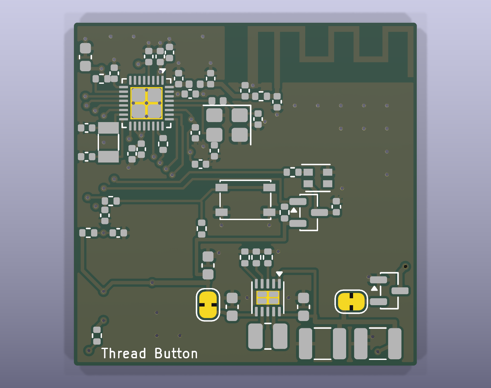
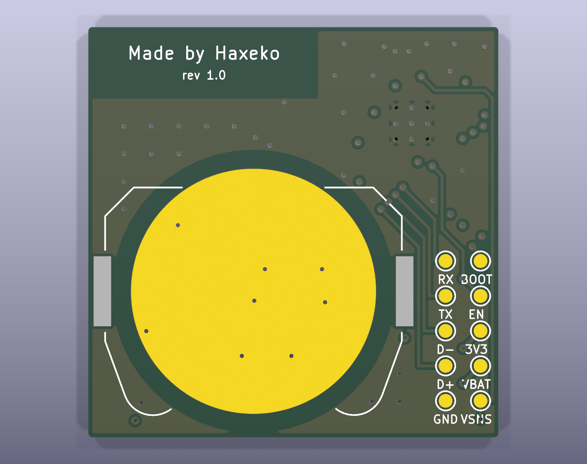
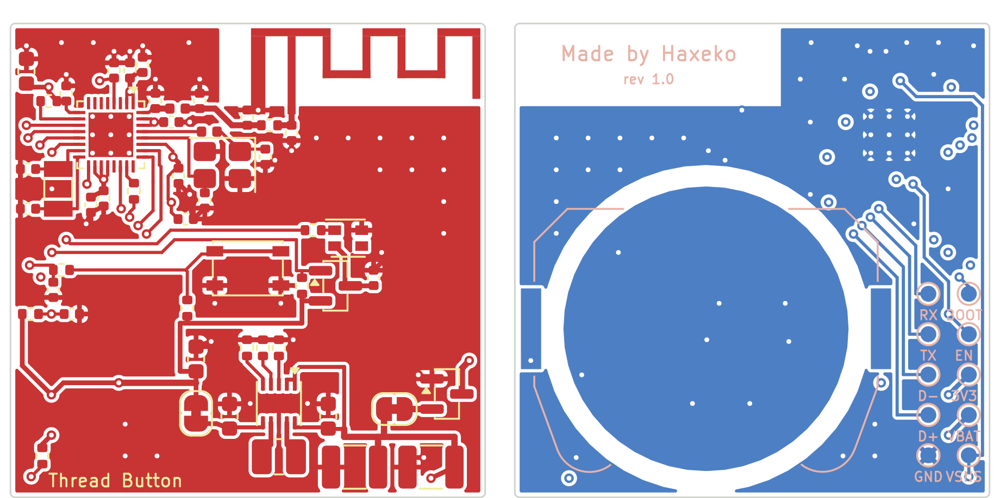

# PCB KiCad: nút nhấn Matter CR2032, chip ESP32-H2 + anten PCB (không dùng module)

Bản "chip-down" của mạch trong [`../hardware`](../hardware/README.md): thay module ESP32-H2-WROOM-02C bằng **chip ESP32-H2FH4** (QFN32 4 × 4 mm, flash 4 MB trong chip) cùng các linh kiện mà module có sẵn bên trong: **thạch anh 32 MHz**, mạch phối hợp RF, **anten in trên PCB** (TI AN043). Thêm **thạch anh 32,768 kHz** cho đồng hồ RTC khi ngủ, và **LED RGB nhỏ giao thức WS2812B** (XL-2121RGBC-WS2812B, 2,1 × 2,1 mm) thay cho LED đỏ. Phần pin CR2032, chống ngược cực, TPS63900, nút nhấn, đo pin và pad test giữ nguyên như bản module (cùng ký hiệu, cùng giá trị). Mọi file được sinh bằng script trong `scripts/` từ một nguồn dữ liệu duy nhất (`scripts/design.py`), rồi kiểm tra bằng KiCad:

- **ERC: 0 lỗi, 0 cảnh báo.**
- **DRC: 0 vi phạm, 0 pad chưa nối, 0 lỗi footprint, 0 lệch giữa PCB và schematic** (`kicad-cli pcb drc --severity-all --schematic-parity`, KiCad 9.0.9).

Chưa đặt mạch, chưa đo trên bo thật. Bản chip có thêm hai việc mà bản module không cần: **chỉnh anten** (mạng π C24/R11/C25, cần máy phân tích mạng VNA) và **kiểm tra tần số thạch anh** (tụ tải C18/C19), xem [mục 6](#6-hiệu-chỉnh-khi-có-bo). Sau đó chạy [checklist](../docs/test-checklist.md): mục A–N như bản module, thêm mục O cho bo chip.

| Mặt trên | Mặt dưới |
|---|---|
|  |  |

Đồng và silkscreen (mặt dưới nhìn từ dưới lên, đã lật):



## 1. File

| File | Nội dung |
|---|---|
| `matter-button-cr2032-chip.kicad_pro/.kicad_sch/.kicad_pcb` | dự án KiCad 9 (mở bằng KiCad ≥ 9.0) |
| `matter-button-cr2032-chip.kicad_dru` | luật riêng: cho phép courtyard của linh kiện 0402/0603, QFN, thạch anh, SOT-23, LED, anten và cầu hàn chồng nhau (bo dày linh kiện; thân linh kiện không chồng nhau, khe hở đồng vẫn được kiểm tra đủ) |
| `lib/matter_button_chip.kicad_sym`, `lib/matter_button_chip.pretty/` | linh kiện riêng: symbol + footprint ESP32-H2FH4 (QFN32, 9 via nhiệt 0,3 mm), anten MIFA TI AN043, LED XL-2121RGBC-WS2812B, đế Keystone 3034 (bản sửa), power symbol VBAT |
| `fab/matter-button-cr2032-chip-gerber.zip` | Gerber 4 lớp đồng (`.gtl`, `.g1` = L2, `.g2` = L3, `.gbl`; không thuộc tính X2, theo hướng dẫn KiCad của JLCPCB) + khoan Excellon (một cỡ lỗ 0,3 mm) |
| `fab/bom-vi.csv` | BOM theo tên và thông số linh kiện (tiếng Việt), kèm từ khóa tìm mua, mã LCSC và linh kiện thay thế |
| `fab/bom-jlcpcb.csv`, `fab/cpl-jlcpcb.csv` | BOM (mã LCSC + MPN) và file vị trí linh kiện (tên cột theo JLCPCB) cho dịch vụ lắp ráp; không có BT1 (hàn tay) |
| `fab/bom.csv` | BOM đầy đủ (MPN, mã LCSC, mô tả), C24/C25 ghi DNP |
| `docs/schematic.pdf` | schematic KiCad |
| `docs/assembly-top.svg`, `docs/assembly-bottom.svg` | bản vẽ lắp ráp: viền linh kiện + ký hiệu (C24, C25 gạch chéo: không lắp) |
| `docs/pcb-*.png` | ảnh render 3D (không có model linh kiện) và layout 2D |
| `scripts/` | các script sinh toàn bộ dự án (mục 8) |

## 2. Khác gì bản module

| | Bản module ([`../hardware`](../hardware/README.md)) | Bản chip (thư mục này) |
|---|---|---|
| Vi điều khiển | ESP32-H2-WROOM-02C (LCSC không có, hàn tay) | **ESP32-H2FH4** QFN32 4 × 4 mm (C22470214, JLCPCB lắp được) |
| Anten | anten PCB của module, chìa ra ngoài mép bo 6 mm | **anten in trên bo** (TI AN043, F ngược uốn khúc 15,2 × 5,2 mm) ở góc trên phải, nằm trong bo |
| Thạch anh | trong module | **32 MHz ±10 ppm** (Y1, cuộn 24 nH nối tiếp ở XTAL_P theo Espressif) + **32,768 kHz** (Y2, RTC) |
| RF | trong module | lọc CLC sát chân 32 (C22 1,5 pF, L3 2,4 nH, C23 1,5 pF), đường 50 Ω, mạng π chỉnh anten (C24, R11 0 Ω, C25) |
| LED | đỏ, GPIO22 | **RGB XL-2121RGBC-WS2812B**: dữ liệu GPIO12 qua R12 100 Ω; nguồn LED đóng/cắt bằng Q2 (AO3401A) từ GPIO11, mức thấp = bật |
| Bo | 2 lớp 1,6 mm; 29,8 × 23,9 mm + anten 6 mm | **4 lớp 1,0 mm; 29,8 × 29,8 mm**, anten nằm trong bo |
| Firmware | `sdkconfig.defaults` | thêm **`sdkconfig.defaults.chip`** (thạch anh 32 kHz, LED RGB) |
| Lắp ráp JLCPCB | trừ U1, BT1 | chỉ trừ BT1 |

**Không có LED kiểu WS2812 nào thuộc nhóm Basic của JLCPCB**: tìm WS2812, SK6812, SK6805, WS2813, WS2815, XL-1615/2020/2121 trong thư viện lắp ráp của JLCPCB (10/2026), tất cả kết quả đều là Extended. Mạch chọn XL-2121RGBC-WS2812B (LCSC C5349957, LCSC ghi tên XL-2121RGBC-2812B; còn ~51 000 con, ~0,12 USD), loại 2,1 × 2,1 mm nhỏ và chạy được ở 3,3 V (datasheet: VDD 3,0–5,5 V, DI mức cao ≥ 0,65 VDD).

LED dạng WS2812 tiêu thụ **0,7 mA ngay cả khi tắt** (IC điều khiển bên trong), gấp ~20 lần dòng ngủ của cả mạch, nên nguồn LED đi qua Q2: GPIO11 kéo xuống thấp chỉ khi LED sáng, R8 100 kΩ giữ Q2 tắt lúc reset và khi chip ngủ. Firmware giữ đường dữ liệu ở mức thấp khi LED tắt nguồn, để không cấp ngược vào LED qua chân DI.

## 3. Thông số bo

| Mục | Giá trị |
|---|---|
| Kích thước | **29,8 × 29,8 mm** (dưới 30 × 30 mm), góc bo R0,3; anten nằm trong bo; không có lỗ bắt vít |
| Lớp | **4 lớp FR-4 1,0 mm**, stack-up JLCPCB **JLC04101H-7628** (L1–L2: prepreg 7628 0,21 mm, εr 4,4; lõi 0,5 mm; đồng ngoài 1 oz, trong 0,5 oz) |
| Dùng lớp | L1: linh kiện, tín hiệu, đường RF · **L2: GND liền, không có đường mạch** (tham chiếu của đường RF, thạch anh, chip) · L3: vùng 3,3 V dưới chip, trục 3,3 V, vài đường dài (BOOT, nút, LED, VBAT), còn lại GND · L4: đế pin, pad test, đường xuống pad test, GND |
| Đường RF | đồng phẳng có đất (grounded coplanar) 50 Ω trên L1: rộng **0,38 mm**, khe 0,2 mm tới đồng GND hai bên, mặt đất L2 bên dưới |
| Đường mạch | 0,2 mm tín hiệu; 0,3–0,4 mm nguồn và GND; khe hở 0,15 mm (bước chân 0,4 mm của chip), 0,2 mm tới vùng đồng |
| Via | 0,6 / 0,3 mm, phủ mask (tented); 9 via nhiệt 0,3 mm trong pad GND giữa của chip (theo footprint KiCad) |
| Cách mép bo | đồng ≥ 0,3 mm |
| Bề mặt | **ENIG** khuyến nghị: chip QFN bước 0,4 mm, WSON bước 0,5 mm, pad tiếp xúc âm của pin là đồng trần |
| GND | đồng GND cả 4 lớp (trừ vành quanh mép pin ở L4 và vùng anten ở mọi lớp), 16 via khâu; mỗi tụ lọc có via GND riêng |
| Linh kiện | mặt trên tất cả, trừ đế pin BT1 ở mặt dưới; 10 pad test Ø1,0 mm ở mặt dưới |

Các thông số nằm trong quy trình chuẩn 4 lớp của JLCPCB (track/space 0,09 mm, lỗ 0,15 mm tối thiểu), không cần tùy chọn đặc biệt.

## 4. Bố trí

| Vùng | Linh kiện | Lý do |
|---|---|---|
| Góc trên phải | anten AE1 (x 13,1–29,8, y 0–5,2): không đồng, không via ở mọi lớp trong vùng này | anten F ngược cần mép đất thẳng ngay dưới nó (đồng GND cả 4 lớp, via khâu ngay dưới mép đất) |
| Góc trên trái | U1 ESP32-H2 (chân 32 = ANT quay về phía anten); tụ lọc sát từng chân nguồn (C6, C10, C11 ở chân 1–2; C12 ở 30–31; C13, C14 ở 27; C15 ở 18–19; C16 ở 20; C17 ở 9); R5 kéo lên GPIO8 | đường RF ngắn nhất: C22–L3–C23 sát chân 32, đường 50 Ω chạy ngay dưới mép đất tới mạng π C24/R11/C25 ở chân feed của anten |
| Phải chip | Y1 32 MHz + L2 24 nH + C18/C19 | thạch anh sát chân 28/29, nằm trên L2 GND liền |
| Trái chip | Y2 32,768 kHz + C20/C21 sát chân 15/16 | |
| Dải trái (x < 7,5 mm) | R7/C8 (lọc nút), R4/C7 (trễ EN), R9 (đo pin); 10 pad test ở mặt dưới | via tín hiệu chỉ đặt được ngoài vùng pin (mục 7) |
| Giữa bo | SW1 PTS810; LED D1 + Q2, R8, R12, C26 bên phải nút; R6 kéo lên ở góc dưới trái nút | dữ liệu và cổng Q2 đi trên lớp trên vòng qua phía trên nút; 3,3 V tới từ phía dưới |
| Dưới giữa | TPS63900: R1–R3 phía trên, C4 (VOUT) trái, C3 (VIN) phải, L1 phía dưới; C5, JP2 bên trái | như bản module |
| Góc dưới phải | Q1, JP1, C1, C2 | chuỗi nguồn: tai + của đế pin → Q1 → JP1 → C1/C2 → C3/U2 → C4 → JP2 → 3,3 V |
| Mặt dưới | đế pin Keystone 3034, tâm (17,8; 19,2), sát mép dưới và mép phải; 10 pad test ở dải trái | pad tiếp xúc âm là một phần GND; vành 8,95–10,3 mm quanh tâm pin không có đồng (mép vỏ pin là cực +) |

Chữ in: "Thread Button" ở góc dưới trái mặt trên; "Made by Haxeko" và số rev ở mặt dưới, dưới vùng anten (mặt dưới ở đó không có đồng); nhãn pad test ngay dưới mỗi pad.

Tọa độ (mm, gốc ở góc trên trái, nhìn từ mặt trên; nhìn từ mặt dưới thì trái/phải đảo lại) để thiết kế vỏ và jig:

| Vật | Tọa độ |
|---|---|
| Tâm nút SW1 (thân 4,2 × 3,2 mm) | (14,9; 15,4) |
| Tâm LED D1 (2,1 × 2,1 mm) | (21,2; 13,5) |
| Tâm đế pin BT1 (mặt dưới) | (17,8; 19,2); pin Ø20 mm: x 7,8–27,8, y 9,2–29,2 |
| Pad test (mặt dưới, Ø1,0 mm, lưới 2,54 mm) | cột x = 1,30: y = 17,00 BOOT · 19,54 EN · 22,08 3V3 · 24,62 VBAT · 27,16 VSNS; cột x = 3,84: y = 17,00 RX · 19,54 TX · 22,08 D− · 24,62 D+ · 27,16 GND |
| Cầu hàn đo dòng JP1 / JP2 | (24,1; 24,25) / (11,65; 24,52) |
| Chip U1 / chân feed anten | (6,3; 7,0) / (17,65; 5,45) |
| Vùng anten | x 13,1–29,8, y 0–5,2 |

Chiều cao: bo 1,0 mm; chiều cao nút PTS810, LED (1,0 mm) và đế pin Keystone 3034 lấy theo datasheet. Trong vỏ: không đặt kim loại (vít, lò xo, tấm che) trong ~15 mm quanh vùng anten; ngón tay và vỏ nhựa cũng làm lệch cộng hưởng một ít, nên chỉnh anten khi bo đã nằm trong vỏ (mục 6).

**Đánh đổi:** pin CR2032 (vỏ kim loại) nằm ngay dưới mép đất của anten (mép trên của pin cách mép đất 4 mm, không nằm dưới anten). Như bản module, đây là cái giá để cả bo dưới 30 × 30 mm; kiểm tra RSSI/LQI của parent sau khi chỉnh anten (checklist mục C).

## 5. Đặt mạch và lắp ráp

1. **PCB**: tải `fab/matter-button-cr2032-chip-gerber.zip` lên JLCPCB: **4 lớp, 1,0 mm**, stack-up **JLC04101H-7628** (mặc định của 4 lớp 1,0 mm; độ rộng đường RF 0,38 mm tính theo stack-up này), **ENIG**, via phủ mask. Không cần đặt kiểm soát trở kháng (đường RF chỉ ~9 mm).
2. **Lắp ráp JLCPCB**: chọn lắp mặt trên (Top side), tải `fab/bom-jlcpcb.csv` và `fab/cpl-jlcpcb.csv`. Mọi dòng BOM có mã LCSC nên được ghép tự động: **16 loại Basic, 11 loại Extended** (phí nạp tính theo loại): U1 C22470214, U2 C1518762, L1 C391305, C1/C2 C469553, R1 C49010116, Y1 C90923, L2 C74301, L3 C97997, C22/C23 C76957, SW1 C116501, D1 C5349957. Hàng tồn thấp lúc kiểm tra (10/2026): SW1 ~970, U1 ~2 100, Y1 ~2 200; Y2 (C32346) là Basic. SW1 phải là bản **SJM** (160 gf). C24, C25 không lắp (DNP).
   - **Kiểm tra góc xoay ở bản xem trước** của JLCPCB, nhất là U1 (chấm chân 1 ở góc trên phải khi nhìn bo theo chiều chữ "Thread Button"), D1 (góc vát = chân 1 DI), Q1/Q2, U2, Y1, SW1.
   - **BT1 không có ở LCSC**: hàn tay sau khi nhận bo (2 tai lớn ở mặt dưới, dễ hàn).
3. **JP1, JP2** là cầu hàn đã nối sẵn bằng đồng: cắt đường đồng nhỏ giữa hai pad để đo dòng (nối ampe kế vào hai pad), đo xong hàn nối lại.
4. Cấp nguồn lần đầu và nạp firmware **bản chip** (`sdkconfig.defaults.chip`, [README chính mục 8](../README.md#8-build-flash-commissioning-windows-powershell)): nạp qua USB bằng pad D+/D− (USB Serial/JTAG của ESP32-H2, không cần BOOT/EN), hoặc qua UART0 (pad TX/RX, giữ BOOT ở GND rồi chạm EN). Khi có pin, **không** cấp 3V3 vào pad 3V3.

## 6. Hiệu chỉnh khi có bo

Ba thứ mà module đã được Espressif chỉnh sẵn, bản chip phải tự làm trên bo thật:

1. **Anten.** AN043 được thiết kế cho bo 1,0 mm (giống bo này) nhưng với mặt đất và vỏ khác, nên tần số cộng hưởng sẽ lệch. Đo S11 ở chân feed bằng VNA: tháo R11, hàn một sợi cáp đồng trục nhỏ (lõi vào pad R11 phía anten, vỏ vào GND bên cạnh), lắp bo vào vỏ và pin như khi dùng. Chọn mạng π (C24 song song, R11 nối tiếp → L hoặc C, C25 song song) để anten khớp 50 Ω ở 2,40–2,48 GHz (S11 < −10 dB). Bản đầu để R11 = 0 Ω, C24/C25 trống.
2. **Lọc RF ở chân 32** (C22, L3, C23): giá trị ban đầu theo hướng dẫn phần cứng của Espressif; đo công suất phát và hài bằng ESP RF Test Tool (dẫn qua cáp như trên) và chỉnh theo hướng dẫn đó.
3. **Thạch anh 32 MHz**: phát sóng mang đơn (TX tone, ESP RF Test Tool), đo tần số bằng máy phân tích phổ; lệch phải nằm trong **±10 ppm** (Espressif yêu cầu cho 802.15.4/BLE). Lệch dương → tăng C18/C19, lệch âm → giảm (bắt đầu 18 pF, CL 12 pF). Thạch anh 32,768 kHz: firmware bản chip dùng nó làm đồng hồ RTC; nếu thạch anh không dao động, bootloader tự chuyển về bộ dao động RC trong chip (log lúc khởi động báo điều này).

## 7. Ghi chú thiết kế

- **ESP32-H2FH4**: footprint KiCad VQFN-32 4 × 4 mm, pad GND giữa 2,8 mm với 9 via nhiệt, lỗ 0,3 mm (bản gốc của KiCad 0,2 mm) để cả bo chỉ có một cỡ lỗ. Tụ lọc theo schematic mẫu của Espressif (ESP32-H2 Hardware Design Guidelines) và bo Waveshare ESP32-H2-Zero. Chân 18 (VBAT, nguồn RTC) nối 3V3, không nối thẳng vào pin.
- **Strapping**: GPIO8 kéo lên bằng R5 10 kΩ; GPIO9 (BOOT) có kéo lên trong chip + pad TP6; GPIO25 để hở. EN trễ bằng R4 10 kΩ + C7 1 µF.
- **Chân GPIO**: nút GPIO10 (chân 12, LP IO, đánh thức khi Light-sleep); LED: cổng Q2 GPIO11 (chân 13), dữ liệu GPIO12 (chân 14) — cả hai không có kéo lên/xuống lúc reset (datasheet bảng 2-1); đo pin GPIO1 (chân 4, ADC1); UART0 chân 22/23 (TX qua R10 510 Ω); USB chân 25/26.
- **Anten AN043**: chép đúng kích thước bảng 1 của TI (W1 0,9; W2 0,5; L1 3,94; L2 2,7; L3 5,0; L4 2,64; L5 2,0; L6 4,9; D1 0,5; D2 0,3; D3 0,3; D4 0,5; D5 1,4; D6 1,7 mm). Vùng không đồng mở rộng thêm 1,5 mm bên trái anten. Chân ngắn mạch xuống GND có via.
- **Lớp L3**: vùng 3,3 V dưới chip nối mọi via 3V3 của các tụ lọc; trục 3,3 V rộng 0,4 mm từ C5/JP2 (via ở dải trái) lên vùng này; phần còn lại là GND, có vài đường dài (BOOT, nút, LED dọc mép trái, VBAT dọc mép dưới). L2 không có đường mạch nào.
- **Dưới pin**: vành quanh mép pin ở L4 là vùng cấm (không đường mạch, không via, không đồng) vì mép vỏ CR2032 là cực +; via GND chỉ đặt bên trong pad tiếp xúc âm hoặc ngoài pin; **via tín hiệu chỉ đặt ngoài pin** (cách tâm pin > 10,6 mm), nên các đường qua vùng pin đi trên lớp trên hoặc L3. Tai trái của đế pin (một phần lá kẹp +) không nối mạch, như bản module.
- **Đi dây**: mọi đường trừ GND được vẽ trong script (`ROUTES`, `VIAS` trong `gen_pcb.py`, đều khóa), không dùng autorouter; GND do đồng phủ 4 lớp nối.

## 8. Sinh lại dự án từ script

Cần KiCad 9 (`kicad-cli` và module Python `pcbnew`). Trên Windows chạy trong "KiCad 9.0 Command Prompt" (Python kèm KiCad có `pcbnew`), gõ `python` thay cho `python3`.

```bash
cd ESP32-H2/matter-thread/matter-button-cr2032/hardware-chip
python3 scripts/gen_project.py          # .kicad_pro (luật, net class), .kicad_dru, lib/, bảng thư viện
python3 scripts/gen_sch.py              # .kicad_sch
python3 scripts/gen_pcb.py all          # .kicad_pcb: viền bo, vị trí, đường mạch, vùng cấm, đồng GND, via khâu
python3 scripts/gen_fab.py              # ERC + DRC (dừng nếu có lỗi), fab/, docs/
```

Chỉ đổi giá trị hoặc mã linh kiện (cùng footprint, cùng net) trong `design.py`: chạy `gen_sch.py`, rồi `python3 scripts/gen_pcb.py sync` (cập nhật giá trị và trường MPN/LCSC trên bo, không đặt lại), rồi `gen_fab.py`.

| Script | Việc |
|---|---|
| `design.py` | dữ liệu duy nhất: linh kiện, giá trị, MPN, mã LCSC, footprint, chân → net, vị trí trên schematic |
| `gen_project.py` | file dự án (luật thiết kế, net class Default 0,2 mm / Power 0,3 mm / Ground / RF 0,38 mm), luật courtyard, thư viện riêng (footprint chip, anten, LED) |
| `gen_sch.py` | schematic A3 một trang: mỗi chân có đoạn dây ngắn tới nhãn net hoặc ký hiệu nguồn |
| `gen_pcb.py` | board từ netlist do `kicad-cli` xuất ra (giống "Update PCB from Schematic"); bảng `PLACE` (vị trí), `ROUTES`/`VIAS` (đường mạch); bước `pour` phủ đồng GND 4 lớp, vùng 3,3 V ở L3, via khâu; bước `sync` chỉ cập nhật giá trị và mã linh kiện |
| `gen_fab.py` | kiểm tra và xuất file sản xuất (ảnh layout 2D cần thêm `pip install cairosvg pillow`) |

Sửa tay trong KiCad cũng được (sau đó không chạy lại `gen_pcb.py place`, vì nó ghi đè `.kicad_pcb`); chạy `python3 scripts/gen_pcb.py pour` để phủ đồng và via khâu lại, rồi `gen_fab.py`.

## 9. Tài liệu tham khảo

- [ESP32-H2 Datasheet v1.3](https://documentation.espressif.com/esp32-h2_datasheet_en.pdf) (chân, trạng thái chân lúc reset, nguồn, footprint QFN32)
- [ESP32-H2 Hardware Design Guidelines](https://docs.espressif.com/projects/esp-hardware-design-guidelines/en/latest/esp32h2/) (schematic mẫu, tụ lọc, thạch anh, phối hợp RF, bố trí PCB)
- [Waveshare ESP32-H2-Zero schematic](https://files.waveshare.com/wiki/ESP32-H2-Zero/ESP32-H2-Zero-Schematic.pdf) (bo ESP32-H2 chip-down nhỏ, để đối chiếu)
- [TI AN043: Small Size 2.4 GHz PCB antenna](https://www.ti.com/lit/an/swra117d/swra117d.pdf) (kích thước anten)
- [JLCPCB stack-up](https://jlcpcb.com/impedance) và [bảng stack-up JLCPCB](https://github.com/gsuberland/jlcpcb_autogenerated_stackups) (JLC04101H-7628)
- [XL-2121RGBC-WS2812B datasheet](https://www.lcsc.com/datasheet/C5349957.pdf) (LCSC C5349957: thời gian bit, dòng, chân)
