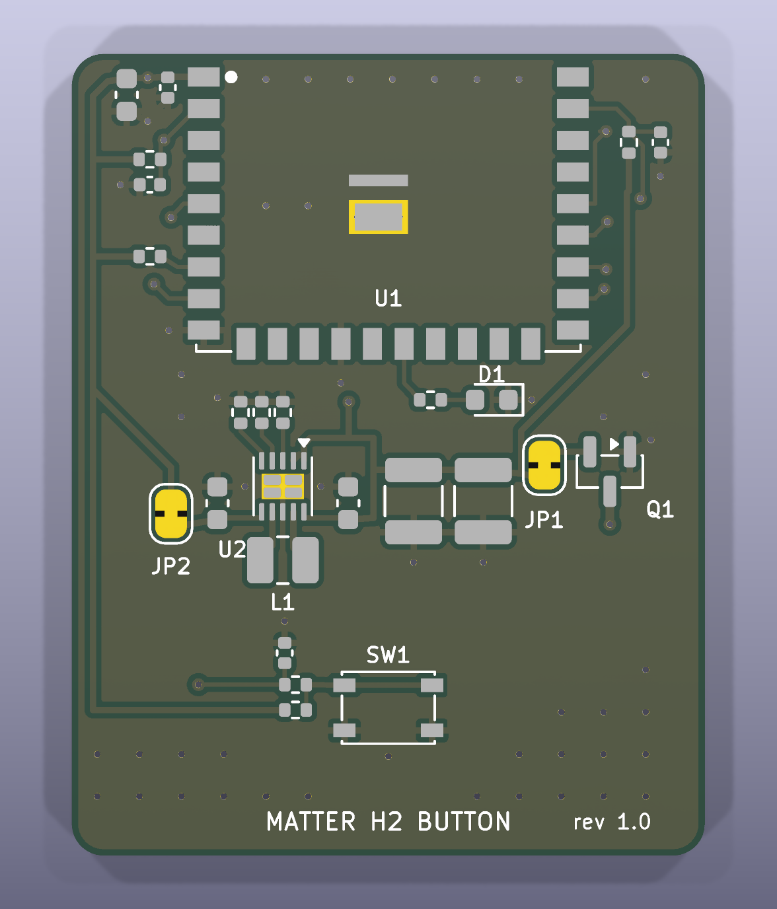
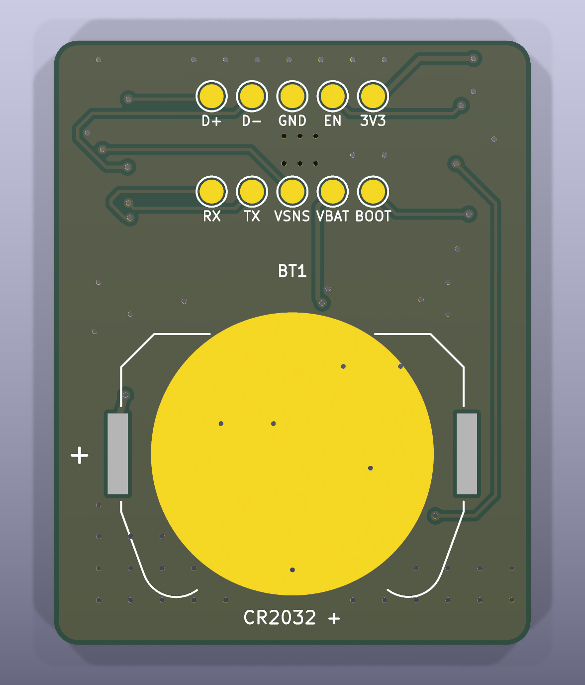
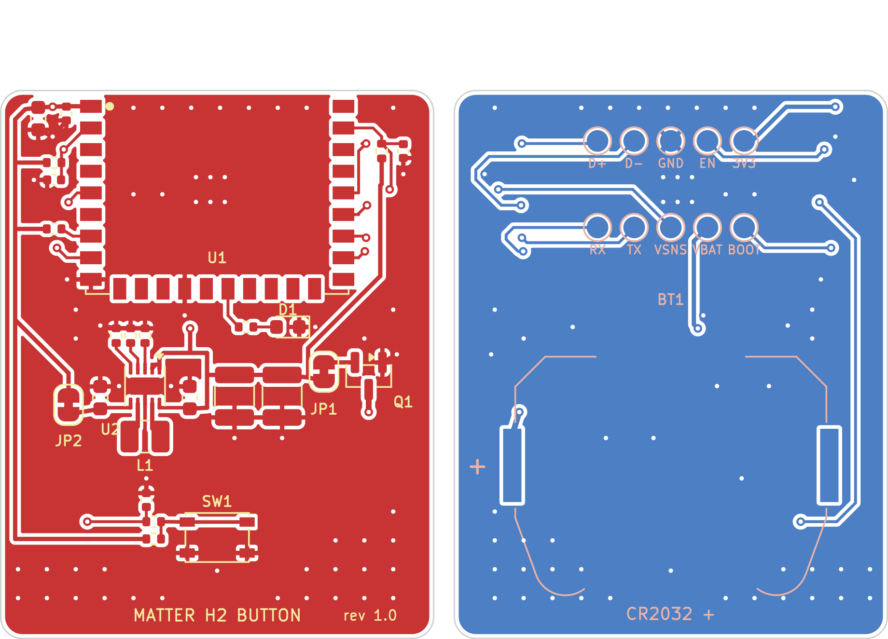

# PCB KiCad: nút nhấn Matter CR2032 (ESP32-H2-WROOM-02C)

Dự án KiCad 9 của mạch trong [README chính](../README.md) (mục 2–4): schematic, PCB 2 lớp đã đi dây, file sản xuất. Mọi file được sinh bằng các script trong `scripts/` từ một nguồn dữ liệu duy nhất (`scripts/design.py`), rồi kiểm tra bằng KiCad:

- **ERC: 0 lỗi, 0 cảnh báo.**
- **DRC: 0 vi phạm, 0 pad chưa nối, 0 lỗi footprint, 0 lệch giữa PCB và schematic** (`kicad-cli pcb drc --severity-all --schematic-parity`, KiCad 9.0.9).

Chưa đặt mạch, chưa đo trên bo thật: kiểm tra lại footprint module với datasheet trước khi đặt và chạy [checklist](../docs/test-checklist.md) khi có bo.

| Mặt trên | Mặt dưới |
|---|---|
|  |  |

Đồng và silkscreen (mặt dưới nhìn từ dưới lên, đã lật):



## 1. File

| File | Nội dung |
|---|---|
| `matter-button-cr2032.kicad_pro/.kicad_sch/.kicad_pcb` | dự án KiCad 9 (mở bằng KiCad ≥ 9.0) |
| `lib/matter_button.kicad_sym`, `lib/matter_button.pretty/` | linh kiện riêng: symbol + footprint ESP32-H2-WROOM-02C, power symbol VBAT, đế Keystone 3034 (bản sửa) |
| `fab/matter-button-cr2032-gerber.zip` | Gerber X2 + khoan Excellon: gửi thẳng cho nhà sản xuất PCB |
| `fab/bom.csv`, `fab/cpl.csv` | BOM (theo MPN) và file vị trí linh kiện (tên cột theo JLCPCB) cho dịch vụ lắp ráp |
| `docs/schematic.pdf` | schematic KiCad |
| `docs/assembly-top.svg`, `docs/assembly-bottom.svg` | bản vẽ lắp ráp: viền linh kiện + ký hiệu (C7 gạch chéo: không lắp) |
| `docs/pcb-*.png` | ảnh render 3D (không có model linh kiện) và layout 2D |
| `scripts/` | các script sinh toàn bộ dự án (mục 6) |

## 2. Thông số bo

| Mục | Giá trị |
|---|---|
| Kích thước | **30 × 38 mm**, góc bo R1,5; anten module chìa ra 6 mm ở mép trên → cả cụm **30 × 44 mm** |
| Lớp | 2 lớp FR-4 1,6 mm, đồng 1 oz |
| Đường mạch | 0,2 mm tín hiệu, 0,3 mm nguồn và GND, 0,4 mm cực + pin; khe hở 0,2 mm (tối thiểu 0,15 mm ở pad của linh kiện) |
| Via | 0,6 / 0,3 mm, phủ mask; via nhiệt trong pad GND của module theo land pattern datasheet |
| Cách mép bo | đồng ≥ 0,3 mm |
| Bề mặt | **ENIG** khuyến nghị: pad tiếp xúc âm của pin là đồng trần, chân WSON bước 0,5 mm |
| GND | phủ đồng cả hai mặt, mỗi pad GND có via riêng xuống mặt dưới, thêm ~40 via khâu |
| Linh kiện | mặt trên tất cả, trừ đế pin BT1 ở mặt dưới; 10 pad test ở mặt dưới |

Các thông số nằm trong quy trình tiêu chuẩn của JLCPCB / PCBWay (track/space 0,127 mm, lỗ 0,3 mm), không cần tùy chọn đặc biệt.

## 3. Bố trí

| Vùng | Linh kiện | Lý do |
|---|---|---|
| Mép trên | U1 ESP32-H2-WROOM-02C, vùng anten 6 mm **nhô ra ngoài mép bo** | không đồng, không FR-4 dưới anten (datasheet WROOM-02C mục 11, ESP32-H2 Hardware Design Guidelines); mặt phẳng GND chạy tới sát mép, đúng chân anten |
| Trái module | C6 100 nF sát chân 1, C5 10 µF; R4 (+ C7 không lắp) ở EN; R5 kéo lên GPIO8 | trục 3V3 chạy dọc mép trái từ JP2 lên chân 1 |
| Phải module | R9 1 MΩ + C9 100 nF đo pin ở GPIO1 | |
| Dưới module | R1–R3 cấu hình TPS63900; LED D1 + R8 (GPIO22) | đặt ống dẫn sáng ở tọa độ D1 |
| Giữa | chuỗi nguồn phải → trái: Q1 → JP1 → C2, C1 → C3 → U2 (L1 ngay dưới) → C4 → JP2 | vòng VIN (C3) và VOUT (C4) ngắn trên lớp trên, cuộn cảm sát LX1/LX2, pad tản nhiệt của U2 nối chân GND 8 và hai via |
| Nửa dưới | SW1 PTS810 ở giữa; R7, C8 (lọc RC) và R6 (kéo lên 470 kΩ) cạnh nút | GPIO10 đi ở lớp dưới dọc mép trái |
| Mặt dưới | đế pin Keystone 3034, tâm cách mép trên 26 mm | mép pin cách chân anten ~16 mm; pad tiếp xúc âm Ø17,8 mm là một phần mặt phẳng GND |
| Mặt dưới, dưới module | 10 pad test Ø1,5 mm, 2 hàng × 5, bước 2,54 mm | kẹp pogo-pin; nhãn in ở mặt dưới |

Tọa độ (mm, gốc ở góc trên trái, nhìn từ mặt trên; nhìn từ mặt dưới thì thứ tự pad test ngược lại) để thiết kế vỏ và jig:

| Vật | Tọa độ |
|---|---|
| Tâm nút SW1 (thân 4,2 × 3,2 mm) | (15,0; 31,0) |
| Tâm LED D1 | (19,9; 16,4) |
| Tâm đế pin BT1 (mặt dưới) | (15,0; 26,0) |
| Pad test, hàng 1 (y = 3,5) | x = 9,92 3V3 · 12,46 EN · 15,00 GND · 17,54 USB D− · 20,08 USB D+ |
| Pad test, hàng 2 (y = 9,5) | x = 9,92 BOOT · 12,46 VBAT · 15,00 VBAT_SENSE · 17,54 TXD0 · 20,08 RXD0 |
| Module: mép anten / chân anten | y = −6 / y = 0 (mép bo) |

Chiều cao: module 3,2 mm trên bo 1,6 mm; chiều cao nút PTS810 và đế pin Keystone 3034 lấy theo datasheet của chúng. Trong vỏ: không đặt kim loại (vít, lò xo, tấm che) trong ~15 mm quanh anten; kiểm tra RSSI/LQI của parent khi đã đóng vỏ (checklist mục C).

## 4. Đặt mạch và lắp ráp

1. **PCB**: tải `fab/matter-button-cr2032-gerber.zip` lên JLCPCB/PCBWay: 2 lớp, 1,6 mm, ENIG, các mục khác để mặc định.
2. **Lắp ráp (tùy chọn)**: tải `fab/bom.csv` và `fab/cpl.csv`. File không có mã LCSC: chọn linh kiện theo cột MPN. Kiểm tra góc xoay ở bản xem trước của nhà sản xuất (thường phải chỉnh U1, U2, Q1, D1). BT1 nằm mặt dưới: chọn lắp hai mặt, hoặc tự hàn (2 tai lớn, dễ hàn tay). C7 không lắp (DNP).
3. **JP1, JP2** là cầu hàn đã nối sẵn bằng đồng: cắt đường đồng nhỏ giữa hai pad để đo dòng (nối ampe kế vào hai pad), đo xong hàn nối lại.
4. Cấp nguồn lần đầu, nạp firmware: [README chính mục 8.3](../README.md#83-nạp-firmware) và [checklist](../docs/test-checklist.md). Khi có pin, **không** cấp 3V3 vào pad 3V3.

## 5. Ghi chú thiết kế

- **Footprint ESP32-H2-WROOM-02C** tự vẽ theo land pattern datasheet v1.2 mục 11.1: pad 1,5 × 0,9 mm bước 1,5 mm; chân 1–9 trái, 10–19 dưới, 20–28 phải; pad GND 29 gồm hai phần 2,8 × 0,55 và 2,8 × 1,6 mm với 6 via nhiệt (phủ mask mặt dưới). Gốc tọa độ là tâm module, vùng anten y = −10 … −4 có keep-out mọi lớp đồng. Silkscreen chỉ vẽ góc dưới và chấm chân 1 (vùng anten nằm ngoài bo).
- **TPS63900**: symbol chuẩn của KiCad đã có chân 11 (pad tản nhiệt) ẩn, chồng lên chân GND 8. Footprint WSON-10 không có via trong pad (TI: via là tùy chọn); pad tản nhiệt nối chân 8 bằng đường mạch, rồi ra hai via GND hai bên.
- **Keystone 3034**: footprint chuẩn có hai pad cùng số "1" (hai tai của cùng một lá kim loại); KiCad 9 sẽ đòi nối đồng giữa chúng vòng qua pin. Bản trong `lib/` bỏ số của tai trái (nhìn từ trên), tai này chỉ để hàn giữ.
- **Ký hiệu linh kiện** trên silkscreen chỉ có ở linh kiện lớn; điện trở, tụ 0402/0603 quá dày, xem `docs/assembly-*.svg`.
- **Đi dây**: phần TPS63900 bước 0,5 mm, trục 3V3, nút nhấn, LED, đo pin, cực pin và mọi via GND được vẽ trong script (khóa); FreeRouting đi phần còn lại (các pad test, VBAT tới R9, UART/USB). GND không qua autorouter: phủ đồng hai mặt nối tất cả.

## 6. Sinh lại dự án từ script

Cần KiCad 9 (`kicad-cli` và module Python `pcbnew`), Java 21 và [FreeRouting 2.1.0](https://github.com/freerouting/freerouting/releases) (`freerouting-2.1.0.jar`). Trên Windows chạy trong "KiCad 9.0 Command Prompt" (Python kèm KiCad có `pcbnew`): gõ `python` thay cho `python3`, và đặt biến bằng `set FREEROUTING_JAR=C:\đường\dẫn\freerouting-2.1.0.jar` trước lệnh `route`.

```bash
cd ESP32-H2/matter-thread/matter-button-cr2032/hardware
python3 scripts/gen_project.py          # .kicad_pro (luật, net class), lib/, bảng thư viện
python3 scripts/gen_sch.py              # .kicad_sch
python3 scripts/gen_pcb.py place        # .kicad_pcb: viền bo, vị trí, đường vẽ tay, vùng cấm
FREEROUTING_JAR=/đường/dẫn/freerouting-2.1.0.jar python3 scripts/gen_pcb.py route
python3 scripts/gen_fab.py              # ERC + DRC (dừng nếu có lỗi), fab/, docs/
```

| Script | Việc |
|---|---|
| `design.py` | dữ liệu duy nhất: linh kiện, giá trị, MPN, footprint, chân → net, vị trí trên schematic |
| `gen_project.py` | file dự án (luật thiết kế, net class Default 0,2 mm / Power 0,3 mm / Ground), thư viện riêng |
| `gen_sch.py` | schematic A3 một trang: mỗi chân có đoạn dây ngắn tới nhãn net hoặc ký hiệu nguồn |
| `gen_pcb.py` | board từ netlist do `kicad-cli` xuất ra (giống "Update PCB from Schematic"); bảng `PLACE` (vị trí), `ROUTES`/`VIAS` (đi dây tay); bước `route` gọi FreeRouting, dọn đoạn thừa, phủ đồng GND, via khâu |
| `gen_fab.py` | kiểm tra và xuất file sản xuất (ảnh layout 2D cần thêm `pip install cairosvg pillow`) |

FreeRouting không cho cùng một kết quả mỗi lần chạy: sau `route`, `gen_fab.py` chỉ xuất file khi DRC sạch. Sửa tay trong KiCad cũng được (sau đó không chạy lại `gen_pcb.py`, vì nó ghi đè `.kicad_pcb`); chạy `python3 scripts/gen_pcb.py pour` để phủ đồng và via khâu lại, rồi `gen_fab.py`.
