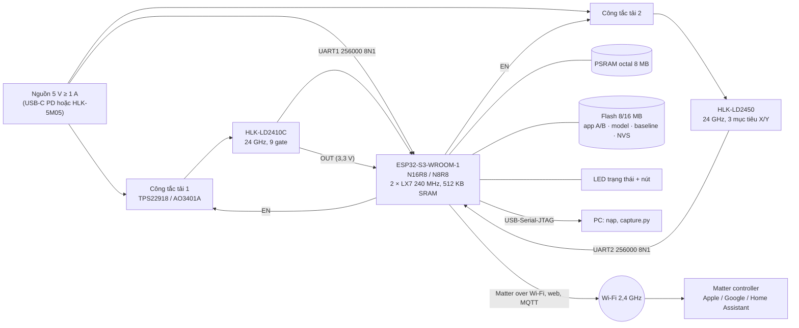
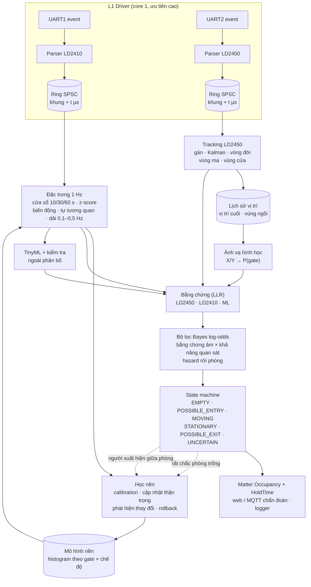
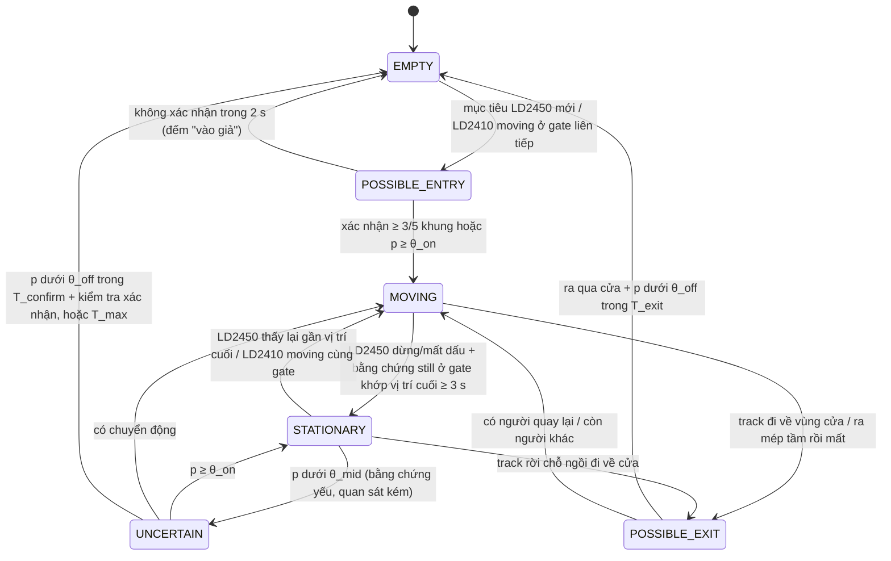

# AI Radar Fusion Presence Sensor — Phương án kỹ thuật tổng thể

ESP32-S3 (N8R8 / N16R8) + HLK-LD2410 (B/C) + HLK-LD2450, Matter over Wi-Fi.

| | |
|---|---|
| Trạng thái | **Phase 1 đang thực hiện**: tài liệu chính thức đã đối chiếu, thư viện giao thức + firmware probe + công cụ PC đã viết và kiểm thử trên máy tính; **chưa có số đo trên radar thật** |
| Tài liệu Phase 1 | `phase1/nguon-tai-lieu.md`, `phase1/giao-thuc-ld2410.md`, `phase1/giao-thuc-ld2450.md`, `phase1/thi-nghiem-phase1.md` |
| Nhãn độ tin cậy | **[TL]** tài liệu chính thức Hi-Link · **[CĐ]** nguồn cộng đồng · **[GT]** giả thuyết cần kiểm chứng (kèm mã thí nghiệm) · **[ĐX]** phương án đề xuất · **[ĐO]** đã đo (chưa có) |

Tài liệu trả lời theo đúng trình tự yêu cầu: (1) khả thi và giới hạn vật lý, (2) kiến trúc, (3) sơ đồ khối phần cứng, (4) sơ đồ xử lý dữ liệu, (5) học phòng trống, (6) nhận diện người ngồi im (kèm state machine và confidence), (7) phân biệt quạt và người, (8) so sánh mô hình AI, (9) dataset và huấn luyện (kèm KPI và cách đo), (10) firmware ESP-IDF (kèm Matter / Home Assistant), (11) linh kiện và đấu nối, (12) roadmap có tiêu chí nghiệm thu.

## 0. Tóm tắt điều hành

1. **Dự án khả thi về phần cứng và tính toán**, với một điều kiện quan trọng: hai radar dùng **cùng băng 24–24,25 GHz FMCW** [TL], Hi-Link chính thức cảnh báo nhiễu lẫn nhau [TL], cộng đồng đã gặp LD2410 báo nhầm khi LD2450 chạy [CĐ]. Phải tìm được bố trí lắp không nhiễu (thí nghiệm E8) **trước** mọi việc khác.
2. **Hai radar bổ sung cho nhau đúng như ý tưởng**, nhưng thông tin ít hơn tưởng: LD2450 chỉ cho tối đa 3 mục tiêu (X, Y, tốc độ) ở 10 Hz, **không có năng lượng** [TL]; LD2410 chỉ cho **năng lượng 0–100 theo 9 gate khoảng cách** (khi bật engineering mode), **không có toạ độ, không có tín hiệu thô**, thuật toán bên trong không công bố [TL]. Không giao thức nào có checksum [TL].
3. **Người ngồi yên 4–6 m là điểm rủi ro nhất**: năng lượng phản xạ giảm theo R⁴ (từ 1 m tới 5 m giảm ~28 dB), Hi-Link ghi "tầm cảm nhận tới 5 m" [TL], LD2450 yếu với người tĩnh ngoài ~2 m [CĐ]. KPI "recall > 95 % ở 4 m" chỉ được xác nhận hoặc sửa sau E6.
4. **AI không tạo ra thông tin không có trong dữ liệu.** Khi quạt và người ở cùng gate, LD2410 có thể không còn tín hiệu phân biệt được; khi đó hệ thống dựa vào lịch sử LD2450 (không thấy ai đi ra) và **logic giữ hiện diện có giới hạn** (§6.4, §6.7), và báo trạng thái `UNCERTAIN` thay vì đoán.
5. **Phương án khuyến nghị: Hybrid** — lõi thống kê (mô hình nền bằng histogram theo gate, bộ lọc Bayes log-odds có trọng số theo khả năng quan sát, state machine 6 trạng thái) + một mô hình TinyML nhỏ (cây quyết định hoặc MLP INT8) chỉ đóng vai **một nguồn bằng chứng có giới hạn**, tắt khi dữ liệu ngoài phân bố huấn luyện. Lõi thống kê được làm trước (Phase 3–4) và luôn là phương án dự phòng.
6. **Matter chuẩn chỉ cần cho trạng thái có/không người** (Occupancy Sensing, HoldTime). Độ tin cậy, năng lượng từng gate, trạng thái radar, mức nhiễu **không có thuộc tính Matter chuẩn** → web UI / REST / MQTT. Điều khiển (calibration, bật/tắt học, rollback) dùng Mode Select như các project LD2410 hiện có trong repo (hiện trong Home Assistant, không hiện trong Apple Home).

## 1. Đánh giá tính khả thi và giới hạn vật lý

### 1.1 Năng lực dữ liệu của hai radar

| | HLK-LD2410 / B / C | HLK-LD2450 |
|---|---|---|
| Băng tần, điều chế, băng quét | 24–24,25 GHz, FMCW, 250 MHz [TL] | 24–24,25 GHz, FMCW, 250 MHz [TL] |
| Anten | không nêu trong tài liệu | 1 phát 2 thu [TL] |
| Đầu ra | trạng thái mục tiêu; khoảng cách + năng lượng tổng của mục tiêu chuyển động và đứng yên; **engineering mode: năng lượng moving và still của 9 gate** (0,75 m hoặc 0,2 m mỗi gate); B/C: giá trị ánh sáng, trạng thái chân OUT [TL] | tối đa **3 mục tiêu**: X, Y (mm), tốc độ (cm/s); không có năng lượng, gate, ngưỡng [TL] |
| Tần suất | **không ghi** (repo đo ~10 Hz trên H2/C3) → E1 | **10 khung/s** [TL] |
| Tầm, góc | 0,75–6 m chỉnh được ("tới 5 m" trong phần giới thiệu), ±60° [TL] | 6 m, ±60° phương vị, ±35° ngẩng [TL] |
| Cấu hình | gate xa nhất, ngưỡng từng gate, thời gian giữ "no-one", độ phân giải gate, đo nhiễu nền tự động (firmware V2.44) [TL] | một/nhiều mục tiêu, 3 vùng lọc chữ nhật [TL] |
| Checksum | không (byte "check" cố định 0x00) [TL] | không, không có cả trường độ dài [TL] |
| Nguồn | 5 V > 200 mA, trung bình 79–80 mA [TL] | 5 V > 200 mA, trung bình 120 mA [TL] |
| Bluetooth | B/C: bật mặc định, mật khẩu mặc định "HiLink", **OTA firmware qua app** [TL] | bật mặc định, OTA qua app [TL] |

Chi tiết byte, lệnh, sai sót tài liệu: `phase1/giao-thuc-ld2410.md`, `phase1/giao-thuc-ld2450.md`, `phase1/nguon-tai-lieu.md`.

**Những gì dự án không được giả định** (đúng như yêu cầu): LD2450 không có năng lượng thô; LD2410 không có X/Y; một gate LD2410 không tương ứng một vị trí (nó là một vành khuyên khoảng cách rộng 0,75 m phủ ±60°, chứa vô số vị trí X/Y).

### 1.2 Giới hạn vật lý

| Đại lượng | Giá trị | Hệ quả |
|---|---|---|
| Bước sóng λ = c/f | 3·10⁸ / 24,125·10⁹ ≈ **12,4 mm** | Dịch chuyển lồng ngực khi thở 4–12 mm ⇒ pha thay đổi 4πd/λ ≈ 4–12 rad: radar **có thể** thấy nhịp thở trong tín hiệu thô. Nhưng LD2410 chỉ xuất năng lượng đã xử lý ở ~10 Hz: thông tin nhịp thở còn hay đã bị làm mượt là [GT] → E7 |
| Độ phân giải khoảng cách c/(2B) | 3·10⁸ / (2 × 250·10⁶) = **0,6 m** | Hai vật cách nhau < 0,6 m theo khoảng cách không tách được. Gate 0,2 m của LD2410 là kích thước ô sau xử lý, **không** tăng khả năng tách [GT, suy ra từ vật lý] |
| Doppler f_d = 2v/λ | đi bộ 1 m/s → 161 Hz; vi chuyển động 1 cm/s → 1,6 Hz | Cách radar tách "moving" và "still" (nhiều khả năng theo dải Doppler) không được công bố [GT]; ranh giới giữa hai loại năng lượng phải suy ra từ dữ liệu (E6, E7) |
| Suy hao theo khoảng cách (phương trình radar, P ∝ σ/R⁴) | 1 m → 5 m: −28 dB | Người ngồi yên ở xa cho năng lượng thấp, gần mức nền; ngưỡng still mặc định ở gate 6–8 là 20 [TL] — thấp, nên nhạy với nhiễu |
| RCS người | ~0,1–1 m², thay đổi theo tư thế, hướng | Năng lượng của cùng một người dao động mạnh khi đổi tư thế; không có "giá trị năng lượng của người" cố định |
| Góc của mảng 2 phần tử (LD2450) | bề rộng búp ≈ λ/(N·d) ≈ 1 rad (~57°) với N = 2, d = λ/2 | Không tách được hai người cùng khoảng cách chỉ bằng góc; LD2450 tách mục tiêu chủ yếu nhờ khoảng cách/vận tốc [GT về thuật toán bên trong] → hai người ngồi sát nhau có thể thành một mục tiêu |
| Tần suất 10 Hz | Nyquist 5 Hz | Chuỗi năng lượng không thể hiện trực tiếp dao động nhanh (cánh quạt 10–25 vòng/s); quạt **xoay đầu** (chu kỳ 5–30 s) thì có thể thấy [GT] → E9 |
| Xuyên vật liệu | sóng 24 GHz xuyên vách mỏng, gỗ, kính [TL: hướng dẫn vỏ radar; LD2410 thấy người sau cửa gỗ theo kinh nghiệm của repo] | Người ở phòng bên có thể bị tính; giới hạn bằng gate xa nhất (LD2410) và vùng lọc (LD2450) |
| Phản xạ nhiều đường | gương, TV, tủ kim loại | Mục tiêu ma (LD2450) và năng lượng ở gate "lạ" (LD2410) → học "vùng ma" và nền theo gate |
| Búp sóng sau | radar thấy chuyển động phía sau [TL] | Tấm kim loại sau radar; không lắp trên vách có người đi phía sau |
| Nhiễu chéo hai radar 24 GHz | cùng băng, không có cơ chế đồng bộ / chọn kênh trong giao thức [TL] | Rủi ro số 1 → E8; dự án thêm công tắc tải để đo A/B và để khởi động lại radar treo |
| Không checksum | [TL] | Một byte hỏng có thể lọt qua; giảm thiểu bằng kiểm tra cấu trúc + hợp lý + thống kê (đã cài trong parser) |
| Firmware radar thay đổi qua OTA Bluetooth | [TL]; v2.14 của LD2450 đổi baud rate [CĐ] | Ghi phiên bản firmware vào mọi bộ dữ liệu; tắt Bluetooth radar; probe tự dò baud |

### 1.3 Khả thi theo từng mục tiêu

| Mục tiêu | Đánh giá | Lý do | Kiểm chứng |
|---|---|---|---|
| Phát hiện người bước vào < 2 s | **Cao** | LD2450 theo dõi người chuyển động 10 Hz [TL]; LD2410 có năng lượng moving; xác nhận 3/5 khung ≈ 0,3–0,5 s; báo qua Matter thêm ~0,1–0,5 s [GT] | E10, Phase 4 |
| Người ngồi im ≤ 3 m | **Trung bình–cao** | LD2410 được thiết kế cho cả người đứng yên [TL]; hoạt động ở khoảng cách này trong các project của repo | E6 |
| Người ngồi im 4–6 m, recall > 95 % | **Chưa chắc, thấp–trung bình** | suy hao R⁴; "tới 5 m" [TL]; LD2450 không giúp ở khoảng cách này [CĐ] | **E6 quyết định**; có thể phải sửa KPI |
| Báo nhầm khi phòng trống có quạt < 1 lần/ngày | **Trung bình** | phụ thuộc quạt ở gate nào so với chỗ ngồi; mô hình nền theo chế độ môi trường + chu kỳ quạt xoay | E9, Phase 3, 5 |
| Không mất hiện diện trong 60 phút ngồi im | **Trung bình–cao** trong phòng yên tĩnh ≤ 3–4 m | bộ lọc Bayes giữ hiện diện khi không có bằng chứng ra khỏi phòng, có giới hạn | Phase 4 |
| Không giữ hiện diện vô hạn | **Cao** (do thiết kế) | rò rỉ xác suất theo hàm hazard + giới hạn tối đa + bằng chứng âm có trọng số quan sát | Phase 4 |
| 7 ngày không crash | **Cao** | ESP-IDF, cấp phát tĩnh, watchdog, khởi động lại radar treo | E12, Phase 2, 8 |
| Matter over Wi-Fi | **Cao** | esp-matter hỗ trợ Occupancy Sensor; repo đã có bản C3 Wi-Fi và H2 Thread chạy | Phase 7 |
| TinyML trên ESP32-S3 | **Cao** về tính toán, **trung bình** về giá trị | MLP/CNN nhỏ chạy < 20 ms; giá trị phụ thuộc dataset nhiều phòng | Phase 5–6 |

### 1.4 Rủi ro chính và biện pháp

| Rủi ro | Mức | Biện pháp |
|---|---|---|
| Nhiễu chéo 24 GHz giữa hai radar | Cao | E8 tìm bố trí (khoảng cách, hướng, tấm chắn); phương án chia thời gian bằng công tắc tải |
| LD2410 không phân biệt được người ngồi yên ở 4–6 m | Cao | E6; sửa KPI; lắp LD2410 gần vùng ngồi chính hoặc trên trần |
| Quạt cùng gate với người che mất tín hiệu | Trung bình | mô hình nền theo chế độ quạt; logic giữ có giới hạn; báo `UNCERTAIN` |
| Học nhầm người ngồi im thành nền | Trung bình | điều kiện cập nhật chặt + cách ly thời gian + vô hiệu hoá hồi tố + rollback (§5) |
| Firmware radar khác nhau giữa các lô / bị cập nhật | Trung bình | ghi phiên bản; tắt Bluetooth; kiểm tra năng lực bằng `info all` khi khởi động |
| Dataset không đủ đa dạng → mô hình không tổng quát | Trung bình | chuẩn hoá theo nền của từng phòng; đánh giá trên phòng chưa thấy; ML chỉ là bằng chứng phụ |
| Bộ nhớ khi chạy Matter + Wi-Fi + ML | Thấp | N8R8/N16R8: dữ liệu lớn ở PSRAM; ngân sách §10.3 |

## 2. Kiến trúc hệ thống đề xuất (Hybrid) [ĐX]

### 2.1 Nguyên tắc

1. **Mỗi cảm biến làm việc nó làm tốt**: LD2450 → sự kiện vào/ra, vị trí, quỹ đạo; LD2410 → bằng chứng vi chuyển động theo khoảng cách so với nền của chính căn phòng.
2. **Bằng chứng, không phải quyết định**: mọi nguồn (LD2450, LD2410, mô hình ML) quy về **log-likelihood ratio (LLR)** có giới hạn; một bộ lọc Bayes duy nhất gộp chúng theo thời gian. Không nguồn nào một mình bật/tắt đèn (trừ đường nhanh "người đi vào" của LD2450).
3. **"Không thấy" chỉ là bằng chứng khi đáng lẽ phải thấy**: bằng chứng âm được nhân với **khả năng quan sát** (xác suất phát hiện một người đứng yên ở vị trí đó với mức nhiễu hiện tại). Gần quạt: không thấy ≠ không có người.
4. **Mọi trạng thái đều thoát được**: log-odds bị chặn, rò rỉ theo hazard, thời gian giữ tối đa → không giữ hiện diện vô hạn, không kẹt ở "trống".
5. **Học thận trọng, quên được**: nền chỉ học khi rất chắc phòng trống, có cách ly thời gian, có bản ghi thử trước khi chép thật, có rollback.
6. **Suy giảm nhẹ nhàng**: mất một radar → chạy bằng radar còn lại với tham số riêng; mất cả hai → giữ trạng thái có giới hạn và báo lỗi.
7. **Đo được**: mọi khối xuất số liệu chẩn đoán; firmware ghi được dữ liệu thô để tái hiện trên PC (cùng mã nguồn C++ chạy host).

### 2.2 Các tầng

| Tầng | Thành phần | Tần suất | Nơi chạy |
|---|---|---|---|
| L0 Phần cứng | 2 radar, công tắc tải, ESP32-S3, PSRAM, flash | — | — |
| L1 Driver | UART theo sự kiện, parser không chặn, mốc thời gian µs, giám sát liên kết, lệnh cấu hình bất đồng bộ | theo khung (10 Hz/radar) | core 1 |
| L2 Tiền xử lý | Tracking LD2450 (gán mục tiêu, Kalman vận tốc không đổi, vòng đời track, vùng ma, vùng cửa); bộ đệm vòng năng lượng LD2410 | 10 Hz | core 1 |
| L3 Đặc trưng + mô hình nền | cửa sổ 10/30/60 s, z-score so với nền, độ biến động, tự tương quan, công suất dải; histogram nền theo gate và chế độ môi trường; phát hiện thay đổi | 1 Hz | core 1, dữ liệu ở PSRAM |
| L4 Suy luận | ánh xạ hình học X/Y → gate; LLR từng nguồn; TinyML + kiểm tra ngoài phân bố; bộ lọc Bayes log-odds | 1 Hz (LLR LD2450 10 Hz) | core 1 |
| L5 Quyết định | state machine 6 trạng thái, hysteresis, timeout thích nghi, xác nhận phòng trống, confidence | 10 Hz | core 1 |
| L6 Giao tiếp | Matter (Occupancy, HoldTime, Mode Select), web/REST/WebSocket, MQTT tuỳ chọn, data logger, OTA | sự kiện | core 0 |

### 2.3 Vì sao Hybrid

- Chỉ thống kê: diễn giải được, ít dữ liệu, nhưng khó khai thác các mẫu thời gian phức tạp (quạt + người cùng gate) → kém ở các ca khó.
- Chỉ TinyML: cần dataset lớn nhiều phòng, dễ học thuộc phòng huấn luyện, lỗi im lặng khi gặp phòng mới.
- Hybrid: chuẩn hoá theo nền của từng phòng làm đặc trưng gần như "độc lập phòng" → mô hình nhỏ tổng quát hơn; ML chỉ cộng thêm bằng chứng có giới hạn vào bộ lọc → không thể một mình gây báo nhầm kéo dài; khi ML lỗi/ngoài phân bố → hệ thống vẫn chạy bằng lõi thống kê. So sánh định lượng: §8.

## 3. Sơ đồ khối phần cứng [ĐX]



Điểm chính:
- **Mỗi radar một UART phần cứng** (ESP32-S3 có UART0–2 [TL Espressif]; UART0 để console). 256000 baud chỉ dùng ~3 % băng thông (LD2410 engineering 45 byte × 10 Hz, LD2450 30 byte × 10 Hz).
- **Công tắc tải trên đường 5 V của từng radar**: khởi động lại cứng khi radar treo, đo nhiễu A/B (E8), và phương án chia thời gian nếu nhiễu không loại được.
- **Bố trí cơ khí**: hai radar trên cùng tấm gá, cạnh nhau, song song, không nhìn vào nhau [TL cảnh báo], khoảng cách và tấm chắn do E8 quyết định (cộng đồng: ~15 cm là tối thiểu với LD2450 + LD2412 [CĐ]). Cao 1,5–2 m (khuyến nghị lắp tường của LD2450 [TL]); LD2410 có thể nghiêng xuống nhẹ. Tấm kim loại phía sau chặn búp sóng sau [TL].
- **Vỏ**: không kim loại; khoảng cách anten–mặt trong vỏ ≈ bội số λ/2 ≈ 6,2 mm (khuyên 12,4 hoặc 18,6 mm ± 1,2 mm), độ dày ≈ λ/2 trong vật liệu (ABS εr ≈ 2,5: ~3,9 mm) hoặc ≤ λ/8 [TL hướng dẫn vỏ trong manual LD2450 §9].

## 4. Sơ đồ xử lý dữ liệu [ĐX]



Ngân sách thời gian và tần suất:

| Bước | Tần suất | Độ trễ thêm (ước tính [GT]) |
|---|---|---|
| Radar xử lý nội bộ | 10 Hz | không biết, đo tương đối ở E10 |
| Khung qua UART + parser | theo khung | < 2 ms (45 byte ở 256000 baud = 1,8 ms) |
| Tracking + LLR LD2450 | 10 Hz | < 1 ms |
| Đặc trưng, nền, ML, bộ lọc | 1 Hz | < 20 ms (ML < 15 ms) |
| State machine | 10 Hz | đường nhanh "vào phòng": 3/5 khung LD2450 ≈ 300–500 ms |
| Matter báo cáo thuộc tính | sự kiện | ~100–500 ms qua Wi-Fi [GT] |
| **Tổng "người bước vào → controller nhận"** | | **~0,5–1,5 s** (mục tiêu < 2 s) |

**Đồng bộ thời gian giữa hai radar**: mỗi khung mang mốc `esp_timer` (µs) của byte cuối, đã trừ thời gian truyền các byte đến sau nó trong cùng lần đọc (probe Phase 1 đã cài và kiểm thử: sai số ±2 µs trong mô phỏng). Fusion ghép theo mốc gần nhất với "sample-and-hold" và tuổi mẫu; độ trễ nội bộ khác nhau của hai radar được bù bằng hằng số đo ở E10.

## 5. Thuật toán học phòng trống (Adaptive Background Learning) [ĐX]

Mục tiêu: biết "căn phòng này khi không có người thì LD2410 thấy gì" ở từng gate, cho từng chế độ môi trường (yên tĩnh, quạt chạy, điều hoà...), để mọi bằng chứng hiện diện được đo **so với nền của chính căn phòng**, không so với một ngưỡng chung. Repo đã có một phiên bản đơn giản trên ESP32-H2/C3 (`quiet_learn.cpp`: ghi 60 s, mức 95 %, đặt ngưỡng LD2410); thiết kế dưới mở rộng nó thành mô hình thống kê đầy đủ, học liên tục và có rollback.

### 5.1 Mô hình nền

Ký hiệu: khung LD2410 tại thời điểm t (≈ 10 Hz) cho 18 kênh c ∈ {m₀…m₈, s₀…s₈} (moving/still của 9 gate), giá trị nguyên x_{t,c} ∈ {0…100}. Chế độ môi trường e ∈ {1…E}, E ≤ 4.

Với mỗi cặp (e, c), mô hình giữ:

| Thành phần | Định nghĩa | Kích thước |
|---|---|---|
| Histogram mức năng lượng H_{e,c}[k], k = 0…100 | số đếm có suy giảm theo thời gian (float32) | 18 × 101 × 4 B = 7,3 KB |
| Histogram độ biến động V_{e,c}[j] | độ lệch chuẩn của cửa sổ 10 s, bước 0,5 đơn vị, 64 ô | 4,6 KB |
| Chữ ký chu kỳ (T*_{e,c}, ρ*_{e,c}) | chu kỳ và độ mạnh tự tương quan trong 2–60 s (quạt xoay, cánh gió điều hoà) | 0,1 KB |
| Trung bình μ_e và hiệp phương sai Σ_e của 18 kênh | trên trung bình các cửa sổ 30 s, có co rút | 1,4 KB |
| Siêu dữ liệu | firmware radar, hash cấu hình radar (độ phân giải, gate xa nhất, ngưỡng), mã vị trí lắp, nhãn, thời điểm tạo/cập nhật, số mẫu, điểm chất lượng q | < 0,2 KB |

Vì dữ liệu là số nguyên 0–100, **histogram cho phân vị chính xác**, không cần ước lượng gần đúng:

$$F_{e,c}(k)=\frac{\sum_{j\le k}H_{e,c}[j]}{\sum_{j}H_{e,c}[j]},\qquad b_{e,c}=\min\{k:F_{e,c}(k)\ge 0{,}5\},\qquad q^{(p)}_{e,c}=\min\{k:F_{e,c}(k)\ge p\}$$

MAD tính chính xác từ cùng histogram (histogram của |k − b|), độ lệch chuẩn bền:

$$\hat\sigma_{e,c}=\max\big(1{,}4826\cdot\mathrm{MAD}_{e,c},\ \sigma_{\min}\big),\qquad \sigma_{\min}=1$$

Hai thước đo độ lệch so với nền, dùng ở §6 và §7:

- **z-score bền** của trung vị cửa sổ $\tilde x_c$ (10 s hoặc 60 s): $z_{e,c}=(\tilde x_c-b_{e,c})/\hat\sigma_{e,c}$.
- **Độ bất ngờ hai phía**, không giả định phân bố, phát hiện cả **tăng** lẫn **giảm** năng lượng (người che quạt): $S_{e,c}(k)=-\ln\max\big(\min(F_{e,c}(k),\,1-F_{e,c}(k-1)),\,p_{\min}\big)$.
- **Khoảng cách Mahalanobis** của vector trung bình 30 s: $D^2_e=(\bar x-\mu_e)^\top\hat\Sigma_e^{-1}(\bar x-\mu_e)$, với $\hat\Sigma_e=(1-\alpha)S_e+\alpha\,\mathrm{diag}(S_e)$, α = 0,2.

Mô hình bị coi là **không hợp lệ** khi firmware radar, cấu hình radar hoặc vị trí lắp khác siêu dữ liệu → yêu cầu calibration lại.

### 5.2 Chế độ A — Calibration (người dùng xác nhận phòng trống)

Kích hoạt từ Home Assistant (Mode Select "Calibrate: quiet" / "Calibrate: fan/AC"), web UI, hoặc nút bấm. Pseudocode:

```text
procedure CALIBRATE(label, T_leave = 30 s, T_rec = 300 s)        # T_rec trong [180 s, 900 s]
    require: hai radar khoẻ (có khung trong 5 s gần nhất), LD2410 engineering mode bật
    báo "rời phòng" (LED, trạng thái HA); chờ T_leave
    H ← 0; V ← 0; blocks ← []; paused ← 0
    for mỗi khung LD2410 trong T_rec:
        if LD2450 có mục tiêu hợp lý ngoài vùng ma, |v| > 0 hoặc dịch chuyển > 0,3 m, trong ≥ 3/5 khung:
            paused += 1 khung; bỏ khung này                        # có người đi lại trong phòng
            if paused > 20 % T_rec: return FAILED("phòng không trống")
            continue
        cộng khung vào H[c] cho 18 kênh; cập nhật V theo cửa sổ 10 s; thêm vào block 30 s hiện tại
    # kiểm tra dừng (stationarity): nền phải ổn định trong suốt thời gian ghi
    unstable ← { c : max_block |median_block(c) − b(c)| > max(3, 2·MAD(c)) }
    if |unstable| > 2:
        if chưa gia hạn: gia hạn T_rec thêm 50 %, tiếp tục ghi
        else: return FAILED("nền không ổn định", unstable)
    tính chu kỳ (T*, ρ*) từng kênh; μ, Σ từ trung bình các block
    q ← (khung hợp lệ / tổng) · exp(−|unstable| / 18) · (1 − paused / T_rec)
    B_new ← {H, V, chu kỳ, μ, Σ, siêu dữ liệu, label, q}
    e ← chế độ cùng nhãn có D(B_new, B_e) nhỏ nhất
    if e tồn tại và D(B_new, B_e) < θ_merge: B_e ← trộn có trọng số (B_e, B_new)
    else: tạo chế độ mới (bỏ chế độ tự động ít dùng nhất nếu đã đủ E)
    lưu B_e (§5.6), giữ bản cũ làm rollback
    tuỳ chọn: ghi ngưỡng LD2410 = clamp(q99 + margin, mặc định, mặc định + 30) để chân OUT và
              trạng thái của chính radar có nghĩa (đường dự phòng khi fusion lỗi)
    return OK(q)
```

### 5.3 Chế độ B — Học thích nghi thận trọng

**Điều kiện cập nhật — phải thoả tất cả:**

| Mã | Điều kiện | Mặc định |
|---|---|---|
| U1 | Trạng thái `EMPTY` liên tục ≥ T_e | 20 phút |
| U2 | Xác suất có người của bộ lọc P_occ(t) ≤ 0,02 trong suốt khoảng đó | |
| U3 | LD2450 không có mục tiêu nào ngoài vùng ma trong khoảng đó | |
| U4 | **Cách ly**: đã qua ≥ T_q kể từ lần cuối có hiện diện (`MOVING`, `STATIONARY`, `POSSIBLE_EXIT`, `UNCERTAIN`) | 60 phút |
| U5 | Dữ liệu phù hợp một chế độ đã biết: $D^2_{e^*}\le\chi^2_{18;\,0{,}999}\approx 42{,}3$, hoặc chỉ trôi chậm (Page–Hinkley §5.4 chưa báo động) | |
| U6 | Không có "chữ ký người" ở các vùng ngồi: $z^{var}\le 2$ và (nếu E7 xác nhận đặc trưng nhịp thở) tỉ lệ công suất dải thở ≤ P95 của nền | |
| U7 | Cấu hình/firmware radar, vị trí lắp, trạng thái nguồn radar giống siêu dữ liệu; engineering mode bật; hai radar khoẻ | |

**Công thức cập nhật** (mỗi phút, cho kênh c của chế độ e*): với $h_c[k]$ là histogram 600 mẫu của phút vừa qua,

$$H'_{e,c}[k]\leftarrow\lambda\,H'_{e,c}[k]+h_c[k],\qquad \lambda=e^{-\Delta t/\tau},\ \Delta t=60\ \text{s},\ \tau=72\ \text{h}$$

Tổng số đếm ổn định quanh 600/(1 − λ) ≈ 2,6·10⁶ (float32 đủ chính xác). Hằng số thời gian 72 h nghĩa là một giờ học sai chỉ làm lệch ~1,4 % trọng số của histogram; phân vị gần như không đổi. Tương tự cho V, μ, Σ (trung bình trượt mũ).

**Ghi thử rồi mới chép (staging):** cập nhật đi vào bản sao H′ dưới dạng **các gói delta theo giờ** (vòng 24 gói × 7,3 KB ≈ 175 KB ở PSRAM). Mỗi T_commit = 6 h, chỉ các gói cũ hơn 6 h mới được trộn vào bản chính, và chỉ khi:
- $|b'_c-b_c|\le 2$ với ≥ 16/18 kênh và $\max_c|b'_c-b_c|\le 5$ (thay đổi lớn hơn là "môi trường đổi", xử lý ở §5.4, không học âm thầm);
- không có sự kiện vô hiệu hoá hồi tố trong khoảng đó.

**Vô hiệu hoá hồi tố (chống học nhầm người ngồi im):** nếu xảy ra **sự kiện "xuất hiện"** — LD2450 bắt đầu một track mà điểm đầu cách mọi vùng cửa > 1 m và nằm trong lòng phòng, hoặc LD2410 có bùng năng lượng moving tại gate của vùng ngồi — trong lúc hệ thống đang `EMPTY`/`UNCERTAIN`, thì:
1. chuyển ngay sang `MOVING` (sửa lỗi bỏ sót);
2. **huỷ mọi gói delta** từ lúc bắt đầu khoảng `EMPTY` hiện tại (cộng biên 30 phút) — đó là lúc có thể đã có người ngồi im mà hệ thống không thấy;
3. tăng bộ đếm "nghi bỏ sót" (FN nghi ngờ) để chẩn đoán và để rollback tự động (§5.6);
4. ghi vị trí điểm đầu track vào bản đồ "vùng ngồi" (prior không gian của §6.3).

```text
every 1 minute:
    if not all(U1..U7): return
    for c in 18 kênh: delta[hour_now][c] += histogram(phút vừa qua, c)
on emergence_event(t):
    discard delta[h] for all h ≥ hour(t_empty_start − 30 min); fn_suspected += 1
every 6 hours:
    staging ← active ⊕ Σ decay·delta[h] với h cũ hơn 6 h
    if change_small(staging, active) and not invalidated: commit(staging) (§5.6)
    else if change_large: flag_environment_change()
```

### 5.4 Phát hiện thay đổi môi trường

Trong các phút "chắc chắn trống" (U1–U4), chạy **Page–Hinkley** trên z-score từng kênh:

$$g_{t,c}=\max\big(0,\ g_{t-1,c}+|z_{t,c}|-\delta\big),\qquad \text{báo động khi } g_{t,c}>\lambda_{PH}$$

với δ = 1, λ_PH = 50: một dịch chuyển bền 3σ bị phát hiện sau ~25 phút, nhiễu ngẫu nhiên hiếm khi gây báo động. Khi ≥ 3 kênh báo động (hoặc $D^2$ vượt $\chi^2_{18;\,0{,}9999}$ trong ≥ 30 phút) → trạng thái **ENV_CHANGED**:
1. Bằng chứng âm từ LD2410 bị hạ trọng số (khả năng quan sát coi như thấp) → hệ thống dựa vào LD2450 và thời gian, tránh báo "trống" sai;
2. Báo người dùng (HA/web: "cần calibration lại", lý do: kênh nào, dịch bao nhiêu);
3. Học **chế độ tạm**: sau 2 h ổn định (không báo động so với chế độ tạm, không có hoạt động LD2450) → tạo chế độ mới với độ tin 0,5; thành chế độ chính thức khi người dùng xác nhận hoặc sau 24 h không có FN nghi ngờ.

Nguyên nhân thường gặp: dời đồ đạc, dời radar, cửa/rèm thay đổi vị trí lâu dài, thiết bị mới chạy liên tục.

### 5.5 Nhiều chế độ môi trường

- Chọn chế độ khi phòng trống: $e^*=\arg\min_e\sum_c\min(z_{e,c}^2,25)$ trên trung vị 60 s; chỉ đổi khi chế độ mới tốt hơn rõ ($D_{mới}<0{,}6\,D_{cũ}$ trong 2 phút liền).
- **Khi đang có người, chế độ "dính"**: chỉ đổi nếu thay đổi khớp chữ ký của chế độ mới trên các kênh đặc trưng (ví dụ quạt xoay: chu kỳ T* xuất hiện ở đúng gate của quạt). Lý do: người ngồi xuống cũng làm năng lượng đổi, không được hiểu nhầm là "quạt vừa bật".
- Không chế độ nào khớp và LD2450 không thấy ai → `UNKNOWN_ENVIRONMENT`: bằng chứng LD2410 dùng trọng số thấp, đề nghị calibration.
- Tối đa E = 4 chế độ; chế độ người dùng đặt nhãn được giữ, chế độ tự động ít dùng nhất bị thay.

### 5.6 Rollback và ghi flash không gây mòn

- Phân vùng `bgmodel` 128 KB = 8 ô × 16 KB. Mỗi bản ghi: header {magic, phiên bản định dạng, seq, mã chế độ, nhãn, thời điểm, firmware radar, hash cấu hình, mã vị trí lắp, q, CRC32} + payload nén (histogram chuẩn hoá về uint16 + hệ số tỉ lệ, ~7 KB).
- **Chỉ ghi khi commit** (tối đa mỗi 6 h, và chỉ khi có thay đổi ≥ 1 đơn vị ở một phân vị nào đó), ghi xoay vòng vào ô cũ nhất; khi khởi động, bản hợp lệ là bản có seq lớn nhất và CRC đúng.
- Độ mòn: 4 lần/ngày × 365 × 10 năm = 14 600 lần ghi chia cho 8 ô × 4 sector → ~1 800 lần xoá mỗi sector trong 10 năm, rất xa giới hạn điển hình ≥ 100 000 chu kỳ của NOR flash. Cấu hình nhỏ (HoldTime, tuỳ chọn) dùng NVS như các project của repo.
- **Rollback thủ công**: lệnh "Rollback baseline" (HA Mode Select / web) nạp seq trước đó của chế độ.
- **Rollback tự động**: trong 24 h sau một commit, nếu FN nghi ngờ ≥ 2, hoặc thời lượng `UNCERTAIN` > 3 × trung vị 7 ngày, hoặc số "vào phòng giả" (POSSIBLE_ENTRY không xác nhận) tăng ≥ 3 × → quay về bản trước, đóng băng học thích nghi của chế độ đó, báo người dùng.
- **Reset baseline**: xoá mọi chế độ đã học → dùng ngưỡng mặc định bền (factory) cho tới khi calibration.

### 5.7 Tham số mặc định

| Tham số | Giá trị | Hiệu chỉnh từ |
|---|---|---|
| T_leave / T_rec calibration | 30 s / 300 s | E5 (độ ổn định nền) |
| τ học thích nghi | 72 h | E5 (độ trôi 24 h) |
| T_e / T_q (trống liên tục / cách ly) | 20 / 60 phút | E4, Phase 3 (phân bố thời gian ngồi im không cử động) |
| T_commit | 6 h | độ mòn flash, Phase 3 |
| δ / λ_PH Page–Hinkley | 1 / 50 | Phase 3 (tỉ lệ báo động giả trên dữ liệu 7 ngày) |
| Ngưỡng thay đổi nhỏ | 2 đơn vị (16/18 kênh), tối đa 5 | E5 |

## 6. Thuật toán nhận diện người ngồi im [ĐX]

Ý tưởng đúng theo đề bài: LD2450 thấy người đi vào và nơi người đó dừng lại; khi LD2450 mất dấu (người ngồi yên), hệ thống **không** kết luận trống mà chuyển sang hỏi LD2410 "ở các gate quanh vị trí cuối cùng, năng lượng có khác nền của phòng không", rồi gộp mọi bằng chứng theo thời gian bằng bộ lọc Bayes. Năm khối: ánh xạ hình học (6.1), bằng chứng từng gate (6.2), prior không gian (6.3), bộ lọc thời gian (6.4), state machine và confidence (6.5–6.7).

### 6.1 Ánh xạ hình học X/Y (LD2450) → distance gate (LD2410), có độ bất định

Hệ toạ độ phòng: LD2450 ở gốc, cao h₁ so với sàn, trục y theo hướng nhìn (lắp thẳng đứng, không nghiêng), x ngang. LD2410 đặt tại $\mathbf p_2=(d_x,d_y,h_1+d_z)$ so với LD2450 (đo khi lắp; hướng nhìn song song).

1. Khoảng cách xiên LD2450 đo được: $r_1=\sqrt{x^2+y^2}$. (Giả định: X, Y của LD2450 là $r_1\sin\theta$, $r_1\cos\theta$ trong mặt phẳng anten; LD2450 không đo góc ngẩng [GT, kiểm ở E11].)
2. Độ cao điểm phản xạ chính của người $z_p$ không biết → prior theo tư thế: đứng U[1,0; 1,4] m, ngồi U[0,6; 1,0] m, nằm U[0,3; 0,6] m (tư thế lấy từ trạng thái: `MOVING` → đứng, `STATIONARY` → ngồi).
3. Khoảng cách ngang $\rho=\sqrt{\max(r_1^2-(h_1-z_p)^2,0)}$, góc $\theta=\operatorname{atan2}(x,y)$, điểm $\mathbf p=(\rho\sin\theta,\rho\cos\theta,z_p)$.
4. Khoảng cách tới LD2410: $r_2=\lVert\mathbf p-\mathbf p_2\rVert+b$, với $b$ là độ lệch khoảng cách giữa hai radar (E11).
5. Xác suất người nằm trong gate g (độ dài gate L = 0,75 m hoặc 0,2 m):

$$P(g\mid x,y)=\mathbb E_{z_p}\left[\Phi\!\left(\frac{(g+1)L-r_2}{\sigma_r}\right)-\Phi\!\left(\frac{gL-r_2}{\sigma_r}\right)\right],\qquad \sigma_r^2=\sigma_{pos}^2+\sigma_{body}^2+\sigma_{proc}^2$$

$\sigma_{pos}$: sai số vị trí LD2450 (E3); $\sigma_{body}\approx 0{,}15$ m: độ dày cơ thể theo hướng xuyên tâm [GT]; $\sigma_{proc}$: độ "lan" năng lượng của LD2410 sang gate bên cạnh (E11). Kỳ vọng theo $z_p$ lấy bằng 8 điểm mẫu → vài chục phép tính mỗi giây cho tối đa 3 vị trí. Nếu $\mathbf p$ ngoài góc ±60° của LD2410 thì giảm trọng số tương ứng.

Hệ quả: một vị trí X/Y cho **một phân bố trên 1–3 gate**, không phải một gate; ngược lại một gate là cả một vành khuyên. Bảng $P(g\mid r)$ thực nghiệm từ E11 thay thế các giá trị σ giả định.

### 6.2 Bằng chứng từ LD2410 tại từng gate

Mỗi giây, với gate g, so với chế độ nền $e^*$ (§5):

| Đặc trưng | Công thức | Ý nghĩa |
|---|---|---|
| Mức still | $z^{lvl}_g=(\mathrm{med}_{10s}(s_g)-b_{e^*,g})/\hat\sigma_{e^*,g}$ | năng lượng đứng yên cao hơn nền |
| Biến động still | $z^{var}_g=(\mathrm{std}_{10s}(s_g)-\tilde v_{e^*,g})/\hat\sigma^{v}_{e^*,g}$ | vi chuyển động làm năng lượng dao động hơn nền [GT] |
| Mức moving | $z^{mov}_g$ tương tự trên $m_g$ | cử động nhỏ (gõ phím, đổi tư thế) |
| Dải thở | $\beta_g=P_{0{,}1-0{,}5\,\text{Hz}}/P_{0{,}02-2\,\text{Hz}}$ trên 32–64 s | chỉ dùng nếu E7 xác nhận năng lượng còn mang nhịp thở |
| Độ bất ngờ hai phía | $S_g$ (§5.1) | bắt cả trường hợp năng lượng **giảm** (người che vật phản xạ mạnh) |

LLR của gate g (dạng logistic, trọng số khớp từ dữ liệu E6/Phase 3 theo từng dải khoảng cách, bị chặn để một gate không thể áp đảo):

$$\ell_g=\operatorname{clip}\Big(w_0+w_1[z^{lvl}_g]_++w_2[z^{var}_g]_++w_3[z^{mov}_g]_++w_4\,\beta_g+w_5\,S_g\cdot\mathbb 1_{\text{vật phản xạ mạnh}},\ -3,\ +6\Big)$$

**Khả năng quan sát** $d_g\in(0,1)$: xác suất một người ngồi yên ở gate g tạo ra $\ell_g>\ell^*$ **với mức nhiễu hiện tại**. Từ đường cong E6 (phân bố năng lượng người theo khoảng cách) và $\hat\sigma_{e^*,g}$ hiện tại: $d_g=\Phi\big((\mu^{người}_g-b_{e^*,g}-\ell^*\hat\sigma_{e^*,g})/\sqrt{(\sigma^{người}_g)^2+\hat\sigma^2_{e^*,g}}\big)$. Phòng yên tĩnh, gần radar: $d_g$ cao (~0,9); gate có quạt: $\hat\sigma$ lớn → $d_g$ thấp.

### 6.3 Prior không gian

$$w_g(t)=(1-\beta)\sum_k\pi_k(t)\,P(g\mid\mathbf p_k)+\beta\,u_g,\qquad \pi_k(t)\propto e^{-(t-t_k)/\tau_\pi}$$

$\mathbf p_k$: các vị trí cuối cùng LD2450 thấy (tối đa 3 người, mỗi người vài điểm cuối của track), $u_g$: phân bố gate của các **vùng ngồi** đã học (nơi `STATIONARY` từng được xác nhận, nơi track "xuất hiện lại"), β = 0,3, $\tau_\pi$ = 30 phút. Khi chưa có lịch sử (khởi động khi đã có người ngồi sẵn): $u_g$ đều trên các gate trong tầm.

### 6.4 Bộ lọc Bayes theo thời gian (log-odds)

Trạng thái ẩn $O_t\in\{\text{có người},\text{trống}\}$, $\ell_t=\ln\frac{P(O_t=\text{có})}{P(O_t=\text{trống})}$, $p_t=\sigma(\ell_t)$.

**Bước dự đoán** (mỗi giây):

$$p^-_t=\big(1-h_{out}(\tau_t)\big)\,p_{t-1}+h_{in}\,(1-p_{t-1}),\qquad \ell^-_t=\operatorname{logit}(p^-_t)$$

- $h_{in}$ ≈ 10⁻⁶/s: người vào mà không radar nào thấy (rất hiếm).
- $h_{out}(\tau)$: xác suất mỗi giây người đã rời đi mà không ai thấy, tăng theo thời gian τ kể từ bằng chứng dương cuối: hazard Weibull $h_{out}(\tau)=\frac{k}{\lambda}\left(\frac{\tau}{\lambda}\right)^{k-1}\Delta t$ với k > 1, khớp từ phân bố "khoảng thời gian giữa hai cử động phát hiện được" của người ngồi (E4, E6, dataset Phase 5). Nhân ×20 nếu track cuối của LD2450 đi về **vùng cửa**. Đây là cơ chế làm hệ thống **không giữ hiện diện vô hạn** chỉ vì lịch sử.

**Bước cập nhật**:

$$\ell_t=\operatorname{clip}\big(\ell^-_t+\kappa_{50}\Lambda^{2450}_t+\kappa_{10}\Lambda^{2410}_t+\kappa_{ML}\Lambda^{ML}_t,\ -L,\ +L\big),\qquad L=8$$

| Nguồn | Bằng chứng dương | Bằng chứng âm |
|---|---|---|
| LD2450, $\Lambda^{2450}$ | +4 khi có track xác nhận (≥ 3/5 khung, động học hợp lý, ngoài vùng ma); +1 khi có mục tiêu chưa xác nhận | chỉ ở nơi LD2450 thật sự thấy được người tĩnh: $\ln(1-d^{2450}(r_{cuối}))$ mỗi cửa sổ 10 s, $d^{2450}(r)$ đo ở E4; ngoài ~2 m [CĐ] gần như 0 |
| LD2410, $\Lambda^{2410}$ | $\ln\sum_g w_g e^{\ell_g}$ khi $\max_g w_g\ell_g>0$ (hỗn hợp theo vị trí) | $\ln\big(1-\sum_g w_g d_g\big)$ mỗi cửa sổ 10 s độc lập khi mọi gate được prior chú ý đều giống nền — **mạnh khi quan sát tốt, yếu khi có quạt** |
| ML, $\Lambda^{ML}$ | $\operatorname{logit}(p_{ML})-\operatorname{logit}(\pi)$, chặn ±2,5 | như trên; **= 0 khi đầu vào ngoài phân bố huấn luyện** |

$\kappa\le 1$ giảm trùng lặp bằng chứng (LD2410 và ML dùng chung đầu vào: $\kappa_{ML}=0{,}5$). Chặn $|\ell|\le 8$ (p ∈ [0,0003; 0,9997]) bảo đảm thoát khỏi mọi trạng thái trong thời gian hữu hạn. Thêm **giới hạn cứng** $T_{max}$ (mặc định 2 h, chỉnh được): không có bằng chứng dương nào trong $T_{max}$ → đi `UNCERTAIN` → `EMPTY` với lý do "max hold".

Ví dụ minh hoạ cơ chế (số giả định, **không phải số đo**):
- Phòng yên tĩnh, người ngồi 2,5 m: $\ell_g\approx+3$ mỗi cửa sổ → ℓ bão hoà +8 sau vài chục giây.
- Người đứng dậy đi ra cửa: LD2450 thấy track về vùng cửa ($h_{out}$ ×20); sau đó LD2410 giống nền với $d\approx 0{,}9$ → $\Lambda^{2410}=\ln 0{,}1=-2{,}3$ mỗi 10 s → ℓ từ +8 xuống dưới ngưỡng tắt (−1,4) trong ~40 s; cộng điều kiện xác nhận (§6.7) → `EMPTY` sau ~30–60 s (theo HoldTime).
- Người ngồi cạnh quạt cùng gate, không cử động: $\ell_g\approx 0$, $d\approx 0{,}2$ → $\Lambda^{2410}=\ln 0{,}8=-0{,}22$ mỗi 10 s → nếu hoàn toàn không có bằng chứng dương, ℓ từ +8 xuống −1,4 sau ~7 phút. Thực tế người ngồi đổi tư thế, gõ phím trong vài phút (bằng chứng dương làm mới ℓ); nếu người đã ra khỏi phòng qua điểm mù của LD2450, hệ thống qua `UNCERTAIN` rồi `EMPTY` trong thời gian có giới hạn thay vì giữ mãi.

### 6.5 State machine



| Trạng thái | Matter Occupancy | Ghi chú |
|---|---|---|
| EMPTY | 0 | |
| POSSIBLE_ENTRY | 0 | ngắn (≤ 2 s), lọc khung lẻ; đường nhanh xác nhận trong 0,3–0,5 s |
| MOVING | 1 | |
| STATIONARY | 1 | |
| POSSIBLE_EXIT | 1 | chờ xác nhận ra hẳn |
| UNCERTAIN | 1 (mặc định, an toàn cho chiếu sáng) | chỉnh được: một số tự động hoá muốn 0 |

**Hysteresis**: vào có người khi p ≥ θ_on = 0,7; ra khi p < θ_off = 0,2; vùng giữa θ_mid = 0,5 chỉ đổi giữa `STATIONARY` và `UNCERTAIN`. Nhiều người: trạng thái là của **phòng**; tracking giữ tới 3 người, `POSSIBLE_EXIT` của một người không làm phòng trống khi còn bằng chứng ở chỗ khác.

**Mã lý do** (xuất ra web/MQTT để chẩn đoán): ví dụ `MOVING: ld2450 track 2`, `STATIONARY: ld2410 gate 3 z=4.1, prior từ track cuối (−0.4, 2.6) m`, `UNCERTAIN: quan sát kém (chế độ quạt, d=0.18)`.

### 6.6 Confidence và hiệu chỉnh

$$C_t=\sigma(\ell_t/T)$$

T (temperature) khớp trên dữ liệu kiểm định để confidence đúng nghĩa xác suất: vẽ biểu đồ độ tin cậy (reliability diagram), yêu cầu ECE < 5 % trên phòng chưa thấy (Phase 5, 8). Hiệu chỉnh các tham số: (1) trọng số $w$ của §6.2 bằng hồi quy logistic trên cửa sổ có nhãn; (2) $h_{out}$ từ phân bố thời gian giữa các cử động; (3) θ_on/θ_off chọn trên đường cong đánh đổi "độ trễ vào phòng – số lần vào giả" và "thời gian mất hiện diện – số lần báo nhầm"; (4) T như trên. Confidence xuất qua web/MQTT (Matter không có thuộc tính tương ứng, §10.7).

### 6.7 Timeout thích nghi và xác nhận phòng trống

$$T_{confirm}=\operatorname{clip}\left(T_{hold}\cdot\frac{1}{\max(\bar d,\,0{,}2)}\cdot k_{zone},\ T_{hold},\ T_{confirm,max}\right)$$

$T_{hold}$ = HoldTime người dùng đặt qua Matter; $\bar d$ = khả năng quan sát trung bình ở các gate của vị trí cuối; $k_{zone}$ = 0,5 (vừa thấy đi về vùng cửa), 1 (không rõ), 2 (vị trí cuối là vùng ngồi và không thấy đi ra); $T_{confirm,max}$ = 15 phút.

Chuyển sang `EMPTY` cần **đủ cả**:
1. p < θ_off liên tục trong $T_{confirm}$;
2. LD2450 không có mục tiêu (ngoài vùng ma) trong $T_{confirm}$;
3. LD2410 phù hợp nền chế độ $e^*$: $D^2<\chi^2_{18;\,0{,}99}$ trong $T_{confirm}$;
4. nếu vị trí cuối là vùng ngồi và không thấy đi ra: thêm 2 phút với $\bar d\ge 0{,}5$, nếu không đạt → giữ `UNCERTAIN` tới khi đạt hoặc tới $T_{max}$.

### 6.8 Vòng xử lý

```text
on each LD2450 frame (10 Hz):
    tracks.update(frame, t)                     # gán, Kalman CV, vòng đời, vùng ma, vùng cửa
    Λ2450 ← evidence_ld2450(tracks)
    sm.fast_path(tracks)                        # EMPTY → POSSIBLE_ENTRY → MOVING trong 0,3–0,5 s
on each LD2410 frame (10 Hz):
    rings.push(energies, t)
every 1 s:
    e* ← background.select_mode(rings, sm.state)
    f ← features(rings, background[e*])         # z_lvl, z_var, z_mov, β, S, D²
    w ← spatial_prior(tracks.last_positions, seat_zones, geometry)
    Λ2410 ← evidence_ld2410(f, w, observability(f, e*))
    ΛML ← model.enabled and not ood(f) ? clip(model(f)) : 0
    ℓ ← bayes.predict(h_out(τ, tracks.exit_hint)); ℓ ← bayes.update(Λ2450, Λ2410, ΛML)
    sm.step(ℓ, tracks, f, timers)               # hysteresis, T_confirm, kiểm tra xác nhận, T_max
    background.maybe_learn(sm, ℓ, tracks, f)    # §5.3, chỉ khi U1–U7
    outputs.publish(sm.state, σ(ℓ/T), reasons)
```

## 7. Thuật toán phân biệt quạt (nhiễu động) và người

### 7.1 Phân tích từng tình huống

Mọi dòng dưới là **[GT]** — dấu hiệu dự kiến, được đo ở E5, E9 rồi kiểm chứng đầy đủ ở Phase 3/5.

| Tình huống | LD2410 (năng lượng theo gate) | LD2450 | Phân biệt dựa trên |
|---|---|---|---|
| A. Trống, quạt tắt | nền chế độ "yên tĩnh"; gate 0–1 cao sẵn | không mục tiêu (có thể có ma cố định) | mô hình nền |
| B. Trống, quạt quay | moving tăng ở gate của quạt (± gate cạnh do búp phụ, đa đường); phân bố **dừng** (tốc độ cánh không đổi); quạt xoay đầu → **chu kỳ** 5–30 s | có thể có mục tiêu ma ở vị trí quạt, tốc độ nhỏ/0 | chế độ nền "quạt" (histogram + chữ ký chu kỳ); vùng ma |
| C. Quạt quay + người ngồi gần | **khác gate quạt**: bằng chứng người ở gate của người → tách được; **cùng gate**: chồng chập; người có thể (a) tăng still, (b) phá chu kỳ của quạt, (c) **che** quạt làm năng lượng **giảm** | thấy người đi tới và dừng; sau đó có thể mất | lịch sử LD2450 (track tới và không rời đi) + độ bất ngờ hai phía + chu kỳ yếu đi + đặc trưng dải thở nếu có |
| D. Quạt quay, người đứng dậy rời phòng | về lại phân bố chế độ quạt (KS nhỏ so với nền quạt) | track rời chỗ ngồi đi về cửa | bằng chứng ra khỏi phòng + xác nhận nền §6.7 |
| E. Rèm lay do gió | moving từng đợt, không đều, ở gate của cửa sổ; tương quan với gió/quạt | mục tiêu ma lang thang dọc tường cửa sổ | vị trí cố định ở gate/vùng cửa sổ, không có track vào phòng, không có dải thở |
| F. Điều hoà làm rung vật | still/moving thấp nhưng bền ở vài gate; cánh đảo gió → chu kỳ | có thể có ma ở miệng gió | chế độ nền "điều hoà" (người dùng gắn nhãn khi calibration) |
| G. Robot hút bụi | moving vừa, di chuyển dần qua các gate, không có pha đứng yên kèm dải thở | track chậm (~0,2–0,4 m/s), quỹ đạo dọc tường, bắt đầu từ vị trí đế sạc | động học track (tốc độ đều thấp, quỹ đạo có hệ thống), vùng đế sạc học được; trạng thái robot từ Home Assistant nếu có (ngữ cảnh) |
| H. Người ngồi im 4–6 m | still yếu, gần nền; ngưỡng still mặc định gate 6–8 = 20 [TL] | thường không thấy (tĩnh, xa) [CĐ] | cửa sổ dài 60 s (giảm nhiễu nếu nhiễu ít tương quan), lịch sử LD2450 lúc người đi vào, logic giữ có giới hạn; **khả năng phát hiện do E6 quyết định** |

### 7.2 Đặc trưng phân biệt

| Đặc trưng | Quạt (dự kiến) | Người (dự kiến) |
|---|---|---|
| Vị trí năng lượng (gate) | cố định, đã biết từ chế độ nền | thay đổi khi người đến; khớp prior từ LD2450 |
| Tính dừng (KS giữa các cửa sổ 30 s liên tiếp) | rất dừng | không dừng (đổi tư thế, cử động) |
| Chu kỳ 5–30 s (tự tương quan) | mạnh nếu quạt xoay | không; có thể làm yếu chu kỳ của quạt |
| Dải 0,1–0,5 Hz trên still | thấp (trừ khi quạt xoay nhanh) | cao nếu năng lượng còn mang nhịp thở (E7) |
| Phân bố giữa các gate (cosine với mẫu chế độ quạt) | khớp mẫu | lệch mẫu (thêm gate, hoặc giảm ở gate quạt do che) |
| Sự kiện khởi đầu | bước nhảy khi bật quạt, không có track LD2450 | có track LD2450 đi tới trước đó |
| Track LD2450 | ma cố định, tốc độ ~0 | track đầy đủ: vào, di chuyển, dừng |

### 7.3 Thuật toán

1. **Nền theo chế độ** (§5.5): khi quạt chạy mà phòng trống, mô hình nền "quạt" đã chứa năng lượng của quạt → z-score/độ bất ngờ đo phần **vượt ra ngoài** những gì quạt thường tạo ra.
2. **Phần dư theo mẫu**: $\mathbf r=\bar{\mathbf x}-\boldsymbol\mu_{e^*}$, chuẩn hoá theo $\hat\sigma$; người tạo phần dư dương ở gate của người hoặc âm ở gate quạt (che) — dùng độ bất ngờ hai phía, **không giả định năng lượng luôn tăng**.
3. **Chữ ký chu kỳ**: độ mạnh tự tương quan tại $T^*$ của chế độ; giảm mạnh khi có người ở gần là bằng chứng (yếu) có người [GT].
4. **Khả năng quan sát** giảm ở gate quạt → bằng chứng âm ở đó yếu đi (§6.4), nên quạt **không** làm hệ thống vội báo trống khi có người ngồi cạnh.
5. **Mục tiêu ma của LD2450**: một mục tiêu đứng yên ở cùng vị trí trong nhiều giờ khi phòng chắc chắn trống → vùng ma (bán kính 0,5 m), loại khỏi bằng chứng; vùng ma hết hạn nếu không còn xuất hiện 7 ngày.
6. **Phương án AI** (§8): mô hình nhỏ nhận các đặc trưng trên (đã chuẩn hoá theo nền của phòng) để học các tương tác khó (quạt + người cùng gate); chỉ cộng bằng chứng có giới hạn.

### 7.4 Kiểm chứng giả thuyết "người ngồi cạnh quạt làm thay đổi năng lượng và phân bố"

Giả thuyết **không** được coi là đúng trước khi đo. Thiết kế thí nghiệm giai thừa (Phase 1 làm khảo sát E9; Phase 3/5 làm đầy đủ):

- **Yếu tố**: quạt {tắt, số thấp, số cao} × xoay {không, có} × người {vắng, P1 cạnh quạt cùng khoảng cách (lệch ngang 0,5 m), P2 giữa radar và quạt (che), P3 sau quạt, P4 khác quạt ≥ 2 gate} × vị trí quạt {gate 3 (2,25–3 m), gate 5 (3,75–4,5 m)}.
- **Khối**: 10 phút (5 phút ổn định + 5 phút phân tích), **thứ tự ngẫu nhiên**, ≥ 3 lần lặp mỗi ô, ≥ 3 người, ≥ 2 phòng; thứ tự và điều kiện ghi bằng marker.
- **Đo**: trung vị, P95, MAD từng gate; độ mạnh chu kỳ tại $T^*$; tỉ lệ dải thở; cosine với mẫu chế độ quạt; mục tiêu LD2450.
- **Phân tích**: mô hình hiệu ứng hỗn hợp (người, phiên là hiệu ứng ngẫu nhiên): đặc trưng ~ quạt × vị trí người; kích thước hiệu ứng (Cliff's delta); khả năng phân biệt **AUC trên các phiên giữ lại** (leave-one-session-out); KS với cỡ mẫu hiệu dụng (tự tương quan, như `report.py`).
- **Quy tắc quyết định (định trước)**: giả thuyết được chấp nhận cho một cấu hình khi AUC ≥ 0,9 trên phiên giữ lại **và** hiệu ứng cùng chiều ở mọi người tham gia. Cấu hình không đạt được ghi là "không phân biệt được bằng LD2410" → hệ thống dựa vào lịch sử LD2450 và logic giữ có giới hạn ở cấu hình đó.
- **Kỳ vọng ban đầu** [GT]: P4 phân biệt được; P1 không chắc; P2 có thể cho **giảm** năng lượng ở gate quạt.

## 8. So sánh các phương án AI khả thi

| Tiêu chí | PA1: Statistical Sensor Fusion | PA2: TinyML Classification | PA3: Hybrid AI (khuyến nghị) |
|---|---|---|---|
| Lõi | nền histogram + z-score + bộ lọc Bayes + state machine | MLP (~100 → 64 → 32 → 5) trên đặc trưng cửa sổ, hoặc 1D-CNN/TCN trên chuỗi 60 s × 18 kênh | PA1 + mô hình nhỏ (GBDT hoặc MLP INT8) là **một nguồn LLR có giới hạn** |
| Flash | 30–50 KB mã | mô hình 10–60 KB INT8 + runtime TFLM ~100–150 KB (emlearn: vài KB) | 150–250 KB |
| RAM nội | 10–20 KB | arena 8 KB (MLP) – 40 KB (CNN) | 40–80 KB |
| PSRAM | 100–250 KB (bộ đệm vòng, histogram, gói delta, ô rollback) | ~11 KB bộ đệm đầu vào | 150–300 KB |
| CPU (240 MHz) | < 1 % | MLP < 0,5 ms, CNN 5–20 ms (ESP-NN) mỗi giây → < 2 % [GT, đo ở Phase 6] | < 3 % |
| Độ trễ | đường nhanh vào phòng 0,3–0,5 s; người ngồi yên theo cửa sổ 10–60 s | theo cửa sổ (10–60 s) | như PA1 (đường nhanh không qua ML) |
| Dữ liệu huấn luyện | ít: calibration + dữ liệu chỉnh tham số (E6, Phase 3) | **nhiều**: ≥ 5 phòng, ≥ 300 h có nhãn | vừa: đặc trưng đã chuẩn hoá theo nền tổng quát hơn |
| Diễn giải / chẩn đoán | cao (mã lý do) | thấp | trung bình–cao |
| Tổng quát sang phòng mới | nhờ calibration | rủi ro học thuộc phòng huấn luyện | chuẩn hoá theo nền + kiểm tra ngoài phân bố |
| Kiểu lỗi | ngưỡng chưa tối ưu ở ca khó | phân loại sai **im lặng** ngoài phân bố | ML bị chặn ±2,5, tắt khi ngoài phân bố → lõi PA1 vẫn quyết định |
| Chạy offline | có | có | có |

**Khuyến nghị: PA3, triển khai theo bậc.** PA1 làm trước (Phase 3–4) và giữ làm dự phòng; Phase 5 thử các mô hình trên **cùng đặc trưng** và chỉ đưa vào nếu cải thiện được trên phòng chưa thấy (§12).

Ứng viên mô hình (Phase 5, chọn bằng dữ liệu, không chọn trước):

| Mô hình | Đầu vào | Triển khai | Ghi chú |
|---|---|---|---|
| Hồi quy logistic | ~30 đặc trưng | C thuần | mốc so sánh |
| GBDT / Random Forest nhỏ | ~60 đặc trưng | emlearn → C (2–20 KB) | mạnh với dữ liệu bảng, diễn giải được |
| MLP INT8 | ~60–100 đặc trưng | esp-tflite-micro 1.4.x (IDF ≥ 5.1) hoặc ESP-DL 3.3.x (IDF ≥ 5.3) | tương thích IDF 6.0 cần kiểm [GT] |
| 1D-CNN / TCN INT8 | chuỗi z-score 30–60 s × 18 kênh | như trên | học được chu kỳ quạt, nhịp thở nếu có |
| Phát hiện bất thường | đặc trưng khi phòng trống | Mahalanobis bền (không cần huấn luyện có nhãn) hoặc autoencoder nhỏ | chính là mô hình nền §5; đánh giá AUROC có người vs trống có nhiễu |

Lớp đầu ra: `EMPTY`, `MOVING_PERSON`, `STATIONARY_PERSON`, `INTERFERENCE`. **`UNCERTAIN` không nên là một lớp huấn luyện** (nhãn "không chắc" không nhất quán); nó được suy ra khi xác suất lớn nhất < τ hoặc đầu vào ngoài phân bố (khoảng cách Mahalanobis của đặc trưng tới dữ liệu huấn luyện vượt ngưỡng).

**Giới hạn phải nói rõ**: mô hình **không** thể nhận diện người ngồi im khi dữ liệu LD2410 ở cấu hình đó không chứa tín hiệu phân biệt được với nhiễu (ví dụ quạt cùng gate, AUC ≈ 0,5 ở §7.4) hoặc ở khoảng cách E6 cho thấy năng lượng người chìm trong nền. Đánh giá luôn tách theo điều kiện để biết chỗ mô hình có ích và chỗ không.

## 9. Thiết kế dataset và quy trình huấn luyện [ĐX]

### 9.1 Data logger

- **Nguyên tắc: ghi dữ liệu thô, tính đặc trưng sau.** Mỗi khung radar được lưu nguyên byte kèm mốc thời gian µs, nên mọi thay đổi thuật toán/đặc trưng đều tái hiện được trên dữ liệu cũ. Định dạng hiện có của probe Phase 1 (`@D/@A/@E/@S...` có checksum, `.rlog`) là định dạng chính thức của logger; firmware sản phẩm giữ nguyên định dạng này.
- Đường ghi: USB (probe, Phase 1–2) → TCP qua Wi-Fi tới PC (Phase 2+, để đặt thiết bị ở vị trí thật) → thẻ microSD (tuỳ chọn, ghi nhiều ngày không cần PC). Dung lượng: ~2 KB/s văn bản ≈ 170 MB/ngày (nén gzip ~5–10×).
- Đồng bộ thời gian: probe trả `@T` cho mỗi `sync <ms PC>` (đã cài) → nội suy đồng hồ thiết bị sang giờ thật; firmware có Wi-Fi dùng thêm SNTP.
- Chuyển đổi: `decode.py` → CSV (đã có); Phase 2 thêm xuất Parquet theo phiên + file siêu dữ liệu JSON (phòng, hình học, firmware/cấu hình radar, người tham gia đã mã hoá, nguồn nhiễu, nguồn nhãn).
- Gắn nhãn: marker trong lúc ghi (`mark seg ...`, nút bấm) + công cụ gán nhãn theo khoảng thời gian trên PC (CSV `start,end,label,annotator`) để gộp nhãn từ quan sát độc lập.

### 9.2 Nhãn

| Nhãn | Định nghĩa |
|---|---|
| `empty` | không có người trong tầm của cả hai radar, không có nguồn nhiễu chủ động |
| `fan_only` | không có người, quạt chạy (ghi tốc độ, xoay, vị trí) |
| `fan_and_person` | có người (đứng yên hoặc cử động nhẹ) và quạt chạy |
| `stationary_person` | có người ngồi/đứng/nằm, không đi lại |
| `walking_person` | có người đi lại |
| `curtain_motion` | rèm lay, không có người |
| `uncertain` | người gán nhãn không chắc → loại khỏi huấn luyện và đánh giá chính |

Gắn thêm **thẻ ngữ cảnh** đa nhãn: `ac_on`, `robot_vacuum`, `pet`, số người, tư thế, khoảng cách tới radar, vị trí so với quạt. Nhãn mô hình (§8) suy ra từ nhãn gốc: có người/không, chuyển động/đứng yên, có nhiễu/không.

**Sự thật nền độc lập**: kịch bản có giờ + marker tức thời; video cục bộ (camera để trong phòng thí nghiệm, lưu trên PC, xoá sau khi gán nhãn, không đưa lên mạng) hoặc người quan sát thứ hai; cảm biến cửa/đệm ngồi làm nhãn yếu để phát hiện lỗi gán nhãn. Hai người gán nhãn độc lập trên 10 % dữ liệu để đo độ đồng thuận (Cohen's κ ≥ 0,8).

### 9.3 Quy trình thu (theo đề bài, chi tiết hoá)

1. **Nhiều phòng**: ≥ 5 phòng khác nhau (phòng ngủ nhỏ ~3 × 3 m, phòng làm việc, phòng khách lớn ~5 × 6 m, phòng có cửa kính/rèm, phòng có tủ kim loại/TV lớn).
2. **Nhiều khoảng cách**: ghế đặt tại tâm gate 1–7 (1,1–5,6 m) như E6.
3. **Nhiều vị trí lắp**: ≥ 3 mỗi phòng (tường 1,5 m, tường 2,0 m, góc phòng; LD2410 thử thêm trên trần nếu E6 cho thấy có lợi).
4. **Ngồi im 5, 15, 30, 60 phút** (đọc sách, xem điện thoại, ngủ gật), ≥ 6 người khác vóc dáng.
5. **Quạt nhiều tốc độ**: thấp/vừa/cao × xoay/không × vị trí so với người (P1–P4 của §7.4).
6. **Gán nhãn bằng quan sát độc lập** (9.2).
7. **Huấn luyện trên PC** (9.7).
8. **Lượng tử hoá INT8** (9.7).
9. **Chuyển mô hình sang ESP32-S3** (9.7, §10).
10. **Đánh giá trên phòng chưa xuất hiện trong tập huấn luyện** (9.5).

Mỗi phiên kết thúc bằng 5 phút `empty` có kiểm soát để có nền của phiên (dùng cho chuẩn hoá — được phép vì sản phẩm thật cũng có calibration).

### 9.4 Số lượng, tần suất lấy mẫu, cửa sổ

| Hạng mục | Mục tiêu tối thiểu |
|---|---|
| Tổng dữ liệu | ≥ 300 h |
| Phòng trống (gồm đêm, quạt/điều hoà bật/tắt) | ≥ 48 h mỗi phòng |
| Người ngồi im | ≥ 40 h, ≥ 120 phiên |
| Quạt + người | ≥ 20 h |
| Đi lại | ≥ 5 h |
| Rèm / điều hoà / robot | ≥ 10 h / 10 h / 3 h |

- Lấy mẫu thô: 10 Hz mỗi radar (tốc độ gốc). Đặc trưng: 1 Hz. Cửa sổ: 10 s (phản ứng nhanh), 30 s, 60 s (người ngồi yên), 64 s cho phổ.
- **Cỡ mẫu hiệu dụng là số phiên, không phải số cửa sổ**: cửa sổ trượt 1 s của cùng một phiên rất tương quan. Mọi khoảng tin cậy tính theo phiên (bootstrap theo phiên).
- Cân bằng lớp bằng trọng số mẫu theo phiên, không nhân bản cửa sổ.

### 9.5 Tránh data leakage

1. **Chia theo phòng** (leave-one-room-out) cho chọn mô hình; một phòng giữ hẳn đến cuối làm tập kiểm tra cuối, chỉ dùng **một lần**.
2. Không để cửa sổ của cùng một phiên vừa ở train vừa ở test; không để cửa sổ chồng lên ranh giới tập.
3. Chia thêm theo người tham gia và theo ngày khi có thể.
4. Chuẩn hoá đặc trưng bằng **nền calibration của chính phòng đó** (có trong sản phẩm), không bằng thống kê của tập test, không dùng nhãn.
5. Không dùng đặc trưng mang danh tính phiên: giờ trong ngày, mã phòng, firmware radar (firmware chỉ dùng để phân tầng đánh giá).
6. Chọn siêu tham số chỉ trên phòng kiểm định; báo cáo kết quả kiểm tra cuối cùng kèm số phiên và khoảng tin cậy.

### 9.6 Supervised và anomaly detection

- **Có giám sát** (§8): phân loại 4 lớp + xác suất hiệu chỉnh; so với PA1 trên cùng dữ liệu.
- **Phát hiện bất thường** (không cần nhãn người): học phân bố đặc trưng khi phòng trống của từng phòng (chính là mô hình nền §5, thêm autoencoder nhỏ để so sánh); đánh giá AUROC "có người" vs "trống có nhiễu". Ưu điểm: thích nghi từng phòng mà không cần dataset người; nhược: quạt bật lần đầu cũng là "bất thường" → cần chế độ môi trường.
- Kết hợp: điểm bất thường là một đặc trưng đầu vào của mô hình có giám sát.

### 9.7 Pipeline huấn luyện → INT8 → ESP32-S3

```text
.rlog (thô) → decode → đặc trưng (Python) ──┐
                                            ├─ so khớp từng giá trị với đặc trưng C++ (host build) trên cùng file
.rlog (thô) → host build firmware C++ ──────┘   → sai khác > dung sai thì dừng (tránh lệch PC/thiết bị)
đặc trưng + nhãn → chia theo phòng → huấn luyện (scikit-learn / TensorFlow-Keras / PyTorch)
→ hiệu chỉnh xác suất (temperature / isotonic) → chọn mô hình theo §12 Phase 5
→ INT8: post-training full-integer quantization với tập đại diện (TFLite) hoặc ESP-PPQ (ESP-DL)
→ kiểm tra: độ chính xác giảm ≤ 2 điểm %; đầu ra INT8 trên PC = đầu ra trên thiết bị (vector test)
→ blob mô hình + siêu dữ liệu (phiên bản đặc trưng, kích thước đầu vào, tham số chuẩn hoá, ngưỡng OOD, CRC)
→ phân vùng `model` (A/B), cập nhật OTA riêng được; firmware từ chối mô hình không khớp phiên bản đặc trưng
```

### 9.8 KPI và phương pháp đo

KPI ban đầu là **mục tiêu nghiên cứu**, chưa phải hiệu năng đã chứng minh:

| KPI | Mục tiêu | Cách đo | Số mẫu tối thiểu |
|---|---|---|---|
| Phát hiện người bước vào | < 2 s (P95) | mốc nút bấm/cảm biến cửa khi bước qua cửa → thời điểm Matter Occupancy = 1 trên controller (log HA) và trên thiết bị | ≥ 50 lần vào, ≥ 3 phòng |
| Người ngồi im 4 m | recall > 95 % trong điều kiện xác định | tỉ lệ **thời gian** báo có người / thời gian có người, theo phiên 15–60 phút, ghế cố định 4 m, không quạt | ≥ 60 phiên: nếu 0 phiên thất bại thì cận trên 95 % của tỉ lệ thất bại ≈ 3/60 = 5 % (quy tắc "ba chia n") |
| Báo nhầm khi trống có quạt | < 1 lần/ngày | số sự kiện Occupancy 0→1 khi phòng trống (gộp các sự kiện cách nhau < 5 phút) trên tổng số ngày | ≥ 7 ngày liên tục: 0 sự kiện → cận trên 95 % ≈ 3/7 ≈ 0,43 lần/ngày |
| Không mất hiện diện 60 phút ngồi im | 0 lần mất | số lần Occupancy về 0 trong phiên 60 phút có người | ≥ 20 phiên |
| Ổn định | 7 ngày không crash | số lần khởi động lại (reset reason), heap thấp nhất, stack thấp nhất | 7 ngày × ≥ 2 thiết bị |

Chỉ số chi tiết (tính theo phiên, khoảng tin cậy bootstrap theo phiên hoặc Wilson):
- **Precision / Recall theo thời gian**: trên lưới 1 s, có người = dương. Recall = TP / (TP + FN), Precision = TP / (TP + FP).
- **Tỉ lệ báo nhầm theo giờ**: số sự kiện FP (đoạn FP liên tục gộp thành một sự kiện) / số giờ trống.
- **Thời lượng bỏ sót (FN duration)**: tổng và phân bố độ dài các đoạn FN liên tục trong lúc có người.
- **Độ trễ phát hiện**: phân bố (P50, P95) từ sự kiện thật tới chuyển trạng thái; tương tự độ trễ báo trống sau khi người rời đi.
- **Bộ nhớ và CPU**: `heap_caps_get_free_size` / `get_minimum_free_size` / `get_largest_free_block` cho internal và PSRAM; FreeRTOS run-time stats (% CPU từng task); thời gian suy luận đo bằng `esp_timer`.
- **Tổng quát giữa các phòng**: mọi chỉ số trên báo cáo theo từng phòng chưa thấy (leave-one-room-out) + phòng kiểm tra cuối.

## 10. Cấu trúc firmware ESP-IDF [ĐX]

### 10.1 Cấu trúc thư mục

```
ESP32-S3/radar-fusion-presence/
├── components/
│   └── radar_proto/          # ĐÃ CÓ (Phase 1): tách khung, giải mã báo cáo/ACK, tạo lệnh — C/C++ thuần, test trên máy tính
├── radar_probe/              # ĐÃ CÓ (Phase 1): firmware đo đạc
├── firmware/                 # Phase 2+: firmware sản phẩm (esp-matter)
│   ├── CMakeLists.txt  sdkconfig.defaults  partitions_8mb.csv  partitions_16mb.csv
│   ├── main/app_main.cpp     # khởi tạo, gắn các khối, không chứa logic
│   └── components/
│       ├── drivers/
│       │   ├── ld2410/       # UART theo sự kiện, máy trạng thái lệnh bất đồng bộ, engineering mode, giám sát liên kết
│       │   └── ld2450/       # tương tự; vùng lọc, chế độ mục tiêu
│       ├── tracking/         # gán mục tiêu, Kalman vận tốc không đổi, vòng đời track, vùng ma / cửa / ngồi
│       ├── features/         # bộ đệm vòng, thống kê cửa sổ, tự tương quan, Goertzel/FFT dải tần
│       ├── background_learning/ # histogram nền, calibration, cập nhật thận trọng, Page–Hinkley, chế độ môi trường
│       ├── fusion/           # ánh xạ hình học, LLR từng nguồn, khả năng quan sát, bộ lọc Bayes
│       ├── tinyml/           # nạp mô hình từ phân vùng, emlearn/TFLM/ESP-DL, kiểm tra ngoài phân bố
│       ├── presence_engine/  # state machine, hysteresis, timeout thích nghi, confidence, mã lý do
│       ├── matter/           # endpoint Occupancy, Mode Select, cầu nối thuộc tính ↔ engine
│       ├── storage/          # NVS cấu hình, ô A/B cho baseline và mô hình, chính sách ghi flash
│       └── diagnostics/      # web UI, REST/WebSocket, MQTT (tuỳ chọn), log có cấu trúc, data logger, chỉ số
├── tools/                    # ĐÃ CÓ: capture / decode / report / simulate (Python)
├── test/
│   ├── host/                 # ĐÃ CÓ: test C++ (giao thức, probe với radar mô phỏng) + Python
│   ├── vectors/              # ĐÃ CÓ: vector giao thức dùng chung C++/Python
│   └── replay/               # Phase 3+: phát lại file .rlog qua engine trên máy tính, so kết quả mong đợi
└── docs/
```

Các khối từ `tracking` trở xuống viết **không phụ thuộc ESP-IDF** (như `radar_proto`) để chạy được trên máy tính với dữ liệu ghi thật (`test/replay`) — cùng một mã nguồn cho thiết bị, test và phân tích.

### 10.2 Task, ưu tiên, core

| Task | Core | Ưu tiên | Chu kỳ | Stack | Vai trò |
|---|---|---|---|---|---|
| `ld2410_rx`, `ld2450_rx` | 1 | 12 | theo sự kiện UART | 4 KB | đọc UART, parser, đẩy khung + mốc thời gian vào ring SPSC; gửi lệnh bất đồng bộ |
| `fusion` | 1 | 9 | 100 ms + 1 s | 8 KB | tracking, đặc trưng, nền, bằng chứng, bộ lọc, state machine |
| `tinyml` | 1 | 7 | 1 s (theo yêu cầu) | 6 KB + arena | suy luận |
| `health` | 0 | 6 | 1 s | 3 KB | giám sát liên kết radar, khôi phục, watchdog ứng dụng |
| Matter / Wi-Fi (esp-matter) | 0 | mặc định | — | theo esp-matter | cập nhật thuộc tính qua lịch của stack CHIP (`ScheduleLambda` / khoá stack) |
| `diag` (web, MQTT), `logger` | 0 | 4 | sự kiện | 6 / 4 KB | chẩn đoán, ghi dữ liệu |
| `storage` | 0 | 3 | sự kiện | 4 KB | ghi flash có giới hạn tần suất |

Driver chạy core 1 tách khỏi Wi-Fi/Matter ở core 0 để độ trễ đọc UART không phụ thuộc mạng.

### 10.3 Luồng dữ liệu và bộ nhớ

- **UART không chặn**: driver ESP-IDF với hàng đợi sự kiện, `uart_set_rx_timeout` nhỏ (3 ký tự) để có sự kiện ngay cuối mỗi khung; parser là máy trạng thái nhận từng byte, không chờ, không cấp phát (đã cài trong `radar_proto`, kiểm thử với dòng byte nhiễu ngẫu nhiên).
- **Kiểm tra khung**: header, LEN ≤ 64, footer; byte 0xAA/0x55/0x00 bên trong; giới hạn số gate; kiểm tra hợp lý của LD2450 (Y ≥ 0, |X| ≤ 8 m, |v| ≤ 8 m/s); đếm từng loại lỗi (chưa có checksum nào để kiểm, §1.1).
- **Mốc thời gian**: µs của byte cuối, trừ thời gian các byte đến sau trong cùng lần đọc (đã cài ở probe).
- **Ring buffer SPSC** không khoá giữa task driver và fusion; nếu fusion chậm, khung cũ nhất bị ghi đè và đếm.
- **Không cấp phát trong vòng xử lý**: mọi bộ đệm cấp một lần khi khởi động (`heap_caps_malloc(..., MALLOC_CAP_SPIRAM)` cho bộ đệm lớn, `MALLOC_CAP_INTERNAL` cho arena ML và dữ liệu nóng); không `std::string`/`std::vector` tăng trưởng trong đường nóng; giám sát `largest_free_block` để phát hiện phân mảnh (cảnh báo khi < 16 KB, như `mem_monitor` của repo).

Ngân sách bộ nhớ (ước tính, đo lại ở Phase 6):

| Khối | Internal SRAM | PSRAM |
|---|---|---|
| Wi-Fi + Matter (esp-matter) | ~120–160 KB | một phần có thể đưa sang PSRAM |
| Driver + ring (2 × 2 s) | ~6 KB | — |
| Bộ đệm năng lượng 120 s × 18 kênh × 10 Hz | — | 22 KB |
| Lịch sử track 120 s | — | 29 KB |
| Lịch sử đặc trưng 10 phút | — | ~150 KB |
| Mô hình nền: 4 chế độ + staging + 2 rollback + 24 gói delta | — | ~270 KB |
| Arena ML | 8–40 KB | — |
| Web/MQTT | ~30 KB | bộ đệm gửi |
| **Tổng** | **~200–250 KB / 512 KB** | **~0,5 MB / 8 MB** |

### 10.4 Phân vùng flash

N8R8 (8 MB):

| Tên | Loại | Kích thước | Dùng cho |
|---|---|---|---|
| nvs | data/nvs | 64 KB | cấu hình, Matter |
| otadata | data/ota | 8 KB | |
| phy_init | data/phy | 4 KB | |
| fctry | data/nvs | 24 KB | dữ liệu nhà máy Matter (như repo) |
| ota_0 / ota_1 | app | 2 × 3 MB | firmware A/B |
| model | data (0x40) | 512 KB | 2 ô × 256 KB mô hình TinyML |
| bgmodel | data (0x41) | 128 KB | 8 ô × 16 KB mô hình nền |
| coredump | data/coredump | 64 KB | phân tích crash |

N16R8 thêm `logfs` (LittleFS ~4 MB) làm bộ đệm vòng ghi dữ liệu thô khi không có PC.

### 10.5 Watchdog, mất kết nối radar, fallback

| Mức | Điều kiện | Hành động |
|---|---|---|
| Task watchdog | task driver/fusion không báo trong 5 s | ESP-IDF TWDT → khởi động lại (ghi lý do) |
| Radar suy giảm | không khung hợp lệ 1 s | đánh dấu radar `DEGRADED`, fusion bỏ nguồn đó (bằng chứng = 0, không phải âm) |
| Radar mất | 5 s | gửi lệnh restart (0x00A3); dò baud nếu cần |
| Radar treo | 15 s sau restart | **ngắt nguồn radar** qua công tắc tải 1 s; bật lại; bật lại engineering mode |
| Lỗi lặp | > 3 lần/giờ | báo lỗi (web/HA), giữ chế độ fallback |

Chế độ fallback: **chỉ LD2450** (hiện diện theo chuyển động + HoldTime dài hơn, không giữ người ngồi yên ngoài ~2 m); **chỉ LD2410** (bằng chứng năng lượng + trạng thái của chính radar, không có sự kiện vào/ra); **mất cả hai** (giữ trạng thái hiện tại tối đa T_fault rồi báo lỗi; Matter Occupancy không có giá trị "không biết" nên giữ giá trị cuối và báo qua kênh chẩn đoán).

### 10.6 Log, chẩn đoán, OTA, bảo mật

- **Log có cấu trúc**: dòng JSON (`{"t":..., "src":"fusion", "ev":"state", "from":"STATIONARY", "to":"UNCERTAIN", "reason":"low_observability", "d":0.18}`) trên kênh chẩn đoán; `ESP_LOGx` cho người đọc; giới hạn tần suất để không ngập log.
- **Chỉ số**: số khung / lỗi từng loại, độ tuổi mẫu, thời gian xử lý, heap/stack, số lần vào giả, FN nghi ngờ, thời gian ở từng trạng thái.
- **OTA**: Matter OTA Requestor (Home Assistant Matter Server có "Upload Firmware", repo đã dùng) + HTTPS OTA qua web; rollback của `app_update` (xác nhận ảnh mới sau khi tự kiểm tra); mô hình ML cập nhật riêng qua phân vùng `model`.
- **Bảo mật**: tắt Bluetooth của **cả hai** radar sau khi cài đặt (mật khẩu mặc định ai cũng biết, OTA radar qua app) [ĐX]; web UI có mật khẩu, chỉ trong LAN; bản phát hành tắt in mã ghép nối (như repo).

### 10.7 Matter và Home Assistant

| Chức năng | Cách xuất | Apple Home | Google Home | Home Assistant |
|---|---|---|---|---|
| Có/không người | Device type **Occupancy Sensor (0x0107)**, cluster **Occupancy Sensing (0x0406)**, feature Radar | Có | Có | Có (binary sensor) |
| Thời gian giữ hiện diện | thuộc tính **HoldTime** (ghi được) + HoldTimeLimits, lưu NVS | Không | Không rõ [GT] | Có (number) — đã thấy ở các project LD2410 của repo |
| Calibration, bật/tắt học thích nghi, reset baseline, rollback | **Mode Select (0x0050)** trên endpoint riêng (device type Mode Select 0x0027), mỗi endpoint một cluster như repo đang làm | Không | Không rõ [GT] | Có (select) — như "Learn empty room" của repo |
| Chuyển động vs đứng yên | (tuỳ chọn) endpoint Occupancy Sensor thứ hai "Motion" | Có (thêm một cảm biến, có thể gây rối) | Có | Có |
| Confidence, năng lượng từng gate, trạng thái từng radar, mức nhiễu, chế độ môi trường, mã lý do | **Không có cluster Matter chuẩn** → web UI (biểu đồ trực tiếp qua WebSocket) + REST JSON + **MQTT có discovery** cho Home Assistant (tuỳ chọn) | Không | Không | Qua MQTT / REST |
| Cấu hình hình học, vùng cửa, vùng ma | web UI / REST | — | — | REST |
| Cập nhật firmware | Matter OTA + HTTPS OTA | — | — | Có (Matter Server) |

Ghi chú:
- Có thể định nghĩa **cluster riêng của nhà sản xuất** để xuất confidence/năng lượng qua Matter (esp-matter hỗ trợ), nhưng Apple Home, Google Home **không** hiển thị, và tích hợp Matter của Home Assistant chỉ ánh xạ các cluster nó biết → không thấy như entity [GT, kiểm lại với phiên bản HA lúc triển khai]. Vì vậy kênh chẩn đoán chính là web/REST/MQTT.
- Thuộc tính `PredictedOccupancy` (feature PRED) đang ở mức *provisional* trong mã nguồn Matter, không dùng cho sản phẩm.
- Không giả định thuộc tính tuỳ chỉnh nào hiện trong Apple Home.

## 11. Danh sách linh kiện và sơ đồ đấu nối [ĐX]

### 11.1 Danh sách linh kiện

| # | Linh kiện | SL | Ghi chú |
|---|---|---|---|
| 1 | ESP32-S3-DevKitC-1-**N16R8** (hoặc N8R8); sản phẩm: module ESP32-S3-WROOM-1-N16R8 | 1 | PSRAM octal: GPIO33–37 không dùng được |
| 2 | HLK-LD2410C (hoặc LD2410B) | 1 | ưu tiên bản có firmware hỗ trợ engineering mode + lệnh 0x000B (V2.44+) |
| 3 | HLK-LD2450 | 1 | ghi lại firmware; bản mới có thể đổi baud |
| 4 | Nguồn 5 V ≥ 1 A (khuyên 2 A): USB-C 5 V, hoặc AC-DC HLK-5M05 (5 W) cho bản gắn tường | 1 | LD2410 ~80 mA + LD2450 ~120 mA trung bình (mỗi radar yêu cầu nguồn > 200 mA) + ESP32-S3 Wi-Fi đỉnh ~350–500 mA |
| 5 | Công tắc tải 5 V: TPS22918 (hoặc P-MOSFET AO3401A + NPN/N-MOSFET kéo) | 2 | khởi động lại cứng radar; thí nghiệm A/B nhiễu |
| 6 | Tụ 100 µF + 100 nF gần mỗi radar; ferrite bead (~600 Ω @ 100 MHz) trên đường 5 V mỗi radar | 2 bộ | giảm nhiễu nguồn chéo |
| 7 | LED WS2812 (có sẵn trên DevKitC: GPIO48 bản v1.0 / GPIO38 bản v1.1) + nút (BOOT GPIO0) | — | trạng thái, calibration bằng nút |
| 8 | (tuỳ chọn) module microSD SPI | 1 | ghi dữ liệu nhiều ngày không cần PC |
| 9 | Tấm kim loại nối GND (chắn búp sau, chắn giữa hai radar nếu E8 cần) | 1–2 | |
| 10 | Vỏ ABS/PC, khoảng cách anten–vỏ ≈ 12,4 mm, độ dày ~3,9 mm (ABS) hoặc ≤ 1,5 mm | 1 | theo hướng dẫn vỏ của Hi-Link |
| 11 | Đồ thí nghiệm: giá gá có vạch khoảng cách/góc, thước laser, băng dính đánh dấu lưới, quạt đứng có xoay | — | Phase 1, 5 |

### 11.2 Sơ đồ đấu nối

Chân mặc định (trùng probe Phase 1; firmware sản phẩm dùng cùng bảng):

| Tín hiệu | Chân radar | ESP32-S3 | Ghi chú |
|---|---|---|---|
| LD2410 → ESP | TX | **GPIO17** (UART1 RX) | 3,3 V, nối thẳng [TL] |
| ESP → LD2410 | RX | **GPIO18** (UART1 TX) | |
| LD2410 OUT | OUT | **GPIO7** (vào, tuỳ chọn) | so sánh với quyết định của chính radar |
| LD2450 → ESP | Tx | **GPIO4** (UART2 RX) | |
| ESP → LD2450 | Rx | **GPIO5** (UART2 TX) | |
| Nguồn LD2410 | VCC | 5 V qua công tắc tải, EN = **GPIO15** | |
| Nguồn LD2450 | 5V | 5 V qua công tắc tải, EN = **GPIO16** | |
| GND chung | GND | GND | bắt buộc nối chung GND |
| Nút | — | GPIO0 (BOOT) | calibration / marker |
| LED | — | GPIO48 / GPIO38 (DevKitC) | |
| microSD (tuỳ chọn) | SCK/MOSI/MISO/CS | GPIO12 / 11 / 13 / 10 | |

Tránh: GPIO26–32 (flash), **GPIO33–37 (PSRAM octal của R8/N16R8)**, GPIO19–20 (USB), GPIO43–44 (UART0 console), chân strapping 3, 45, 46.

```
              5 V ──┬──────────────[TPS22918]──┬── VCC  HLK-LD2410C   TX ──► GPIO17
                    │                EN◄─GPIO15 │        (UART1)       RX ◄── GPIO18
                    │                           └─ 100µF+100nF         OUT ──► GPIO7
                    ├──────────────[TPS22918]──┬── 5V   HLK-LD2450    Tx ──► GPIO4
                    │                EN◄─GPIO16 │        (UART2)       Rx ◄── GPIO5
                    │                           └─ 100µF+100nF
                    └── 5V  ESP32-S3-DevKitC-1 N16R8 ── USB (USB-Serial-JTAG) ── PC
   GND ─────────────── GND chung cho cả hai radar và ESP32-S3
```

Bố trí cơ khí: hai radar trên cùng tấm gá, cạnh nhau, **song song, cùng hướng nhìn vào phòng**, khoảng cách và tấm chắn theo kết quả E8 (bắt đầu từ 20 cm); cao 1,5–2 m; tấm kim loại phía sau; ghi kích thước đo được vào cấu hình hình học (§6.1).

## 12. Roadmap triển khai và tiêu chí nghiệm thu

| Phase | Nội dung | Thời lượng ước tính | Tiêu chí nghiệm thu |
|---|---|---|---|
| **1. Nghiên cứu tài liệu, kiểm chứng dữ liệu** | Đối chiếu tài liệu chính thức; thư viện giao thức; firmware probe; công cụ PC; thí nghiệm E0–E12 | 2–3 tuần | G1–G6 của `phase1/thi-nghiem-phase1.md`: luồng ≥ 99,9 % khung hợp lệ / 72 h; cấu trúc engineering đã rõ; có bố trí không nhiễu; đã đo khả năng phân biệt người ngồi yên theo khoảng cách, thời gian LD2450 giữ người tĩnh, dải thở; quy ước toạ độ, độ trễ, ánh xạ hình học; KPI xác nhận hoặc sửa bằng văn bản |
| **2. Driver sản phẩm và thu dữ liệu thực tế** | Driver bất đồng bộ (lệnh không chặn, giám sát liên kết, khôi phục bằng công tắc tải, dò baud), ring buffer, data logger USB/TCP/SD, bắt đầu thu dataset | 3–4 tuần | 72 h ghi liên tục mất < 0,01 % khung; tự khôi phục sau rút/cắm radar < 10 s; 0 lỗi checksum khi giải mã; ≥ 50 h dữ liệu đầu tiên có nhãn |
| **3. Học phòng trống không dùng AI** | Mô hình nền, calibration, học thích nghi, Page–Hinkley, chế độ môi trường, rollback, lưu flash; test phát lại `.rlog` | 4 tuần | Calibration lặp lại 3 lần: trung vị mỗi gate lệch ≤ 2; **0 lần học nhầm** trong ≥ 10 phiên ngồi im 60 phút (nền trước/sau phiên không đổi quá ngưỡng); 7 ngày phòng trống có quạt bật/tắt theo lịch: báo nhầm dựa trên LD2410 được đo và ghi; rollback hoạt động |
| **4. Sensor fusion và tracking** | Tracking LD2450, ánh xạ hình học, LLR, bộ lọc Bayes, state machine, confidence, timeout thích nghi | 4 tuần | Vào phòng P95 < 2 s (≥ 50 lần); không mất hiện diện trong ≥ 20 phiên 60 phút ở ≤ 3 m; recall 4 m được đo với khoảng tin cậy; báo nhầm/ngày có quạt được đo (7 ngày); không có phiên nào giữ hiện diện quá T_max sau khi người rời đi |
| **5. Dataset và huấn luyện TinyML** | ≥ 300 h, ≥ 5 phòng; đặc trưng khớp C++/Python; huấn luyện, hiệu chỉnh, INT8 | 6–8 tuần | Trên phòng chưa thấy: mô hình giảm thời lượng bỏ sót ≥ 20 % **hoặc** tăng balanced accuracy, **không** tăng báo nhầm so với PA1; ECE < 5 %; INT8 giảm ≤ 2 điểm %; nếu không đạt → giữ PA1, ghi kết luận |
| **6. Tích hợp mô hình vào ESP32-S3** | Runtime (emlearn/TFLM/ESP-DL), phân vùng `model`, kiểm tra ngoài phân bố, đo hiệu năng | 2–3 tuần | Suy luận < 20 ms; RAM trong ngân sách §10.3; đầu ra trên thiết bị = PC trên vector test; phát lại `.rlog` cho cùng quyết định như mô phỏng PC |
| **7. Matter over Wi-Fi** | Occupancy + HoldTime, Mode Select (calibration, học, rollback), web/REST/MQTT chẩn đoán, OTA | 3 tuần | Ghép nối được với Apple Home, Google Home, Home Assistant; HA hiện HoldTime và các select; Apple Home hiện cảm biến chiếm chỗ; 7 ngày kết nối không crash; OTA có rollback |
| **8. Thử nghiệm thực tế, tối ưu, hoàn thiện** | ≥ 3 nhà mới, tinh chỉnh tham số, đo KPI §9.8, tài liệu người dùng | ≥ 4 tuần | Bảng KPI đo đủ số mẫu §9.8 kèm khoảng tin cậy; danh sách giới hạn đã biết (ví dụ: cấu hình quạt cùng gate, khoảng cách tối đa thực tế); phát hành |

Phase 1 được thực hiện trong repo này (`README.md` của dự án): tài liệu, thư viện giao thức, firmware probe, công cụ PC, kế hoạch thí nghiệm. Việc còn lại của Phase 1 là **chạy E0–E12 trên phần cứng thật** và cập nhật các nhãn [GT] thành [ĐO].

## Phụ lục — Tài liệu tham khảo

- Danh sách đầy đủ tài liệu Hi-Link, phiên bản, mã băm và sai sót: `phase1/nguon-tai-lieu.md`.
- Repo này: `ESP32-H2/matter-presence-ld2410-learning` (driver LD2410, học phòng trống đơn giản, Matter Mode Select, HoldTime), `ESP32-C3/matter-wifi-presence` (bản Matter over Wi-Fi).
- Espressif: ESP-IDF v6.0.2; esp-matter release/v1.6; esp-tflite-micro 1.4.1; ESP-DL 3.3.x.
- Matter: Occupancy Sensing cluster (0x0406), Mode Select (0x0050) — theo mã nguồn connectedhomeip.
