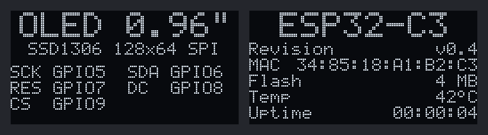

# OLED 0.96" SPI (SSD1306) trên ESP32-C3

Chương trình ESP-IDF đơn giản hiển thị thông tin lên màn hình **OLED 0.96 inch 128x64** (chip **SSD1306**, giao tiếp **SPI**, module 7 chân) nối với **ESP32-C3** (ESP32-C3 SuperMini, ESP32-C3-DevKitM-1...).

Khi cấp điện, màn hình lần lượt hiện:

1. **Tất cả điểm ảnh sáng** trong 1 giây, để thấy điểm chết (nếu có) và biết dây đã nối đúng.
2. **Thông tin màn hình** trong 3 giây: loại màn hình và chân GPIO nối với từng chân của màn hình.
3. **Thông tin ESP32-C3**, cập nhật mỗi giây:

| Dòng | Nội dung |
|---|---|
| Revision | Phiên bản chip, ví dụ `v0.4` |
| MAC | Địa chỉ MAC Wi-Fi của chip |
| Flash | Dung lượng thật của chip flash |
| Temp | Nhiệt độ bên trong chip, thường cao hơn nhiệt độ phòng vài độ |
| Uptime | Thời gian chạy từ lúc khởi động, `giờ:phút:giây` |



Hình mô phỏng, vẽ từ chính code của chương trình. Trên module hai màu, 16 hàng điểm ảnh trên cùng có màu vàng, phần còn lại màu xanh: dòng tiêu đề nằm gọn trong phần màu vàng.

## Phần cứng

- ESP32-C3 (ESP32-C3 SuperMini, ESP32-C3-DevKitM-1...), flash 4 MB
- Màn hình OLED 0.96 inch 128x64, chip SSD1306 (hoặc SSD1315), SPI, 7 chân: GND, VCC, SCK (D0), SDA (D1), RES, DC, CS

### Nối dây

| Chân OLED | ESP32-C3 |
|---|---|
| GND | GND |
| VCC | 3.3V |
| SCK (D0) | **GPIO5** |
| SDA (D1) | **GPIO6** |
| RES | **GPIO7** |
| DC | **GPIO8** |
| CS | **GPIO9** |

- Trên module SPI, SCK và SDA là chân xung nhịp và dữ liệu (MOSI) của SPI, không phải I2C.
- GPIO8 và GPIO9 là chân strapping của ESP32-C3. Màn hình không kéo hai chân này xuống lúc khởi động, nên ESP32-C3 vẫn khởi động và nạp code bình thường.
- Trên một số mạch, GPIO8 còn nối với LED (LED xanh trên SuperMini, LED RGB trên DevKitM-1): LED có thể sáng, tắt hay đổi màu lung tung theo chân DC. Không ảnh hưởng tới màn hình.
- GPIO9 nối với nút **BOOT**. Không nhấn nút BOOT khi chương trình đang chạy: nút sẽ nối thẳng chân CS (đang ở mức cao) xuống GND.

Nối chân khác thì đổi trong `idf.py menuconfig`, xem [Cấu hình](#cấu-hình).

## Build và nạp

Cần **ESP-IDF v5.4 trở lên**, không cần esp-matter. Đã build thử với ESP-IDF v5.4.1 và v6.0.2.

```bash
. ./esp-idf/export.sh      # thư mục cài ESP-IDF của bạn
cd "TEST/OLED DISPLAY"
idf.py build
idf.py -p /dev/ttyACM0 flash monitor
```

- Tên thư mục có dấu cách, nên đặt đường dẫn trong ngoặc kép khi `cd`.
- `sdkconfig.defaults` đã chọn chip ESP32-C3, không cần chạy `idf.py set-target`. Mạch có flash 2 MB thì đổi *Serial flasher config → Flash size* trong menuconfig.
- Trên Windows, cổng nạp có dạng `COM3`, `COM4`... thay cho `/dev/ttyACM0`.

Khi khởi động, log in ra:

```
I (...) oled_test: OLED: SCK=GPIO5 SDA=GPIO6 RES=GPIO7 DC=GPIO8 CS=GPIO9, SPI 8000 kHz
I (...) oled_test: ESP32-C3 v0.4, MAC 34:85:18:xx:xx:xx, flash 4 MB
```

SPI chỉ truyền một chiều, màn hình không trả lời, nên chương trình không biết màn hình đã được nối hay chưa: log vẫn in như trên kể cả khi chưa cắm màn hình. Phải nhìn màn hình để biết có chạy hay không.

## Cấu hình

`idf.py menuconfig` → *OLED Display (SSD1306 SPI)*:

| Tùy chọn | Mặc định |
|---|---|
| SCK (D0) GPIO | 5 |
| SDA (D1, SPI MOSI) GPIO | 6 |
| RES (reset) GPIO | 7 |
| DC (data/command) GPIO | 8 |
| CS (chip select) GPIO | 9 |
| SPI clock (kHz) | 8000 (SSD1306 chịu tối đa 10000) |
| Rotate the picture 180 degrees | tắt |

Không dùng chân flash (GPIO11 đến GPIO17) và chân USB (GPIO18, GPIO19).

## Hiển thị nội dung khác

Sửa hàm `show_board_info()` trong `main/main.c`. Các hàm vẽ nằm trong `main/ssd1306.h`: vẽ vào bộ đệm trong RAM, xong gọi `ssd1306_flush()` để gửi lên màn hình. Tọa độ (0, 0) là góc trên bên trái.

```c
ssd1306_clear();
ssd1306_draw_text(0, 0, "Xin chao!", 2);        // chữ cỡ 2: mỗi ký tự 12 x 16 điểm ảnh
ssd1306_draw_text(0, 20, "ESP32-C3 + OLED", 1);  // chữ cỡ 1: mỗi ký tự 6 x 8 điểm ảnh, 21 ký tự một dòng
ssd1306_fill_rect(0, 30, 128, 1);                // đường kẻ ngang
ssd1306_flush();
```

Font 5x7 chỉ có ký tự ASCII (chữ không dấu) và dấu `°`. Chữ tiếng Việt có dấu hiện thành `?`.

## Khi màn hình không hiện đúng

- **Tối hẳn**: kiểm tra GND và VCC, rồi RES, DC, CS. Nối lộn SCK với SDA cũng làm màn hình tối. Một số module 7 chân có điện trở chọn chế độ ở mặt sau: phải để chế độ SPI 4 dây (mặc định khi mua).
- **Có điểm nhiễu, hình chập chờn**: dây dài hoặc lỏng. Giảm *SPI clock* trong menuconfig, ví dụ xuống 1000 kHz.
- **Hình bị ngược**: bật *Rotate the picture 180 degrees*.
- **Hình vỡ, đầy điểm rác**: màn hình có thể dùng chip SH1106 (thường là loại 1.3 inch). Chương trình này chỉ dành cho SSD1306.

## Cấu trúc thư mục

```
OLED DISPLAY/
├── CMakeLists.txt
├── sdkconfig.defaults     # chọn chip ESP32-C3, flash 4 MB
├── docs/screens.png       # hình mô phỏng màn hình
└── main/
    ├── main.c             # nội dung hiển thị
    ├── ssd1306.c / .h     # driver OLED SSD1306 qua SPI: bộ đệm khung hình, vẽ chữ
    ├── font5x7.h          # font chữ 5x7
    └── Kconfig.projbuild  # cấu hình chân và tốc độ SPI
```
