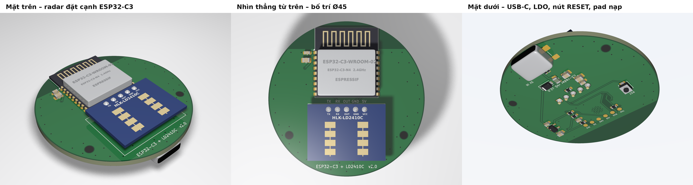
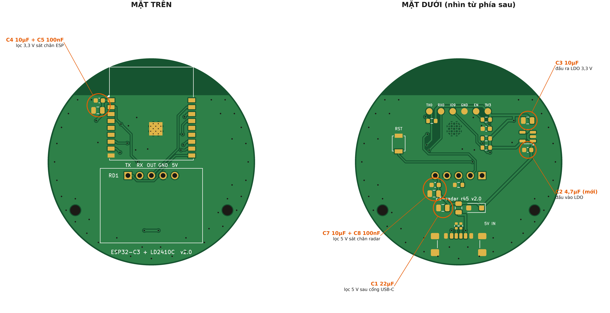

# c3-radar r45 — ESP32-C3-WROOM-02-N4 + HLK-LD2410C, bo tròn Ø45 mm

Phiên bản Ø45 của cảm biến hiện diện. ESP32-C3 và radar đặt **cạnh nhau, không xếp chồng**, để tối ưu sóng WiFi và tản nhiệt. Mạch điện giữ nguyên bản Ø30: USB-C chỉ lấy nguồn 5 V, LDO AP2112K-3.3, pad nạp, nút RESET.

## Cấu trúc repo

| Thư mục | Nội dung |
|---|---|
| `hardware/` | Project KiCad: sơ đồ (A3), PCB đã đi dây, thư viện symbol/footprint riêng |
| `fab/` | Gerber + file khoan (`c3_radar_r45_gerbers.zip` để upload), BOM, file toạ độ, PDF sơ đồ |
| `esphome/` | Cấu hình ESPHome `c3-radar.yaml` (firmware khác, không phải Matter). Firmware Matter của bo này: `../../firmware`, `tools/build.sh c3-radar-r45` |
| `docs/images/` | Ảnh render 3D, lớp đồng, sơ đồ, bản lắp ráp, vị trí tụ lọc |
| `tools/` | Script Python đã dùng để sinh project (KiCad 7 + Freerouting 2.1.0) và render (POV-Ray). Đường dẫn bên trong là đường dẫn máy dựng, chỉ để tham khảo |

## Mở project

- Mở `hardware/c3_radar_r45.kicad_pro`. Project tạo bằng **KiCad 7.0.11**, mở được bằng KiCad 8/9/10 (KiCad sẽ hỏi nâng cấp định dạng file).
- Thư viện riêng đi kèm trong `hardware/`: `c3_radar_r45.kicad_sym` và `c3_radar_r45.pretty/`.
- Symbol và footprint liên kết theo UUID. Chạy *Update PCB from Schematic* sẽ không phát sinh thay đổi.
- H1/H2 là lỗ bắt vít chỉ có trên PCB (đánh dấu *board only*), không có symbol trong sơ đồ.

## Bố trí

- **Mặt trên (quay ra phòng):**
  - U1 ESP32-C3 ở phía trên, đầu anten nằm sát mép tròn. Toàn bộ vùng phía trên đường y = 14,5 mm (tính từ tâm) để trống đồng ở cả hai lớp.
  - RD1 LD2410C nằm phẳng ngay dưới ESP. Mép radar cách vùng anten khoảng 16 mm (Espressif khuyên từ 15 mm trở lên).
  - C4/C5 là tụ lọc 3,3 V đặt sát chân 3V3 của ESP.
- **Mặt dưới (quay vào tường):**
  - USB-C J1 ở mép dưới, đối diện anten.
  - LDO U2 cùng C2/C3 ở mép trái, xa radar.
  - Mạch reset, các trở kéo lên và 6 pad nạp nằm dưới thân ESP.
  - Nút RESET ở bên phải.
- **Lỗ M2:** H1/H2 ở nửa dưới, cách anten hơn 25 mm.
- **Mặt GND:** liền cả hai lớp, có khoảng 45 via khâu. Mặt GND phía sau anten dài khoảng 37 mm, hơn 1/4 bước sóng ở 2,4 GHz.
- **Dây lớp trên dưới ESP:** không có đường tín hiệu ở lớp trên trong vùng quanh pad GND giữa (EPAD), giữ GND liền ngay dưới chip.

## Tụ lọc nguồn

| Tụ | Giá trị | Mặt | Vai trò |
|---|---|---|---|
| C1 | 22 µF | dưới | lọc 5 V ngay sau cổng USB-C và cầu chì |
| C2 | 4,7 µF | dưới | đầu vào LDO (AP2112K cần ≥ 1 µF sát chân VIN) |
| C3 | 10 µF | dưới | đầu ra LDO 3,3 V |
| C4 + C5 | 10 µF + 100 nF | trên | lọc 3,3 V sát chân nguồn ESP32-C3 |
| C7 + C8 | 10 µF + 100 nF | dưới | lọc 5 V sát chân VCC radar |

## Lắp radar

1. Kiểm tra chữ in trên radar. Nhìn từ mặt anten, với hàng chân ở **phía trên**, thứ tự phải là **TX RX OUT GND VCC** (silkscreen trên board ghi TX RX OUT GND 5V). VCC và TX nằm ở hai đầu đối diện; cắm ngược sẽ đưa 5 V vào chân TX.
2. Hàn toàn bộ linh kiện SMD và ESP trước.
3. Cắm radar từ mặt trên, mặt anten hướng lên, để khối nhựa header tì thẳng lên board. Không cần kê đệm như bản Ø30.
4. Hàn 5 chân ở mặt dưới rồi cắt chân thừa.

Mặt anten radar sẽ cao khoảng 3,5 mm so với board. Hi-Link khuyên khoảng cách từ anten tới mặt trong nắp là 12,4 mm hoặc 18,6 mm nếu đủ chỗ; nếu không, dùng nắp nhựa thật mỏng. Phía trước radar và trong vòng 15 mm quanh anten ESP không được có kim loại.

## Gán chân (giữ nguyên bản Ø30, `esphome/c3-radar.yaml` dùng được ngay)

| Chức năng | ESP32-C3 | Ghi chú |
|---|---|---|
| LD2410C TX → ESP RX | IO10 | UART1, 256000 8N1 |
| ESP TX → LD2410C RX | IO3 | |
| LD2410C OUT | IO1 | R7 100 kΩ kéo xuống |
| EN | EN | 10 kΩ + 1 µF, nút RESET, pad EN |
| BOOT | IO9 | 10 kΩ kéo lên, pad IO9 |
| Strapping | IO2, IO8 | 10 kΩ kéo lên |
| Nạp code | RXD0 / TXD0 | pad RX0 / TX0 |

## Nạp code

Pad nằm ở mặt dưới, dưới thân ESP: đường kính 1,4 mm, **bước 2,54 mm**, thứ tự **3V3 – EN – GND – IO9 – RX0 – TX0**.

1. Dùng mạch USB-UART mức 3,3 V. Nối GND chung, TX0 của board vào RX của mạch nạp, RX0 của board vào TX của mạch nạp.
2. Cấp nguồn từ USB-C hoặc từ pad 3V3. Không cấp cả hai cùng lúc.
3. Vào chế độ nạp: giữ IO9 nối với GND (hai pad nằm cạnh nhau), rồi bấm RST hoặc chạm EN với GND.
4. Nạp firmware Matter (`../../firmware`, `tools/build.sh c3-radar-r45`, file `_merged.bin` cho lần đầu), hoặc ESPHome bằng `esphome/c3-radar.yaml`. Sau lần nạp đầu, các lần sau nạp OTA qua mạng.

## Đặt làm mạch

- 2 lớp, dày 1,6 mm, viền tròn Ø45 mm. Upload `fab/c3_radar_r45_gerbers.zip`.
- Via 0,6/0,3 mm; via tản nhiệt dưới EPAD của ESP có lỗ 0,2 mm. Khoảng cách tối thiểu 0,2 mm, đồng cách mép board ít nhất 0,3 mm.
- Nếu đặt lắp ráp: đây là lắp **hai mặt**. Mặt trên có U1, C4, C5; mặt dưới có phần còn lại. Radar hàn tay.

## Cần kiểm tra trước khi đặt

1. **USB-C:** footprint là GCT USB4135-GF-A, loại 6 chân, chân vỏ toàn SMD. Nếu dùng loại 6P khác, đối chiếu kích thước pad.
2. **Hàng chân radar:** vị trí lấy từ file 3D của Hi-Link. Nên đo lại trên module thật bằng thước kẹp.
3. **ERC:** chạy ERC trong giao diện KiCad trước khi đặt. KiCad 7 bản dòng lệnh không có ERC; kết nối đã được kiểm bằng netlist.

## Trạng thái kiểm tra

- **DRC (KiCad 7):** 0 lỗi, 0 cảnh báo, 0 kết nối thiếu. Hai mục được tắt có chủ đích: silkscreen đè lên đồng, và silkscreen của ESP bị mép board cắt.
- **Sơ đồ ↔ PCB:** đã so 78 chân, khớp hoàn toàn.
- **Đi dây:** Freerouting 2.1.0 tự đi dây. Phần VBUS/GND quanh USB-C được đi tay rồi khóa: VBUS thứ hai nối qua một đoạn cầu ngắn ở lớp trên.
- **Ảnh render 3D** trong `docs/images/` dùng mặt bo dựng từ chính các lớp KiCad. Hình khối linh kiện là mô hình đơn giản, chỉ để minh họa.
