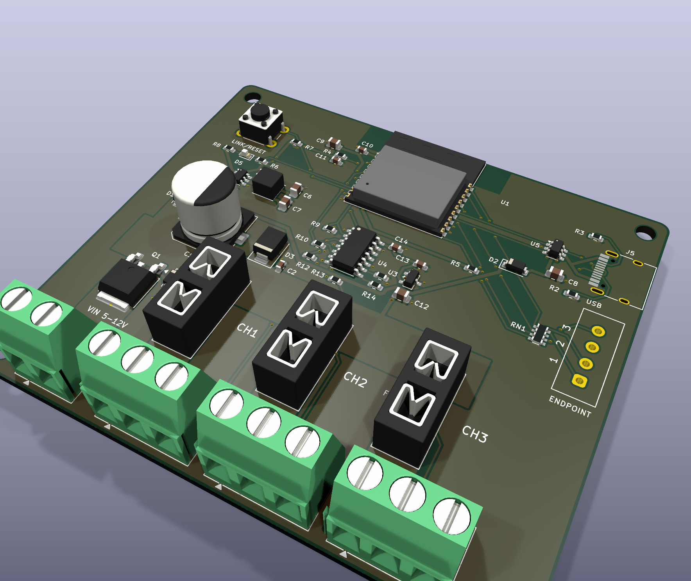
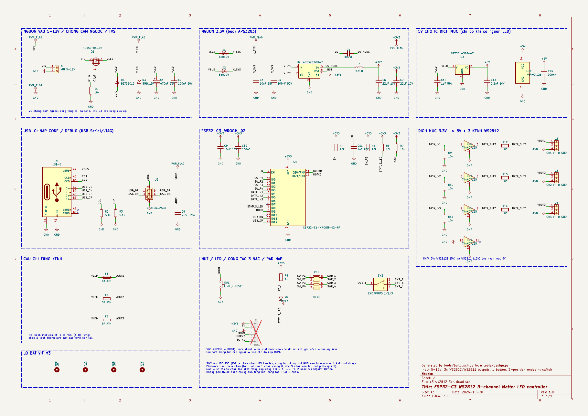
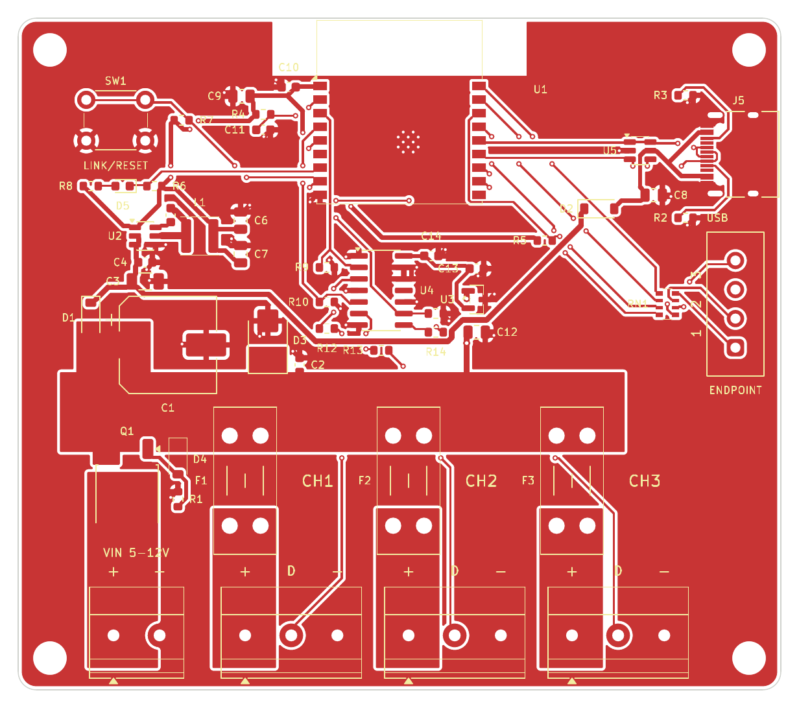
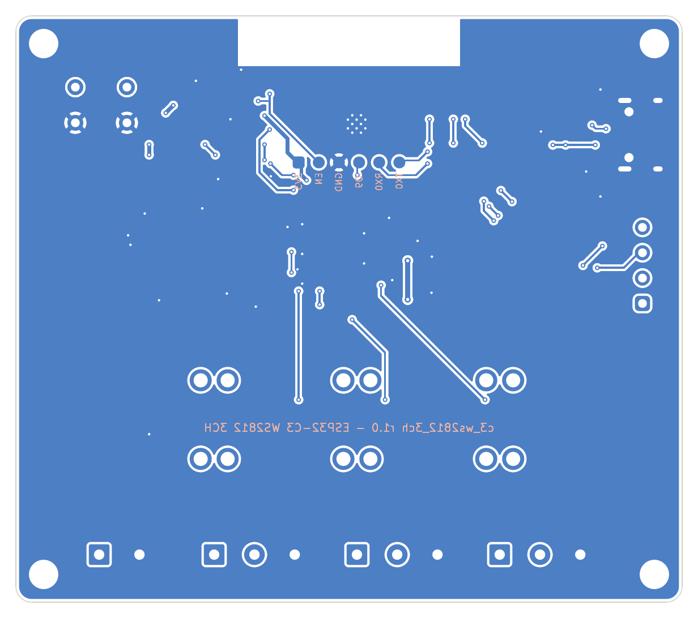
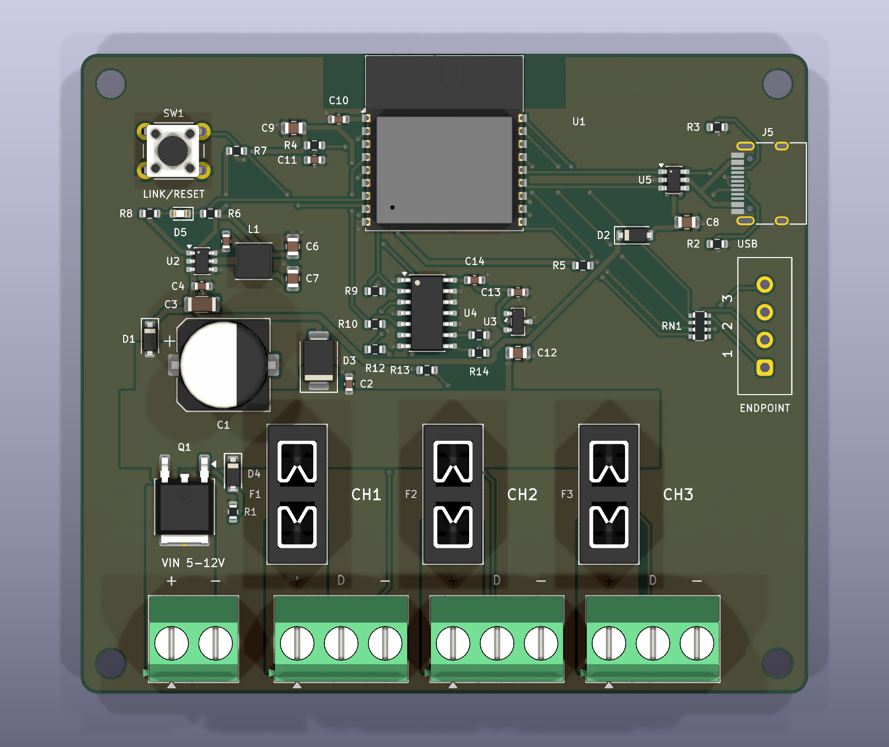

# matter-ws2812-3ch: bo điều khiển LED WS2812 3 kênh (ESP32-C3-WROOM-02, nguồn 5–12 V)

Bo mạch KiCad 9 dùng ESP32-C3-WROOM-02 để điều khiển dải LED WS2812/WS2812B (5 V) hoặc WS2811/WS2815 (12 V), dự kiến chạy firmware **Matter over Wi‑Fi** (viết sau). Bo có:

- **3 kênh ra độc lập**, mỗi kênh có cầu đấu `+ D −` và cầu chì riêng.
- **1 nút** để vào chế độ kết nối và factory reset.
- **Công tắc gạt 3 nấc** để chọn số endpoint Matter (1, 2 hoặc 3).



## Thông số

| Mục | Giá trị |
|---|---|
| Vi điều khiển | ESP32-C3-WROOM-02-N4 (flash 4 MB, đủ cho Matter) |
| Nguồn vào | 5–12 V DC, cầu đấu 5,08 mm. Nguồn này cấp thẳng cho dải LED: dải 5 V cắm nguồn 5 V, dải 12 V cắm nguồn 12 V |
| Dòng | Tổng tối đa 10 A. Mỗi kênh có cầu chì ô tô loại mini (ATM), mặc định 5 A |
| Bảo vệ | Chống cắm ngược bằng MOSFET P (SUD50P04-08), TVS SMBJ15A, tụ lọc 470 µF |
| 3,3 V | Buck AP63203 (vào 3,8–32 V, 2 A) |
| Mức tín hiệu DATA | 5 V, qua 74AHCT125 và điện trở 100 Ω. IC này được cấp từ LDO AP7381‑5.0 lấy điện từ nguồn LED |
| USB-C | Nạp code và debug qua USB Serial/JTAG của C3. Có chống ESD USBLC6-2SC6. USB chỉ nuôi phần logic, không bao giờ cấp điện cho dải LED |
| Giao diện | Nút LINK/RESET (GPIO9), LED xanh báo trạng thái (GPIO8), công tắc 3 nấc (GPIO0–GPIO3), 6 pad UART0 ở mặt dưới |
| PCB | 84 × 74 mm, 2 lớp, dày 1,6 mm, 4 lỗ M3 |

## Cấu trúc thư mục

| Thư mục | Nội dung |
|---|---|
| `hardware/` | Project KiCad 9: `c3_ws2812_3ch.kicad_pro/.kicad_sch/.kicad_pcb`, thư viện riêng `.kicad_sym` và `.pretty` (công tắc gạt, pad nạp, module ESP với via 0,3 mm) |
| `fab/` | `c3_ws2812_3ch_gerbers.zip` để upload, thư mục `gerbers/`, BOM, file toạ độ (CPL), PDF sơ đồ |
| `docs/images/` | Ảnh render 3D, lớp đồng trên/dưới, sơ đồ nguyên lý |
| `tools/` | Script Python sinh toàn bộ project: `design.py` (linh kiện và net), `layout.py` (vị trí), `build_all.sh` |

## Sơ đồ nguyên lý



Bản đầy đủ ở `fab/c3_ws2812_3ch_schematic.pdf`. Sơ đồ có các khối sau:

1. **Nguồn vào:** J1 → Q1 (MOSFET P chống cắm ngược, D4 kẹp Vgs ở 15 V, R1 10k kéo gate xuống GND) → đường **VLED**. TVS D3, C1 470 µF và C2 100 nF đặt trên VLED.
2. **Cầu chì:** VLED → F1/F2/F3 → chân `+` của J2/J3/J4. Chập một kênh chỉ làm đứt cầu chì kênh đó; ESP và hai kênh còn lại vẫn chạy.
3. **3,3 V:** VLED qua D1 và VBUS (USB) qua D2 cùng đổ vào V_SYS (hai diode Schottky B5819W). V_SYS vào buck AP63203 (L1 3,9 µH, tụ vào 10 µF và 100 nF, tụ ra 2 × 22 µF, theo bảng 2 trong datasheet).
4. **5 V cho IC dịch mức:** LDO AP7381‑5.0 chịu được 40 V. Khi nguồn vào là 5 V, LDO ra khoảng 4,8–4,9 V (vẫn trong dải 4,5–5,5 V của 74AHCT125). Khi chỉ cắm USB, IC dịch mức không có điện, nên không có dòng chạy ngược vào chân DATA của dải LED đang tắt.
5. **Dịch mức:** GPIO4/5/6 → 74AHCT125 (mỗi ngõ vào có 10k kéo xuống để LED không nhận rác khi ESP đang khởi động) → 100 Ω → chân `D`. Cổng thứ 4 không dùng: ngõ vào nối GND.
6. **ESP32-C3:** tụ 10 µF + 100 nF ở chân 3V3, mạch RC 10k + 1 µF ở chân EN, điện trở kéo lên cho các chân strap IO2, IO8 và IO9.
7. **USB-C:** CC1/CC2 nối điện trở 5,1k xuống GND, D+/D− đi qua USBLC6-2SC6.

## Gán chân

| GPIO | Chân module | Chức năng | Ghi chú |
|---|---|---|---|
| IO4 | 3 | DATA kênh 1 | Trùng mặc định `CONFIG_LED_GPIO=4` của `ESP32-C3/matter-wifi/matter-rgb-light-ws2812` |
| IO5 | 4 | DATA kênh 2 | |
| IO6 | 5 | DATA kênh 3 | |
| IO9 | 8 | Nút LINK/RESET (cũng là BOOT) | 10k kéo lên, nhấn = 0. Trùng `CONFIG_APP_BUTTON_GPIO=9` |
| IO8 | 7 | LED trạng thái, 0 = sáng | Chân strap, có 10k kéo lên |
| IO0 / IO1 / IO2 / IO3 | 18 / 17 / 16 / 15 | Chân 1 / 2 / 3 / 4 của công tắc SW2, nối qua RN1 (4 × 1k) | IO2 là chân strap, có R5 10k kéo lên |
| IO18 / IO19 | 13 / 14 | USB D− / D+ | |
| IO20 / IO21 | 11 / 12 | UART0 RX / TX | Ra pad nạp |
| IO7, IO10 | 6, 10 | Trống | |

Hai chân strap trên đường công tắc vẫn an toàn khi khởi động:

- IO2 phải ở mức 1 khi khởi động. Không chân nào của công tắc nối GND. Theo bảng 2‑1 datasheet ESP32‑C3, lúc reset GPIO0–GPIO3 đều không bật điện trở kéo xuống, nên R5 luôn giữ IO2 ở mức 1 ở mọi nấc.
- IO8 có R6 kéo lên. Mạch LED nối từ 3V3 qua R8 vào IO8 nên không kéo chân này xuống.

## Nút LINK/RESET (gợi ý cho firmware)

Giữ cách dùng nút của các firmware có sẵn trong repo:

- **Nhấn nhanh:** bật/tắt đèn, hoặc mở lại cửa sổ kết nối Matter.
- **Giữ ≥ 5 giây rồi nhả:** factory reset, xoá Wi‑Fi và thông tin ghép nối.
- **Giữ nút trong lúc cắm điện:** ESP32‑C3 vào chế độ nạp ROM (GPIO9 = 0 khi reset). Dùng để cứu mạch khi firmware lỗi.

LED xanh (GPIO8) dùng để báo trạng thái, ví dụ: nháy chậm khi chờ kết nối, nháy nhanh khi đang giữ nút để reset, sáng một lúc khi kết nối xong.

## Công tắc gạt 3 nấc: đọc số endpoint

Mỗi loại công tắc SP3T 4 chân dùng một chân khác làm chân chung. Ví dụ Same Sky SLW‑156646 dùng chân đầu hàng; C&K OS103011 dùng chân 2 (nấc 1 nối 1‑2, nấc 2 nối 2‑3, nấc 3 nối 2‑4). Vì vậy bo **không nối chân nào của công tắc xuống GND**. Cả 4 chân đi qua RN1 vào IO0–IO3, và firmware quét để tìm cặp chân đang thông:

- Bật pull-up cho cả 4 chân.
- Lần lượt kéo một chân xuống 0 và đọc 3 chân còn lại.
- Cặp đang thông luôn là (1,2), (x,3) hoặc (x,4). **Số endpoint = số thứ tự chân lớn nhất trong cặp − 1.** Quy tắc này đúng cho cả hai kiểu công tắc ở trên.

```c
#include "driver/gpio.h"
#include "esp_rom_sys.h"

/* Chân 1..4 của SW2 */
static const gpio_num_t SW_PINS[4] = {GPIO_NUM_0, GPIO_NUM_1, GPIO_NUM_2, GPIO_NUM_3};

/* Trả về 1, 2 hoặc 3 endpoint; 0 nếu không đọc được (công tắc nằm giữa hai nấc) */
int read_endpoint_switch(void)
{
    for (int i = 0; i < 4; i++) {
        gpio_reset_pin(SW_PINS[i]);
        gpio_set_direction(SW_PINS[i], GPIO_MODE_INPUT);
        gpio_set_pull_mode(SW_PINS[i], GPIO_PULLUP_ONLY);
    }
    int top = -1;                       /* chỉ số (0..3) của chân lớn hơn trong cặp đang thông */
    for (int i = 0; i < 3 && top < 0; i++) {
        gpio_set_direction(SW_PINS[i], GPIO_MODE_OUTPUT);
        gpio_set_level(SW_PINS[i], 0);
        esp_rom_delay_us(20);
        for (int j = i + 1; j < 4; j++) {
            if (gpio_get_level(SW_PINS[j]) == 0) {
                top = j;
            }
        }
        gpio_set_direction(SW_PINS[i], GPIO_MODE_INPUT);
    }
    return top < 0 ? 0 : top;           /* chân lớn nhất = top + 1, endpoint = (top + 1) - 1 */
}
```

Nên đọc công tắc **một lần lúc khởi động**. Danh sách endpoint là một phần của thiết bị đã ghép nối Matter, nên khi số endpoint đổi so với lần trước (lưu trong NVS), firmware nên yêu cầu factory reset và ghép lại thay vì đổi ngầm. Vạch `1 2 3` in cạnh công tắc ghi theo thứ tự cặp chân (1,2), (·,3), (·,4). Nếu loại công tắc mua được cho kết quả đảo chiều, chỉ cần đảo bảng tra trong firmware.

## Gợi ý cho firmware 3 kênh

- ESP32‑C3 chỉ có **2 kênh RMT TX**. Để chạy 3 dải độc lập, có thể dùng RMT cho 2 kênh và `led_strip` backend **SPI** (SPI2 + DMA) cho kênh thứ 3. Cách khác là dùng chung một kênh RMT, đổi GPIO giữa các lần gửi khung, vì dữ liệu chỉ phải gửi lại khi trạng thái đèn thay đổi.
- Firmware `matter-rgb-light-ws2812` có sẵn dùng GPIO4 và GPIO9, nên chạy được ngay trên kênh 1 của bo này (1 endpoint).

## Nguồn, dòng và cầu chì

- **Chọn nguồn theo dải LED:** WS2812/WS2812B cần 5 V, WS2811/WS2815 loại 12 V cần 12 V. Mức DATA luôn là 5 V, hợp với cả hai loại.
- **Cầu chì:** dùng cầu chì ô tô loại mini (ATM), mua được ở cửa hàng phụ tùng xe. Chọn 2, 3, 5 hoặc 7,5 A theo dải LED, miễn là tổng 3 kênh không quá 10 A.
- **Tổn hao Q1:** khoảng 1 W khi chạy 5 V/10 A, khoảng 0,6 W khi 5 V/8 A. Q1 hàn trên mảng đồng VIN lớn để toả nhiệt. Nếu thay bằng **AOD4185** (cùng vỏ DPAK, 20 mΩ ở 4,5 V) thì nên giới hạn khoảng 6 A ở nguồn 5 V.
- **Lớp đồng:** thanh VLED (rộng khoảng 8 mm) và các vùng VOUT (khoảng 7 mm) nằm ở lớp trên, GND là mặt đồng liền ở lớp dưới. Theo ước tính IPC‑2221, với đồng 1 oz, thanh VLED nóng thêm khoảng 10 °C khi chạy 10 A. Nếu chạy liên tục từ 8 A trở lên, nên đặt **đồng 2 oz**.
- **Dải LED dài:** cấp nguồn thêm ở giữa hoặc ở cuối dải (power injection) trực tiếp từ nguồn. Không kéo toàn bộ dòng qua bo.
- **Cắm USB khi đã có nguồn LED:** an toàn. Diode D1/D2 chọn nguồn cao hơn cho phần logic, và USB không bao giờ nối vào VLED.

## Bố trí PCB

| Lớp trên | Lớp dưới |
|---|---|
|  |  |

- **Anten ESP** nằm sát mép trên. Vùng 28 × 11 mm quanh anten không có đồng ở cả hai lớp (theo vùng cấm của footprint).
- **Đường công suất:** đi theo vùng đồng, không dùng đường mảnh. Thứ tự: J1 → Q1 → thanh VLED → cầu chì → vùng VOUT → cầu đấu. Chân của cầu đấu, đế cầu chì và Q1 nối đặc vào vùng đồng (không dùng thermal relief).
- **Buck:** tụ vào nằm ngay dưới U2, nối thẳng chân VIN và GND. Nút SW ngắn, tụ BST sát chân.
- **USB:** D+/D− đi song song, ngắn, qua USBLC6 rồi vào chân 13/14 của module.
- **Đường DATA:** chỉ chui xuống lớp dưới đúng đoạn băng qua thanh VLED. Mặt GND dưới gần như liền, nhất là ở vùng dòng lớn sát cầu đấu.
- **Pad nạp UART0:** 6 pad Ø1,5 mm, bước 2,54 mm, ở **mặt dưới, dưới thân module**, cùng bộ tín hiệu với bo cảm biến c3-radar (`3V3 EN GND IO9 RX0 TX0`). Tên từng pad in trên silkscreen mặt dưới; nhìn từ mặt dưới, thứ tự từ trái sang phải là TX0 → 3V3.



## Nạp firmware

1. **Qua USB-C (khuyên dùng):** cắm cáp, chạy `idf.py -p /dev/ttyACM0 flash monitor`. Chip mới hoặc firmware treo: giữ nút LINK/RESET rồi mới cắm cáp.
2. **Qua UART:** dùng mạch USB‑UART 3,3 V nối vào pad mặt dưới (TX0 → RX, RX0 → TX, chung GND). Nối IO9 với GND, chạm EN xuống GND rồi nạp.
3. Không cần nguồn LED khi nạp; USB tự nuôi phần logic.

## Đặt làm mạch

- Upload `fab/c3_ws2812_3ch_gerbers.zip`: 2 lớp, 1,6 mm, đồng 1 oz (hoặc 2 oz như ở trên).
- Luật dùng: đường và khoảng hở tối thiểu 0,2 mm, via 0,6/0,3 mm (via công suất 0,8/0,4 mm), đồng cách mép board 0,4 mm. Đều nằm trong khả năng tiêu chuẩn của JLCPCB/PCBWay.
- Lắp ráp SMT: dùng `fab/c3_ws2812_3ch-BOM.csv` và `fab/c3_ws2812_3ch-pos.csv`. Gốc toạ độ là góc dưới trái board. Một số linh kiện có thể bị lệch góc xoay trong trình xem của nhà mạch; kiểm tra lại ở bước preview.
- Linh kiện cắm (cột `Mount = THT`: cầu đấu, đế cầu chì, nút, công tắc gạt) hàn tay sau.
- Cột LCSC có mã cho các linh kiện đã đối chiếu (AP63203WU‑7 C780769, USBLC6‑2SC6 C7519, HRO TYPE‑C‑31‑M‑12 C165948, B5819W C8598) và các điện trở/tụ 0603 loại basic thông dụng. Các dòng còn trống thì chọn theo MPN.

## Cần kiểm tra trước khi đặt

1. **Công tắc gạt SW2:** footprint vẽ theo bản vẽ của **Same Sky SLW‑156646‑5A‑N‑D** (4 chân dẹt, bước 3,2 mm, lỗ 1,1 mm). Nếu dùng loại khác (SK‑13D07, C&K OS103011…), đo lại bước chân. Mạch quét không phụ thuộc chân chung, nhưng lỗ phải khớp.
2. **Đế cầu chì:** footprint là Keystone 3568, 4 chân, lỗ 1,78 mm. Đế mini blade của hãng khác thường cùng kích thước nhưng nên đối chiếu.
3. **Q1:** SUD50P04‑08 (Vishay). Có thể không có sẵn ở LCSC. Xem ghi chú về AOD4185 ở mục nguồn.
4. **Cầu đấu:** footprint Phoenix MKDS 1,5 bước 5,08 mm. Loại KF128/DG128 phổ biến có cùng bước chân và lỗ luồn dây quay ra mép dưới board.
5. **Module ESP:** dùng footprint ESP32‑C3‑WROOM‑02 của KiCad, chỉ mở 12 via tản nhiệt dưới EPAD từ 0,2 lên 0,3 mm cho hợp quy trình 2 lớp tiêu chuẩn.
6. Ảnh render không có mô hình 3D của USB‑C và công tắc gạt (chỉ hiện pad).

## Trạng thái kiểm tra

- **ERC (KiCad 9.0.9):** 0 lỗi, 0 cảnh báo.
- **Netlist:** `tools/check_netlist.py` so netlist KiCad xuất ra với `design.py`. Khớp 40/40 net, mọi chân đúng net, các chân bỏ trống có cờ no-connect.
- **DRC (KiCad 9.0.9, `--schematic-parity`):** 0 vi phạm, 0 kết nối thiếu, 0 lệch giữa PCB và sơ đồ.
- **Đi dây:** dùng bộ đi dây lưới 2 lớp viết riêng (`tools/autoroute.py` + `tools/astar.c`). Khoảng hở được tính chính xác từ đa giác pad của KiCad, sau đó DRC kiểm lại toàn bộ. Nên mở PCB trong KiCad xem lại một lượt trước khi đặt, vì vài đường tín hiệu còn rút ngắn được bằng tay.

## Tái tạo / chỉnh sửa

```bash
cd matter-ws2812-3ch/tools
./build_all.sh      # sơ đồ -> ERC -> so netlist -> PCB -> đi dây -> DRC -> file sản xuất (khoảng 4 phút)
```

Cần KiCad 9.0 (`kicad-cli` và module Python `pcbnew`), Python 3 có `numpy` và `Pillow`, và `gcc`.

- Linh kiện và net sửa trong `tools/design.py`.
- Vị trí linh kiện, vùng đồng và chữ silkscreen sửa trong `tools/layout.py`.

Có thể sửa trực tiếp trong KiCad, nhưng chạy lại script sẽ ghi đè các sửa tay.
