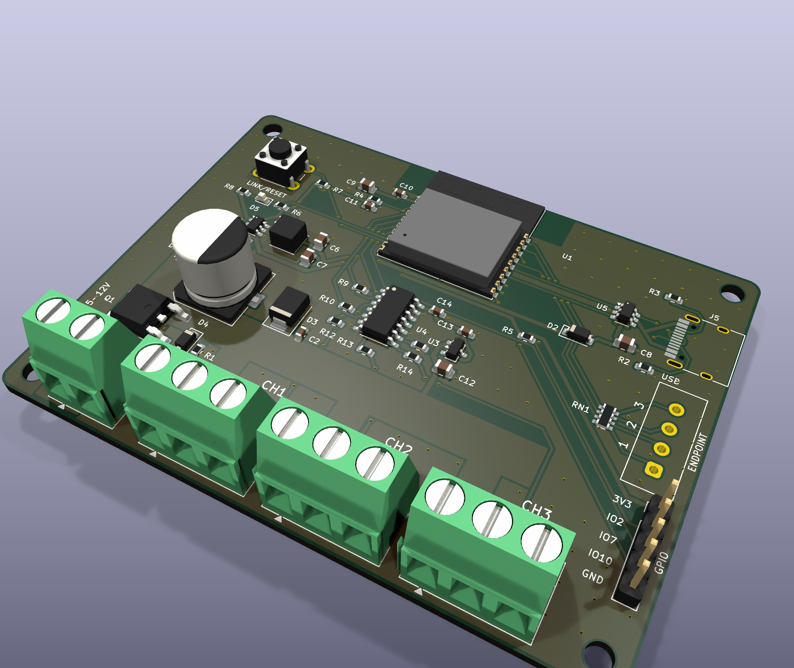
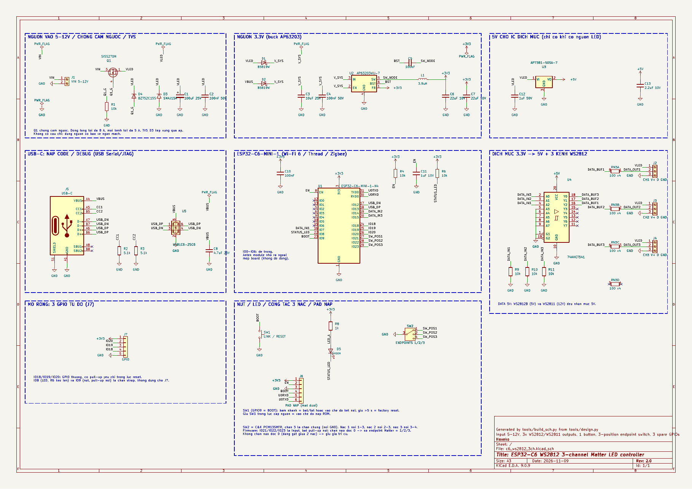
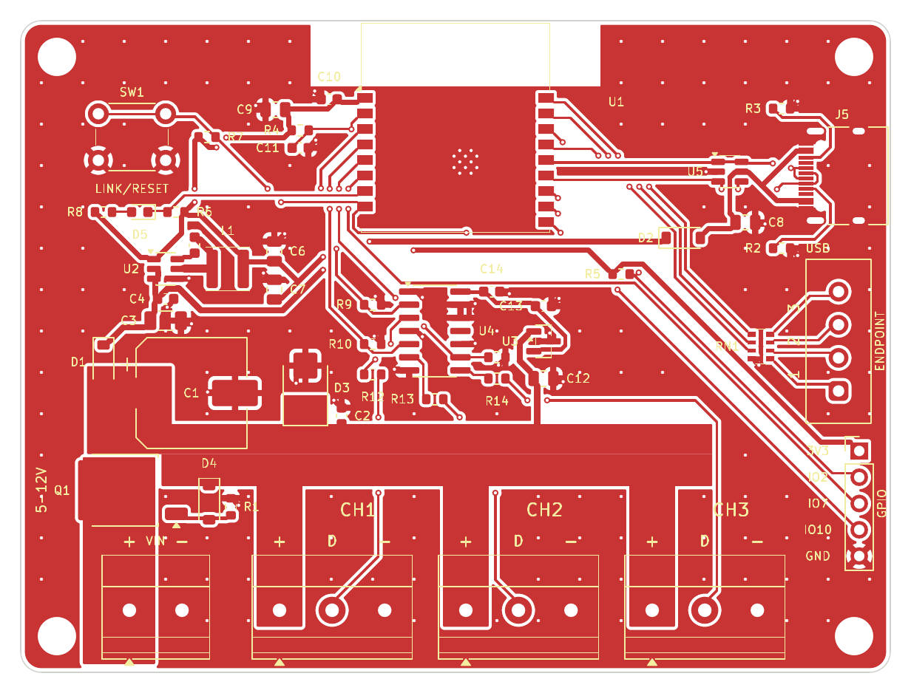
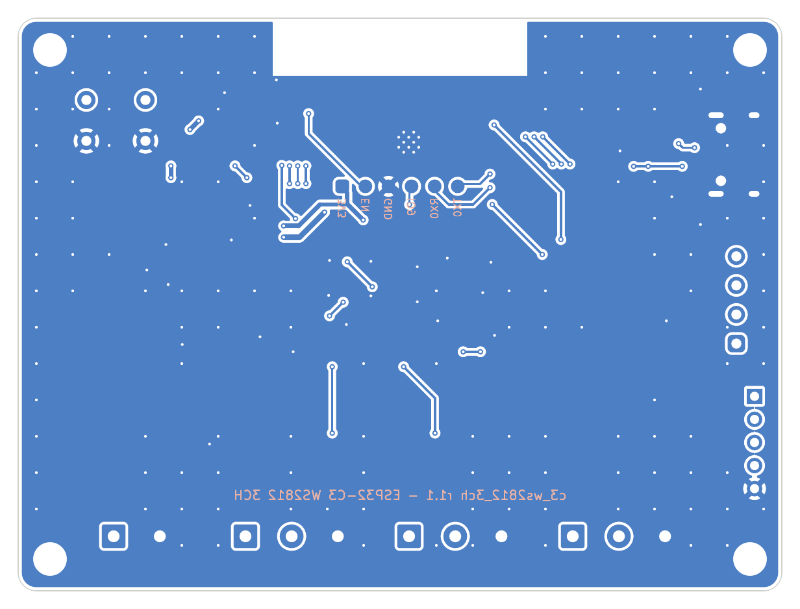
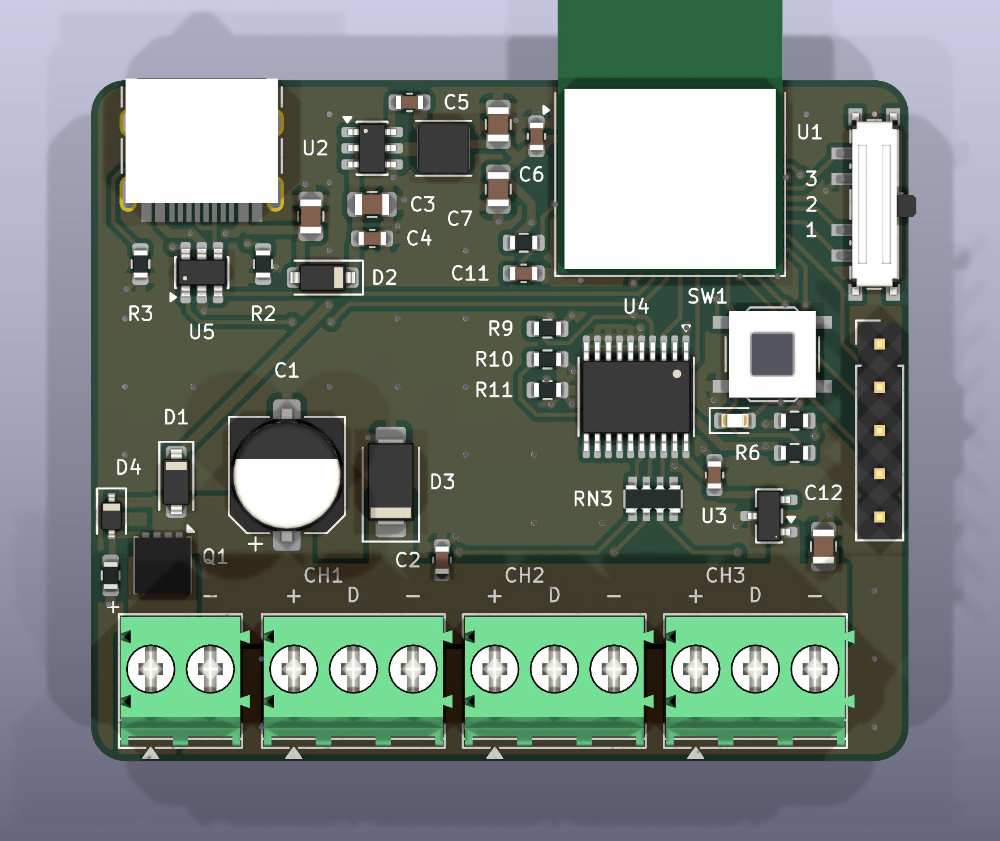
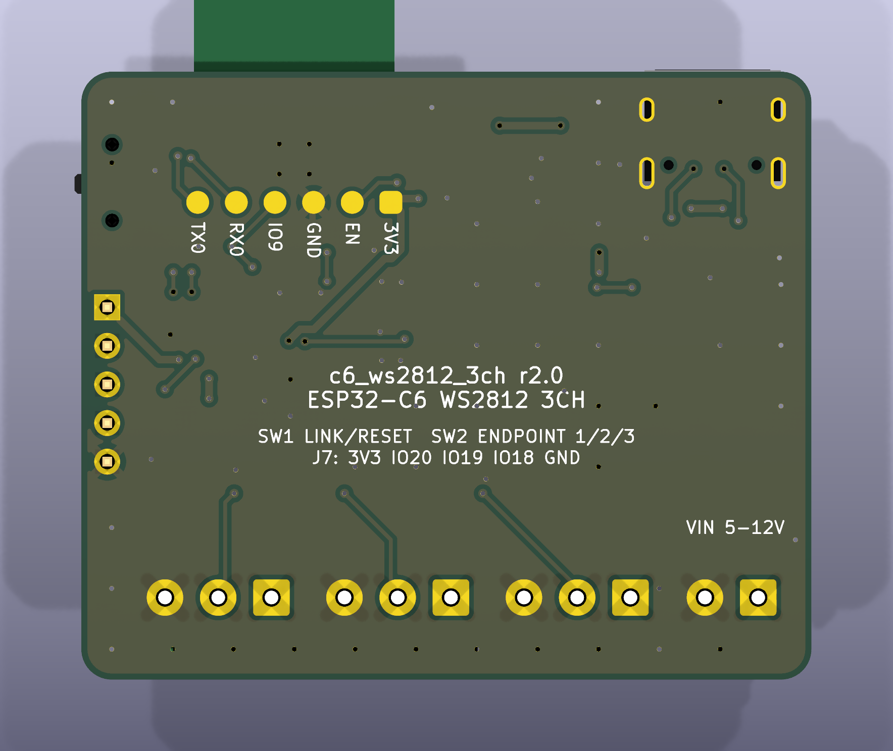

# matter-ws2812-3ch: bo điều khiển LED WS2812 3 kênh (ESP32-C6-MINI-1, nguồn 5–12 V)

Bo mạch KiCad 9 dùng module **ESP32-C6-MINI-1** để điều khiển dải LED WS2812/WS2812B (5 V) hoặc WS2811/WS2815 (12 V). ESP32-C6 có Wi‑Fi 6, BLE 5 và radio IEEE 802.15.4, nên firmware viết sau có thể chạy **Matter over Wi‑Fi** hoặc **Matter over Thread**. Bo có:

- **3 kênh ra độc lập**, mỗi kênh có cầu đấu `+ D −`.
- **1 nút** để vào chế độ kết nối và factory reset.
- **Công tắc gạt 3 nấc** để chọn số endpoint Matter (1, 2 hoặc 3).
- **Header J7** đưa ra 3 GPIO trống (IO20, IO19, IO18) kèm 3V3 và GND.
- **6 pad nạp UART0** ở mặt dưới, và cổng USB‑C để nạp code/debug.



### Thay đổi ở r2.0

- **ESP32-C3-WROOM-02 → ESP32-C6-MINI-1-N4** (13,2 × 16,6 mm, flash 4 MB). Module đặt sát mép trên, **anten chìa ra ngoài mép board** khoảng 5,3 mm.
- **Board còn 48 × 40 mm**, giảm khoảng 64 % diện tích so với r1.1 (84 × 63 mm). Không còn lỗ bắt vít.
- Cầu đấu đổi sang loại **bước 3,5 mm** (Phoenix PT 1,5 / KF350), vẫn xếp một hàng ở mép dưới.
- Công tắc 3 nấc đổi sang **C&K PCM13SMTR** (dán, gạt ngang ở mép phải). Theo datasheet, chân chung là chân 3, nên chân 3 nối thẳng GND và chỉ cần đọc 3 GPIO. Bỏ mảng điện trở RN1.
- Nút bấm dán 5,1 × 5,1 mm (XKB TS-1187A).
- IC dịch mức đổi sang **74AHCT541** (TSSOP-20). Ngõ vào và ngõ ra nằm ở hai phía đối diện, nên đường DATA đi thẳng từ module xuống cầu đấu. 3 điện trở 100 Ω gộp thành mảng RN3.
- Linh kiện công suất nhỏ gọn hơn: MOSFET SiSS27DN (PowerPAK 1212‑8, 3,3 × 3,3 mm), TVS SMAJ15A, tụ 100 µF 25 V (6,3 × 7,7 mm), cuộn cảm 3 × 3 mm.

## Thông số

| Mục | Giá trị |
|---|---|
| Vi điều khiển | ESP32-C6-MINI-1-N4: Wi‑Fi 6 2,4 GHz, BLE 5, 802.15.4 (Thread/Zigbee), flash 4 MB |
| Nguồn vào | 5–12 V DC, cầu đấu 3,5 mm. Nguồn này cấp thẳng cho dải LED: dải 5 V cắm nguồn 5 V, dải 12 V cắm nguồn 12 V |
| Dòng | Tổng tối đa **8 A**, mỗi kênh tối đa **5 A**. Trên bo **không có cầu chì**: dùng nguồn có bảo vệ ngắn mạch (xem mục nguồn) |
| Bảo vệ | Chống cắm ngược bằng MOSFET P SiSS27DN (−30 V, tối đa 9 mΩ ở −4,5 V), TVS SMAJ15A, tụ lọc 100 µF |
| 3,3 V | Buck AP63203 (vào 3,8–32 V, 2 A) |
| Mức tín hiệu DATA | 5 V, qua 74AHCT541 và điện trở 100 Ω. IC này được cấp từ LDO AP7381‑5.0 lấy điện từ nguồn LED |
| USB-C | Nạp code và debug qua USB Serial/JTAG của C6 (IO12/IO13). Có chống ESD USBLC6-2SC6. USB chỉ nuôi phần logic, không bao giờ cấp điện cho dải LED |
| Giao diện | Nút LINK/RESET (GPIO9), LED xanh báo trạng thái (GPIO8), công tắc 3 nấc (GPIO21/22/23), header J7 (GPIO20/19/18), 6 pad UART0 ở mặt dưới |
| PCB | 48 × 40 mm, 2 lớp, dày 1,6 mm. Kể cả phần anten chìa ra: 48 × 45,3 mm |

## Cấu trúc thư mục

| Thư mục | Nội dung |
|---|---|
| `hardware/` | Project KiCad 9: `c6_ws2812_3ch.kicad_pro/.kicad_sch/.kicad_pcb`, thư viện footprint riêng `.pretty` (module C6 có via GND, pad nạp, USB‑C và công tắc gạt đã cắt silkscreen ở mép board), mô hình 3D dạng hộp trong `.3dshapes` |
| `fab/` | `c6_ws2812_3ch_gerbers.zip` để upload, thư mục `gerbers/`, BOM, file toạ độ (CPL), PDF sơ đồ |
| `docs/images/` | Ảnh render 3D, lớp đồng trên/dưới, sơ đồ nguyên lý |
| `tools/` | Script Python sinh toàn bộ project: `design.py` (linh kiện và net), `layout.py` (vị trí), `build_all.sh` |

## Sơ đồ nguyên lý



Bản đầy đủ ở `fab/c6_ws2812_3ch_schematic.pdf`. Sơ đồ có các khối sau:

1. **Nguồn vào:** J1 → Q1 (MOSFET P chống cắm ngược, D4 kẹp Vgs ở 15 V, R1 10k kéo gate xuống GND) → đường **VLED**. TVS D3, C1 100 µF và C2 100 nF đặt trên VLED.
2. **Ngõ ra:** VLED nối thẳng vào chân `+` của J2/J3/J4.
3. **3,3 V:** VLED qua D1 và VBUS (USB) qua D2 cùng đổ vào V_SYS (hai diode Schottky B5819W). V_SYS vào buck AP63203 (L1 3,9 µH, tụ vào 10 µF và 100 nF, tụ ra 2 × 22 µF).
4. **5 V cho IC dịch mức:** LDO AP7381‑5.0 chịu được 40 V. Khi nguồn vào là 5 V, LDO ra khoảng 4,8–4,9 V (vẫn trong dải 4,5–5,5 V của 74AHCT541). Khi chỉ cắm USB, IC dịch mức không có điện, nên không có dòng chạy vào chân DATA của dải LED đang tắt. Ngõ vào họ AHCT chịu được 5,5 V cả khi IC không có điện.
5. **Dịch mức:** GPIO7/14/15 → 74AHCT541 (dùng 3 bộ đệm A2/A1/A0; mỗi ngõ vào có 10k kéo xuống để LED không nhận rác khi ESP đang khởi động) → RN3 100 Ω → chân `D`. 5 ngõ vào không dùng và 2 chân OE nối GND.
6. **ESP32-C6:** tụ 100 nF sát chân 3V3 (hai tụ 22 µF của buck nằm cách khoảng 4 mm), mạch RC 10k + 1 µF ở chân EN, R6 10k kéo IO8 lên.
7. **USB-C:** CC1/CC2 nối điện trở 5,1k xuống GND, D+/D− đi qua USBLC6-2SC6.
8. **Mở rộng:** J7 đưa ra `3V3, IO20, IO19, IO18, GND`.

## Gán chân

| GPIO | Chân module | Chức năng | Ghi chú |
|---|---|---|---|
| IO7 | 16 | DATA kênh 1 | Không có pull lúc reset; R9 10k kéo xuống |
| IO14 | 19 | DATA kênh 2 | R10 10k kéo xuống |
| IO15 | 20 | DATA kênh 3 | R11 10k kéo xuống. IO15 chỉ có tác dụng strap khi đã đốt eFuse JTAG (mặc định chưa đốt) |
| IO9 | 23 | Nút LINK/RESET (cũng là BOOT) | Pull-up nội, nhấn = 0 |
| IO8 | 22 | LED trạng thái, 0 = sáng | Chân strap, R6 10k kéo lên |
| IO21 / IO22 / IO23 | 27 / 28 / 29 | Chân 1 / 2 / 4 của công tắc SW2 = nấc 1 / 2 / 3 | Chân 3 (chung) của SW2 nối GND |
| IO20 / IO19 / IO18 | 26 / 25 / 24 | J7 chân 2 / 3 / 4 | |
| IO12 / IO13 | 17 / 18 | USB D− / D+ | |
| RXD0 / TXD0 | 30 / 31 | UART0 RX / TX | Ra pad nạp |
| IO0–IO6 | | Để trống | |

Các chân strap của ESP32-C6 đều ở trạng thái an toàn khi khởi động:

- **IO9 = 1, IO8 = 1:** chạy firmware bình thường. Giữ nút (IO9 = 0) lúc reset thì vào chế độ nạp; lúc đó IO8 phải bằng 1, nên có R6 kéo lên. Mạch LED nối từ 3V3 qua R8 vào IO8, không kéo chân này xuống.
- **IO4/IO5 (MTMS/MTDI):** chỉ chọn cạnh lấy mẫu SDIO, bo để trống hai chân này.
- **IO15:** chọn nguồn tín hiệu JTAG, nhưng bị bỏ qua khi các eFuse JTAG còn mặc định. R11 giữ IO15 = 0.

## Header J7: 3 GPIO tự do

| Chân J7 | Tín hiệu | Lưu ý |
|---|---|---|
| 1 | 3V3 | Lấy từ buck AP63203; nên dùng dưới khoảng 300 mA cho thiết bị ngoài |
| 2 | IO20 | GPIO thường |
| 3 | IO19 | GPIO thường |
| 4 | IO18 | GPIO thường |
| 5 | GND | |

- Ba chân này là chân SDIO của C6 (bo không dùng SDIO). Có pull-up yếu chỉ trong lúc reset; sau reset không có pull nào.
- Mức logic 3,3 V, **không chịu 5 V**. Mỗi chân nên dùng dưới khoảng 20 mA. Tải lớn hơn (relay, quạt, đèn) thì qua transistor/MOSFET.
- Dùng được làm I2C (ví dụ IO19 = SDA, IO18 = SCL, thêm điện trở kéo lên 4,7k), UART phụ, PWM (LEDC), ngõ vào nút bấm hoặc cảm biến.
- Header bước 2,54 mm ở mép phải, dưới công tắc gạt. Tên chân in ở mặt dưới (`J7: 3V3 IO20 IO19 IO18 GND`); chân 1 (3V3) là pad vuông, ở phía công tắc gạt.

## Nút LINK/RESET (gợi ý cho firmware)

- **Nhấn nhanh:** bật/tắt đèn, hoặc mở lại cửa sổ kết nối Matter.
- **Giữ ≥ 5 giây rồi nhả:** factory reset, xoá Wi‑Fi/Thread và thông tin ghép nối.
- **Giữ nút trong lúc cắm điện:** ESP32‑C6 vào chế độ nạp ROM (GPIO9 = 0 khi reset). Dùng để cứu mạch khi firmware lỗi.

LED xanh (GPIO8) dùng để báo trạng thái, ví dụ: nháy chậm khi chờ kết nối, nháy nhanh khi đang giữ nút để reset, sáng một lúc khi kết nối xong.

## Công tắc gạt 3 nấc: đọc số endpoint

SW2 là **C&K PCM13SMTR**. Bảng "switch function" trong datasheet C&K: **nấc 1 nối chân 1‑3, nấc 2 nối 2‑3, nấc 3 nối 3‑4**, tức chân 3 là chân chung. Bo nối:

- **Chân 3** của SW2 nối GND.
- **Chân 1, 2, 4** vào **IO21, IO22, IO23**.

Firmware bật pull-up nội cho 3 GPIO rồi đọc: chân nào bằng 0 thì công tắc đang ở nấc tương ứng.

```c
#include "driver/gpio.h"
#include "esp_rom_sys.h"

/* SW2 chân 1, 2, 4 -> nấc 1, 2, 3 (chân 3 là chân chung, nối GND) */
static const gpio_num_t EP_PIN[3] = {GPIO_NUM_21, GPIO_NUM_22, GPIO_NUM_23};

/* Trả về 1, 2 hoặc 3 endpoint; 0 nếu công tắc đang nằm giữa hai nấc */
int read_endpoint_switch(void)
{
    gpio_config_t io = {
        .pin_bit_mask = (1ULL << GPIO_NUM_21) | (1ULL << GPIO_NUM_22) | (1ULL << GPIO_NUM_23),
        .mode = GPIO_MODE_INPUT,
        .pull_up_en = GPIO_PULLUP_ENABLE,
    };
    gpio_config(&io);
    esp_rom_delay_us(50);
    for (int i = 0; i < 3; i++) {
        if (gpio_get_level(EP_PIN[i]) == 0) {
            return i + 1;
        }
    }
    return 0;
}
```

- Nên đọc công tắc **một lần lúc khởi động**. Danh sách endpoint là một phần của thiết bị đã ghép nối Matter. Nên khi số endpoint đổi so với lần trước (lưu trong NVS), firmware nên yêu cầu factory reset và ghép lại thay vì đổi ngầm.
- Vạch `1 2 3` in cạnh công tắc chỉ vị trí cần gạt: gạt về phía cầu đấu là nấc 1, về phía anten là nấc 3.
- Cần gạt nhô ra khoảng 0,75 mm khỏi mép phải board, đủ để gạt bằng móng tay hoặc đầu bút. Thân công tắc phải lùi vào trong để pad hàn giữ khoảng cách 0,4 mm tới mép board.
- Nếu thay bằng công tắc loại khác, phải đúng kiểu nối nấc 1‑3 / 2‑3 / 3‑4 và cùng footprint.

## Gợi ý cho firmware 3 kênh

- ESP32‑C6 có **2 kênh RMT TX**. Để chạy 3 dải độc lập có thể:
  - dùng RMT cho 2 kênh và `led_strip` backend **SPI** (SPI2 + DMA) cho kênh thứ 3;
  - dùng **PARLIO TX** (bus song song của C6) xuất cả 3 đường DATA cùng lúc;
  - hoặc dùng chung một kênh RMT và đổi GPIO giữa các lần gửi khung, vì chỉ cần gửi lại khi trạng thái đèn thay đổi.
- Firmware `ESP32-C3/matter-wifi/matter-rgb-light-ws2812` trong repo có thể dùng cho kênh 1 (1 endpoint): `idf.py set-target esp32c6`, đặt `CONFIG_LED_GPIO=7`, giữ `CONFIG_APP_BUTTON_GPIO=9`. Chưa build thử cho C6.
- Với Matter over Thread, cần một Thread Border Router trong nhà (ví dụ HomePod mini, Apple TV 4K, Google Nest Hub 2, hoặc OTBR tự dựng).

## Nguồn và dòng

- **Chọn nguồn theo dải LED:** WS2812/WS2812B cần 5 V, WS2811/WS2815 loại 12 V cần 12 V. Mức DATA luôn là 5 V, hợp với cả hai loại.
- **Không có cầu chì trên bo.** Nếu dây ra dải LED bị chập, dòng chỉ bị giới hạn bởi nguồn. Nên dùng nguồn có bảo vệ ngắn mạch (phần lớn nguồn tổ ong có, nhưng nên xem thông số của nguồn). Với nguồn lớn hoặc dây ra mảnh, nên gắn cầu chì trên dây cho từng dải.
- **Tổn hao Q1:** SiSS27DN tối đa 9 mΩ ở Vgs = −4,5 V (ở 25 °C). Ở 5 V/8 A tổn hao khoảng 0,6–0,8 W; Q1 nằm trên mảng đồng VIN/VLED và nóng thêm cỡ vài chục °C. Ở nguồn 12 V, Vgs lớn hơn nên RDS(on) thấp hơn và tổn hao ít hơn.
- **Lớp đồng:** đường VLED là một dải đồng rộng khoảng 4,7 mm ở lớp trên, chạy dọc phía trên hàng cầu đấu (một phần nằm dưới thân cầu đấu), có 3 nhánh rộng 2,4 mm xuống chân `+`. GND là mặt đồng liền ở lớp dưới. Theo ước tính IPC‑2221 với đồng 1 oz: dải VLED nóng thêm khoảng 12 °C khi chạy 8 A; một nhánh chạy 5 A cũng khoảng 12 °C (nhánh rất ngắn nên thực tế mát hơn). Nếu chạy liên tục gần 8 A, nên đặt **đồng 2 oz**.
- **Cầu đấu 3,5 mm:** loại phổ biến (KF350, Phoenix PT 1,5) chịu khoảng 8–10 A mỗi chân; xem datasheet loại mua được. Dây 0,5–1,5 mm².
- **Dải LED dài:** cấp nguồn thêm ở giữa hoặc ở cuối dải (power injection) trực tiếp từ nguồn. Không kéo toàn bộ dòng qua bo.
- **Cắm USB khi đã có nguồn LED:** an toàn. Diode D1/D2 chọn nguồn cao hơn cho phần logic, và USB không bao giờ nối vào VLED.

## Bố trí PCB

| Lớp trên | Lớp dưới |
|---|---|
|  |  |

- **Anten ESP:** mép trên của board trùng chỗ bắt đầu vùng anten của module, nên toàn bộ anten nằm ngoài board, không có đồng bên dưới. Khi làm hộp, không đặt kim loại hoặc dây điện sát phần anten.
- **Đường công suất:** đi theo vùng đồng, không dùng đường mảnh: J1 → Q1 → dải VLED → 3 nhánh xuống chân `+` của J2/J3/J4. Chân cầu đấu và Q1 nối đặc vào vùng đồng (không dùng thermal relief).
- **Buck:** nằm giữa USB‑C và module. Tụ vào ngay dưới U2, nút SW ngắn, tụ BST sát chân. 3,3 V đi thẳng vào chân 3 của module.
- **USB:** USB‑C ở góc trên trái, D+/D− qua USBLC6 rồi vào chân 17/18 (IO12/IO13) của module.
- **Đường DATA:** 74AHCT541 nằm dưới module, ngõ vào ở phía trên, ngõ ra ở phía dưới. Ba đường DATA chỉ chui xuống lớp dưới đúng đoạn băng qua dải VLED.
- **GND:** mặt GND lớp dưới gần như liền. 4 via trong pad giữa của module, 37 via khâu (lưới 4 mm) và các via cạnh chân GND nối mảng GND lớp trên xuống lớp dưới.
- **Header J7:** ở mép phải, dưới công tắc gạt.
- **Pad nạp UART0:** 6 pad Ø1,5 mm, bước 2,54 mm, ở **mặt dưới, dưới thân module** (`3V3 EN GND IO9 RX0 TX0`). Tên từng pad in ở mặt dưới; nhìn từ mặt dưới, thứ tự từ trái sang phải là TX0 → 3V3.





## Nạp firmware

1. **Qua USB-C (khuyên dùng):** cắm cáp, chạy `idf.py -p /dev/ttyACM0 flash monitor`. Chip mới hoặc firmware treo: giữ nút LINK/RESET rồi mới cắm cáp.
2. **Qua pad UART0:** dùng mạch USB‑UART 3,3 V nối vào pad mặt dưới (TX0 → RX, RX0 → TX, chung GND). Có thể dùng kim pogo hoặc hàn tạm dây. Nối IO9 với GND, chạm EN xuống GND rồi nạp.
3. Không cần nguồn LED khi nạp; USB tự nuôi phần logic. Khi nạp qua pad UART, cấp 3,3 V vào pad `3V3` hoặc cắm USB‑C, không cấp cả hai cùng lúc.

## Đặt làm mạch

- Upload `fab/c6_ws2812_3ch_gerbers.zip`: 2 lớp, 1,6 mm, đồng 1 oz (hoặc 2 oz như ở trên).
- Luật dùng: đường tối thiểu 0,25 mm, khoảng hở tối thiểu 0,2 mm (VIN/VLED 0,25 mm), via 0,6/0,3 mm, đồng cách mép board 0,4 mm. Đều nằm trong khả năng tiêu chuẩn của JLCPCB/PCBWay.
- Lắp ráp SMT: dùng `fab/c6_ws2812_3ch-BOM.csv` và `fab/c6_ws2812_3ch-pos.csv`. Gốc toạ độ là góc dưới trái board. Một số linh kiện có thể bị lệch góc xoay trong trình xem của nhà mạch; kiểm tra lại ở bước preview.
- Linh kiện cắm (cột `Mount = THT`: 4 cầu đấu, header J7) hàn tay sau. Nút và công tắc gạt đều là linh kiện dán.
- Cột LCSC có mã cho các linh kiện đã đối chiếu: AP63203WU‑7 C780769, USBLC6‑2SC6 C7519, HRO TYPE‑C‑31‑M‑12 C165948, B5819W C8598, C&K PCM13SMTR C221842, XKB TS‑1187A C318884, LED xanh C72043, và các điện trở/tụ 0603 loại basic thông dụng. Các dòng còn trống thì chọn theo MPN.

## Cần kiểm tra trước khi đặt

1. **Công tắc gạt SW2:** footprint `SW_SP3T_PCM13` của KiCad khớp bản vẽ "PC mounting" trong datasheet C&K (4 chân, cách nhau 1,5 / 3,0 / 1,5 mm). Kiểu nối 1‑3 / 2‑3 / 3‑4 lấy từ bảng "switch function" của datasheet. Nếu firmware đọc ra nấc bị đảo chiều, chỉ cần đảo bảng tra.
2. **Q1:** SiSS27DN (Vishay). Nếu thay, chọn MOSFET P vỏ PowerPAK 1212‑8 cùng sơ đồ chân (1–3 S, 4 G, pad lớn D), VDS ≥ 20 V, VGS ±20 V, RDS(on) ≤ 10 mΩ ở −4,5 V.
3. **Cầu đấu:** footprint Phoenix PT 1,5/x‑3,5‑H (lỗ 1,2 mm, bước 3,5 mm), lỗ luồn dây quay ra mép dưới board. Loại KF350‑3.5 phổ biến có cùng bước chân.
4. **Module ESP:** footprint ESP32‑C6‑MINI‑1 của KiCad, thêm 4 via GND 0,3 mm (phủ mask) ở khe giữa các ô của pad giữa. Các chân GND quanh module nối qua mảng GND lớp trên dưới bụng module; riêng pad góc 51 (kẹp giữa IO18 và IO19) có đường đi riêng.
5. **Mô hình 3D:** thư viện 3D của KiCad 9.0.9 chưa có mô hình cho module C6, USB‑C HRO, nút TS‑1187A và MOSFET PowerPAK. Script sinh hộp đơn giản thay thế (`hardware/c6_ws2812_3ch.3dshapes`), chỉ để xem render.

## Trạng thái kiểm tra

- **ERC (KiCad 9.0.9):** 0 lỗi, 0 cảnh báo.
- **Netlist:** `tools/check_netlist.py` so netlist KiCad xuất ra với `design.py`. Khớp 35/35 net, mọi chân đúng net, các chân bỏ trống có cờ no-connect.
- **DRC (KiCad 9.0.9, `--schematic-parity`):** 0 vi phạm, 0 kết nối thiếu, 0 lệch giữa PCB và sơ đồ.
- **Đi dây:** dùng bộ đi dây lưới 2 lớp viết riêng (`tools/autoroute.py` + `tools/astar.c`). Khoảng hở được tính chính xác từ đa giác pad của KiCad, sau đó DRC kiểm lại toàn bộ. Nên mở PCB trong KiCad xem lại một lượt trước khi đặt, vì vài đường tín hiệu còn rút ngắn được bằng tay.

## Tái tạo / chỉnh sửa

```bash
cd matter-ws2812-3ch/tools
./build_all.sh      # sơ đồ -> ERC -> so netlist -> PCB -> đi dây -> DRC -> file sản xuất (vài phút)
```

Cần KiCad 9.0 (`kicad-cli` và module Python `pcbnew`), Python 3 có `numpy` và `Pillow`, và `gcc`.

- Linh kiện và net sửa trong `tools/design.py`.
- Vị trí linh kiện, vùng đồng và chữ silkscreen sửa trong `tools/layout.py`.

Có thể sửa trực tiếp trong KiCad, nhưng chạy lại script sẽ ghi đè các sửa tay.

Bản r1.1 (ESP32-C3-WROOM-02, 84 × 63 mm) vẫn còn trong lịch sử git (commit `2404e9e`).
